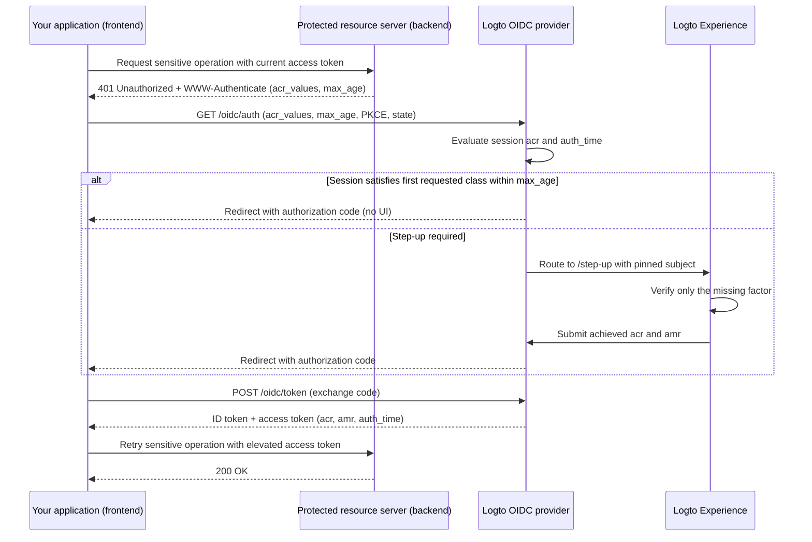

# Step-up authentication

Step-up authentication lets an application require recent user authentication or a stronger authentication assurance level before performing sensitive operations—such as authorizing a payment, viewing confidential records, or modifying account security settings—without signing the user out.

Logto implements standards-based step-up authentication built on [OpenID Connect Core](https://openid.net/specs/openid-connect-core-1_0.html), [RFC 9470 (OAuth 2.0 Step Up Authentication Challenge Protocol)](https://www.rfc-editor.org/rfc/rfc9470.html), and [RFC 8176 (Authentication Method Reference Values)](https://www.rfc-editor.org/rfc/rfc8176.html):

1. Protected resource servers challenge insufficient tokens with `401 Unauthorized` and an RFC 9470 `WWW-Authenticate` header carrying `acr_values` and `max_age`.
2. Your application starts an Authorization Code Flow with `acr_values` and `max_age`. When an authenticated session already exists, Logto pins the signed-in user and prompts only for the missing verification.
3. Logto records the achieved authentication context (`acr`, `amr`, and `auth_time`) on the session and emits it in ID tokens, JWT access tokens, and opaque-token introspection responses.



## Authentication context model \{#authentication-context-model}

Every sign-in, registration, and step-up completed through the Logto Experience records three standard claims on the OIDC session, whether or not the application requested `acr_values`:

| Claim       | Type       | Description                                                                                 |
| ----------- | ---------- | ------------------------------------------------------------------------------------------- |
| `acr`       | `string`   | Authentication Context Class Reference—the assurance level achieved. Omitted when none met. |
| `amr`       | `string[]` | Authentication Methods References—the verification methods used in that interaction.        |
| `auth_time` | `number`   | Epoch timestamp (in seconds) when the end-user authentication completed.                    |

Logto advertises these capabilities in OIDC Discovery (`/.well-known/openid-configuration` and `/.well-known/oauth-authorization-server`):

```json
{
  "acr_values_supported": ["urn:logto:acr:1fa", "urn:logto:acr:mfa"],
  "claims_supported": ["sub", "acr", "amr", "auth_time"]
}
```

In ID tokens, `acr`, `amr`, and `auth_time` are included under the standard `openid` scope whenever present on the session. On user access tokens, Logto copies them from the authorization code, device code, or refresh token into JWT payloads and opaque-token introspection responses. Refresh token rotation preserves the original `acr`, `amr`, and `auth_time`—refreshing a token never advances `auth_time`. Other grant types (such as client credentials and token exchange) and legacy `/interaction` routes do not emit authentication context claims.

### Supported ACR values \{#supported-acr-values}

Logto defines two Authentication Context Class Reference (`acr`) values:

| ACR value           | Meaning                                                                                                                                                                                                    | Satisfies                                |
| ------------------- | ---------------------------------------------------------------------------------------------------------------------------------------------------------------------------------------------------------- | ---------------------------------------- |
| `urn:logto:acr:1fa` | At least one factor that Logto directly verified or established in the interaction: password, primary email or phone verification code, magic link (one-time token on sign-in), or an enrolled MFA factor. | `urn:logto:acr:1fa`                      |
| `urn:logto:acr:mfa` | A Logto-verifiable first-factor (`1fa`-role) proof combined with an `mfa`-role proof from a **different** factor, or a user-verified WebAuthn / passkey assertion on its own.                              | `urn:logto:acr:mfa`, `urn:logto:acr:1fa` |

The satisfaction relation is `urn:logto:acr:mfa` → `urn:logto:acr:1fa`: any session or token holding `urn:logto:acr:mfa` also satisfies a requirement for `urn:logto:acr:1fa`. Standard `phr` and `phrh` ACR values are not supported; WebAuthn and passkey ceremonies require user verification and map to `urn:logto:acr:mfa`.

When deriving `urn:logto:acr:mfa`, Logto classifies each Logto-verifiable method by the pairing role it can fill:

- **First-factor (`1fa`) role**: password, primary email verification code, primary phone verification code, and one-time token (sign-in only).
- **Second-factor (`mfa`) role**: authenticator app OTP (TOTP), backup code, MFA email verification code, and MFA phone verification code. An `mfa`-role factor verified without a Logto-verifiable first factor (for example, social sign-in + TOTP) reaches `urn:logto:acr:1fa`, not `urn:logto:acr:mfa`.
- **Self-sufficient (`both`) role**: passkey sign-in and WebAuthn MFA with user verification satisfy both roles in one ceremony and reach `urn:logto:acr:mfa` alone.
- **Distinct-factor rule**: `urn:logto:acr:mfa` requires two **different** factors. Two first factors (such as email verification code + password during registration), two `mfa`-role factors (such as TOTP + backup code), or two proofs of the same underlying channel (such as primary email code + MFA email code) count as a single factor or role and achieve `urn:logto:acr:1fa`.
- **Trusted devices and adaptive MFA**: [trusted-device](/end-user-flows/mfa/trusted-devices) fulfillment and adaptive-MFA skips prove nothing in the current interaction and do not contribute to `acr` (a password sign-in that skips MFA via a trusted device yields `acr="urn:logto:acr:1fa"` and `amr=["pwd"]`).

Registration records authentication context under the same rules because the credentials written while creating the account prove that account. For example, a username and password registration yields `acr="urn:logto:acr:1fa"` and `amr=["pwd"]`; an email verification code registration yields `acr="urn:logto:acr:1fa"` and `amr=["otp"]`; a password registration that binds mandatory TOTP yields `acr="urn:logto:acr:mfa"` and `amr=["pwd", "otp", "mfa"]`.

### AMR mapping \{#amr-mapping}

Logto populates `amr` with values from [RFC 8176](https://www.rfc-editor.org/rfc/rfc8176.html), plus `fed` for federated authentication:

| Logto verification method                                                        | `amr` values         | Contributes to `acr` |
| -------------------------------------------------------------------------------- | -------------------- | -------------------- |
| Password (verified, or newly set during registration or step-up)                 | `pwd`                | Yes (`1fa` role)     |
| Primary email verification code                                                  | `otp`                | Yes (`1fa` role)     |
| Primary phone verification code                                                  | `sms`                | Yes (`1fa` role)     |
| One-time token / magic link (sign-in only; unavailable in step-up)               | `otp`                | Yes (`1fa` role)     |
| Authenticator app OTP (TOTP, verified or newly bound)                            | `otp`                | Yes (`mfa` role)     |
| MFA email verification code                                                      | `otp`                | Yes (`mfa` role)     |
| MFA phone verification code                                                      | `sms`                | Yes (`mfa` role)     |
| Backup code                                                                      | `otp`                | Yes (`mfa` role)     |
| WebAuthn MFA or passkey sign-in with user verification (verified or newly bound) | `pop`, `user`, `mfa` | Yes (`both` roles)   |
| Social sign-in or enterprise SSO                                                 | `fed`                | No                   |
| Any interaction whose achieved `acr` is `urn:logto:acr:mfa`                      | appends `mfa` at end | —                    |

`amr` contains deduplicated references in first-seen order, with `mfa` always placed last when present.

#### Federated authentication (`fed`) \{#federated-authentication-fed}

RFC 8176 defines no registry value for authentication delegated to an external identity provider. Logto emits `fed`—matching the convention used by Microsoft Entra ID and Okta—to indicate that the user authenticated through an upstream social or enterprise SSO assertion whose method Logto cannot directly verify.

- A pure social or enterprise SSO sign-in or registration records `amr=["fed"]` and a fresh `auth_time`, with **no `acr` claim**.
- `fed` is not a first factor, and repeating the upstream login never raises `acr`. Completing one Logto-verifiable factor after social sign-in (such as TOTP) yields `acr="urn:logto:acr:1fa"` and `amr=["fed", "otp"]`.
- `auth_time` alone carries no assurance—always check `acr` alongside `auth_time`.
- Which upstream provider authenticated the user is exposed in the `identities` and `sso_identities` claims rather than encoded in `amr`.

### How step-up updates session and token claims \{#how-step-up-updates-session-and-token-claims}

When an authorization request with `acr_values` arrives on an existing OIDC session and requires interaction, Experience enters **step-up mode** (`/step-up`):

- **Subject pinning and cumulative ACR**: Logto pins the current session's `sub` (no account switching, identifier input, or registration) and asks only for the missing assurance. Unambiguous session methods carry their pairing role into the step-up:
  - A session authenticated with `pwd` or `sms` already supplies a `1fa` contribution, so stepping up to `urn:logto:acr:mfa` prompts **only** for an enrolled MFA factor (even when `max_age=0` or `prompt=login` forces fresh authentication).
  - A session whose only `amr` is `otp` is ambiguous across email code, TOTP, and backup code, so stepping up to `urn:logto:acr:mfa` requires proving a fresh first factor before MFA.
  - A social or enterprise SSO session (`amr=["fed"]`) supplies no `1fa` contribution, so reaching `urn:logto:acr:mfa` requires proving (or establishing) a first factor before MFA, or verifying a WebAuthn passkey.
- **`amr` and `auth_time` reflect only the current interaction**: On a password session, verifying TOTP during step-up produces `acr="urn:logto:acr:mfa"`, `amr=["otp", "mfa"]`, and a new `auth_time`. **Relying parties must read assurance from `acr` and must not look for a first factor in `amr`.**
- **Session replacement, not merge**: After step-up completes, the session's `acr`, `amr`, and `auth_time` are replaced with the context achieved by the new interaction. For example, password reauthentication for `urn:logto:acr:1fa` sets the session to `acr="urn:logto:acr:1fa"` and `amr=["pwd"]`. Previously issued tokens retain the claims captured when they were minted.
- **Policy overrides and side-effect isolation**: Requesting `urn:logto:acr:1fa` requires one eligible active verification and does not re-run the tenant's sign-in MFA policy. Requesting `urn:logto:acr:mfa` ignores trusted-device fulfillment, user `skipMfaOnSignIn` preferences, and adaptive-MFA non-trigger results. Pure step-up runs no sign-in side effects (no `PostSignIn` webhooks or actions, `lastSignInAt` updates, identity sync, or JIT provisioning) and logs a dedicated `Interaction.SignIn.StepUp.Submit` audit event.

If no authenticated OIDC session exists when `acr_values` is requested, Logto runs the normal sign-in or registration flow and enforces the requested ACR as a completion requirement before issuing the authorization code.

## Request step-up authentication \{#request-step-up-authentication}

Pass `acr_values` and `max_age` on an Authorization Code Flow request to `/oidc/auth`.

### Ordered-list semantics of `acr_values` \{#ordered-list-semantics-of-acr-values}

`acr_values` is a space-delimited list of acceptable ACR values in **caller preference order** (for example, `urn:logto:acr:mfa urn:logto:acr:1fa`). Logto ignores unrecognized values; if **none** of the requested values is supported (for example, `acr_values=phr`), Logto fails immediately before any UI and redirects to `redirect_uri` with `error=unmet_authentication_requirements`.

When at least one supported class is requested:

1. **First class already satisfied**: If an authenticated session satisfies the **first** supported class in `acr_values`, meets `max_age`, and `prompt=login` was not requested, Logto issues an authorization code immediately with no UI.
2. **Only a later class satisfied**: If the session satisfies a later listed class but not the first—for example, `acr_values="urn:logto:acr:mfa urn:logto:acr:1fa"` on a `1fa` session—Logto still starts a step-up interaction to pursue the earlier class (`urn:logto:acr:mfa`).
   - If the user can reach `urn:logto:acr:mfa` (by verifying an enrolled MFA factor or enrolling one), Experience prompts for it.
   - If `urn:logto:acr:mfa` is unreachable (for example, the user has no enrolled MFA factor and the tenant enables no enrollable TOTP or WebAuthn factor), Logto falls back to the next reachable class (`urn:logto:acr:1fa`). When the session already satisfies that fallback class and no fresh authentication was forced, Logto finishes without showing UI and preserves the session's original `auth_time`.
3. **Strict failure with `unmet_authentication_requirements`**: Logto never issues a token with a weaker ACR than the class the interaction pursues. Only when **no** listed class is reachable does Logto redirect back to `redirect_uri` with `error=unmet_authentication_requirements`.

### Strict requests vs. the retry-with-weaker-class pattern \{#strict-requests-vs-the-retry-with-weaker-class-pattern}

Depending on how your application handles users who cannot satisfy MFA, choose one of two patterns:

- **Require a specific class strictly, then retry or branch in your app**: Request `acr_values=urn:logto:acr:mfa` alone. Logto guarantees either an `mfa` token or an `error=unmet_authentication_requirements` redirect. On `unmet_authentication_requirements`, your callback handler can explicitly decide whether to retry authorization with `acr_values=urn:logto:acr:1fa`, block the operation, or route the request to an approval workflow.
- **Declare ordered fallback in one request**: Request `acr_values="urn:logto:acr:mfa urn:logto:acr:1fa"`. Logto pursues `mfa` whenever reachable and automatically falls back to `1fa` only when `mfa` cannot be reached for that user and tenant. Verify `acr` on the resulting access token to see which level was achieved.

:::note
Abandoning a step-up screen does not trigger fallback or notify your app—there is no cancellation endpoint, and an abandoned interaction simply expires with the 1-hour interaction TTL or is replaced by the next authorization request. Keep pending action state in your application and clear it if the user navigates back without completing the callback.
:::

### Combining `max_age` and `acr_values` \{#combining-max-age-and-acr-values}

`max_age` specifies the maximum allowable elapsed time in seconds since the user's last active authentication (`auth_time`):

- `max_age` checks `auth_time`, **not** token `exp`. Refreshing tokens never resets `auth_time`.
- `max_age=0` (or `prompt=login`) forces fresh interactive verification even when the session already holds the requested `acr`.
- `max_age` **without** `acr_values` lands on the regular `/sign-in` flow and enforces no assurance level—a user can re-authenticate with social sign-in, refreshing `auth_time` with no `acr`. When your operation requires both freshness and Logto-verified assurance, always send **both** `acr_values` and `max_age`.

### Silent gap detection with `prompt=none` \{#silent-gap-detection-with-prompt-none}

To check whether the user's current Logto session already meets an assurance and freshness requirement without showing any UI or offering enrollment, combine `prompt=none` with `acr_values` (and optional `max_age`):

- **Satisfied**: Because `prompt=none` permits no UI to pursue preference order, Logto issues an authorization code if the session satisfies **any** supported class in `acr_values` within `max_age`.
- **Authenticated session, requirement unmet or stale**: Logto redirects with `error=unmet_authentication_requirements` (taking precedence over `max_age` errors).
- **No authenticated session**: Logto redirects with `error=login_required`.

### Authorization URL and SDK examples \{#authorization-url-and-sdk-examples}

Raw authorization request requesting MFA within the last 5 minutes (`300` seconds) for a protected API resource:

```http
GET /oidc/auth?client_id=my-web-app
  &redirect_uri=https%3A%2F%2Fapp.example.com%2Fcallback
  &response_type=code
  &scope=openid%20offline_access%20payment%3Awrite
  &resource=https%3A%2F%2Fapi.example.com
  &acr_values=urn%3Alogto%3Aacr%3Amfa
  &max_age=300
  &state=8f3d9c1b2a...
  &nonce=4e1a7b9c0f...
  &code_challenge=E9Melhoa2OwvFrEMTJguCHaoeK1t8URWbuGJSstw-cM
  &code_challenge_method=S256 HTTP/1.1
Host: [tenant-id].logto.app
```

With a Logto JavaScript / TypeScript SDK (such as `@logto/browser`, `@logto/react`, `@logto/vue`, or `@logto/node`), pass `acr_values` and `max_age` via `extraParams`. In single-page applications where the user is already signed in, set `clearTokens: false` so cached tokens stay intact if the user abandons the step-up or returns with an OIDC error:

```ts
await signIn({
  redirectUri: 'https://app.example.com/callback',
  clearTokens: false,
  extraParams: {
    acr_values: 'urn:logto:acr:mfa',
    max_age: '300',
  },
});
```

On the callback route, inspect `error` before calling `handleSignInCallback()`:

```ts
const params = new URLSearchParams(window.location.search);
const error = params.get('error');

if (error === 'unmet_authentication_requirements') {
  // User cannot reach the requested ACR (or prompt=none detected a gap).
  // Optionally retry with a weaker class such as 'urn:logto:acr:1fa', or show an explanation.
  return;
}
```

:::tip[Stepping up for a different API resource]
Authentication context belongs to the Logto session, not to a single API resource. Requesting step-up with a `resource` indicator issues elevated tokens for that resource (prompting for consent if its scopes have not been granted yet). Tokens issued earlier for other API resources remain unchanged; each resource server evaluates `acr` and `auth_time` on the token presented to it.
:::

## Challenge and validate on a protected resource server \{#challenge-and-validate-on-a-protected-resource-server}

Authorization decisions belong on your backend or protected resource server:

- Always validate the **access token** on the resource server, never the ID token.
- Browser applications should treat access tokens as opaque. Your application may read `acr` and `auth_time` from its ID token to coordinate UI state before sending a request, but must never rely on client-side decoding for security enforcement.

### Return an RFC 9470 challenge \{#return-an-rfc-9470-challenge}

When an access token is valid as a bearer token (valid signature, `iss`, `aud`, `exp`, and `scope`) but lacks the required `acr` or exceeds your `max_age` window, respond with `401 Unauthorized` and an [RFC 9470](https://www.rfc-editor.org/rfc/rfc9470.html) `WWW-Authenticate` header:

```http
HTTP/1.1 401 Unauthorized
WWW-Authenticate: Bearer error="insufficient_user_authentication",
  error_description="Multi-factor authentication within the last 5 minutes is required",
  acr_values="urn:logto:acr:mfa",
  max_age="300"
```

When your application receives `401` with `error="insufficient_user_authentication"`, parse `acr_values` and `max_age` from `WWW-Authenticate`, persist the user's pending route or intent locally, trigger `signIn()` with those parameters, and retry the API call once with the newly issued access token. Guard against retry loops by not starting a second step-up if the retried request after callback still receives `401`.

### Validate JWT access tokens \{#validate-jwt-access-tokens}

When an API resource indicator (`resource`) is requested, Logto issues a signed JWT access token that includes `acr`, `amr`, and `auth_time`:

```json
{
  "iss": "https://[tenant-id].logto.app/oidc",
  "sub": "user-id",
  "aud": "https://api.example.com",
  "client_id": "my-web-app",
  "scope": "payment:write",
  "exp": 1787749200,
  "iat": 1787745601,
  "auth_time": 1787745600,
  "acr": "urn:logto:acr:mfa",
  "amr": ["pwd", "otp", "mfa"]
}
```

After [validating standard JWT claims](/authorization/validate-access-tokens) (signature against JWKS, `iss`, `aud`, `exp`, and `scope`), verify `acr` using the satisfaction relation and compare `auth_time` (never `iat`) against your policy:

```ts
import { createRemoteJWKSet, jwtVerify } from 'jose';

const issuer = 'https://[tenant-id].logto.app/oidc';
const jwks = createRemoteJWKSet(new URL(`${issuer}/jwks`));

type LogtoAcr = 'urn:logto:acr:1fa' | 'urn:logto:acr:mfa';

const satisfiedAcrs: Record<string, readonly LogtoAcr[]> = {
  'urn:logto:acr:1fa': ['urn:logto:acr:1fa'],
  'urn:logto:acr:mfa': ['urn:logto:acr:mfa', 'urn:logto:acr:1fa'],
};

const acrSatisfies = (achieved: unknown, required: LogtoAcr): boolean => {
  if (typeof achieved !== 'string') {
    return false;
  }

  return Boolean(satisfiedAcrs[achieved]?.includes(required));
};

export async function verifySensitiveRequest(
  bearerToken: string,
  requiredAcr: LogtoAcr = 'urn:logto:acr:mfa',
  maxAgeSeconds = 300
) {
  const { payload } = await jwtVerify(bearerToken, jwks, {
    issuer,
    audience: 'https://api.example.com',
  });

  const authTime = payload.auth_time;
  const nowSeconds = Date.now() / 1000;
  const isFresh =
    typeof authTime === 'number' &&
    Number.isInteger(authTime) &&
    nowSeconds - authTime >= 0 &&
    nowSeconds - authTime <= maxAgeSeconds;

  if (!acrSatisfies(payload.acr, requiredAcr) || !isFresh) {
    const challenge =
      `Bearer error="insufficient_user_authentication", ` +
      `error_description="Recent user authentication is required", ` +
      `acr_values="${requiredAcr}", max_age="${maxAgeSeconds}"`;

    return { authorized: false as const, wwwAuthenticate: challenge };
  }

  return { authorized: true as const, payload };
}
```

You may also inspect `payload.amr` (an array of strings) when you have method-specific requirements—for example, checking for `'pop'` and `'user'` to confirm hardware-bound or passkey proof-of-possession. Remember that after a step-up on an existing session, `amr` lists only the methods verified in the step-up interaction itself.

### Validate opaque access tokens via introspection \{#validate-opaque-access-tokens-via-introspection}

When no API `resource` is requested, Logto issues an [opaque access token](/concepts/opaque-token). Validate it by calling the [RFC 7662](https://www.rfc-editor.org/rfc/rfc7662.html) introspection endpoint (`POST /oidc/token/introspection`) with client authentication; Logto returns `acr`, `amr`, and `auth_time` at the top level of an active response:

```bash
curl -X POST https://[tenant-id].logto.app/oidc/token/introspection \
  -u "<client_id>:<client_secret>" \
  -H "Content-Type: application/x-www-form-urlencoded" \
  --data-urlencode "token=<opaque_access_token>" \
  --data-urlencode "token_type_hint=access_token"
```

Example introspection response:

```json
{
  "active": true,
  "client_id": "my-web-app",
  "exp": 1787749200,
  "iat": 1787745601,
  "iss": "https://[tenant-id].logto.app/oidc",
  "scope": "openid offline_access profile",
  "sub": "user-id",
  "token_type": "Bearer",
  "acr": "urn:logto:acr:1fa",
  "amr": ["pwd"],
  "auth_time": 1787745600
}
```

Check `active === true` first, then apply the same `acrSatisfies` and `auth_time` checks as above.

:::note
Structured JWT access tokens cannot be introspected at `/oidc/token/introspection`—passing a JWT returns `400 Bad Request` with `error: "unsupported_token_type"`. Always verify JWT access tokens locally using your tenant's JWKS.
:::

### Reserved claims in Custom JWT \{#reserved-claims-in-custom-jwt}

On user access tokens, `acr`, `amr`, and `auth_time` are reserved by Logto. If a [custom access token script](/developers/custom-token-claims/create-script) (`getCustomJwtClaims`) returns any of these three keys, Logto strips them before merging custom claims—both in JWT payloads and in opaque-token introspection—so custom scripts can neither override Logto-derived assurance nor fabricate `acr` on grants that carry none (such as social sign-in or token exchange). Machine-to-machine (`ClientCredentials`) tokens carry no user authentication context and are unaffected.

## Establishing a first factor and enrolling MFA \{#establishing-a-first-factor-and-enrolling-mfa}

A user prompted for `urn:logto:acr:1fa` or `urn:logto:acr:mfa` may not yet have the credentials needed to reach that class—for example, a password-only user who has never enrolled MFA, or a social-only user who has no password, primary email/phone code, or MFA factor. Logto allows establishing a missing first factor and enrolling MFA **inside the same sign-in or step-up interaction**, gated by strict freshness preconditions so a stolen session cookie alone can never enroll or establish anything:

- **Enrolling an MFA factor**: Offered only when the user has no enrolled MFA factor that can reach `urn:logto:acr:mfa`, and **only after a Logto-verifiable first factor (`1fa` or `both` class) has been verified or established in the current interaction**.
  - Neither the session's stored `acr` nor a trusted-device cookie satisfies this gate. A signed-in password user who has no MFA must first re-enter their password in the step-up, and can then bind TOTP or a WebAuthn passkey (with optional backup codes alongside TOTP or WebAuthn; backup codes cannot be enrolled standalone).
- **Establishing a first factor**: Offered only when the user lacks a first factor that can reach the pursued class (either they have no eligible method at all, such as a social-only user requesting `1fa`, or they have only an `mfa`-role factor like TOTP when requesting `mfa`), and **only when the current interaction holds a fresh subject proof**:
  - During **step-up on an existing session**, the user proves the subject by re-authenticating with one of their **already-linked** social or enterprise SSO connectors enabled in Sign-in Experience. If the upstream callback resolves to a different user or an unlinked account, Logto rejects it with `403`—neither registration nor account linking is allowed.
  - Once subject proof succeeds, the user can establish whichever first-factor method the tenant enables for sign-in: a password (when password sign-in is enabled) or a verified primary email or phone number (when enabled for sign-in with an active email or SMS connector). For example, a social-only user who re-authenticates with Google and sets a password finishes with `acr="urn:logto:acr:1fa"` and `amr=["fed", "pwd"]`.
  - Establishing is never offered as an alternative when the user already has an eligible method to verify.

Logto counts a credential or MFA factor established and bound during an interaction the same as one verified in it, so the user completes the step-up immediately without being challenged a second time for the factor they just set up. When a user establishes a new credential or factor during pure step-up, Logto emits the `User.Data.Updated` webhook event. If the tenant enables nothing the user can verify, establish, or enroll (or the user has no linked social/SSO connector to prove the subject), Logto finishes the interaction with `error=unmet_authentication_requirements`.

### Planned tenant-level setting to disable in-flow setup \{#planned-tenant-level-setting-to-disable-in-flow-setup}

OpenID Connect and RFC 9470 define no per-request parameter for "verify existing methods only; do not allow enrolling new ones." Following how enterprise identity providers separate enrollment policy from per-request ACR values, Logto will provide a **tenant-level setting** (enabled by default) that controls whether interactions may establish a first factor or enroll MFA to fulfill `acr_values`. When turned off by an administrator, users who already have eligible methods verify them as usual, while users missing a required factor fail immediately with `unmet_authentication_requirements` so the relying party can route them to its own onboarding or approval flow.

If your application wants to detect today whether a signed-in user already meets an ACR requirement without prompting or offering enrollment, send a silent check with [`prompt=none`](#silent-gap-detection-with-prompt-none).

## Account API and Account Center \{#account-api-and-account-center}

### Account API authorization policy \{#account-api-authorization-policy}

Sensitive [Account API](/end-user-flows/account-settings/by-account-api) operations—such as updating a password, primary email, primary phone, or username, linking or removing social identities, managing MFA factors and settings, managing personal access tokens, and viewing or revoking active sessions, app grants, and trusted devices—require:

1. **First-party application access**: Third-party OIDC applications (`isThirdParty: true`) and Client ID Metadata Document (CIMD) clients cannot mutate sensitive Account API resources or receive Account API step-up challenges, even with `urn:logto:acr:mfa`.
2. **Recent identity verification**, satisfied by **either** of the following:
   - **OIDC authentication context**: The opaque access token carries `acr` satisfying `urn:logto:acr:1fa` (`urn:logto:acr:1fa` or `urn:logto:acr:mfa`) **and** `now - auth_time <= maximumAuthenticationAgeInSeconds` (evaluated strictly from `auth_time`, never `iat`).
   - **Verification record (`logto-verification-id`)**: For direct Account API integrations, Logto continues to accept a valid, unexpired 10-minute verification record ID in the `logto-verification-id` request header created via `POST /api/verifications/password` or `POST /api/verifications/verification-code` + `/verify`.

:::info[Configuring the recent authentication window]
By default, `maximumAuthenticationAgeInSeconds` is **600 seconds (10 minutes)**. You can configure it per tenant from **1 to 120 minutes (60–7,200 seconds)** in <CloudLink to="/sign-in-experience/account-center">Console > Sign-in & account > Account center</CloudLink> under **Recent authentication**, or via the Management API (`PATCH /api/account-center` with `maximumAuthenticationAgeInSeconds`).

With OIDC authentication context, a user who just signed in or registered with a Logto-verifiable method can perform sensitive Account API operations within this window without a separate verification prompt. Note that `logto-verification-id` records created through the Verification API keep their fixed 10-minute TTL for backward compatibility, and binding a _new_ email, phone, social identity, or MFA factor still requires `newIdentifierVerificationRecordId` (or the factor verification record) in the request body to prove ownership of that new identifier or factor.
:::

Account API also preserves the initial-password exception: a user who currently has no password, primary email, or primary phone can set an initial password via `POST /api/my-account/password` without recent identity verification. Setting a password through Account API does not update the OIDC session's `acr` and does not authorize subsequent sensitive operations.

### Account API `WWW-Authenticate` challenge \{#account-api-www-authenticate-challenge}

When a first-party Account API request lacks both a fresh `urn:logto:acr:1fa` access token and a valid `logto-verification-id` header, Logto responds with `401 Unauthorized`, preserving the existing JSON error body for compatibility and adding the RFC 9470 `WWW-Authenticate` header with the tenant's configured `max_age`:

```http
HTTP/1.1 401 Unauthorized
WWW-Authenticate: Bearer error="insufficient_user_authentication", error_description="Recent user authentication is required", acr_values="urn:logto:acr:1fa", max_age="600"
Content-Type: application/json

{
  "code": "verification_record.permission_denied",
  "message": "Permission denied, please re-authenticate."
}
```

### Prebuilt Account Center \{#prebuilt-account-center}

The [prebuilt Account Center UI](/end-user-flows/account-settings/by-account-center-ui) (`/account/*`) uses OIDC step-up authentication exclusively and never creates `logto-verification-id` permission records:

- It inspects `acr` and `auth_time` on its local ID token to start step-up proactively before sensitive inline actions or multi-step subpages when the sign-in lacks `urn:logto:acr:1fa` or is stale, and also handles RFC 9470 `401` challenges from the Account API as a fallback.
- After step-up completes, Account Center replaces its token set and resumes the pending action at most once.

## Related resources \{#related-resources}

<Url href="/end-user-flows/mfa">Multi-factor authentication</Url>
<Url href="/authorization/validate-access-tokens">
  How to validate access tokens in your API service or backend
</Url>
<Url href="/concepts/opaque-token">Opaque token and introspection</Url>
<Url href="/end-user-flows/account-settings/by-account-api">Account settings by Account API</Url>
<Url href="/end-user-flows/account-settings/by-account-center-ui">
  Account settings by prebuilt Account Center UI
</Url>
