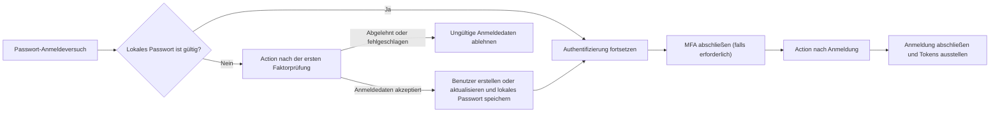

# Actions

Logto Actions ermöglichen es dir, vertrauenswürdigen JavaScript-Code an bestimmten Punkten im Authentifizierungsablauf auszuführen. Eine Action läuft synchron: Die Authentifizierungsanfrage wartet auf das Skript, und das Skriptergebnis kann den Benutzer aktualisieren oder bestimmen, ob der Ablauf fortgesetzt wird.

Actions sind nützlich, wenn die Entscheidung innerhalb des Authentifizierungsablaufs getroffen werden muss. Häufige Anwendungsfälle sind:

- Migration von Benutzern und Passwörtern aus einem Altsystem, wenn sie sich zum ersten Mal anmelden.
- Aktualisierung des Benutzerprofils oder anwendungsspezifischer Daten, bevor Logto eine Anmeldung abschließt.
- Aufruf eines externen Dienstes und Anwendung seines Ergebnisses auf den Logto-Benutzer.

:::note
Actions sind in Logto Cloud Enterprise-Plänen und im selbst gehosteten Logto OSS (ab v1.43.0) verfügbar.
:::

:::warning
Action-Skripte können die Authentifizierung beeinflussen und Benutzerdaten ändern. Nur vertrauenswürdige Administratoren sollten sie anzeigen, erstellen, bearbeiten, testen, aktivieren oder löschen dürfen.

In selbst gehosteten Umgebungen laufen Action-Skripte im Logto-Serverprozess mit dessen Berechtigungen. Das Gewähren von Skript-Bearbeitungs- oder Testzugriff entspricht der Erlaubnis zur Codeausführung auf dem Logto-Host. Die Admin-Konsole sollte daher nicht mit nicht vertrauenswürdigen Benutzern geteilt werden. Behandle Skripte wie vertrauenswürdigen serverseitigen Code; die Laufzeit begrenzt die Zeit und den Speicher eines Skripts, ist aber keine Sicherheitsgrenze für nicht vertrauenswürdigen Code.
:::

## Wie Actions in die Anmeldung passen \{#how-actions-fit-into-sign-in}

Logto bietet derzeit zwei Action-Typen:



| Action-Typ                                                                                 | Wann sie ausgeführt wird                                                                                                                                                        | Was sie tun kann                                                                                                                                                                            |
| ------------------------------------------------------------------------------------------ | ------------------------------------------------------------------------------------------------------------------------------------------------------------------------------- | ------------------------------------------------------------------------------------------------------------------------------------------------------------------------------------------- |
| [Action nach der ersten Faktorprüfung](/developers/actions/post-first-factor-verification) | Während einer Passwort-Anmeldung, nur nachdem die lokale Passwortüberprüfung von Logto fehlgeschlagen ist. Sie wird nicht ausgeführt, wenn das lokale Passwort gültig ist.      | Die übermittelten Anmeldedaten gegen ein Altsystem prüfen, dann einen neuen Logto-Benutzer erstellen oder einen bestehenden Benutzer aktualisieren und das übermittelte Passwort migrieren. |
| [Action nach Anmeldung](/developers/actions/post-sign-in)                                  | Nachdem der Benutzer alle Authentifizierungsfaktoren abgeschlossen hat, einschließlich MFA (falls erforderlich), und bevor Logto die Anmeldung abschließt und Tokens ausstellt. | Den bestehenden Logto-Benutzer mit dem finalen Anmeldekontext aktualisieren und anreichern.                                                                                                 |

Beide Action-Typen laufen nur für `SignIn`-Interaktionen in der Experience API. Die Action nach der ersten Faktorprüfung gilt nur für die Passwort-Anmeldung; die Action nach Anmeldung ist unabhängig von der Authentifizierungsmethode.

## Skriptmodell \{#script-model}

Jeder Action-Typ hat eine Konfiguration und eine JavaScript-Einstiegsfunktion namens `runAction`:

```js
const runAction = async ({ event, environmentVariables = {} }) => {
  // Untersuche das Event, hole ggf. externe Daten und gib
  // ein für diesen Action-Typ unterstütztes Ergebnis zurück.
};
```

Das Payload enthält:

- `event`: Das produktive Authentifizierungsereignis. Die Struktur hängt vom Action-Typ ab.
- `environmentVariables`: Die für diese Action konfigurierten Zeichenfolgenwerte. Diese Werte werden durch das Funktions-Payload übergeben; sie sind nicht über `process.env` verfügbar.

Der Editor bietet Typinformationen, aber das gespeicherte Skript wird als JavaScript ausgeführt. Das Skript kann asynchron sein und folgende Standard-Web-APIs sowohl in Logto Cloud als auch im selbst gehosteten Logto verwenden:

- `fetch`, `Request`, `Response` und `Headers`
- Web Crypto über `crypto` und `crypto.subtle`
- `TextEncoder` und `TextDecoder`
- `URL` und `URLSearchParams`

Skripte können keine Pakete importieren. Vermeide Node.js-spezifische Globals und Module, da sie nicht zwischen selbst gehostetem Logto und Logto Cloud portabel sind und nicht Teil des unterstützten Skriptvertrags sind.

Das unterstützte Ergebnis ist für jeden Action-Typ unterschiedlich; siehe die entsprechende Referenzseite, bevor du eine Action aktivierst.

## Actions und Webhooks \{#actions-and-webhooks}

Actions und [Webhooks](/developers/webhooks) dienen unterschiedlichen Zwecken:

|                                                          | Actions                                                      | Webhooks                                                             |
| -------------------------------------------------------- | ------------------------------------------------------------ | -------------------------------------------------------------------- |
| Ausführung                                               | Synchron und inline mit der Authentifizierung                | Asynchron und außerhalb der Authentifizierungsanfrage                |
| Kann den aktuellen Authentifizierungsablauf beeinflussen | Ja                                                           | Nein                                                                 |
| Kann einen Benutzer durch das Ergebnis ändern            | Ja, mit dem unterstützten Benutzer-Patch                     | Nicht direkt; der Empfänger kann die Management API separat aufrufen |
| Event-Abdeckung                                          | Ausgewählte Authentifizierungspunkte                         | Eine breite Palette von Interaktions- und Datenänderungsereignissen  |
| Typische Verwendung                                      | Anmeldedaten-Migration, Profilanreicherung vor Token-Ausgabe | Benachrichtigungen, Downstream-Synchronisation, Analytik             |

Behalte asynchrone Arbeiten in Webhooks. Verwende eine Action nur, wenn Logto das Ergebnis benötigt, bevor die Authentifizierung fortgesetzt werden kann.

## Nächste Schritte \{#next-steps}

- [Actions konfigurieren und testen](/developers/actions/configure-and-test-actions)
- [Benutzer bei Passwort-Anmeldung migrieren](/developers/actions/post-first-factor-verification)
- [Benutzer nach Anmeldung anreichern](/developers/actions/post-sign-in)
