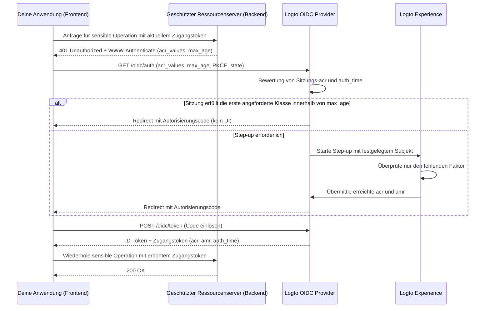

# Step-up-Authentifizierung (Step-up authentication)

Step-up-Authentifizierung ermöglicht es einer Anwendung, vor der Durchführung sensibler Operationen – wie der Autorisierung einer Zahlung, dem Anzeigen vertraulicher Datensätze oder dem Ändern von Kontosicherheitseinstellungen – eine kürzlich erfolgte Benutzer-Authentifizierung oder ein höheres Authentifizierungs-Sicherheitsniveau zu verlangen, ohne den Benutzer abzumelden.

Logto implementiert standardbasierte Step-up-Authentifizierung auf Basis von [OpenID Connect Core](https://openid.net/specs/openid-connect-core-1_0.html), [RFC 9470 (OAuth 2.0 Step Up Authentication Challenge Protocol)](https://www.rfc-editor.org/rfc/rfc9470.html) und [RFC 8176 (Authentication Method Reference Values)](https://www.rfc-editor.org/rfc/rfc8176.html):

1. Geschützte Ressourcenserver fordern bei unzureichenden Tokens mit `401 Unauthorized` und einem RFC 9470 `WWW-Authenticate`-Header, der `acr_values` und `max_age` enthält, eine Nachbesserung an.
2. Deine Anwendung startet einen Authorization Code Flow mit `acr_values` und `max_age`. Wenn bereits eine authentifizierte Sitzung besteht, pinnt Logto den angemeldeten Benutzer und fordert nur die fehlende Verifizierung an.
3. Logto zeichnet den erreichten Authentifizierungskontext (`acr`, `amr` und `auth_time`) in der Sitzung auf und gibt ihn in ID-Tokens, JWT-Zugangstokens und introspektiven Antworten für opake Tokens aus.



## Authentifizierungskontext-Modell (Authentication context model) \{#authentication-context-model}

Jede Anmeldung, Registrierung und Step-up, die über die Logto Experience abgeschlossen wird, zeichnet drei Standard-Ansprüche (Claims) in der OIDC-Sitzung auf, unabhängig davon, ob die Anwendung `acr_values` angefordert hat:

| Claim       | Typ        | Beschreibung                                                                                                 |
| ----------- | ---------- | ------------------------------------------------------------------------------------------------------------ |
| `acr`       | `string`   | Authentication Context Class Reference – das erreichte Sicherheitsniveau. Fehlt, wenn keines erreicht wurde. |
| `amr`       | `string[]` | Authentication Methods References – die in dieser Interaktion verwendeten Verifizierungsmethoden.            |
| `auth_time` | `number`   | Epoch-Timestamp (in Sekunden), wann die Endbenutzer-Authentifizierung abgeschlossen wurde.                   |

Logto gibt diese Fähigkeiten in OIDC Discovery (`/.well-known/openid-configuration` und `/.well-known/oauth-authorization-server`) bekannt:

```json
{
  "acr_values_supported": ["urn:logto:acr:1fa", "urn:logto:acr:mfa"],
  "claims_supported": ["sub", "acr", "amr", "auth_time"]
}
```

In ID-Tokens werden `acr`, `amr` und `auth_time` unter dem Standard-`openid`-Scope einbezogen, sofern sie in der Sitzung vorhanden sind. Bei Benutzer-Zugangstokens übernimmt Logto sie aus dem Autorisierungscode, Gerätecode oder Auffrischungstoken in JWT-Payloads und introspektiven Antworten für opake Tokens. Die Rotation von Auffrischungstokens bewahrt die ursprünglichen Werte von `acr`, `amr` und `auth_time` – das Auffrischen eines Tokens erhöht niemals `auth_time`. Andere Grant-Typen (wie Client Credentials und Token Exchange) geben keine Authentifizierungskontext-Claims aus.

### Unterstützte ACR-Werte (Supported ACR values) \{#supported-acr-values}

Logto definiert zwei Authentication Context Class Reference (`acr`)-Werte:

| ACR-Wert            | Bedeutung                                                                                                                                                                                                                     | Erfüllt                                  |
| ------------------- | ----------------------------------------------------------------------------------------------------------------------------------------------------------------------------------------------------------------------------- | ---------------------------------------- |
| `urn:logto:acr:1fa` | Mindestens ein Faktor, den Logto direkt in der Interaktion verifiziert oder etabliert hat: Passwort, primärer E-Mail- oder SMS-Verifizierungscode, Magic Link (Einmal-Token bei Anmeldung) oder ein registrierter MFA-Faktor. | `urn:logto:acr:1fa`                      |
| `urn:logto:acr:mfa` | Ein von Logto verifizierbarer Erstfaktor (`1fa`-Rolle) kombiniert mit einem `mfa`-Rollen-Nachweis eines **anderen** Faktors oder eine vom Benutzer verifizierte WebAuthn / Passkey-Bestätigung allein.                        | `urn:logto:acr:mfa`, `urn:logto:acr:1fa` |

Die Erfüllungsrelation ist `urn:logto:acr:mfa` → `urn:logto:acr:1fa`: Jede Sitzung oder jedes Token mit `urn:logto:acr:mfa` erfüllt auch eine Anforderung für `urn:logto:acr:1fa`. Standard-ACR-Werte wie `phr` und `phrh` werden nicht unterstützt; WebAuthn- und Passkey-Zeremonien erfordern Benutzerverifizierung und werden `urn:logto:acr:mfa` zugeordnet.

Bei der Ableitung von `urn:logto:acr:mfa` klassifiziert Logto jede von Logto verifizierbare Methode nach der Rolle, die sie erfüllen kann:

- **Erstfaktor (`1fa`)-Rolle**: Passwort, primärer E-Mail-Verifizierungscode, primärer SMS-Verifizierungscode und Einmal-Token (nur Anmeldung).
- **Zweitfaktor (`mfa`)-Rolle**: Authenticator-App-OTP (TOTP), Backup-Code, MFA-E-Mail-Verifizierungscode und MFA-SMS-Verifizierungscode. Ein `mfa`-Rollen-Faktor, der ohne einen von Logto verifizierbaren Erstfaktor verifiziert wird (z. B. Social Sign-in + TOTP), erreicht `urn:logto:acr:1fa`, nicht `urn:logto:acr:mfa`.
- **Selbstgenügsame (`both`)-Rolle**: Passkey-Anmeldung und WebAuthn-MFA mit Benutzerverifizierung erfüllen beide Rollen in einer Zeremonie und erreichen allein `urn:logto:acr:mfa`.
- **Unterschiedliche-Faktoren-Regel**: `urn:logto:acr:mfa` erfordert zwei **verschiedene** Faktoren. Zwei Erstfaktoren (wie E-Mail-Code + Passwort bei Registrierung), zwei `mfa`-Rollen-Faktoren (wie TOTP + Backup-Code) oder zwei Nachweise desselben Kanals (wie primärer E-Mail-Code + MFA-E-Mail-Code) zählen als ein Faktor bzw. eine Rolle und erreichen `urn:logto:acr:1fa`.
- **Vertrauenswürdige Geräte und adaptive MFA**: [Trusted-Device](/end-user-flows/mfa/trusted-devices)-Erfüllung und adaptive-MFA-Überspringen beweisen nichts in der aktuellen Interaktion und tragen nicht zu `acr` bei (eine Passwort-Anmeldung, die MFA über ein vertrauenswürdiges Gerät überspringt, ergibt `acr="urn:logto:acr:1fa"` und `amr=["pwd"]`).

Registrierungen zeichnen den Authentifizierungskontext nach denselben Regeln auf, da die beim Erstellen des Kontos hinterlegten Anmeldedaten dieses Konto beweisen. Zum Beispiel ergibt eine Registrierung mit Benutzername und Passwort `acr="urn:logto:acr:1fa"` und `amr=["pwd"]`.

### AMR-Mapping \{#amr-mapping}

Logto befüllt `amr` mit Werten aus [RFC 8176](https://www.rfc-editor.org/rfc/rfc8176.html) sowie `fed` für föderierte Authentifizierung:

| Logto-Verifizierungsmethode                                                                   | `amr`-Werte          | Trägt zu `acr` bei |
| --------------------------------------------------------------------------------------------- | -------------------- | ------------------ |
| Passwort (verifiziert oder neu gesetzt bei Registrierung oder Step-up)                        | `pwd`                | Ja (`1fa`-Rolle)   |
| Primärer E-Mail-Verifizierungscode                                                            | `otp`                | Ja (`1fa`-Rolle)   |
| Primärer SMS-Verifizierungscode                                                               | `sms`                | Ja (`1fa`-Rolle)   |
| Einmal-Token / Magic Link (nur Anmeldung; nicht bei Step-up verfügbar)                        | `otp`                | Ja (`1fa`-Rolle)   |
| Authenticator-App-OTP (TOTP, verifiziert oder neu gebunden)                                   | `otp`                | Ja (`mfa`-Rolle)   |
| MFA-E-Mail-Verifizierungscode                                                                 | `otp`                | Ja (`mfa`-Rolle)   |
| MFA-SMS-Verifizierungscode                                                                    | `sms`                | Ja (`mfa`-Rolle)   |
| Backup-Code                                                                                   | `otp`                | Ja (`mfa`-Rolle)   |
| WebAuthn-MFA oder Passkey-Anmeldung mit Benutzerverifizierung (verifiziert oder neu gebunden) | `pop`, `user`, `mfa` | Ja (`both`-Rollen) |
| Social Sign-in oder Enterprise SSO                                                            | `fed`                | Nein               |
| Jede Interaktion mit erreichtem `acr` = `urn:logto:acr:mfa`                                   | ergänzt `mfa`        | —                  |

#### Föderierte Authentifizierung (`fed`) \{#federated-authentication-fed}

Logto gibt `fed` aus, um anzuzeigen, dass der Benutzer sich über eine Upstream-Social- oder Enterprise-SSO-Bestätigung angemeldet hat, deren Methode Logto nicht direkt verifizieren kann.

- Eine reine Social- oder Enterprise-SSO-Anmeldung oder -Registrierung zeichnet `amr=["fed"]` und einen frischen `auth_time` auf, **ohne `acr`-Claim**.
- `fed` ist kein Erstfaktor, und das Wiederholen der Upstream-Anmeldung erhöht niemals `acr`. Das Abschließen eines von Logto verifizierbaren Faktors nach Social Sign-in (z. B. TOTP) ergibt `acr="urn:logto:acr:1fa"` und `amr=["fed", "otp"]`.
- `auth_time` allein bietet keine Sicherheit – prüfe immer `acr` zusammen mit `auth_time`.
- Welcher Upstream-Provider den Benutzer authentifiziert hat, wird in den Claims `identities` und `sso_identities` angezeigt, nicht in `amr` kodiert.

### Wie Step-up Sitzungs- und Token-Claims aktualisiert \{#how-step-up-updates-session-and-token-claims}

Wenn eine Autorisierungsanfrage mit `acr_values` auf einer bestehenden OIDC-Sitzung eingeht und Interaktion erfordert, wechselt Experience in den **Step-up-Modus**:

- **Subjekt-Pinning und kumulatives ACR**: Logto pinnt das aktuelle Sitzungs-`sub` (kein Kontowechsel, keine Identitätseingabe, keine Registrierung) und fragt nur nach der fehlenden Sicherheit. Eindeutige Sitzungsmethoden bringen ihre Rollenpaarung in das Step-up ein:
  - Eine Sitzung, die mit `pwd` oder `sms` authentifiziert wurde, liefert bereits einen `1fa`-Beitrag, sodass beim Step-up zu `urn:logto:acr:mfa` **nur** nach einem registrierten MFA-Faktor gefragt wird (auch wenn `max_age=0` oder `prompt=login` eine frische Authentifizierung erzwingen).
  - Eine Social- oder Enterprise-SSO-Sitzung (`amr=["fed"]`) liefert keinen `1fa`-Beitrag, sodass zum Erreichen von `urn:logto:acr:mfa` zuerst ein Erstfaktor nachgewiesen (oder etabliert) werden muss, oder ein WebAuthn-Passkey verifiziert werden muss.
- **`amr` und `auth_time` spiegeln nur die aktuelle Interaktion wider**: Bei einer Passwort-Sitzung ergibt die Verifizierung von TOTP während des Step-ups `acr="urn:logto:acr:mfa"`, `amr=["otp", "mfa"]` und einen neuen `auth_time`. **Vertrauensstellen müssen die Sicherheit aus `acr` ablesen und dürfen keinen Erstfaktor in `amr` suchen.**
- **Sitzungsersetzung, kein Merge**: Nach Abschluss des Step-ups werden die Werte von `acr`, `amr` und `auth_time` der Sitzung durch den Kontext der neuen Interaktion ersetzt. Zum Beispiel setzt eine Passwort-Reauthentifizierung für `urn:logto:acr:1fa` die Sitzung auf `acr="urn:logto:acr:1fa"` und `amr=["pwd"]`. Bereits ausgestellte Tokens behalten die Claims, die bei ihrer Ausstellung festgehalten wurden.
- **Policy-Überschreibungen und Seiteneffekte**: Das Anfordern von `urn:logto:acr:1fa` erfordert eine berechtigte aktive Verifizierung und führt die MFA-Policy des Tenants beim Anmelden nicht erneut aus. Das Anfordern von `urn:logto:acr:mfa` ignoriert Trusted-Device-Erfüllung, Benutzerpräferenzen `skipMfaOnSignIn` und adaptive-MFA-Nichtauslöser. Reines Step-up führt keine Anmelde-Seiteneffekte wie `PostSignIn`-Webhooks oder Aktionen aus.

Existiert keine authentifizierte OIDC-Sitzung, wenn `acr_values` angefordert wird, führt Logto den normalen Anmelde- oder Registrierungsflow durch und erzwingt das angeforderte ACR als Abschlussbedingung vor der Ausgabe des Autorisierungscodes.

## Step-up-Authentifizierung anfordern \{#request-step-up-authentication}

Übergebe `acr_values` und `max_age` bei einer Authorization Code Flow-Anfrage an `/oidc/auth`.

### Listen-Semantik von `acr_values` \{#ordered-list-semantics-of-acr-values}

`acr_values` ist eine durch Leerzeichen getrennte Liste akzeptabler ACR-Werte in **Präferenzreihenfolge des Aufrufers** (z. B. `urn:logto:acr:mfa urn:logto:acr:1fa`). Logto ignoriert nicht erkannte Werte; wenn **keiner** der angeforderten Werte unterstützt wird (z. B. `acr_values=phr`), schlägt Logto sofort vor jeglicher UI fehl und leitet zu `redirect_uri` mit `error=unmet_authentication_requirements` weiter.

Wenn mindestens eine unterstützte Klasse angefordert wird:

1. **Erste Klasse bereits erfüllt**: Wenn eine authentifizierte Sitzung die **erste** unterstützte Klasse in `acr_values` erfüllt, `max_age` einhält und `prompt=login` nicht angefordert wurde, gibt Logto sofort einen Autorisierungscode ohne UI aus.
2. **Nur eine spätere Klasse erfüllt**: Wenn die Sitzung eine später gelistete Klasse, aber nicht die erste erfüllt – z. B. `acr_values="urn:logto:acr:mfa urn:logto:acr:1fa"` bei einer `1fa`-Sitzung – startet Logto dennoch eine Step-up-Interaktion, um die frühere Klasse (`urn:logto:acr:mfa`) zu erreichen.
   - Kann der Benutzer `urn:logto:acr:mfa` erreichen (durch Verifizierung eines registrierten MFA-Faktors oder Registrierung eines solchen), fordert Experience dies an.
   - Ist `urn:logto:acr:mfa` unerreichbar (z. B. kein registrierter MFA-Faktor und der Tenant bietet keinen registrierbaren TOTP- oder WebAuthn-Faktor), fällt Logto auf die nächste erreichbare Klasse zurück (`urn:logto:acr:1fa`). Wenn die Sitzung diese Rückfallklasse bereits erfüllt und keine frische Authentifizierung erzwungen wurde, beendet Logto ohne UI und bewahrt den ursprünglichen `auth_time` der Sitzung.
3. **Striktes Scheitern mit `unmet_authentication_requirements`**: Logto gibt niemals ein Token mit einem schwächeren ACR aus als die Klasse, die die Interaktion anstrebt. Nur wenn **keine** gelistete Klasse erreichbar ist, leitet Logto mit `error=unmet_authentication_requirements` zu `redirect_uri` zurück.

### Strikte Anfragen vs. das Retry-mit-schwächerer-Klasse-Muster \{#strict-requests-vs-the-retry-with-weaker-class-pattern}

Je nachdem, wie deine Anwendung mit Benutzern umgeht, die MFA nicht erfüllen können, wähle eines von zwei Mustern:

- **Eine bestimmte Klasse strikt verlangen, dann in deiner App wiederholen oder verzweigen**: Fordere nur `acr_values=urn:logto:acr:mfa` an. Logto garantiert entweder ein `mfa`-Token oder ein Redirect mit `error=unmet_authentication_requirements`. Bei `unmet_authentication_requirements` kann dein Callback-Handler explizit entscheiden, ob die Autorisierung mit `acr_values=urn:logto:acr:1fa` wiederholt, die Operation blockiert oder die Anfrage in einen Genehmigungs-Workflow geleitet wird.
- **Geordnete Rückfalloptionen in einer Anfrage deklarieren**: Fordere `acr_values="urn:logto:acr:mfa urn:logto:acr:1fa"` an. Logto strebt immer `mfa` an, wenn erreichbar, und fällt automatisch auf `1fa` zurück, wenn `mfa` für diesen Benutzer und Tenant nicht erreichbar ist. Überprüfe `acr` auf dem resultierenden Zugangstoken, um zu sehen, welches Niveau erreicht wurde.

:::note
Das Verlassen eines Step-up-Bildschirms löst keinen Rückfall aus und benachrichtigt deine App nicht – es gibt keinen Abbruch-Endpunkt, und eine abgebrochene Interaktion läuft einfach ab oder wird durch die nächste Autorisierungsanfrage ersetzt. Halte den Status ausstehender Aktionen in deiner Anwendung und lösche ihn, wenn der Benutzer ohne Abschluss des Callbacks zurück navigiert.
:::

### Kombination von `max_age` und `acr_values` \{#combining-max-age-and-acr-values}

`max_age` gibt die maximal zulässige Zeitspanne in Sekunden seit der letzten aktiven Authentifizierung des Benutzers (`auth_time`) an:

- `max_age` prüft `auth_time`, **nicht** das Token-`exp`. Das Auffrischen von Tokens setzt `auth_time` nie zurück.
- `max_age=0` (oder `prompt=login`) erzwingt eine frische interaktive Verifizierung, auch wenn die Sitzung bereits das angeforderte `acr` enthält.
- `max_age` **ohne** `acr_values` landet im regulären `/sign-in`-Flow und erzwingt kein Sicherheitsniveau – ein Benutzer kann sich mit Social Sign-in erneut authentifizieren und dabei `auth_time` aktualisieren, ohne ein `acr` zu erhalten. Wenn deine Operation sowohl Frische als auch von Logto verifizierte Sicherheit erfordert, sende immer **beides**: `acr_values` und `max_age`.

### Stille Lückenerkennung mit `prompt=none` \{#silent-gap-detection-with-prompt-none}

Um zu prüfen, ob die aktuelle Logto-Sitzung des Benutzers bereits eine Sicherheits- und Frischeanforderung erfüllt, ohne UI anzuzeigen oder Enrollment anzubieten, kombiniere `prompt=none` mit `acr_values` (und optional `max_age`):

- **Erfüllt**: Da `prompt=none` keine UI zur Präferenzverfolgung zulässt, gibt Logto einen Autorisierungscode aus, wenn die Sitzung **eine beliebige** unterstützte Klasse in `acr_values` innerhalb von `max_age` erfüllt.
- **Authentifizierte Sitzung, Anforderung nicht erfüllt oder veraltet**: Logto leitet mit `error=unmet_authentication_requirements` weiter (hat Vorrang vor `max_age`-Fehlern).
- **Keine authentifizierte Sitzung**: Logto leitet mit `error=login_required` weiter.

### Autorisierungs-URL- und SDK-Beispiele \{#authorization-url-and-sdk-examples}

Rohe Autorisierungsanfrage, die MFA innerhalb der letzten 5 Minuten (`300` Sekunden) für eine geschützte API-Ressource anfordert:

```http
GET /oidc/auth?client_id=my-web-app
  &redirect_uri=https%3A%2F%2Fapp.example.com%2Fcallback
  &response_type=code
  &scope=openid%20offline_access%20payment%3Awrite
  &resource=https%3A%2F%2Fapi.example.com
  &acr_values=urn%3Alogto%3Aacr%3Amfa
  &max_age=300
  &state=8f3d9c1b2a...
  &nonce=4e1a7b9c0f...
  &code_challenge=E9Melhoa2OwvFrEMTJguCHaoeK1t8URWbuGJSstw-cM
  &code_challenge_method=S256 HTTP/1.1
Host: [tenant-id].logto.app
```

Mit einem Logto JavaScript / TypeScript SDK (wie `@logto/browser`, `@logto/react`, `@logto/vue` oder `@logto/node`) übergibst du `acr_values` und `max_age` über `extraParams`. In Single-Page-Anwendungen, in denen der Benutzer bereits angemeldet ist, setze `clearTokens: false`, damit zwischengespeicherte Tokens erhalten bleiben, falls der Benutzer das Step-up abbricht oder mit einem OIDC-Fehler zurückkehrt:

```ts
await signIn({
  redirectUri: 'https://app.example.com/callback',
  clearTokens: false,
  extraParams: {
    acr_values: 'urn:logto:acr:mfa',
    max_age: '300',
  },
});
```

Auf der Callback-Route prüfe `error`, bevor du `handleSignInCallback()` aufrufst:

```ts
const params = new URLSearchParams(window.location.search);
const error = params.get('error');

if (error === 'unmet_authentication_requirements') {
  // Benutzer kann die angeforderte ACR nicht erreichen (oder prompt=none hat eine Lücke erkannt).
  // Optional mit einer schwächeren Klasse wie 'urn:logto:acr:1fa' wiederholen oder eine Erklärung anzeigen.
  return;
}
```

:::tip[Step-up für eine andere API-Ressource]
Der Authentifizierungskontext gehört zur Logto-Sitzung, nicht zu einer einzelnen API-Ressource. Das Anfordern eines Step-ups mit einem `resource`-Indikator gibt erhöhte Tokens für diese Ressource aus (mit Zustimmung, falls deren Berechtigungen noch nicht gewährt wurden). Früher ausgestellte Tokens für andere API-Ressourcen bleiben unverändert; jeder Ressourcenserver bewertet `acr` und `auth_time` auf dem präsentierten Token.
:::

## Challenge und Validierung auf einem geschützten Ressourcenserver \{#challenge-and-validate-on-a-protected-resource-server}

Autorisierungsentscheidungen gehören in dein Backend oder auf den geschützten Ressourcenserver:

- Validiere immer das **Zugangstoken** auf dem Ressourcenserver, niemals das ID-Token.
- Browser-Anwendungen sollten Zugangstokens als opak behandeln. Deine Anwendung kann `acr` und `auth_time` aus dem ID-Token lesen, um den UI-Status vor dem Senden einer Anfrage zu koordinieren, darf sich aber niemals für die Sicherheit auf clientseitiges Decoding verlassen.

### Eine RFC 9470 Challenge zurückgeben \{#return-an-rfc-9470-challenge}

Wenn ein Zugangstoken als Bearer-Token gültig ist (gültige Signatur, `iss`, `aud`, `exp` und `scope`), aber das erforderliche `acr` fehlt oder das `max_age`-Fenster überschritten ist, antworte mit `401 Unauthorized` und einem [RFC 9470](https://www.rfc-editor.org/rfc/rfc9470.html) `WWW-Authenticate`-Header:

```http
HTTP/1.1 401 Unauthorized
WWW-Authenticate: Bearer error="insufficient_user_authentication",
  error_description="Multi-factor authentication within the last 5 minutes is required",
  acr_values="urn:logto:acr:mfa",
  max_age="300"
```

Wenn deine Anwendung ein `401` mit `error="insufficient_user_authentication"` erhält, analysiere `acr_values` und `max_age` aus `WWW-Authenticate`, speichere die ausstehende Route oder Absicht des Benutzers lokal, löse `signIn()` mit diesen Parametern aus und wiederhole den API-Aufruf einmal mit dem neu ausgestellten Zugangstoken. Schütze dich vor Wiederholungsschleifen, indem du kein zweites Step-up startest, falls die wiederholte Anfrage nach dem Callback erneut ein `401` erhält.

### JWT-Zugangstokens validieren \{#validate-jwt-access-tokens}

Wenn ein API-Ressourcenindikator (`resource`) angefordert wird, gibt Logto ein signiertes JWT-Zugangstoken aus, das `acr`, `amr` und `auth_time` enthält:

```json
{
  "iss": "https://[tenant-id].logto.app/oidc",
  "sub": "user-id",
  "aud": "https://api.example.com",
  "client_id": "my-web-app",
  "scope": "payment:write",
  "exp": 1787749200,
  "iat": 1787745601,
  "auth_time": 1787745600,
  "acr": "urn:logto:acr:mfa",
  "amr": ["pwd", "otp", "mfa"]
}
```

Nach [Validierung der Standard-JWT-Claims](/authorization/validate-access-tokens) (Signatur gegen JWKS, `iss`, `aud`, `exp` und `scope`), prüfe `acr` anhand der Erfüllungsrelation und vergleiche `auth_time` (niemals `iat`) mit deiner Policy:

```ts
import { createRemoteJWKSet, jwtVerify } from 'jose';

const issuer = 'https://[tenant-id].logto.app/oidc';
const jwks = createRemoteJWKSet(new URL(`${issuer}/jwks`));

type LogtoAcr = 'urn:logto:acr:1fa' | 'urn:logto:acr:mfa';

const satisfiedAcrs: Record<string, readonly LogtoAcr[]> = {
  'urn:logto:acr:1fa': ['urn:logto:acr:1fa'],
  'urn:logto:acr:mfa': ['urn:logto:acr:mfa', 'urn:logto:acr:1fa'],
};

const acrSatisfies = (achieved: unknown, required: LogtoAcr): boolean => {
  if (typeof achieved !== 'string') {
    return false;
  }

  return Boolean(satisfiedAcrs[achieved]?.includes(required));
};

export async function verifySensitiveRequest(
  bearerToken: string,
  requiredAcr: LogtoAcr = 'urn:logto:acr:mfa',
  maxAgeSeconds = 300
) {
  const { payload } = await jwtVerify(bearerToken, jwks, {
    issuer,
    audience: 'https://api.example.com',
  });

  const authTime = payload.auth_time;
  const nowSeconds = Date.now() / 1000;
  const isFresh =
    typeof authTime === 'number' &&
    Number.isInteger(authTime) &&
    nowSeconds - authTime >= 0 &&
    nowSeconds - authTime <= maxAgeSeconds;

  if (!acrSatisfies(payload.acr, requiredAcr) || !isFresh) {
    const challenge =
      `Bearer error="insufficient_user_authentication", ` +
      `error_description="Recent user authentication is required", ` +
      `acr_values="${requiredAcr}", max_age="${maxAgeSeconds}"`;

    return { authorized: false as const, wwwAuthenticate: challenge };
  }

  return { authorized: true as const, payload };
}
```

### Opake Zugangstokens per Introspektion validieren \{#validate-opaque-access-tokens-via-introspection}

Wenn keine API-`resource` angefordert wird, gibt Logto ein [opakes Zugangstoken](/concepts/opaque-token) aus. Validiere es, indem du den [RFC 7662](https://www.rfc-editor.org/rfc/rfc7662.html) Introspektions-Endpunkt (`POST /oidc/token/introspection`) mit Client-Authentifizierung aufrufst; Logto gibt `acr`, `amr` und `auth_time` auf oberster Ebene einer aktiven Antwort zurück:

```bash
curl -X POST https://[tenant-id].logto.app/oidc/token/introspection \
  -u "<client_id>:<client_secret>" \
  -H "Content-Type: application/x-www-form-urlencoded" \
  --data-urlencode "token=<opaque_access_token>" \
  --data-urlencode "token_type_hint=access_token"
```

Beispiel-Introspektionsantwort:

```json
{
  "active": true,
  "client_id": "my-web-app",
  "exp": 1787749200,
  "iat": 1787745601,
  "iss": "https://[tenant-id].logto.app/oidc",
  "scope": "openid offline_access profile",
  "sub": "user-id",
  "token_type": "Bearer",
  "acr": "urn:logto:acr:1fa",
  "amr": ["pwd"],
  "auth_time": 1787745600
}
```

Prüfe zuerst `active === true` und wende dann dieselben `acrSatisfies`- und `auth_time`-Prüfungen wie oben an.

### Reservierte Claims im Custom JWT \{#reserved-claims-in-custom-jwt}

Bei Benutzer-Zugangstokens sind `acr`, `amr` und `auth_time` reserviert: Ein [Custom Access Token Script](/developers/custom-token-claims/create-script) kann sie nicht überschreiben oder hinzufügen, wenn Logto keinen Authentifizierungskontext ableitet.

## Erstfaktor etablieren und MFA registrieren \{#establishing-a-first-factor-and-enrolling-mfa}

Ein Benutzer, der nach `urn:logto:acr:1fa` oder `urn:logto:acr:mfa` gefragt wird, verfügt möglicherweise noch nicht über die erforderlichen Anmeldedaten, um diese Klasse zu erreichen – zum Beispiel ein reiner Passwort-Benutzer ohne registrierte MFA oder ein reiner Social-Benutzer ohne Passwort, primären E-Mail-/SMS-Code oder MFA-Faktor. Logto erlaubt das Etablieren eines fehlenden Erstfaktors und das Registrieren von MFA **innerhalb derselben Anmelde- oder Step-up-Interaktion**, abgesichert durch strenge Frischebedingungen, sodass ein gestohlenes Sitzungscookie allein niemals etwas registrieren oder etablieren kann:

- **MFA-Faktor registrieren**: Wird nur angeboten, wenn der Benutzer keinen registrierten MFA-Faktor hat, der `urn:logto:acr:mfa` erreichen kann, und **nur nachdem ein von Logto verifizierbarer Erstfaktor (`1fa` oder `both`-Klasse) in der aktuellen Interaktion verifiziert oder etabliert wurde**.
  - Weder das gespeicherte Sitzungs-`acr` noch ein Trusted-Device-Cookie erfüllen diese Bedingung. Ein angemeldeter Passwort-Benutzer ohne MFA muss zuerst sein Passwort im Step-up erneut eingeben und kann dann TOTP oder einen WebAuthn-Passkey binden (mit optionalen Backup-Codes neben TOTP oder WebAuthn; Backup-Codes können nicht allein registriert werden).
- **Erstfaktor etablieren**: Wird nur angeboten, wenn dem Benutzer ein Erstfaktor fehlt, der die angestrebte Klasse erreichen kann (entweder hat er gar keine geeignete Methode, z. B. ein reiner Social-Benutzer bei `1fa`, oder nur einen `mfa`-Rollen-Faktor wie TOTP bei `mfa`), und **nur wenn die aktuelle Interaktion einen frischen Subjekt-Nachweis enthält**:
  - Während des **Step-ups auf einer bestehenden Sitzung** beweist der Benutzer das Subjekt durch erneute Authentifizierung mit einem seiner **bereits verknüpften** Social- oder Enterprise-SSO-Connectors, die in der Sign-in Experience aktiviert sind. Wenn der Upstream-Callback auf einen anderen Benutzer oder ein nicht verknüpftes Konto verweist, lehnt Logto dies mit `403` ab – weder Registrierung noch Kontoverknüpfung sind erlaubt.
  - Nach erfolgreichem Subjekt-Nachweis kann der Benutzer jede Erstfaktor-Methode etablieren, die der Tenant für die Anmeldung aktiviert: ein Passwort (wenn Passwort-Anmeldung aktiviert ist) oder eine verifizierte primäre E-Mail oder Telefonnummer (wenn für die Anmeldung mit aktivem E-Mail- oder SMS-Connector aktiviert). Zum Beispiel: Ein reiner Social-Benutzer, der sich mit Google erneut authentifiziert und ein Passwort setzt, schließt mit `acr="urn:logto:acr:1fa"` und `amr=["fed", "pwd"]` ab.
  - Etablieren wird nie als Alternative angeboten, wenn der Benutzer bereits eine geeignete Methode zur Verifizierung hat.

Logto zählt ein während einer Interaktion etabliertes und gebundenes Anmeldedatum oder einen MFA-Faktor genauso wie einen in dieser Interaktion verifizierten, sodass der Benutzer das Step-up sofort abschließt, ohne für den gerade eingerichteten Faktor erneut herausgefordert zu werden. Wenn ein Benutzer während eines reinen Step-ups ein neues Anmeldedatum oder einen Faktor etabliert, gibt Logto das Webhook-Ereignis `User.Data.Updated` aus. Wenn der Tenant nichts aktiviert hat, was der Benutzer verifizieren, etablieren oder registrieren kann (oder der Benutzer keinen verknüpften Social/SSO-Connector zum Subjekt-Nachweis hat), beendet Logto die Interaktion mit `error=unmet_authentication_requirements`.

## Account API und Account Center \{#account-api-and-account-center}

### Account API Autorisierungspolicy \{#account-api-authorization-policy}

Sensible [Account API](/end-user-flows/account-settings/by-account-api)-Operationen – wie das Aktualisieren von Passwort, primärer E-Mail, primärer Telefonnummer oder Benutzernamen, das Verknüpfen oder Entfernen von Social-Identitäten, das Verwalten von MFA-Faktoren und -Einstellungen, das Verwalten von persönlichen Zugriffstokens sowie das Anzeigen oder Widerrufen aktiver Sitzungen, App-Genehmigungen und vertrauenswürdiger Geräte – erfordern:

1. **First-Party-Anwendungszugriff**: Drittanbieter-OIDC-Anwendungen (`isThirdParty: true`) und Client ID Metadata Document (CIMD)-Clients können keine sensiblen Account API-Ressourcen ändern oder Account API Step-up-Challenges erhalten, auch nicht mit `urn:logto:acr:mfa`.
2. **Kürzliche Identitätsverifizierung**, erfüllt durch **eines** der folgenden:
   - **OIDC-Authentifizierungskontext**: Das opake Zugangstoken enthält ein `acr`, das `urn:logto:acr:1fa` (`urn:logto:acr:1fa` oder `urn:logto:acr:mfa`) erfüllt **und** `now - auth_time <= maximumAuthenticationAgeInSeconds` (streng aus `auth_time`, niemals `iat`, berechnet).
   - **Verifizierungsnachweis (`logto-verification-id`)**: Für direkte Account API-Integrationen akzeptiert Logto weiterhin eine gültige, nicht abgelaufene 10-Minuten-Verifizierungsnachweis-ID im `logto-verification-id`-Request-Header, die über `POST /api/verifications/password` oder `POST /api/verifications/verification-code` + `/verify` erstellt wurde.

:::info[Konfiguration des Fensters für kürzliche Authentifizierung]
Standardmäßig beträgt `maximumAuthenticationAgeInSeconds` **600 Sekunden (10 Minuten)**. Du kannst dies pro Tenant von **1 bis 120 Minuten (60–7.200 Sekunden)** konfigurieren unter <CloudLink to="/sign-in-experience/account-center">Konsole > Anmeldung & Konto > Account Center</CloudLink> unter **Kürzliche Authentifizierung** oder über die Management API (`PATCH /api/account-center` mit `maximumAuthenticationAgeInSeconds`).

Mit OIDC-Authentifizierungskontext kann ein Benutzer, der sich gerade mit einer von Logto verifizierbaren Methode angemeldet oder registriert hat, innerhalb dieses Fensters sensible Account API-Operationen ohne separate Verifizierungsaufforderung durchführen. Beachte, dass über die Verification API erstellte `logto-verification-id`-Nachweise weiterhin ihre feste 10-Minuten-TTL aus Kompatibilitätsgründen behalten.
:::

Die Account API bewahrt auch die Ausnahme für das Initialpasswort: Ein Benutzer, der derzeit kein Passwort, keine primäre E-Mail oder keine primäre Telefonnummer hat, kann ein Initialpasswort über `POST /api/my-account/password` ohne kürzliche Identitätsverifizierung setzen. Das Setzen eines Passworts über die Account API aktualisiert nicht das OIDC-Sitzungs-`acr` und autorisiert keine nachfolgenden sensiblen Operationen.

### Account API `WWW-Authenticate`-Challenge \{#account-api-www-authenticate-challenge}

Wenn eine First-Party-Account-API-Anfrage sowohl ein frisches `urn:logto:acr:1fa`-Zugangstoken als auch einen gültigen `logto-verification-id`-Header vermissen lässt, antwortet Logto mit `401 Unauthorized`, bewahrt den bestehenden JSON-Fehlerbody zur Kompatibilität und fügt den RFC 9470 `WWW-Authenticate`-Header mit dem konfigurierten `max_age` des Tenants hinzu:

```http
HTTP/1.1 401 Unauthorized
WWW-Authenticate: Bearer error="insufficient_user_authentication", error_description="Recent user authentication is required", acr_values="urn:logto:acr:1fa", max_age="600"
Content-Type: application/json

{
  "code": "verification_record.permission_denied",
  "message": "Permission denied, please re-authenticate."
}
```

### Vorgefertigtes Account Center \{#prebuilt-account-center}

Das [vorgefertigte Account Center UI](/end-user-flows/account-settings/by-account-center-ui) (`/account/*`) verwendet ausschließlich OIDC-Step-up-Authentifizierung und erstellt niemals `logto-verification-id`-Berechtigungsnachweise:

- Es prüft `acr` und `auth_time` auf seinem lokalen ID-Token, um Step-up proaktiv vor sensiblen Inline-Aktionen oder mehrstufigen Unterseiten zu starten, wenn die Anmeldung kein `urn:logto:acr:1fa` enthält oder veraltet ist, und behandelt auch RFC 9470 `401`-Challenges der Account API als Fallback.
- Nach Abschluss des Step-ups ersetzt das Account Center sein Token-Set und setzt die ausstehende Aktion höchstens einmal fort.

## Verwandte Ressourcen \{#related-resources}

<Url href="/end-user-flows/mfa">Multi-Faktor-Authentifizierung</Url>
<Url href="/authorization/validate-access-tokens">
  Wie du Zugangstokens in deinem API-Service oder Backend validierst
</Url>
<Url href="/concepts/opaque-token">Opaker Token und Introspektion</Url>
<Url href="/end-user-flows/account-settings/by-account-api">Kontoeinstellungen per Account API</Url>
<Url href="/end-user-flows/account-settings/by-account-center-ui">
  Kontoeinstellungen per vorgefertigtem Account Center UI
</Url>
