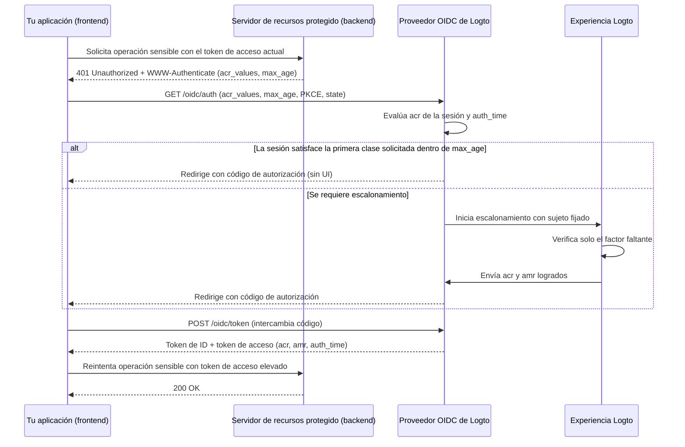

# Autenticación escalonada

La autenticación escalonada permite que una aplicación requiera una autenticación reciente del usuario o un nivel de garantía de autenticación más fuerte antes de realizar operaciones sensibles—como autorizar un pago, ver registros confidenciales o modificar la configuración de seguridad de la cuenta—sin cerrar la sesión del usuario.

Logto implementa autenticación escalonada basada en estándares, construida sobre [OpenID Connect Core](https://openid.net/specs/openid-connect-core-1_0.html), [RFC 9470 (OAuth 2.0 Step Up Authentication Challenge Protocol)](https://www.rfc-editor.org/rfc/rfc9470.html) y [RFC 8176 (Authentication Method Reference Values)](https://www.rfc-editor.org/rfc/rfc8176.html):

1. Los servidores de recursos protegidos desafían tokens insuficientes con `401 Unauthorized` y un encabezado `WWW-Authenticate` RFC 9470 que lleva `acr_values` y `max_age`.
2. Tu aplicación inicia un Authorization Code Flow con `acr_values` y `max_age`. Cuando ya existe una sesión autenticada, Logto fija el usuario autenticado y solicita solo la verificación faltante.
3. Logto registra el contexto de autenticación logrado (`acr`, `amr` y `auth_time`) en la sesión y lo emite en los tokens de ID, tokens de acceso JWT y respuestas de introspección de tokens opacos.



## Modelo de contexto de autenticación \{#authentication-context-model}

Cada inicio de sesión, registro y escalonamiento completado a través de la Experiencia Logto registra tres reclamos estándar en la sesión OIDC, haya o no solicitado la aplicación `acr_values`:

| Reclamo     | Tipo       | Descripción                                                                                                        |
| ----------- | ---------- | ------------------------------------------------------------------------------------------------------------------ |
| `acr`       | `string`   | Referencia de clase de contexto de autenticación—el nivel de garantía alcanzado. Se omite si no se cumple ninguno. |
| `amr`       | `string[]` | Referencias de métodos de autenticación—los métodos de verificación usados en esa interacción.                     |
| `auth_time` | `number`   | Marca de tiempo epoch (en segundos) cuando se completó la autenticación del usuario final.                         |

Logto anuncia estas capacidades en OIDC Discovery (`/.well-known/openid-configuration` y `/.well-known/oauth-authorization-server`):

```json
{
  "acr_values_supported": ["urn:logto:acr:1fa", "urn:logto:acr:mfa"],
  "claims_supported": ["sub", "acr", "amr", "auth_time"]
}
```

En los tokens de ID, `acr`, `amr` y `auth_time` se incluyen bajo el alcance estándar `openid` siempre que estén presentes en la sesión. En los tokens de acceso de usuario, Logto los copia del authorization code, device code o refresh token en los payloads JWT y respuestas de introspección de tokens opacos. La rotación de refresh token preserva el `acr`, `amr` y `auth_time` originales—refrescar un token nunca avanza `auth_time`. Otros tipos de concesión (como client credentials y token exchange) no emiten reclamos de contexto de autenticación.

### Valores ACR soportados \{#supported-acr-values}

Logto define dos valores de Referencia de Clase de Contexto de Autenticación (`acr`):

| Valor ACR           | Significado                                                                                                                                                                                                                                       | Satisface                                |
| ------------------- | ------------------------------------------------------------------------------------------------------------------------------------------------------------------------------------------------------------------------------------------------- | ---------------------------------------- |
| `urn:logto:acr:1fa` | Al menos un factor que Logto verificó directamente o estableció en la interacción: contraseña, código de verificación de correo electrónico o teléfono principal, magic link (token de un solo uso en inicio de sesión) o un factor MFA inscrito. | `urn:logto:acr:1fa`                      |
| `urn:logto:acr:mfa` | Una prueba de primer factor verificable por Logto (rol `1fa`) combinada con una prueba de rol `mfa` de un **factor diferente**, o una aserción WebAuthn / passkey verificada por el usuario por sí sola.                                          | `urn:logto:acr:mfa`, `urn:logto:acr:1fa` |

La relación de satisfacción es `urn:logto:acr:mfa` → `urn:logto:acr:1fa`: cualquier sesión o token que tenga `urn:logto:acr:mfa` también satisface un requisito de `urn:logto:acr:1fa`. Los valores estándar `phr` y `phrh` de ACR no son soportados; las ceremonias WebAuthn y passkey requieren verificación de usuario y se asignan a `urn:logto:acr:mfa`.

Al derivar `urn:logto:acr:mfa`, Logto clasifica cada método verificable por Logto según el rol que puede cumplir:

- **Rol de primer factor (`1fa`)**: contraseña, código de verificación de correo electrónico principal, código de verificación de teléfono principal y token de un solo uso (solo en inicio de sesión).
- **Rol de segundo factor (`mfa`)**: OTP de app autenticadora (TOTP), código de respaldo, código de verificación de correo electrónico MFA y código de verificación de teléfono MFA. Un factor de rol `mfa` verificado sin un primer factor verificable por Logto (por ejemplo, inicio de sesión social + TOTP) alcanza `urn:logto:acr:1fa`, no `urn:logto:acr:mfa`.
- **Rol autosuficiente (`both`)**: inicio de sesión con passkey y MFA WebAuthn con verificación de usuario satisfacen ambos roles en una sola ceremonia y alcanzan solo `urn:logto:acr:mfa`.
- **Regla de factores distintos**: `urn:logto:acr:mfa` requiere dos **factores diferentes**. Dos primeros factores (como código de correo + contraseña durante el registro), dos factores de rol `mfa` (como TOTP + código de respaldo), o dos pruebas del mismo canal subyacente (como código de correo principal + código de correo MFA) cuentan como un solo factor o rol y logran `urn:logto:acr:1fa`.
- **Dispositivos confiables y MFA adaptativo**: el cumplimiento de [dispositivo confiable](/end-user-flows/mfa/trusted-devices) y los saltos de MFA adaptativo no prueban nada en la interacción actual y no contribuyen a `acr` (un inicio de sesión con contraseña que omite MFA mediante un dispositivo confiable da `acr="urn:logto:acr:1fa"` y `amr=["pwd"]`).

El registro registra el contexto de autenticación bajo las mismas reglas porque las credenciales escritas al crear la cuenta prueban esa cuenta. Por ejemplo, un registro con nombre de usuario y contraseña da `acr="urn:logto:acr:1fa"` y `amr=["pwd"]`.

### Mapeo AMR \{#amr-mapping}

Logto rellena `amr` con valores de [RFC 8176](https://www.rfc-editor.org/rfc/rfc8176.html), más `fed` para autenticación federada:

| Método de verificación Logto                                                                            | Valores `amr`        | Contribuye a `acr` |
| ------------------------------------------------------------------------------------------------------- | -------------------- | ------------------ |
| Contraseña (verificada o recién establecida durante registro o escalonamiento)                          | `pwd`                | Sí (rol `1fa`)     |
| Código de verificación de correo principal                                                              | `otp`                | Sí (rol `1fa`)     |
| Código de verificación de teléfono principal                                                            | `sms`                | Sí (rol `1fa`)     |
| Token de un solo uso / magic link (solo inicio de sesión; no disponible en escalonamiento)              | `otp`                | Sí (rol `1fa`)     |
| OTP de app autenticadora (TOTP, verificado o recién vinculado)                                          | `otp`                | Sí (rol `mfa`)     |
| Código de verificación de correo MFA                                                                    | `otp`                | Sí (rol `mfa`)     |
| Código de verificación de teléfono MFA                                                                  | `sms`                | Sí (rol `mfa`)     |
| Código de respaldo                                                                                      | `otp`                | Sí (rol `mfa`)     |
| MFA WebAuthn o inicio de sesión con passkey con verificación de usuario (verificado o recién vinculado) | `pop`, `user`, `mfa` | Sí (ambos roles)   |
| Inicio de sesión social o SSO empresarial                                                               | `fed`                | No                 |
| Cualquier interacción cuyo `acr` logrado sea `urn:logto:acr:mfa`                                        | agrega `mfa`         | —                  |

#### Autenticación federada (`fed`) \{#federated-authentication-fed}

Logto emite `fed` para indicar que el usuario se autenticó mediante una aserción social o SSO empresarial ascendente cuyo método Logto no puede verificar directamente.

- Un inicio de sesión o registro puramente social o SSO empresarial registra `amr=["fed"]` y un `auth_time` nuevo, **sin reclamo `acr`**.
- `fed` no es un primer factor, y repetir el inicio de sesión ascendente nunca eleva `acr`. Completar un factor verificable por Logto después de inicio de sesión social (como TOTP) da `acr="urn:logto:acr:1fa"` y `amr=["fed", "otp"]`.
- `auth_time` por sí solo no aporta garantía—siempre verifica `acr` junto con `auth_time`.
- Qué proveedor ascendente autenticó al usuario se expone en los reclamos `identities` y `sso_identities` en vez de codificarse en `amr`.

### Cómo el escalonamiento actualiza los reclamos de sesión y token \{#how-step-up-updates-session-and-token-claims}

Cuando una solicitud de autorización con `acr_values` llega a una sesión OIDC existente y requiere interacción, la Experiencia entra en **modo escalonado**:

- **Fijación de sujeto y ACR acumulativo**: Logto fija el `sub` de la sesión actual (sin cambio de cuenta, entrada de identificador ni registro) y solicita solo la garantía faltante. Los métodos de sesión inequívocos llevan su rol de emparejamiento al escalonamiento:
  - Una sesión autenticada con `pwd` o `sms` ya aporta una contribución `1fa`, así que escalar a `urn:logto:acr:mfa` solicita **solo** un factor MFA inscrito (incluso cuando `max_age=0` o `prompt=login` fuerza autenticación fresca).
  - Una sesión social o SSO empresarial (`amr=["fed"]`) no aporta contribución `1fa`, así que para alcanzar `urn:logto:acr:mfa` se requiere probar (o establecer) un primer factor antes de MFA, o verificar una passkey WebAuthn.
- **`amr` y `auth_time` reflejan solo la interacción actual**: En una sesión de contraseña, verificar TOTP durante el escalonamiento produce `acr="urn:logto:acr:mfa"`, `amr=["otp", "mfa"]` y un nuevo `auth_time`. **Las partes confiables deben leer la garantía desde `acr` y no buscar un primer factor en `amr`.**
- **Reemplazo de sesión, no fusión**: Tras completar el escalonamiento, los valores de `acr`, `amr` y `auth_time` de la sesión se reemplazan por el contexto logrado en la nueva interacción. Por ejemplo, la reautenticación por contraseña para `urn:logto:acr:1fa` establece la sesión en `acr="urn:logto:acr:1fa"` y `amr=["pwd"]`. Los tokens emitidos previamente retienen los reclamos capturados cuando se generaron.
- **Anulaciones de política y efectos secundarios**: Solicitar `urn:logto:acr:1fa` requiere una verificación activa elegible y no vuelve a ejecutar la política MFA de inicio de sesión del tenant. Solicitar `urn:logto:acr:mfa` ignora el cumplimiento de dispositivo confiable, preferencias de usuario `skipMfaOnSignIn` y resultados de no disparo de MFA adaptativo. El escalonamiento puro no ejecuta efectos secundarios de inicio de sesión como webhooks `PostSignIn` o acciones.

Si no existe una sesión OIDC autenticada cuando se solicita `acr_values`, Logto ejecuta el flujo normal de inicio de sesión o registro y aplica el ACR solicitado como requisito de finalización antes de emitir el código de autorización.

## Solicitar autenticación escalonada \{#request-step-up-authentication}

Pasa `acr_values` y `max_age` en una solicitud Authorization Code Flow a `/oidc/auth`.

### Semántica de lista ordenada de `acr_values` \{#ordered-list-semantics-of-acr-values}

`acr_values` es una lista separada por espacios de valores ACR aceptables en **orden de preferencia del llamador** (por ejemplo, `urn:logto:acr:mfa urn:logto:acr:1fa`). Logto ignora valores no reconocidos; si **ninguno** de los valores solicitados es soportado (por ejemplo, `acr_values=phr`), Logto falla inmediatamente antes de cualquier UI y redirige a `redirect_uri` con `error=unmet_authentication_requirements`.

Cuando se solicita al menos una clase soportada:

1. **Primera clase ya satisfecha**: Si una sesión autenticada satisface la **primera** clase soportada en `acr_values`, cumple `max_age` y no se solicitó `prompt=login`, Logto emite un código de autorización inmediatamente sin UI.
2. **Solo una clase posterior satisfecha**: Si la sesión satisface una clase listada después pero no la primera—por ejemplo, `acr_values="urn:logto:acr:mfa urn:logto:acr:1fa"` en una sesión `1fa`—Logto aún inicia una interacción de escalonamiento para buscar la clase anterior (`urn:logto:acr:mfa`).
   - Si el usuario puede alcanzar `urn:logto:acr:mfa` (verificando un factor MFA inscrito o inscribiendo uno), la Experiencia lo solicita.
   - Si `urn:logto:acr:mfa` es inalcanzable (por ejemplo, el usuario no tiene factor MFA inscrito y el tenant no habilita ningún factor TOTP o WebAuthn inscribible), Logto recurre a la siguiente clase alcanzable (`urn:logto:acr:1fa`). Cuando la sesión ya satisface esa clase de respaldo y no se forzó autenticación fresca, Logto finaliza sin mostrar UI y preserva el `auth_time` original de la sesión.
3. **Fallo estricto con `unmet_authentication_requirements`**: Logto nunca emite un token con un ACR más débil que la clase que persigue la interacción. Solo cuando **ninguna** clase listada es alcanzable, Logto redirige de vuelta a `redirect_uri` con `error=unmet_authentication_requirements`.

### Solicitudes estrictas vs. patrón de reintento con clase más débil \{#strict-requests-vs-the-retry-with-weaker-class-pattern}

Dependiendo de cómo maneje tu aplicación a los usuarios que no pueden cumplir MFA, elige uno de dos patrones:

- **Requiere una clase específica estrictamente, luego reintenta o ramifica en tu app**: Solicita solo `acr_values=urn:logto:acr:mfa`. Logto garantiza un token `mfa` o un redireccionamiento `error=unmet_authentication_requirements`. Ante `unmet_authentication_requirements`, tu manejador de callback puede decidir explícitamente si reintentar la autorización con `acr_values=urn:logto:acr:1fa`, bloquear la operación o enrutar la solicitud a un flujo de aprobación.
- **Declara respaldo ordenado en una sola solicitud**: Solicita `acr_values="urn:logto:acr:mfa urn:logto:acr:1fa"`. Logto busca `mfa` siempre que sea alcanzable y recurre automáticamente a `1fa` solo cuando `mfa` no puede alcanzarse para ese usuario y tenant. Verifica `acr` en el token de acceso resultante para ver qué nivel se logró.

:::note
Abandonar una pantalla de escalonamiento no activa respaldo ni notifica a tu app—no hay endpoint de cancelación, y una interacción abandonada simplemente expira o es reemplazada por la siguiente solicitud de autorización. Mantén el estado de acción pendiente en tu aplicación y límpialo si el usuario navega hacia atrás sin completar el callback.
:::

### Combinando `max_age` y `acr_values` \{#combining-max-age-and-acr-values}

`max_age` especifica el tiempo máximo transcurrido permitido en segundos desde la última autenticación activa del usuario (`auth_time`):

- `max_age` verifica `auth_time`, **no** el `exp` del token. Refrescar tokens nunca reinicia `auth_time`.
- `max_age=0` (o `prompt=login`) fuerza verificación interactiva fresca incluso cuando la sesión ya tiene el `acr` solicitado.
- `max_age` **sin** `acr_values` lleva al flujo regular de `/sign-in` y no aplica ningún nivel de garantía—un usuario puede reautenticarse con inicio de sesión social, refrescando `auth_time` sin `acr`. Cuando tu operación requiere frescura y garantía verificada por Logto, siempre envía **ambos** `acr_values` y `max_age`.

### Detección silenciosa de brechas con `prompt=none` \{#silent-gap-detection-with-prompt-none}

Para comprobar si la sesión Logto actual del usuario ya cumple un requisito de garantía y frescura sin mostrar ninguna UI ni ofrecer inscripción, combina `prompt=none` con `acr_values` (y opcionalmente `max_age`):

- **Satisfecho**: Como `prompt=none` no permite UI para buscar orden de preferencia, Logto emite un código de autorización si la sesión satisface **cualquier** clase soportada en `acr_values` dentro de `max_age`.
- **Sesión autenticada, requisito no cumplido o caducado**: Logto redirige con `error=unmet_authentication_requirements` (tiene prioridad sobre errores de `max_age`).
- **Sin sesión autenticada**: Logto redirige con `error=login_required`.

### Ejemplos de URL de autorización y SDK \{#authorization-url-and-sdk-examples}

Solicitud de autorización sin procesar solicitando MFA en los últimos 5 minutos (`300` segundos) para un recurso de API protegido:

```http
GET /oidc/auth?client_id=my-web-app
  &redirect_uri=https%3A%2F%2Fapp.example.com%2Fcallback
  &response_type=code
  &scope=openid%20offline_access%20payment%3Awrite
  &resource=https%3A%2F%2Fapi.example.com
  &acr_values=urn%3Alogto%3Aacr%3Amfa
  &max_age=300
  &state=8f3d9c1b2a...
  &nonce=4e1a7b9c0f...
  &code_challenge=E9Melhoa2OwvFrEMTJguCHaoeK1t8URWbuGJSstw-cM
  &code_challenge_method=S256 HTTP/1.1
Host: [tenant-id].logto.app
```

Con un SDK de Logto JavaScript / TypeScript (como `@logto/browser`, `@logto/react`, `@logto/vue` o `@logto/node`), pasa `acr_values` y `max_age` vía `extraParams`. En aplicaciones de una sola página donde el usuario ya ha iniciado sesión, establece `clearTokens: false` para que los tokens en caché permanezcan intactos si el usuario abandona el escalonamiento o regresa con un error OIDC:

```ts
await signIn({
  redirectUri: 'https://app.example.com/callback',
  clearTokens: false,
  extraParams: {
    acr_values: 'urn:logto:acr:mfa',
    max_age: '300',
  },
});
```

En la ruta de callback, inspecciona `error` antes de llamar a `handleSignInCallback()`:

```ts
const params = new URLSearchParams(window.location.search);
const error = params.get('error');

if (error === 'unmet_authentication_requirements') {
  // El usuario no puede alcanzar el ACR solicitado (o prompt=none detectó una brecha).
  // Opcionalmente reintenta con una clase más débil como 'urn:logto:acr:1fa', o muestra una explicación.
  return;
}
```

:::tip[Escalonando para un recurso de API diferente]
El contexto de autenticación pertenece a la sesión Logto, no a un solo recurso de API. Solicitar escalonamiento con un indicador `resource` emite tokens elevados para ese recurso (solicitando consentimiento si sus alcances no han sido concedidos aún). Los tokens emitidos previamente para otros recursos de API permanecen sin cambios; cada servidor de recursos evalúa `acr` y `auth_time` en el token que se le presenta.
:::

## Desafía y valida en un servidor de recursos protegido \{#challenge-and-validate-on-a-protected-resource-server}

Las decisiones de autorización pertenecen a tu backend o servidor de recursos protegido:

- Siempre valida el **token de acceso (Access token)** en el servidor de recursos, nunca el token de ID.
- Las aplicaciones de navegador deben tratar los tokens de acceso como opacos. Tu aplicación puede leer `acr` y `auth_time` de su token de ID para coordinar el estado de la UI antes de enviar una solicitud, pero nunca debe confiar en la decodificación del lado del cliente para la aplicación de seguridad.

### Devuelve un desafío RFC 9470 \{#return-an-rfc-9470-challenge}

Cuando un token de acceso es válido como bearer token (firma válida, `iss`, `aud`, `exp` y `scope`) pero carece del `acr` requerido o excede tu ventana `max_age`, responde con `401 Unauthorized` y un encabezado `WWW-Authenticate` [RFC 9470](https://www.rfc-editor.org/rfc/rfc9470.html):

```http
HTTP/1.1 401 Unauthorized
WWW-Authenticate: Bearer error="insufficient_user_authentication",
  error_description="Se requiere autenticación multifactor en los últimos 5 minutos",
  acr_values="urn:logto:acr:mfa",
  max_age="300"
```

Cuando tu aplicación recibe `401` con `error="insufficient_user_authentication"`, analiza `acr_values` y `max_age` del `WWW-Authenticate`, persiste la ruta o intención pendiente del usuario localmente, activa `signIn()` con esos parámetros y reintenta la llamada a la API una vez con el nuevo token de acceso emitido. Protege contra bucles de reintento no iniciando un segundo escalonamiento si la solicitud reintentada tras el callback aún recibe `401`.

### Valida tokens de acceso JWT \{#validate-jwt-access-tokens}

Cuando se solicita un indicador de recurso de API (`resource`), Logto emite un token de acceso JWT firmado que incluye `acr`, `amr` y `auth_time`:

```json
{
  "iss": "https://[tenant-id].logto.app/oidc",
  "sub": "user-id",
  "aud": "https://api.example.com",
  "client_id": "my-web-app",
  "scope": "payment:write",
  "exp": 1787749200,
  "iat": 1787745601,
  "auth_time": 1787745600,
  "acr": "urn:logto:acr:mfa",
  "amr": ["pwd", "otp", "mfa"]
}
```

Después de [validar los reclamos estándar del JWT](/authorization/validate-access-tokens) (firma contra JWKS, `iss`, `aud`, `exp` y `scope`), verifica `acr` usando la relación de satisfacción y compara `auth_time` (nunca `iat`) contra tu política:

```ts
import { createRemoteJWKSet, jwtVerify } from 'jose';

// Comentario: Verifica el token de acceso JWT y el contexto de autenticación

const issuer = 'https://[tenant-id].logto.app/oidc';
const jwks = createRemoteJWKSet(new URL(`${issuer}/jwks`));

type LogtoAcr = 'urn:logto:acr:1fa' | 'urn:logto:acr:mfa';

const satisfiedAcrs: Record<string, readonly LogtoAcr[]> = {
  'urn:logto:acr:1fa': ['urn:logto:acr:1fa'],
  'urn:logto:acr:mfa': ['urn:logto:acr:mfa', 'urn:logto:acr:1fa'],
};

const acrSatisfies = (achieved: unknown, required: LogtoAcr): boolean => {
  if (typeof achieved !== 'string') {
    return false;
  }

  return Boolean(satisfiedAcrs[achieved]?.includes(required));
};

export async function verifySensitiveRequest(
  bearerToken: string,
  requiredAcr: LogtoAcr = 'urn:logto:acr:mfa',
  maxAgeSeconds = 300
) {
  const { payload } = await jwtVerify(bearerToken, jwks, {
    issuer,
    audience: 'https://api.example.com',
  });

  const authTime = payload.auth_time;
  const nowSeconds = Date.now() / 1000;
  const isFresh =
    typeof authTime === 'number' &&
    Number.isInteger(authTime) &&
    nowSeconds - authTime >= 0 &&
    nowSeconds - authTime <= maxAgeSeconds;

  if (!acrSatisfies(payload.acr, requiredAcr) || !isFresh) {
    const challenge =
      `Bearer error="insufficient_user_authentication", ` +
      `error_description="Se requiere autenticación reciente del usuario", ` +
      `acr_values="${requiredAcr}", max_age="${maxAgeSeconds}"`;

    return { authorized: false as const, wwwAuthenticate: challenge };
  }

  return { authorized: true as const, payload };
}
```

### Valida tokens de acceso opacos vía introspección \{#validate-opaque-access-tokens-via-introspection}

Cuando no se solicita un recurso de API (`resource`), Logto emite un [token opaco](/concepts/opaque-token). Valídalo llamando al endpoint de introspección [RFC 7662](https://www.rfc-editor.org/rfc/rfc7662.html) (`POST /oidc/token/introspection`) con autenticación de cliente; Logto devuelve `acr`, `amr` y `auth_time` en el nivel superior de una respuesta activa:

```bash
curl -X POST https://[tenant-id].logto.app/oidc/token/introspection \
  -u "<client_id>:<client_secret>" \
  -H "Content-Type: application/x-www-form-urlencoded" \
  --data-urlencode "token=<opaque_access_token>" \
  --data-urlencode "token_type_hint=access_token"
```

Ejemplo de respuesta de introspección:

```json
{
  "active": true,
  "client_id": "my-web-app",
  "exp": 1787749200,
  "iat": 1787745601,
  "iss": "https://[tenant-id].logto.app/oidc",
  "scope": "openid offline_access profile",
  "sub": "user-id",
  "token_type": "Bearer",
  "acr": "urn:logto:acr:1fa",
  "amr": ["pwd"],
  "auth_time": 1787745600
}
```

Verifica primero que `active === true`, luego aplica los mismos chequeos de `acrSatisfies` y `auth_time` que arriba.

### Reclamos reservados en JWT personalizado \{#reserved-claims-in-custom-jwt}

En los tokens de acceso de usuario, `acr`, `amr` y `auth_time` están reservados: un [script de token de acceso personalizado](/developers/custom-token-claims/create-script) no puede sobrescribirlos ni agregarlos donde Logto no derive contexto de autenticación.

## Establecer un primer factor e inscribir MFA \{#establishing-a-first-factor-and-enrolling-mfa}

Un usuario solicitado para `urn:logto:acr:1fa` o `urn:logto:acr:mfa` puede no tener aún las credenciales necesarias para alcanzar esa clase—por ejemplo, un usuario solo con contraseña que nunca ha inscrito MFA, o un usuario solo social que no tiene contraseña, código de correo/telefono principal ni factor MFA. Logto permite establecer un primer factor faltante e inscribir MFA **dentro de la misma interacción de inicio de sesión o escalonamiento**, restringido por precondiciones estrictas de frescura para que una cookie de sesión robada nunca pueda inscribir ni establecer nada:

- **Inscribir un factor MFA**: Solo se ofrece cuando el usuario no tiene factor MFA inscrito que pueda alcanzar `urn:logto:acr:mfa`, y **solo después de que un primer factor verificable por Logto (`1fa` o clase `both`) haya sido verificado o establecido en la interacción actual**.
  - Ni el `acr` almacenado de la sesión ni una cookie de dispositivo confiable satisfacen esta puerta. Un usuario autenticado por contraseña que no tiene MFA debe primero volver a ingresar su contraseña en el escalonamiento, y luego puede vincular TOTP o una passkey WebAuthn (con códigos de respaldo opcionales junto a TOTP o WebAuthn; los códigos de respaldo no pueden inscribirse solos).
- **Establecer un primer factor**: Solo se ofrece cuando el usuario carece de un primer factor que pueda alcanzar la clase buscada (ya sea que no tenga ningún método elegible, como un usuario solo social solicitando `1fa`, o solo tenga un factor de rol `mfa` como TOTP al solicitar `mfa`), y **solo cuando la interacción actual tiene una prueba de sujeto fresca**:
  - Durante **escalonamiento en una sesión existente**, el usuario prueba el sujeto reautenticándose con uno de sus conectores sociales o SSO empresariales ya vinculados habilitados en la Experiencia de inicio de sesión. Si el callback ascendente resuelve a un usuario diferente o una cuenta no vinculada, Logto lo rechaza con `403`—no se permite ni registro ni vinculación de cuentas.
  - Una vez que la prueba de sujeto tiene éxito, el usuario puede establecer cualquier método de primer factor que el tenant habilite para inicio de sesión: una contraseña (cuando el inicio de sesión por contraseña está habilitado) o un correo electrónico o número de teléfono principal verificado (cuando está habilitado para inicio de sesión con un conector de correo o SMS activo). Por ejemplo, un usuario solo social que se reautentica con Google y establece una contraseña termina con `acr="urn:logto:acr:1fa"` y `amr=["fed", "pwd"]`.
  - Establecer nunca se ofrece como alternativa cuando el usuario ya tiene un método elegible para verificar.

Logto cuenta una credencial o factor MFA establecido y vinculado durante una interacción igual que uno verificado en ella, por lo que el usuario completa el escalonamiento inmediatamente sin ser desafiado una segunda vez por el factor que acaba de configurar. Cuando un usuario establece una nueva credencial o factor durante escalonamiento puro, Logto emite el evento webhook `User.Data.Updated`. Si el tenant no habilita nada que el usuario pueda verificar, establecer o inscribir (o el usuario no tiene conector social/SSO vinculado para probar el sujeto), Logto finaliza la interacción con `error=unmet_authentication_requirements`.

## Account API y Account Center \{#account-api-and-account-center}

### Política de autorización de Account API \{#account-api-authorization-policy}

Las operaciones sensibles de [Account API](/end-user-flows/account-settings/by-account-api)—como actualizar contraseña, correo principal, teléfono principal o nombre de usuario, vincular o eliminar identidades sociales, gestionar factores y ajustes MFA, gestionar tokens de acceso personal y ver o revocar sesiones activas, concesiones de apps y dispositivos confiables—requieren:

1. **Acceso de aplicación de primera parte**: Las aplicaciones OIDC de terceros (`isThirdParty: true`) y los clientes CIMD no pueden modificar recursos sensibles de Account API ni recibir desafíos de escalonamiento de Account API, incluso con `urn:logto:acr:mfa`.
2. **Verificación reciente de identidad**, satisfecha por **cualquiera** de las siguientes:
   - **Contexto de autenticación OIDC**: El token de acceso opaco lleva `acr` que satisface `urn:logto:acr:1fa` (`urn:logto:acr:1fa` o `urn:logto:acr:mfa`) **y** `now - auth_time <= maximumAuthenticationAgeInSeconds` (evaluado estrictamente desde `auth_time`, nunca `iat`).
   - **Registro de verificación (`logto-verification-id`)**: Para integraciones directas de Account API, Logto sigue aceptando un ID de registro de verificación válido y no expirado de 10 minutos en el encabezado de solicitud `logto-verification-id` creado vía `POST /api/verifications/password` o `POST /api/verifications/verification-code` + `/verify`.

:::info[Configurando la ventana de autenticación reciente]
Por defecto, `maximumAuthenticationAgeInSeconds` es **600 segundos (10 minutos)**. Puedes configurarlo por tenant de **1 a 120 minutos (60–7,200 segundos)** en <CloudLink to="/sign-in-experience/account-center">Consola > Inicio de sesión y cuenta > Centro de cuenta</CloudLink> bajo **Autenticación reciente**, o vía Management API (`PATCH /api/account-center` con `maximumAuthenticationAgeInSeconds`).

Con contexto de autenticación OIDC, un usuario que acaba de iniciar sesión o registrarse con un método verificable por Logto puede realizar operaciones sensibles de Account API dentro de esta ventana sin un aviso de verificación separado. Ten en cuenta que los registros `logto-verification-id` creados a través de la Verification API mantienen su TTL fijo de 10 minutos por compatibilidad.
:::

Account API también preserva la excepción de contraseña inicial: un usuario que actualmente no tiene contraseña, correo principal ni teléfono principal puede establecer una contraseña inicial vía `POST /api/my-account/password` sin verificación reciente de identidad. Establecer una contraseña a través de Account API no actualiza el `acr` de la sesión OIDC y no autoriza operaciones sensibles posteriores.

### Desafío `WWW-Authenticate` de Account API \{#account-api-www-authenticate-challenge}

Cuando una solicitud de Account API de primera parte carece tanto de un token de acceso fresco `urn:logto:acr:1fa` como de un encabezado `logto-verification-id` válido, Logto responde con `401 Unauthorized`, preservando el cuerpo de error JSON existente por compatibilidad y agregando el encabezado `WWW-Authenticate` RFC 9470 con el `max_age` configurado del tenant:

```http
HTTP/1.1 401 Unauthorized
WWW-Authenticate: Bearer error="insufficient_user_authentication", error_description="Se requiere autenticación reciente del usuario", acr_values="urn:logto:acr:1fa", max_age="600"
Content-Type: application/json

{
  "code": "verification_record.permission_denied",
  "message": "Permiso denegado, por favor reautentícate."
}
```

### Account Center preconstruido \{#prebuilt-account-center}

La [UI preconstruida de Account Center](/end-user-flows/account-settings/by-account-center-ui) (`/account/*`) usa exclusivamente autenticación escalonada OIDC y nunca crea registros de permiso `logto-verification-id`:

- Inspecciona `acr` y `auth_time` en su token de ID local para iniciar escalonamiento proactivamente antes de acciones sensibles en línea o subpáginas de varios pasos cuando el inicio de sesión carece de `urn:logto:acr:1fa` o está caducado, y también maneja desafíos `401` RFC 9470 de Account API como respaldo.
- Tras completar el escalonamiento, Account Center reemplaza su conjunto de tokens y reanuda la acción pendiente como máximo una vez.

## Recursos relacionados \{#related-resources}

<Url href="/end-user-flows/mfa">Autenticación multifactor</Url>
<Url href="/authorization/validate-access-tokens">
  Cómo validar tokens de acceso en tu servicio API o backend
</Url>
<Url href="/concepts/opaque-token">Token opaco y su introspección</Url>
<Url href="/end-user-flows/account-settings/by-account-api">
  Configuración de cuenta por Account API
</Url>
<Url href="/end-user-flows/account-settings/by-account-center-ui">
  Configuración de cuenta por la UI preconstruida de Account Center
</Url>
