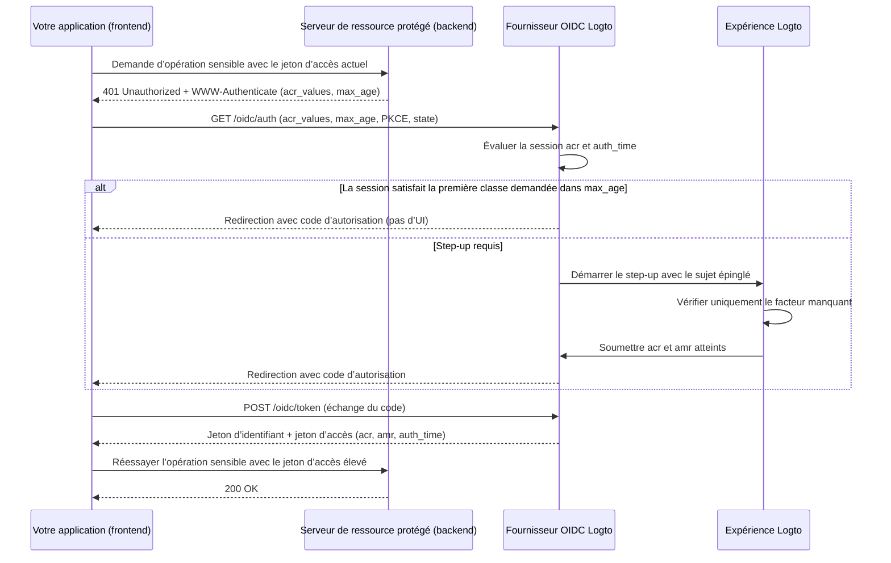

# Authentification step-up

L’authentification step-up permet à une application d’exiger une authentification récente de l’utilisateur ou un niveau d’assurance d’authentification plus élevé avant d’effectuer des opérations sensibles — telles qu’autoriser un paiement, consulter des dossiers confidentiels ou modifier les paramètres de sécurité du compte — sans déconnecter l’utilisateur.

Logto implémente une authentification step-up basée sur les standards, construite sur [OpenID Connect Core](https://openid.net/specs/openid-connect-core-1_0.html), [RFC 9470 (OAuth 2.0 Step Up Authentication Challenge Protocol)](https://www.rfc-editor.org/rfc/rfc9470.html), et [RFC 8176 (Authentication Method Reference Values)](https://www.rfc-editor.org/rfc/rfc8176.html) :

1. Les serveurs de ressources protégées contestent les jetons insuffisants avec `401 Unauthorized` et un en-tête RFC 9470 `WWW-Authenticate` contenant `acr_values` et `max_age`.
2. Votre application démarre un Authorization Code Flow avec `acr_values` et `max_age`. Lorsqu’une session authentifiée existe déjà, Logto épingle l’utilisateur connecté et ne demande que la vérification manquante.
3. Logto enregistre le contexte d’authentification atteint (`acr`, `amr` et `auth_time`) sur la session et l’émet dans les jetons d’identifiant, les jetons d’accès JWT et les réponses d’introspection de jetons opaques.



## Modèle de contexte d’authentification \{#authentication-context-model}

Chaque connexion, inscription et step-up complétés via l’Expérience Logto enregistrent trois revendications standard sur la session OIDC, que l’application ait ou non demandé `acr_values` :

| Claim       | Type       | Description                                                                                                      |
| ----------- | ---------- | ---------------------------------------------------------------------------------------------------------------- |
| `acr`       | `string`   | Référence de classe de contexte d’authentification — le niveau d’assurance atteint. Omis si aucun n’est atteint. |
| `amr`       | `string[]` | Références des méthodes d’authentification — les méthodes de vérification utilisées lors de cette interaction.   |
| `auth_time` | `number`   | Horodatage Epoch (en secondes) lorsque l’authentification de l’utilisateur final a été complétée.                |

Logto annonce ces capacités dans la découverte OIDC (`/.well-known/openid-configuration` et `/.well-known/oauth-authorization-server`) :

```json
{
  "acr_values_supported": ["urn:logto:acr:1fa", "urn:logto:acr:mfa"],
  "claims_supported": ["sub", "acr", "amr", "auth_time"]
}
```

Dans les jetons d’identifiant, `acr`, `amr` et `auth_time` sont inclus sous la portée standard `openid` lorsqu’ils sont présents sur la session. Sur les jetons d’accès utilisateur, Logto les copie à partir du code d’autorisation, du code d’appareil ou du jeton de rafraîchissement dans les charges utiles JWT et les réponses d’introspection de jetons opaques. La rotation du jeton de rafraîchissement préserve les valeurs originales de `acr`, `amr` et `auth_time` — rafraîchir un jeton n’avance jamais `auth_time`. Les autres types de flux (tels que client credentials et token exchange) n’émettent pas de revendications de contexte d’authentification.

### Valeurs ACR prises en charge \{#supported-acr-values}

Logto définit deux valeurs de Référence de classe de contexte d’authentification (`acr`) :

| Valeur ACR          | Signification                                                                                                                                                                                                                          | Satisfait                                |
| ------------------- | -------------------------------------------------------------------------------------------------------------------------------------------------------------------------------------------------------------------------------------- | ---------------------------------------- |
| `urn:logto:acr:1fa` | Au moins un facteur que Logto a directement vérifié ou établi lors de l’interaction : mot de passe, code de vérification e-mail ou téléphone principal, lien magique (jeton à usage unique à la connexion), ou un facteur MFA inscrit. | `urn:logto:acr:1fa`                      |
| `urn:logto:acr:mfa` | Une preuve de premier facteur vérifiable par Logto (rôle `1fa`) combinée à une preuve de rôle `mfa` provenant d’un **facteur différent**, ou une assertion WebAuthn / passkey vérifiée par l’utilisateur seule.                        | `urn:logto:acr:mfa`, `urn:logto:acr:1fa` |

La relation de satisfaction est `urn:logto:acr:mfa` → `urn:logto:acr:1fa` : toute session ou jeton portant `urn:logto:acr:mfa` satisfait également une exigence pour `urn:logto:acr:1fa`. Les valeurs ACR standard `phr` et `phrh` ne sont pas prises en charge ; les cérémonies WebAuthn et passkey nécessitent une vérification utilisateur et correspondent à `urn:logto:acr:mfa`.

Lors de la dérivation de `urn:logto:acr:mfa`, Logto classe chaque méthode vérifiable par Logto selon le rôle qu’elle peut remplir :

- **Rôle premier facteur (`1fa`)** : mot de passe, code de vérification e-mail principal, code de vérification téléphone principal, et jeton à usage unique (connexion uniquement).
- **Rôle second facteur (`mfa`)** : OTP d’application d’authentification (TOTP), code de secours, code de vérification e-mail MFA, et code de vérification téléphone MFA. Un facteur de rôle `mfa` vérifié sans un premier facteur vérifiable par Logto (par exemple, connexion sociale + TOTP) atteint `urn:logto:acr:1fa`, pas `urn:logto:acr:mfa`.
- **Rôle auto-suffisant (`both`)** : connexion par passkey et WebAuthn MFA avec vérification utilisateur satisfont les deux rôles en une seule cérémonie et atteignent uniquement `urn:logto:acr:mfa`.
- **Règle de facteurs distincts** : `urn:logto:acr:mfa` nécessite deux **facteurs différents**. Deux premiers facteurs (comme code de vérification e-mail + mot de passe lors de l’inscription), deux facteurs de rôle `mfa` (comme TOTP + code de secours), ou deux preuves du même canal sous-jacent (comme code e-mail principal + code e-mail MFA) comptent comme un seul facteur ou rôle et atteignent `urn:logto:acr:1fa`.
- **Appareils de confiance et MFA adaptatif** : la satisfaction [appareil de confiance](/end-user-flows/mfa/trusted-devices) et les sauts MFA adaptatifs ne prouvent rien dans l’interaction actuelle et ne contribuent pas à `acr` (une connexion par mot de passe qui saute la MFA via un appareil de confiance donne `acr="urn:logto:acr:1fa"` et `amr=["pwd"]`).

L’inscription enregistre le contexte d’authentification selon les mêmes règles car les identifiants créés lors de la création du compte prouvent ce compte. Par exemple, une inscription par nom d’utilisateur et mot de passe donne `acr="urn:logto:acr:1fa"` et `amr=["pwd"]`.

### Mappage AMR \{#amr-mapping}

Logto renseigne `amr` avec les valeurs de [RFC 8176](https://www.rfc-editor.org/rfc/rfc8176.html), plus `fed` pour l’authentification fédérée :

| Méthode de vérification Logto                                                        | Valeurs `amr`        | Contribue à `acr`  |
| ------------------------------------------------------------------------------------ | -------------------- | ------------------ |
| Mot de passe (vérifié, ou nouvellement défini lors de l’inscription ou du step-up)   | `pwd`                | Oui (rôle `1fa`)   |
| Code de vérification e-mail principal                                                | `otp`                | Oui (rôle `1fa`)   |
| Code de vérification téléphone principal                                             | `sms`                | Oui (rôle `1fa`)   |
| Jeton à usage unique / lien magique (connexion uniquement ; indisponible en step-up) | `otp`                | Oui (rôle `1fa`)   |
| OTP d’application d’authentification (TOTP, vérifié ou nouvellement lié)             | `otp`                | Oui (rôle `mfa`)   |
| Code de vérification e-mail MFA                                                      | `otp`                | Oui (rôle `mfa`)   |
| Code de vérification téléphone MFA                                                   | `sms`                | Oui (rôle `mfa`)   |
| Code de secours                                                                      | `otp`                | Oui (rôle `mfa`)   |
| WebAuthn MFA ou connexion passkey avec vérification utilisateur (vérifié ou lié)     | `pop`, `user`, `mfa` | Oui (rôles `both`) |
| Connexion sociale ou SSO d’entreprise                                                | `fed`                | Non                |
| Toute interaction dont `acr` atteint `urn:logto:acr:mfa`                             | ajoute `mfa`         | —                  |

#### Authentification fédérée (`fed`) \{#federated-authentication-fed}

Logto émet `fed` pour indiquer que l’utilisateur s’est authentifié via une assertion sociale ou SSO d’entreprise amont dont la méthode ne peut pas être vérifiée directement par Logto.

- Une connexion ou inscription purement sociale ou SSO d’entreprise enregistre `amr=["fed"]` et un nouveau `auth_time`, **sans revendication `acr`**.
- `fed` n’est pas un premier facteur, et répéter la connexion amont n’élève jamais `acr`. Compléter un facteur vérifiable par Logto après une connexion sociale (comme TOTP) donne `acr="urn:logto:acr:1fa"` et `amr=["fed", "otp"]`.
- `auth_time` seul ne porte aucune assurance — vérifiez toujours `acr` en plus de `auth_time`.
- Le fournisseur amont ayant authentifié l’utilisateur est exposé dans les revendications `identities` et `sso_identities` plutôt que codé dans `amr`.

### Comment le step-up met à jour les revendications de session et de jeton \{#how-step-up-updates-session-and-token-claims}

Lorsqu’une requête d’autorisation avec `acr_values` arrive sur une session OIDC existante et nécessite une interaction, l’Expérience entre en **mode step-up** :

- **Épinglage du sujet et ACR cumulatif** : Logto épingle le `sub` de la session actuelle (pas de changement de compte, de saisie d’identifiant ou d’inscription) et ne demande que l’assurance manquante. Les méthodes de session non ambiguës conservent leur rôle lors du step-up :
  - Une session authentifiée avec `pwd` ou `sms` fournit déjà une contribution `1fa`, donc le step-up vers `urn:logto:acr:mfa` demande **uniquement** un facteur MFA inscrit (même si `max_age=0` ou `prompt=login` force une authentification fraîche).
  - Une session sociale ou SSO d’entreprise (`amr=["fed"]`) ne fournit aucune contribution `1fa`, donc atteindre `urn:logto:acr:mfa` nécessite de prouver (ou d’établir) un premier facteur avant la MFA, ou de vérifier une passkey WebAuthn.
- **`amr` et `auth_time` reflètent uniquement l’interaction actuelle** : Sur une session mot de passe, vérifier TOTP lors du step-up produit `acr="urn:logto:acr:mfa"`, `amr=["otp", "mfa"]` et un nouveau `auth_time`. **Les parties de confiance doivent lire l’assurance depuis `acr` et ne pas rechercher un premier facteur dans `amr`.**
- **Remplacement de session, pas fusion** : Après le step-up, les valeurs `acr`, `amr` et `auth_time` de la session sont remplacées par le contexte atteint lors de la nouvelle interaction. Par exemple, une réauthentification par mot de passe pour `urn:logto:acr:1fa` définit la session sur `acr="urn:logto:acr:1fa"` et `amr=["pwd"]`. Les jetons émis précédemment conservent les revendications capturées lors de leur émission.
- **Dérogations de politique et effets secondaires** : Demander `urn:logto:acr:1fa` nécessite une vérification active éligible et ne relance pas la politique MFA de connexion du tenant. Demander `urn:logto:acr:mfa` ignore la satisfaction appareil de confiance, les préférences utilisateur `skipMfaOnSignIn` et les résultats non-déclencheurs de MFA adaptatif. Le step-up pur ne déclenche pas les effets secondaires de connexion comme les webhooks `PostSignIn` ou les actions.

Si aucune session OIDC authentifiée n’existe lors de la demande de `acr_values`, Logto exécute le flux de connexion ou d’inscription normal et applique l’ACR demandée comme condition de complétion avant d’émettre le code d’autorisation.

## Demander une authentification step-up \{#request-step-up-authentication}

Passez `acr_values` et `max_age` dans une requête Authorization Code Flow vers `/oidc/auth`.

### Sémantique de liste ordonnée de `acr_values` \{#ordered-list-semantics-of-acr-values}

`acr_values` est une liste d’espaces de valeurs ACR acceptables dans **l’ordre de préférence de l’appelant** (par exemple, `urn:logto:acr:mfa urn:logto:acr:1fa`). Logto ignore les valeurs non reconnues ; si **aucune** des valeurs demandées n’est prise en charge (par exemple, `acr_values=phr`), Logto échoue immédiatement avant toute UI et redirige vers `redirect_uri` avec `error=unmet_authentication_requirements`.

Lorsqu’au moins une classe prise en charge est demandée :

1. **Première classe déjà satisfaite** : Si une session authentifiée satisfait la **première** classe prise en charge dans `acr_values`, respecte `max_age` et que `prompt=login` n’a pas été demandé, Logto émet un code d’autorisation immédiatement sans UI.
2. **Seule une classe ultérieure satisfaite** : Si la session satisfait une classe listée plus tard mais pas la première — par exemple, `acr_values="urn:logto:acr:mfa urn:logto:acr:1fa"` sur une session `1fa` — Logto démarre tout de même une interaction step-up pour poursuivre la première classe (`urn:logto:acr:mfa`).
   - Si l’utilisateur peut atteindre `urn:logto:acr:mfa` (en vérifiant un facteur MFA inscrit ou en en inscrivant un), l’Expérience le demande.
   - Si `urn:logto:acr:mfa` est inatteignable (par exemple, l’utilisateur n’a aucun facteur MFA inscrit et le tenant n’active aucun facteur TOTP ou WebAuthn inscriptible), Logto revient à la prochaine classe atteignable (`urn:logto:acr:1fa`). Lorsque la session satisfait déjà cette classe de repli et qu’aucune authentification fraîche n’a été forcée, Logto termine sans afficher d’UI et préserve le `auth_time` original de la session.
3. **Échec strict avec `unmet_authentication_requirements`** : Logto n’émet jamais de jeton avec un ACR plus faible que la classe poursuivie par l’interaction. Uniquement lorsque **aucune** classe listée n’est atteignable, Logto redirige vers `redirect_uri` avec `error=unmet_authentication_requirements`.

### Requêtes strictes vs. le modèle de réessai avec classe plus faible \{#strict-requests-vs-the-retry-with-weaker-class-pattern}

Selon la façon dont votre application gère les utilisateurs qui ne peuvent pas satisfaire la MFA, choisissez l’un des deux modèles :

- **Exiger strictement une classe spécifique, puis réessayer ou bifurquer dans votre app** : Demandez uniquement `acr_values=urn:logto:acr:mfa`. Logto garantit soit un jeton `mfa`, soit une redirection `error=unmet_authentication_requirements`. En cas de `unmet_authentication_requirements`, votre gestionnaire de callback peut explicitement décider de réessayer l’autorisation avec `acr_values=urn:logto:acr:1fa`, de bloquer l’opération ou de router la demande vers un workflow d’approbation.
- **Déclarer un repli ordonné en une seule requête** : Demandez `acr_values="urn:logto:acr:mfa urn:logto:acr:1fa"`. Logto poursuit `mfa` chaque fois que c’est atteignable et revient automatiquement à `1fa` uniquement lorsque `mfa` n’est pas atteignable pour cet utilisateur et ce tenant. Vérifiez `acr` sur le jeton d’accès résultant pour voir quel niveau a été atteint.

:::note
Abandonner un écran de step-up ne déclenche pas de repli ni ne notifie votre application — il n’y a pas d’endpoint d’annulation, et une interaction abandonnée expire simplement ou est remplacée par la prochaine requête d’autorisation. Gardez l’état d’action en attente dans votre application et effacez-le si l’utilisateur revient en arrière sans compléter le callback.
:::

### Combiner `max_age` et `acr_values` \{#combining-max-age-and-acr-values}

`max_age` spécifie le temps écoulé maximal autorisé en secondes depuis la dernière authentification active de l’utilisateur (`auth_time`) :

- `max_age` vérifie `auth_time`, **pas** `exp` du jeton. Rafraîchir les jetons ne réinitialise jamais `auth_time`.
- `max_age=0` (ou `prompt=login`) force une vérification interactive fraîche même si la session détient déjà l’`acr` demandé.
- `max_age` **sans** `acr_values` atterrit sur le flux `/sign-in` régulier et n’impose aucun niveau d’assurance — un utilisateur peut se réauthentifier avec une connexion sociale, rafraîchissant `auth_time` sans `acr`. Lorsque votre opération nécessite à la fois fraîcheur et assurance vérifiée par Logto, envoyez toujours **les deux** `acr_values` et `max_age`.

### Détection silencieuse d’écart avec `prompt=none` \{#silent-gap-detection-with-prompt-none}

Pour vérifier si la session Logto actuelle de l’utilisateur satisfait déjà une exigence d’assurance et de fraîcheur sans afficher d’UI ni proposer d’inscription, combinez `prompt=none` avec `acr_values` (et éventuellement `max_age`) :

- **Satisfait** : Parce que `prompt=none` n’autorise aucune UI pour poursuivre l’ordre de préférence, Logto émet un code d’autorisation si la session satisfait **n’importe quelle** classe prise en charge dans `acr_values` dans `max_age`.
- **Session authentifiée, exigence non satisfaite ou obsolète** : Logto redirige avec `error=unmet_authentication_requirements` (prend le pas sur les erreurs `max_age`).
- **Aucune session authentifiée** : Logto redirige avec `error=login_required`.

### Exemples d’URL d’autorisation et d’utilisation SDK \{#authorization-url-and-sdk-examples}

Requête d’autorisation brute demandant la MFA dans les 5 dernières minutes (`300` secondes) pour une ressource API protégée :

```http
GET /oidc/auth?client_id=my-web-app
  &redirect_uri=https%3A%2F%2Fapp.example.com%2Fcallback
  &response_type=code
  &scope=openid%20offline_access%20payment%3Awrite
  &resource=https%3A%2F%2Fapi.example.com
  &acr_values=urn%3Alogto%3Aacr%3Amfa
  &max_age=300
  &state=8f3d9c1b2a...
  &nonce=4e1a7b9c0f...
  &code_challenge=E9Melhoa2OwvFrEMTJguCHaoeK1t8URWbuGJSstw-cM
  &code_challenge_method=S256 HTTP/1.1
Host: [tenant-id].logto.app
```

Avec un SDK JavaScript / TypeScript Logto (tel que `@logto/browser`, `@logto/react`, `@logto/vue` ou `@logto/node`), passez `acr_values` et `max_age` via `extraParams`. Dans les applications monopage où l’utilisateur est déjà connecté, définissez `clearTokens: false` pour que les jetons en cache restent intacts si l’utilisateur abandonne le step-up ou revient avec une erreur OIDC :

```ts
await signIn({
  redirectUri: 'https://app.example.com/callback',
  clearTokens: false,
  extraParams: {
    acr_values: 'urn:logto:acr:mfa',
    max_age: '300',
  },
});
```

Sur la route de callback, inspectez `error` avant d’appeler `handleSignInCallback()` :

```ts
const params = new URLSearchParams(window.location.search);
const error = params.get('error');

if (error === 'unmet_authentication_requirements') {
  // L’utilisateur ne peut pas atteindre l’ACR demandée (ou prompt=none a détecté un écart).
  // Optionnellement, réessayez avec une classe plus faible comme 'urn:logto:acr:1fa', ou affichez une explication.
  return;
}
```

:::tip[Step-up pour une ressource API différente]
Le contexte d’authentification appartient à la session Logto, pas à une seule ressource API. Demander un step-up avec un indicateur `resource` émet des jetons élevés pour cette ressource (en demandant le consentement si ses portées n’ont pas encore été accordées). Les jetons émis précédemment pour d’autres ressources API restent inchangés ; chaque serveur de ressource évalue `acr` et `auth_time` sur le jeton qui lui est présenté.
:::

## Challenger et valider sur un serveur de ressource protégé \{#challenge-and-validate-on-a-protected-resource-server}

Les décisions d’autorisation appartiennent à votre backend ou serveur de ressource protégé :

- Validez toujours le **jeton d’accès** sur le serveur de ressource, jamais le jeton d’identifiant.
- Les applications navigateur doivent traiter les jetons d’accès comme opaques. Votre application peut lire `acr` et `auth_time` depuis son jeton d’identifiant pour coordonner l’état de l’UI avant d’envoyer une requête, mais ne doit jamais se fier au décodage côté client pour l’application de la sécurité.

### Retourner un challenge RFC 9470 \{#return-an-rfc-9470-challenge}

Lorsqu’un jeton d’accès est valide en tant que jeton porteur (signature valide, `iss`, `aud`, `exp` et `scope`) mais manque le `acr` requis ou dépasse votre fenêtre `max_age`, répondez avec `401 Unauthorized` et un en-tête [RFC 9470](https://www.rfc-editor.org/rfc/rfc9470.html) `WWW-Authenticate` :

```http
HTTP/1.1 401 Unauthorized
WWW-Authenticate: Bearer error="insufficient_user_authentication",
  error_description="Multi-factor authentication within the last 5 minutes is required",
  acr_values="urn:logto:acr:mfa",
  max_age="300"
```

Lorsque votre application reçoit un `401` avec `error="insufficient_user_authentication"`, analysez `acr_values` et `max_age` depuis `WWW-Authenticate`, conservez localement la route ou l’intention en attente de l’utilisateur, déclenchez `signIn()` avec ces paramètres, puis réessayez l’appel API une fois avec le nouveau jeton d’accès émis. Protégez-vous contre les boucles de réessai en ne démarrant pas un second step-up si la requête réessayée après callback reçoit encore un `401`.

### Valider les jetons d’accès JWT \{#validate-jwt-access-tokens}

Lorsqu’un indicateur de ressource API (`resource`) est demandé, Logto émet un jeton d’accès JWT signé qui inclut `acr`, `amr` et `auth_time` :

```json
{
  "iss": "https://[tenant-id].logto.app/oidc",
  "sub": "user-id",
  "aud": "https://api.example.com",
  "client_id": "my-web-app",
  "scope": "payment:write",
  "exp": 1787749200,
  "iat": 1787745601,
  "auth_time": 1787745600,
  "acr": "urn:logto:acr:mfa",
  "amr": ["pwd", "otp", "mfa"]
}
```

Après [validation des revendications JWT standard](/authorization/validate-access-tokens) (signature contre JWKS, `iss`, `aud`, `exp` et `scope`), vérifiez `acr` en utilisant la relation de satisfaction et comparez `auth_time` (jamais `iat`) à votre politique :

```ts
import { createRemoteJWKSet, jwtVerify } from 'jose';

const issuer = 'https://[tenant-id].logto.app/oidc';
const jwks = createRemoteJWKSet(new URL(`${issuer}/jwks`));

type LogtoAcr = 'urn:logto:acr:1fa' | 'urn:logto:acr:mfa';

const satisfiedAcrs: Record<string, readonly LogtoAcr[]> = {
  'urn:logto:acr:1fa': ['urn:logto:acr:1fa'],
  'urn:logto:acr:mfa': ['urn:logto:acr:mfa', 'urn:logto:acr:1fa'],
};

const acrSatisfies = (achieved: unknown, required: LogtoAcr): boolean => {
  if (typeof achieved !== 'string') {
    return false;
  }

  return Boolean(satisfiedAcrs[achieved]?.includes(required));
};

export async function verifySensitiveRequest(
  bearerToken: string,
  requiredAcr: LogtoAcr = 'urn:logto:acr:mfa',
  maxAgeSeconds = 300
) {
  const { payload } = await jwtVerify(bearerToken, jwks, {
    issuer,
    audience: 'https://api.example.com',
  });

  const authTime = payload.auth_time;
  const nowSeconds = Date.now() / 1000;
  const isFresh =
    typeof authTime === 'number' &&
    Number.isInteger(authTime) &&
    nowSeconds - authTime >= 0 &&
    nowSeconds - authTime <= maxAgeSeconds;

  if (!acrSatisfies(payload.acr, requiredAcr) || !isFresh) {
    const challenge =
      `Bearer error="insufficient_user_authentication", ` +
      `error_description="Recent user authentication is required", ` +
      `acr_values="${requiredAcr}", max_age="${maxAgeSeconds}"`;

    return { authorized: false as const, wwwAuthenticate: challenge };
  }

  return { authorized: true as const, payload };
}
```

### Valider les jetons d’accès opaques via introspection \{#validate-opaque-access-tokens-via-introspection}

Lorsqu’aucune ressource API `resource` n’est demandée, Logto émet un [jeton d’accès opaque](/concepts/opaque-token). Validez-le en appelant l’endpoint d’introspection [RFC 7662](https://www.rfc-editor.org/rfc/rfc7662.html) (`POST /oidc/token/introspection`) avec authentification client ; Logto retourne `acr`, `amr` et `auth_time` au niveau supérieur d’une réponse active :

```bash
curl -X POST https://[tenant-id].logto.app/oidc/token/introspection \
  -u "<client_id>:<client_secret>" \
  -H "Content-Type: application/x-www-form-urlencoded" \
  --data-urlencode "token=<opaque_access_token>" \
  --data-urlencode "token_type_hint=access_token"
```

Exemple de réponse d’introspection :

```json
{
  "active": true,
  "client_id": "my-web-app",
  "exp": 1787749200,
  "iat": 1787745601,
  "iss": "https://[tenant-id].logto.app/oidc",
  "scope": "openid offline_access profile",
  "sub": "user-id",
  "token_type": "Bearer",
  "acr": "urn:logto:acr:1fa",
  "amr": ["pwd"],
  "auth_time": 1787745600
}
```

Vérifiez d’abord que `active === true`, puis appliquez les mêmes vérifications `acrSatisfies` et `auth_time` que ci-dessus.

### Revendications réservées dans le JWT personnalisé \{#reserved-claims-in-custom-jwt}

Sur les jetons d’accès utilisateur, `acr`, `amr` et `auth_time` sont réservés : un [script de jeton d’accès personnalisé](/developers/custom-token-claims/create-script) ne peut ni les surcharger ni les ajouter là où Logto ne dérive aucun contexte d’authentification.

## Établir un premier facteur et inscrire la MFA \{#establishing-a-first-factor-and-enrolling-mfa}

Un utilisateur invité à fournir `urn:logto:acr:1fa` ou `urn:logto:acr:mfa` peut ne pas encore disposer des identifiants nécessaires pour atteindre cette classe — par exemple, un utilisateur uniquement mot de passe qui n’a jamais inscrit de MFA, ou un utilisateur uniquement social qui n’a ni mot de passe, ni code e-mail / téléphone principal, ni facteur MFA. Logto permet d’établir un premier facteur manquant et d’inscrire la MFA **dans la même interaction de connexion ou de step-up**, conditionné par des prérequis stricts de fraîcheur afin qu’un simple cookie de session volé ne puisse jamais inscrire ou établir quoi que ce soit :

- **Inscription d’un facteur MFA** : Proposée uniquement lorsque l’utilisateur n’a aucun facteur MFA inscrit pouvant atteindre `urn:logto:acr:mfa`, et **uniquement après qu’un premier facteur vérifiable par Logto (`1fa` ou classe `both`) a été vérifié ou établi dans l’interaction actuelle**.
  - Ni l’`acr` stocké de la session ni un cookie appareil de confiance ne satisfont cette condition. Un utilisateur connecté par mot de passe sans MFA doit d’abord ressaisir son mot de passe lors du step-up, puis peut lier TOTP ou une passkey WebAuthn (avec codes de secours optionnels en plus de TOTP ou WebAuthn ; les codes de secours ne peuvent pas être inscrits seuls).
- **Établissement d’un premier facteur** : Proposé uniquement lorsque l’utilisateur n’a pas de premier facteur pouvant atteindre la classe poursuivie (soit il n’a aucune méthode éligible, comme un utilisateur uniquement social demandant `1fa`, soit il n’a qu’un facteur de rôle `mfa` comme TOTP en demandant `mfa`), et **uniquement lorsque l’interaction actuelle détient une preuve de sujet fraîche** :
  - Lors d’un **step-up sur une session existante**, l’utilisateur prouve le sujet en se réauthentifiant avec l’un de ses connecteurs sociaux ou SSO d’entreprise déjà liés et activés dans l’Expérience de connexion. Si le callback amont résout vers un autre utilisateur ou un compte non lié, Logto le rejette avec `403` — ni inscription ni liaison de compte ne sont autorisées.
  - Une fois la preuve de sujet réussie, l’utilisateur peut établir toute méthode de premier facteur activée par le tenant pour la connexion : un mot de passe (si la connexion par mot de passe est activée) ou un e-mail ou numéro de téléphone principal vérifié (si activé pour la connexion avec un connecteur e-mail ou SMS actif). Par exemple, un utilisateur uniquement social qui se réauthentifie avec Google et définit un mot de passe termine avec `acr="urn:logto:acr:1fa"` et `amr=["fed", "pwd"]`.
  - L’établissement n’est jamais proposé comme alternative si l’utilisateur dispose déjà d’une méthode éligible à vérifier.

Logto considère qu’un identifiant ou facteur MFA établi et lié lors d’une interaction équivaut à un facteur vérifié lors de celle-ci, donc l’utilisateur termine le step-up immédiatement sans être à nouveau challengé pour le facteur qu’il vient de configurer. Lorsqu’un utilisateur établit un nouvel identifiant ou facteur lors d’un step-up pur, Logto émet l’événement webhook `User.Data.Updated`. Si le tenant n’active rien que l’utilisateur puisse vérifier, établir ou inscrire (ou si l’utilisateur n’a aucun connecteur social / SSO lié pour prouver le sujet), Logto termine l’interaction avec `error=unmet_authentication_requirements`.

## Account API et Account Center \{#account-api-and-account-center}

### Politique d’autorisation Account API \{#account-api-authorization-policy}

Les opérations sensibles de [Account API](/end-user-flows/account-settings/by-account-api) — telles que la mise à jour du mot de passe, de l’e-mail principal, du téléphone principal ou du nom d’utilisateur, la liaison ou la suppression d’identités sociales, la gestion des facteurs et paramètres MFA, la gestion des jetons d’accès personnels, et la consultation ou la révocation des sessions actives, des autorisations d’applications et des appareils de confiance — nécessitent :

1. **Accès application first-party** : Les applications OIDC tierces (`isThirdParty: true`) et les clients Client ID Metadata Document (CIMD) ne peuvent pas modifier les ressources sensibles Account API ni recevoir de challenges step-up Account API, même avec `urn:logto:acr:mfa`.
2. **Vérification d’identité récente**, satisfaite par **l’un ou l’autre** des éléments suivants :
   - **Contexte d’authentification OIDC** : Le jeton d’accès opaque porte un `acr` satisfaisant `urn:logto:acr:1fa` (`urn:logto:acr:1fa` ou `urn:logto:acr:mfa`) **et** `now - auth_time <= maximumAuthenticationAgeInSeconds` (évalué strictement à partir de `auth_time`, jamais `iat`).
   - **Enregistrement de vérification (`logto-verification-id`)** : Pour les intégrations directes Account API, Logto continue d’accepter un identifiant d’enregistrement de vérification valide et non expiré de 10 minutes dans l’en-tête de requête `logto-verification-id` créé via `POST /api/verifications/password` ou `POST /api/verifications/verification-code` + `/verify`.

:::info[Configurer la fenêtre d’authentification récente]
Par défaut, `maximumAuthenticationAgeInSeconds` est de **600 secondes (10 minutes)**. Vous pouvez le configurer par tenant de **1 à 120 minutes (60–7 200 secondes)** dans <CloudLink to="/sign-in-experience/account-center">Console > Connexion & compte > Account center</CloudLink> sous **Authentification récente**, ou via l’API de gestion (`PATCH /api/account-center` avec `maximumAuthenticationAgeInSeconds`).

Avec le contexte d’authentification OIDC, un utilisateur qui vient de se connecter ou de s’inscrire avec une méthode vérifiable par Logto peut effectuer des opérations sensibles Account API dans cette fenêtre sans invite de vérification séparée. Notez que les enregistrements `logto-verification-id` créés via l’API de vérification conservent leur TTL fixe de 10 minutes pour compatibilité ascendante.
:::

Account API préserve également l’exception mot de passe initial : un utilisateur qui n’a actuellement ni mot de passe, ni e-mail principal, ni téléphone principal peut définir un mot de passe initial via `POST /api/my-account/password` sans vérification d’identité récente. Définir un mot de passe via Account API ne met pas à jour l’`acr` de la session OIDC et n’autorise pas les opérations sensibles suivantes.

### Challenge `WWW-Authenticate` Account API \{#account-api-www-authenticate-challenge}

Lorsqu’une requête Account API first-party manque à la fois d’un jeton d’accès `urn:logto:acr:1fa` frais et d’un en-tête `logto-verification-id` valide, Logto répond avec `401 Unauthorized`, préservant le corps d’erreur JSON existant pour compatibilité et ajoutant l’en-tête RFC 9470 `WWW-Authenticate` avec le `max_age` configuré du tenant :

```http
HTTP/1.1 401 Unauthorized
WWW-Authenticate: Bearer error="insufficient_user_authentication", error_description="Recent user authentication is required", acr_values="urn:logto:acr:1fa", max_age="600"
Content-Type: application/json

{
  "code": "verification_record.permission_denied",
  "message": "Permission denied, please re-authenticate."
}
```

### Account Center préconstruit \{#prebuilt-account-center}

L’[interface Account Center préconstruite](/end-user-flows/account-settings/by-account-center-ui) (`/account/*`) utilise exclusivement l’authentification step-up OIDC et ne crée jamais d’enregistrements de permission `logto-verification-id` :

- Elle inspecte `acr` et `auth_time` sur son jeton d’identifiant local pour démarrer le step-up de manière proactive avant les actions sensibles en ligne ou les sous-pages multi-étapes lorsque la connexion manque de `urn:logto:acr:1fa` ou est obsolète, et gère également les challenges `401` RFC 9470 de l’Account API en repli.
- Après le step-up, Account Center remplace son ensemble de jetons et reprend l’action en attente au plus une fois.

## Ressources associées \{#related-resources}

<Url href="/end-user-flows/mfa">Authentification multi-facteurs</Url>
<Url href="/authorization/validate-access-tokens">
  Comment valider les jetons d’accès dans votre service API ou backend
</Url>
<Url href="/concepts/opaque-token">Jeton opaque et introspection</Url>
<Url href="/end-user-flows/account-settings/by-account-api">
  Paramètres du compte via Account API
</Url>
<Url href="/end-user-flows/account-settings/by-account-center-ui">
  Paramètres du compte via l’interface Account Center préconstruite
</Url>
