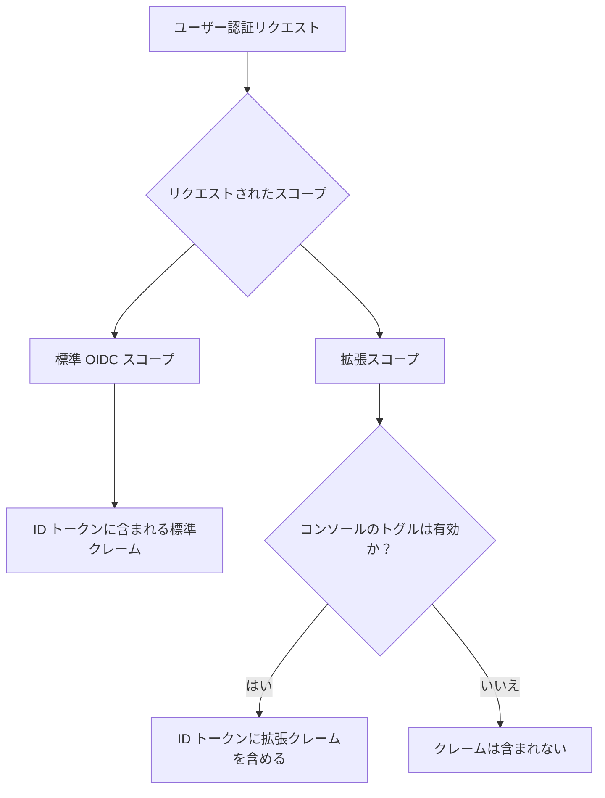

# カスタム ID トークン (ID token)

## はじめに \{#introduction}

[ID トークン (ID token)](https://auth.wiki/id-token) は、[OpenID Connect (OIDC)](https://auth.wiki/openid-connect) プロトコルで定義された特別な種類のトークンです。これは、ユーザーが正常に認証 (Authentication) された後、認可 (Authorization) サーバー（Logto）によって発行されるアイデンティティの証明として機能し、認証 (Authentication) されたユーザーのアイデンティティに関するクレーム (Claims) を運びます。

[アクセス トークン (Access token)](/developers/custom-token-claims) が保護されたリソースへのアクセスに使用されるのとは異なり、ID トークン (ID token) は認証 (Authentication) されたユーザーのアイデンティティをクライアントアプリケーションに伝えるために特化して設計されています。これらは [JSON Web Token (JWT)](https://auth.wiki/jwt) であり、認証 (Authentication) イベントおよび認証 (Authentication) されたユーザーに関するクレーム (Claims) を含みます。

## ID トークン (ID token) のクレーム (Claims) の仕組み \{#how-id-token-claims-work}

Logto では、ID トークン (ID token) のクレーム (Claims) は 2 つのカテゴリに分かれています：

1. **標準 OIDC クレーム (Claims)**：OIDC 仕様で定義されており、これらのクレーム (Claims) は認証 (Authentication) 時にリクエストされたスコープ (Scope) によって完全に決まります。
2. **拡張クレーム (Claims)**：Logto によって拡張され、追加のアイデンティティ情報を運ぶクレーム (Claims) であり、**二重条件モデル**（スコープ (Scope) + トグル）によって制御されます。

## 標準 OIDC クレーム (Claims) \{#standard-oidc-claims}

標準クレーム (Claims) は OIDC 仕様によって完全に管理されています。ID トークン (ID token) への含有は、認証 (Authentication) 時にアプリケーションがリクエストするスコープ (Scope) のみに依存します。Logto では、個々の標準クレーム (Claims) を無効化したり選択的に除外したりするオプションは提供していません。

以下の表は、標準スコープ (Scope) とそれに対応するクレーム (Claims) のマッピングを示しています：

| Scope     | Claims                                                                                                                                                                           |
| --------- | -------------------------------------------------------------------------------------------------------------------------------------------------------------------------------- |
| `openid`  | `sub`, `auth_time`, `acr`, `amr`（認証コンテキストクレームはセッションに存在する場合に含まれます。詳細は [ステップアップ認証](/end-user-flows/step-up-authentication) を参照）   |
| `profile` | `name`, `family_name`, `given_name`, `middle_name`, `nickname`, `preferred_username`, `profile`, `picture`, `website`, `gender`, `birthdate`, `zoneinfo`, `locale`, `updated_at` |
| `email`   | `email`, `email_verified`                                                                                                                                                        |
| `phone`   | `phone_number`, `phone_number_verified`                                                                                                                                          |
| `address` | `address`                                                                                                                                                                        |

例えば、アプリケーションが `openid profile email` スコープ (Scope) をリクエストした場合、ID トークン (ID token) には `openid`、`profile`、`email` スコープ (Scope) のすべてのクレーム (Claims) が含まれます。

## 拡張クレーム (Claims) \{#extended-claims}

標準 OIDC クレーム (Claims) に加えて、Logto は Logto エコシステム固有のアイデンティティ情報を運ぶ追加のクレーム (Claims) を拡張しています。これらの拡張クレーム (Claims) は、ID トークン (ID token) に含めるために **二重条件モデル** に従います：

1. **スコープ条件**：アプリケーションが認証 (Authentication) 時に対応するスコープ (Scope) をリクエストする必要があります。
2. **コンソールのトグル**：管理者が Logto コンソールで該当クレーム (Claims) の ID トークン (ID token) への含有を有効にする必要があります。

両方の条件が同時に満たされる必要があります。スコープ (Scope) はプロトコル層のアクセス宣言として機能し、トグルはプロダクト層の公開制御として機能します — それぞれの役割は明確で代替できません。

### 利用可能な拡張スコープ (Scope) とクレーム (Claims) \{#available-extended-scopes-and-claims}

| Scope                                | Claims                         | 説明                                                    | デフォルトで含まれる |
| ------------------------------------ | ------------------------------ | ------------------------------------------------------- | -------------------- |
| `custom_data`                        | `custom_data`                  | ユーザーオブジェクトに保存されたカスタムデータ          |                      |
| `identities`                         | `identities`, `sso_identities` | ユーザーの連携済みソーシャルおよび SSO アイデンティティ |                      |
| `roles`                              | `roles`                        | ユーザーに割り当てられたロール (Roles)                  | ✅                   |
| `urn:logto:scope:organizations`      | `organizations`                | ユーザーの組織 (Organizations) ID                       | ✅                   |
| `urn:logto:scope:organizations`      | `organization_data`            | ユーザーの組織 (Organizations) データ                   |                      |
| `urn:logto:scope:organization_roles` | `organization_roles`           | ユーザーの組織ロール (Roles) 割り当て                   | ✅                   |

### Logto コンソールでの設定方法 \{#configure-in-logto-console}

ID トークン (ID token) で拡張クレーム (Claims) を有効にするには：

1. <CloudLink to="/customize-jwt">コンソール > カスタム JWT</CloudLink> に移動します。
2. ID トークン (ID token) に含めたいクレーム (Claims) のトグルをオンにします。
3. アプリケーションが認証 (Authentication) 時に対応するスコープ (Scope) をリクエストしていることを確認します。

## 関連リソース \{#related-resources}

<Url href="/developers/custom-token-claims">カスタム アクセス トークン (Access token)</Url>

<Url href="https://openid.net/specs/openid-connect-core-1_0.html#IDToken">
  OpenID Connect Core - ID Token
</Url>
