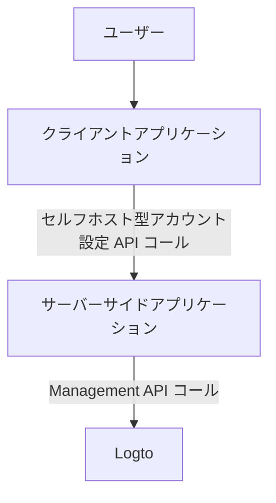
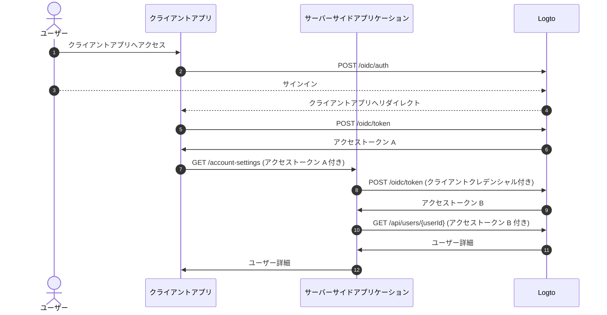
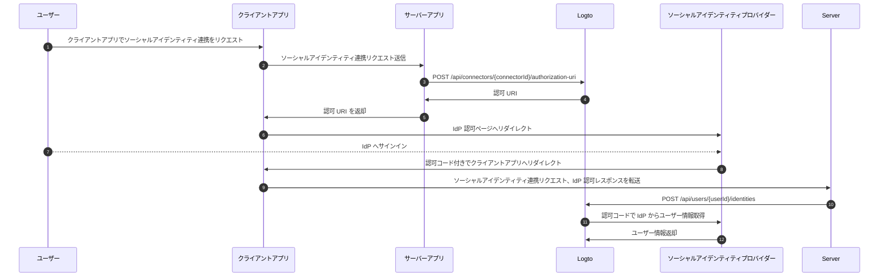

# Management API によるアカウント設定

## インテグレーション \{#integrations}

Logto は、ユーザーアカウントを管理するためのさまざまな Management API を提供しています。これらの API を利用して、エンドユーザー向けのセルフサービス型アカウント設定ページを構築できます。

### アーキテクチャ \{#architecture}

1. **ユーザー**：アカウント設定へアクセス・管理する認証済みのエンドユーザー。
2. **クライアントアプリケーション**：ユーザーにアカウント設定ページを提供するクライアントアプリケーション。
3. **サーバーサイドアプリケーション**：クライアントにアカウント設定 API を提供するサーバーサイドアプリケーション。Logto Management API と連携します。
4. **Logto**：認証 (Authentication) および認可 (Authorization) サービスとしての Logto。ユーザーアカウント管理用の Management API を提供します。

### シーケンス図 \{#sequence-diagram}

1. ユーザーがクライアントアプリケーションへアクセスします。
2. クライアントアプリケーションが認証リクエスト (Authentication request) を Logto へ送り、ユーザーを Logto のサインインページへリダイレクトします。
3. ユーザーが Logto へサインインします。
4. 認証 (Authentication) されたユーザーが認可コード付きでクライアントアプリケーションへリダイレクトされます。
5. クライアントアプリケーションがセルフホスト型アカウント設定 API へのアクセス用アクセストークンを Logto からリクエストします。
6. Logto がクライアントアプリケーションへアクセストークンを発行します。
7. クライアントアプリケーションがユーザーアクセストークン付きでサーバーサイドアプリケーションへアカウント設定リクエストを送信します。
8. サーバーサイドアプリケーションがユーザーアクセストークンからリクエスターのアイデンティティと権限を検証し、Logto から Management API アクセストークンをリクエストします。
9. Logto がサーバーサイドアプリケーションへ Management API アクセストークンを発行します。
10. サーバーサイドアプリケーションが Management API アクセストークンを使って Logto からユーザーデータを取得します。
11. Logto がサーバーのアイデンティティと Management API 権限を検証し、ユーザーデータを返します。
12. サーバーサイドアプリケーションがリクエスターの権限に基づきユーザーデータを処理し、クライアントアプリケーションへユーザーアカウント詳細を返します。

### Management API をサーバーサイドアプリケーションへ統合する \{#integrate-management-api-to-server-side-application}

サーバーサイドアプリケーションへの Management API 統合方法については、[Management API](/integrate-logto/interact-with-management-api/) セクションを参照してください。

## ユーザー管理 API \{#user-management-apis}

### ユーザーデータスキーマ \{#user-data-schema}

Logto のユーザースキーマについては、[ユーザーデータとカスタムデータ](/user-management/user-data/) セクションを参照してください。

### ユーザープロファイルおよび識別子管理 API \{#user-profile-and-identifiers-management-apis}

ユーザープロファイルと識別子はユーザー管理に不可欠です。以下の API を利用してユーザープロファイルや識別子を管理できます。

| method | path                                                                                                     | description                                              |
| ------ | -------------------------------------------------------------------------------------------------------- | -------------------------------------------------------- |
| GET    | [/api/users/\{userId\}](https://openapi.logto.io/operation/operation-getuser)                            | ユーザー ID でユーザー詳細を取得します。                 |
| PATCH  | [/api/users/\{userId\}](https://openapi.logto.io/operation/operation-updateuser)                         | ユーザー詳細を更新します。                               |
| PATCH  | [/api/users/\{userId\}/profile](https://openapi.logto.io/operation/operation-updateuserprofile)          | ユーザー ID でユーザープロファイル項目を更新します。     |
| GET    | [/api/users/\{userId\}/custom-data](https://openapi.logto.io/operation/operation-listusercustomdata)     | ユーザー ID でカスタムデータを取得します。               |
| PATCH  | [/api/users/\{userId\}/custom-data](https://openapi.logto.io/operation/operation-updateusercustomdata)   | ユーザー ID でカスタムデータを更新します。               |
| PATCH  | [/api/users/\{userId\}/is-suspended](https://openapi.logto.io/operation/operation-updateuserissuspended) | ユーザー ID でユーザーの利用停止ステータスを更新します。 |

### メールアドレスと電話番号の認証 (Verification) \{#email-and-phone-number-verification}

Logto システムでは、メールアドレスと電話番号の両方がユーザー識別子として利用できるため、その認証 (Verification) は不可欠です。これをサポートするため、提供されたメールアドレスや電話番号を認証 (Verification) するための認証コード API を用意しています。

:::note
新しいメールアドレスや電話番号でユーザープロファイルを更新する前に、必ずメールアドレスまたは電話番号を認証 (Verification) してください。
:::

| method | path                                                                                                                             | description                                                            |
| ------ | -------------------------------------------------------------------------------------------------------------------------------- | ---------------------------------------------------------------------- |
| POST   | [/api/verifications/verification-code](https://openapi.logto.io/operation/operation-createverificationbyverificationcode)        | メールアドレスまたは電話番号の認証コードを送信します。                 |
| POST   | [/api/verifications/verification-code/verify](https://openapi.logto.io/operation/operation-verifyverificationbyverificationcode) | 認証コードでメールアドレスまたは電話番号を認証 (Verification) します。 |

### ユーザーパスワード管理 \{#user-password-management}

| method | path                                                                                                     | description                                                  |
| ------ | -------------------------------------------------------------------------------------------------------- | ------------------------------------------------------------ |
| POST   | [/api/users/\{userId\}/password/verify](https://openapi.logto.io/operation/operation-verifyuserpassword) | ユーザー ID で現在のパスワードを認証 (Verification) します。 |
| PATCH  | [/api/users/\{userId\}/password](https://openapi.logto.io/operation/operation-updateuserpassword)        | ユーザー ID でパスワードを更新します。                       |
| GET    | [/api/users/\{userId\}/has-password](https://openapi.logto.io/operation/operation-getuserhaspassword)    | ユーザー ID でパスワードの有無を確認します。                 |

:::note
ユーザーパスワードを更新する前に、必ず現在のパスワードを認証 (Verification) してください。
:::

### ユーザーソーシャルアイデンティティ管理 \{#user-social-identities-management}

| method | path                                                                                                                              | description                                                                                                                  |
| ------ | --------------------------------------------------------------------------------------------------------------------------------- | ---------------------------------------------------------------------------------------------------------------------------- |
| GET    | [/api/users/\{userId\}](https://openapi.logto.io/operation/operation-getuser)                                                     | ユーザー ID でユーザー詳細を取得します。ソーシャルアイデンティティは `identities` フィールドに含まれます。                   |
| POST   | [/api/users/\{userId\}/identities](https://openapi.logto.io/operation/operation-createuseridentity)                               | 認証 (Authentication) 済みのソーシャルアイデンティティをユーザー ID でリンクします。                                         |
| DELETE | [/api/users/\{userId\}/identities](https://openapi.logto.io/operation/operation-deleteuseridentity)                               | ユーザー ID でソーシャルアイデンティティのリンクを解除します。                                                               |
| PUT    | [/api/users/\{userId\}/identities](https://openapi.logto.io/operation/operation-replaceuseridentity)                              | ユーザー ID でリンクされたソーシャルアイデンティティを直接更新します。                                                       |
| POST   | [/api/connectors/\{connectorId\}/authorization-uri](https://openapi.logto.io/operation/operation-createconnectorauthorizationuri) | ソーシャルアイデンティティプロバイダーの認可 URI を取得します。この URI で新しいソーシャルアイデンティティ連携を開始します。 |

1. ユーザーがクライアントアプリケーションへアクセスし、ソーシャルアイデンティティ連携をリクエストします。
2. クライアントアプリケーションがサーバーへソーシャルアイデンティティ連携リクエストを送信します。
3. サーバーが Logto へソーシャルアイデンティティプロバイダーの認可 URI を取得するリクエストを送信します。このリクエストには独自の `state` パラメーターと `redirect_uri` を指定する必要があります。`redirect_uri` はソーシャルアイデンティティプロバイダーに事前登録してください。
4. Logto がサーバーへ認可 URI を返却します。
5. サーバーがクライアントアプリケーションへ認可 URI を返却します。
6. クライアントアプリケーションがユーザーを IdP 認可 URI へリダイレクトします。
7. ユーザーが IdP へサインインします。
8. IdP が `redirect_uri` と認可コード付きでユーザーをクライアントアプリケーションへリダイレクトします。
9. クライアントアプリケーションが `state` を検証し、IdP 認可レスポンスをサーバーへ転送します。
10. サーバーが Logto へソーシャルアイデンティティをユーザーへリンクするリクエストを送信します。
11. Logto が認可コードを使って IdP からユーザー情報を取得します。
12. IdP がユーザー情報を Logto へ返却し、Logto がソーシャルアイデンティティをユーザーへリンクします。

:::note
ユーザーへ新しいソーシャルアイデンティティをリンクする際には、いくつかの制限事項があります：

- Management API にはセッションコンテキストがないため、ソーシャル認証状態を安全に維持するためにアクティブなセッションが必要なソーシャルコネクターは Management API 経由でリンクできません。サポートされないコネクターには apple、標準 OIDC、標準 OAuth 2.0 コネクターが含まれます。
- 同じ理由で、Logto は認可レスポンスの `state` パラメーターを検証できません。クライアントアプリで `state` パラメーターを保存し、認可レスポンス受信時に必ず検証してください。
- `redirect_uri` を事前にソーシャルアイデンティティプロバイダーへ登録する必要があります。登録しない場合、ソーシャル IdP はユーザーをクライアントアプリへリダイレクトしません。ソーシャル IdP では、ユーザーサインイン用とプロフィール連携用で複数のコールバック `redirect_uri` を受け入れる必要があります。

:::

### ユーザーエンタープライズアイデンティティ管理 \{#user-enterprise-identities-management}

| method | path                                                                                                    | description                                                                                                                                                                                               |
| ------ | ------------------------------------------------------------------------------------------------------- | --------------------------------------------------------------------------------------------------------------------------------------------------------------------------------------------------------- |
| GET    | [/api/users/\{userId\}?includeSsoIdentities=true](https://openapi.logto.io/operation/operation-getuser) | ユーザー ID でユーザー詳細を取得します。エンタープライズアイデンティティは `ssoIdentities` フィールドに含まれます。ユーザー詳細 API に `includeSsoIdentities=true` クエリパラメーターを追加してください。 |

現在、Management API ではエンタープライズアイデンティティのリンク・解除はサポートされていません。ユーザーにリンクされたエンタープライズアイデンティティの表示のみ可能です。

### パーソナルアクセストークン \{#personal-access-token}

| method | path                                                                                                                                 | description                                                |
| ------ | ------------------------------------------------------------------------------------------------------------------------------------ | ---------------------------------------------------------- |
| GET    | [/api/users/\{userId\}/personal-access-tokens](https://openapi.logto.io/operation/operation-listuserpersonalaccesstokens)            | ユーザーのすべてのパーソナルアクセストークンを取得します。 |
| POST   | [/api/users/\{userId\}/personal-access-tokens](https://openapi.logto.io/operation/operation-createuserpersonalaccesstoken)           | ユーザーに新しいパーソナルアクセストークンを追加します。   |
| DELETE | [/api/users/\{userId\}/personal-access-tokens/\{name\}](https://openapi.logto.io/operation/operation-deleteuserpersonalaccesstoken)  | 名前でユーザーのトークンを削除します。                     |
| PATCH  | [/api/users/\{userId\s}/personal-access-tokens/\{name\}](https://openapi.logto.io/operation/operation-updateuserpersonalaccesstoken) | 名前でユーザーのトークンを更新します。                     |

パーソナルアクセストークンは、ユーザーが認証情報やインタラクティブなサインインを使わずに [アクセス トークン (Access token)](https://auth.wiki/access-token) を安全に発行する方法を提供します。詳しくは [パーソナルアクセストークンの利用](/user-management/personal-access-token) をご覧ください。

### ユーザー多要素認証 (MFA) 設定管理 \{#user-mfa-settings-management}

| method | path                                                                                                                                 | description                                                                           |
| ------ | ------------------------------------------------------------------------------------------------------------------------------------ | ------------------------------------------------------------------------------------- |
| GET    | [/api/users/\{userId\}/mfa-verifications](https://openapi.logto.io/operation/operation-listusermfaverifications)                     | ユーザー ID でユーザーの MFA 認証 (Verification) 情報を取得します。                   |
| POST   | [/api/users/\{userId\}/mfa-verifications](https://openapi.logto.io/operation/operation-createusermfaverification)                    | ユーザー ID でユーザーの MFA 認証 (Verification) をセットアップします。               |
| DELETE | [/api/users/\{userId\}/mfa-verifications/\{verificationId\}](https://openapi.logto.io/operation/operation-deleteusermfaverification) | ID でユーザーの MFA 認証 (Verification) を削除します。                                |
| GET    | [/api/users/\{userId\}/logto-configs](https://openapi.logto.io/operation/operation-listuserlogtoconfigs)                             | ユーザー ID でユーザーの Logto MFA 設定フラグを取得します。                           |
| PATCH  | [/api/users/\{userId\}/logto-configs](https://openapi.logto.io/operation/operation-updateuserlogtoconfigs)                           | ユーザーの Logto MFA 設定フラグ（`mfa.required` や `mfa.skipped` など）を更新します。 |

`GET /api/users/{userId}/mfa-verifications` に `includeWebAuthnCredentials=true` クエリパラメーターを追加すると、保存されている WebAuthn クレデンシャルも含めて取得できます。たとえば、同一ドメイン内の他システムへ [パスキーをエクスポート](/end-user-flows/mfa/webauthn#export-passkeys) する場合などに利用します。

`PATCH /api/users/{userId}/logto-configs` で `{ "mfa": { "required": true } }` を指定すると、個別ユーザーに MFA 設定を必須化できます（`mfa.required` は Account API からユーザー自身で変更できません）。

### ユーザー信頼済みデバイス管理 \{#user-trusted-devices-management}

| method | path                                                                                                                              | description                                        |
| ------ | --------------------------------------------------------------------------------------------------------------------------------- | -------------------------------------------------- |
| GET    | [/api/users/\{userId\}/trusted-devices](https://openapi.logto.io/operation/operation-listusertrusteddevices)                      | ユーザーの有効な信頼済みデバイス一覧を取得します。 |
| DELETE | [/api/users/\{userId\}/trusted-devices/\{trustedDeviceId\}](https://openapi.logto.io/operation/operation-deleteusertrusteddevice) | ID でユーザーの信頼済みデバイスを削除します。      |

信頼済みデバイスの削除は今後のサインインにのみ適用され、既存のセッションは無効化されません。詳細は [MFA 信頼済みデバイス](/end-user-flows/mfa/trusted-devices) を参照してください。

[メール MFA](/end-user-flows/mfa/email-mfa) や [SMS MFA](/end-user-flows/mfa/sms-mfa) をユーザーに追加するには、`{"type":"EmailVerificationCode"}` または `{"type":"PhoneVerificationCode"}` を指定して POST エンドポイントを呼び出します。削除する場合は DELETE エンドポイントで該当認証 (Verification) を削除します。コードはユーザーの主メールアドレスまたは電話番号に送信されるため、いずれかが必要です。同じ要素を 2 回追加しようとすると 422 エラーとなります。**Only users who set it up** [登録設定](/end-user-flows/mfa/configure-mfa#email-and-sms-mfa-enrollment) では、この認証 (Verification) を持つユーザーのみがメールまたは SMS で MFA を利用できます。どちらのモードでも追加可能なので、**Only users who set it up** へ切り替える前に特定ユーザーをメールや SMS MFA にしておくこともできます。

### ユーザーアカウント削除 \{#user-account-deletion}

| method | path                                                                             | description                          |
| ------ | -------------------------------------------------------------------------------- | ------------------------------------ |
| DELETE | [/api/users/\{userId\}](https://openapi.logto.io/operation/operation-deleteuser) | ユーザー ID でユーザーを削除します。 |

### ユーザーセッション管理 \{#user-session-management}

| method | path                                                                                                           | description                                      |
| ------ | -------------------------------------------------------------------------------------------------------------- | ------------------------------------------------ |
| GET    | [/api/users/\{userId\}/sessions](https://openapi.logto.io/operation/operation-listusersessions)                | ユーザー ID でユーザーセッションを取得します。   |
| GET    | [/api/users/\{userId\}/sessions/\{sessionId\}](https://openapi.logto.io/operation/operation-getusersession)    | セッション ID でユーザーセッションを取得します。 |
| DELETE | [/api/users/\{userId\}/sessions/\{sessionId\}](https://openapi.logto.io/operation/operation-deleteusersession) | セッション ID でユーザーセッションを削除します。 |

### ユーザー認可済みアプリ（グラント）管理 \{#manage-user-authorized-apps-grants}

| method | path                                                                                                     | description                                      |
| ------ | -------------------------------------------------------------------------------------------------------- | ------------------------------------------------ |
| GET    | [/api/users/\{userId\}/grants](https://openapi.logto.io/operation/operation-listusergrants)              | ユーザーの有効なアプリグラント一覧を取得します。 |
| DELETE | [/api/users/\{userId\}/grants/\{grantId\}](https://openapi.logto.io/operation/operation-deleteusergrant) | 指定 ID のアプリグラントを取り消します。         |

グラント一覧取得時のオプションクエリパラメーター：

- `appType=firstParty`：ファーストパーティアプリのグラントのみ返却
- `appType=thirdParty`：サードパーティアプリのグラントのみ返却
- `appType` 省略時：すべての有効なグラントを返却

グラントが取り消されると、そのグラントで発行された不透明トークン (Opaque token) およびリフレッシュトークン (Refresh token) は無効化されます。
