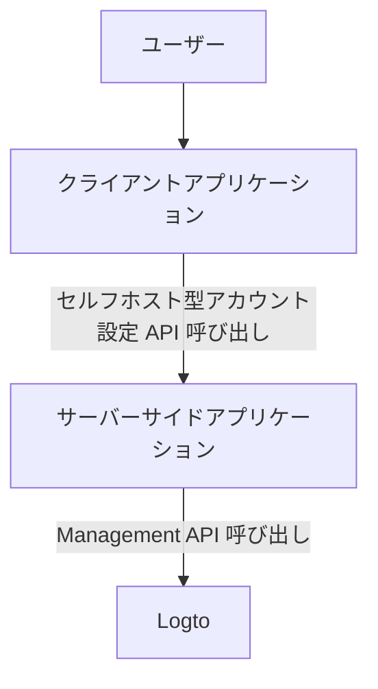
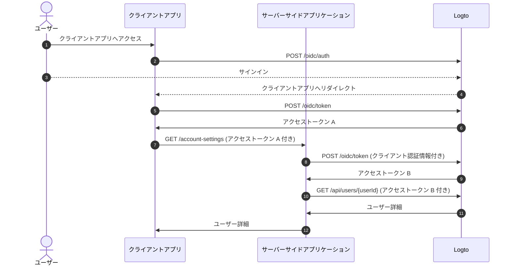
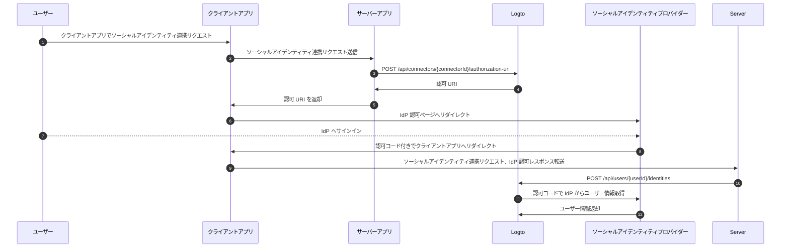

# Management API によるアカウント設定

## インテグレーション \{#integrations}

Logto は、ユーザーアカウントを管理するためのさまざまな Management API を提供しています。これらの API を利用して、エンドユーザー向けのセルフサービス型アカウント設定ページを構築できます。

### アーキテクチャ \{#architecture}

1. **ユーザー**：アカウント設定へアクセス・管理する認証済みエンドユーザー。
2. **クライアントアプリケーション**：ユーザーにアカウント設定ページを提供するクライアントアプリケーション。
3. **サーバーサイドアプリケーション**：クライアントにアカウント設定 API を提供するサーバーサイドアプリケーション。Logto Management API と連携します。
4. **Logto**：認証 (Authentication) および認可 (Authorization) サービスとしての Logto。ユーザーアカウント管理用の Management API を提供します。

### シーケンス図 \{#sequence-diagram}

1. ユーザーがクライアントアプリケーションへアクセスします。
2. クライアントアプリケーションが認証リクエストを Logto へ送り、ユーザーを Logto のサインインページへリダイレクトします。
3. ユーザーが Logto へサインインします。
4. 認証されたユーザーが認可コードとともにクライアントアプリケーションへリダイレクトされます。
5. クライアントアプリケーションがセルフホスト型アカウント設定 API へのアクセス用アクセストークンを Logto からリクエストします。
6. Logto がクライアントアプリケーションへアクセストークンを発行します。
7. クライアントアプリケーションがユーザーアクセストークン付きでサーバーサイドアプリケーションへアカウント設定リクエストを送信します。
8. サーバーサイドアプリケーションがユーザーアクセストークンからリクエスターのアイデンティティと権限を検証し、Logto から Management API アクセストークンをリクエストします。
9. Logto がサーバーサイドアプリケーションへ Management API アクセストークンを発行します。
10. サーバーサイドアプリケーションが Management API アクセストークンを使って Logto からユーザーデータを取得します。
11. Logto がサーバーのアイデンティティと Management API 権限を検証し、ユーザーデータを返します。
12. サーバーサイドアプリケーションがリクエスターの権限に基づきユーザーデータを処理し、クライアントアプリケーションへユーザーアカウント詳細を返します。

### Management API をサーバーサイドアプリケーションに統合する \{#integrate-management-api-to-server-side-application}

Management API をサーバーサイドアプリケーションに統合する方法については、[Management API](/integrate-logto/interact-with-management-api/) セクションを参照してください。

## ユーザー管理 API \{#user-management-apis}

### ユーザーデータスキーマ \{#user-data-schema}

Logto のユーザースキーマについて詳しくは、[ユーザーデータとカスタムデータ](/user-management/user-data/) セクションを参照してください。

### ユーザープロファイルおよび識別子管理 API \{#user-profile-and-identifiers-management-apis}

ユーザープロファイルと識別子はユーザー管理に不可欠です。以下の API を利用してユーザープロファイルや識別子を管理できます。

| method | path                                                                                                     | description                                    |
| ------ | -------------------------------------------------------------------------------------------------------- | ---------------------------------------------- |
| GET    | [/api/users/\{userId\}](https://openapi.logto.io/operation/operation-getuser)                            | ユーザー ID でユーザー詳細を取得します。       |
| PATCH  | [/api/users/\{userId\}](https://openapi.logto.io/operation/operation-updateuser)                         | ユーザー詳細を更新します。                     |
| PATCH  | [/api/users/\{userId\}/profile](https://openapi.logto.io/operation/operation-updateuserprofile)          | ユーザー ID でユーザープロファイル項目を更新。 |
| GET    | [/api/users/\{userId\}/custom-data](https://openapi.logto.io/operation/operation-listusercustomdata)     | ユーザー ID でカスタムデータを取得します。     |
| PATCH  | [/api/users/\{userId\}/custom-data](https://openapi.logto.io/operation/operation-updateusercustomdata)   | ユーザー ID でカスタムデータを更新します。     |
| PATCH  | [/api/users/\{userId\}/is-suspended](https://openapi.logto.io/operation/operation-updateuserissuspended) | ユーザー ID でアカウント停止状態を更新します。 |

### メールアドレスと電話番号の認証 \{#email-and-phone-number-verification}

Logto システムでは、メールアドレスと電話番号の両方がユーザー識別子として利用できるため、その認証が重要です。これをサポートするため、指定したメールアドレスや電話番号の認証に役立つ認証コード API を提供しています。

:::note
新しいメールアドレスや電話番号でユーザープロファイルを更新する前に、必ずメールアドレスまたは電話番号の認証を行ってください。
:::

| method | path                                                                                                                             | description                                      |
| ------ | -------------------------------------------------------------------------------------------------------------------------------- | ------------------------------------------------ |
| POST   | [/api/verifications/verification-code](https://openapi.logto.io/operation/operation-createverificationbyverificationcode)        | メールアドレスまたは電話番号の認証コード送信。   |
| POST   | [/api/verifications/verification-code/verify](https://openapi.logto.io/operation/operation-verifyverificationbyverificationcode) | 認証コードでメールアドレスまたは電話番号を認証。 |

### ユーザーパスワード管理 \{#user-password-management}

| method | path                                                                                                     | description                            |
| ------ | -------------------------------------------------------------------------------------------------------- | -------------------------------------- |
| POST   | [/api/users/\{userId\}/password/verify](https://openapi.logto.io/operation/operation-verifyuserpassword) | ユーザー ID で現在のパスワードを認証。 |
| PATCH  | [/api/users/\{userId\}/password](https://openapi.logto.io/operation/operation-updateuserpassword)        | ユーザー ID でパスワードを更新。       |
| GET    | [/api/users/\{userId\}/has-password](https://openapi.logto.io/operation/operation-getuserhaspassword)    | ユーザー ID でパスワードの有無を確認。 |

:::note
ユーザーパスワードを更新する前に、必ず現在のパスワードを認証してください。
:::

### ユーザーソーシャルアイデンティティ管理 \{#user-social-identities-management}

| method | path                                                                                                                              | description                                                                                                       |
| ------ | --------------------------------------------------------------------------------------------------------------------------------- | ----------------------------------------------------------------------------------------------------------------- |
| GET    | [/api/users/\{userId\}](https://openapi.logto.io/operation/operation-getuser)                                                     | ユーザー ID でユーザー詳細を取得。ソーシャルアイデンティティは `identities` フィールドに含まれます。              |
| POST   | [/api/users/\{userId\}/identities](https://openapi.logto.io/operation/operation-createuseridentity)                               | 認証済みソーシャルアイデンティティをユーザー ID で紐付け。                                                        |
| DELETE | [/api/users/\{userId\}/identities](https://openapi.logto.io/operation/operation-deleteuseridentity)                               | ユーザー ID でソーシャルアイデンティティの紐付け解除。                                                            |
| PUT    | [/api/users/\{userId\}/identities](https://openapi.logto.io/operation/operation-replaceuseridentity)                              | ユーザー ID で紐付けられたソーシャルアイデンティティを直接更新。                                                  |
| POST   | [/api/connectors/\{connectorId\}/authorization-uri](https://openapi.logto.io/operation/operation-createconnectorauthorizationuri) | ソーシャルアイデンティティプロバイダーの認可 URI を取得。新しいソーシャルアイデンティティ連携の開始に利用します。 |

1. ユーザーがクライアントアプリケーションでソーシャルアイデンティティ連携をリクエストします。
2. クライアントアプリケーションがサーバーへソーシャルアイデンティティ連携リクエストを送信します。
3. サーバーが Logto へソーシャルアイデンティティプロバイダーの認可 URI を取得するリクエストを送信します。この際、独自の `state` パラメーターと `redirect_uri` をリクエストに含める必要があります。`redirect_uri` はソーシャルアイデンティティプロバイダーに事前登録してください。
4. Logto がサーバーへ認可 URI を返します。
5. サーバーがクライアントアプリケーションへ認可 URI を返します。
6. クライアントアプリケーションがユーザーを IdP 認可 URI へリダイレクトします。
7. ユーザーが IdP へサインインします。
8. IdP が認可コード付きでユーザーをクライアントアプリケーションへ `redirect_uri` でリダイレクトします。
9. クライアントアプリケーションが `state` を検証し、IdP 認可レスポンスをサーバーへ転送します。
10. サーバーが Logto へソーシャルアイデンティティをユーザーに紐付けるリクエストを送信します。
11. Logto が認可コードを使って IdP からユーザー情報を取得します。
12. IdP がユーザー情報を Logto へ返却し、Logto がソーシャルアイデンティティをユーザーに紐付けます。

:::note
ユーザーに新しいソーシャルアイデンティティを紐付ける際、いくつかの制限事項があります：

- Management API にはセッションコンテキストがないため、ソーシャル認証状態を安全に維持するためにアクティブなセッションが必要なソーシャルコネクターは Management API 経由で紐付けできません。サポートされないコネクターには apple、標準 OIDC、標準 OAuth 2.0 コネクターが含まれます。
- 同じ理由で、Logto は認可レスポンスの `state` パラメーターを検証できません。クライアントアプリで `state` パラメーターを保存し、認可レスポンス受信時に必ず検証してください。
- `redirect_uri` を事前にソーシャルアイデンティティプロバイダーへ登録する必要があります。登録しない場合、ソーシャル IdP はユーザーをクライアントアプリへリダイレクトしません。ソーシャル IdP には、ユーザーサインイン用と独自のプロフィール連携ページ用の複数のコールバック `redirect_uri` を受け入れる必要があります。

:::

### ユーザーエンタープライズアイデンティティ管理 \{#user-enterprise-identities-management}

| method | path                                                                                                    | description                                                                                                                                                                            |
| ------ | ------------------------------------------------------------------------------------------------------- | -------------------------------------------------------------------------------------------------------------------------------------------------------------------------------------- |
| GET    | [/api/users/\{userId\}?includeSsoIdentities=true](https://openapi.logto.io/operation/operation-getuser) | ユーザー ID でユーザー詳細を取得。エンタープライズアイデンティティは `ssoIdentities` フィールドに含まれます。API で `includeSsoIdentities=true` クエリパラメーターを追加してください。 |

現在、Management API ではエンタープライズアイデンティティのユーザーへの紐付けや解除はサポートされていません。ユーザーに紐付けられたエンタープライズアイデンティティの表示のみ可能です。

### パーソナルアクセストークン \{#personal-access-token}

| method | path                                                                                                                                 | description                                          |
| ------ | ------------------------------------------------------------------------------------------------------------------------------------ | ---------------------------------------------------- |
| GET    | [/api/users/\{userId\}/personal-access-tokens](https://openapi.logto.io/operation/operation-listuserpersonalaccesstokens)            | ユーザーのすべてのパーソナルアクセストークンを取得。 |
| POST   | [/api/users/\{userId\}/personal-access-tokens](https://openapi.logto.io/operation/operation-createuserpersonalaccesstoken)           | ユーザーの新しいパーソナルアクセストークンを追加。   |
| DELETE | [/api/users/\{userId\}/personal-access-tokens/\{name\}](https://openapi.logto.io/operation/operation-deleteuserpersonalaccesstoken)  | 名前でユーザーのトークンを削除。                     |
| PATCH  | [/api/users/\{userId\s}/personal-access-tokens/\{name\}](https://openapi.logto.io/operation/operation-updateuserpersonalaccesstoken) | 名前でユーザーのトークンを更新。                     |

パーソナルアクセストークンは、ユーザーが認証情報やインタラクティブなサインインを使わずに [アクセス トークン (Access token)](https://auth.wiki/access-token) を安全に発行する方法を提供します。詳しくは [パーソナルアクセストークンの利用](/user-management/personal-access-token) をご覧ください。

### ユーザー MFA 設定管理 \{#user-mfa-settings-management}

| method | path                                                                                                                                 | description                             |
| ------ | ------------------------------------------------------------------------------------------------------------------------------------ | --------------------------------------- |
| GET    | [/api/users/\{userId\}/mfa-verifications](https://openapi.logto.io/operation/operation-listusermfaverifications)                     | ユーザー ID で MFA 設定を取得。         |
| POST   | [/api/users/\{userId\}/mfa-verifications](https://openapi.logto.io/operation/operation-createusermfaverification)                    | ユーザー ID で MFA 認証をセットアップ。 |
| DELETE | [/api/users/\{userId\}/mfa-verifications/\{verificationId\}](https://openapi.logto.io/operation/operation-deleteusermfaverification) | ID でユーザーの MFA 認証を削除。        |

GET エンドポイントに `includeWebAuthnCredentials=true` クエリパラメーターを追加すると、保存されている WebAuthn 資格情報も含めて取得できます。たとえば、同一ドメインの他システムへ [パスキーをエクスポート](/end-user-flows/mfa/webauthn#export-passkeys) する場合などに利用できます。

### ユーザーアカウント削除 \{#user-account-deletion}

| method | path                                                                             | description                    |
| ------ | -------------------------------------------------------------------------------- | ------------------------------ |
| DELETE | [/api/users/\{userId\}](https://openapi.logto.io/operation/operation-deleteuser) | ユーザー ID でユーザーを削除。 |

### ユーザーセッション管理 \{#user-session-management}

| method | path                                                                                                           | description                                |
| ------ | -------------------------------------------------------------------------------------------------------------- | ------------------------------------------ |
| GET    | [/api/users/\{userId\}/sessions](https://openapi.logto.io/operation/operation-listusersessions)                | ユーザー ID でユーザーセッションを取得。   |
| GET    | [/api/users/\{userId\}/sessions/\{sessionId\}](https://openapi.logto.io/operation/operation-getusersession)    | セッション ID でユーザーセッションを取得。 |
| DELETE | [/api/users/\{userId\}/sessions/\{sessionId\}](https://openapi.logto.io/operation/operation-deleteusersession) | セッション ID でユーザーセッションを削除。 |

### ユーザー認可済みアプリ (グラント) の管理 \{#manage-user-authorized-apps-grants}

| method | path                                                                                                     | description                          |
| ------ | -------------------------------------------------------------------------------------------------------- | ------------------------------------ |
| GET    | [/api/users/\{userId\}/grants](https://openapi.logto.io/operation/operation-listusergrants)              | ユーザーの有効なアプリグラント一覧。 |
| DELETE | [/api/users/\{userId\}/grants/\{grantId\}](https://openapi.logto.io/operation/operation-deleteusergrant) | 指定 ID のアプリグラントを取り消し。 |

グラント一覧取得時のオプションクエリパラメーター：

- `appType=firstParty`：ファーストパーティアプリのグラントのみ返却。
- `appType=thirdParty`：サードパーティアプリのグラントのみ返却。
- `appType` を省略：すべての有効なグラントを返却。

グラントが取り消されると、そのグラントで発行された不透明トークン (Opaque token) やリフレッシュ トークン (Refresh token) は無効化されます。
