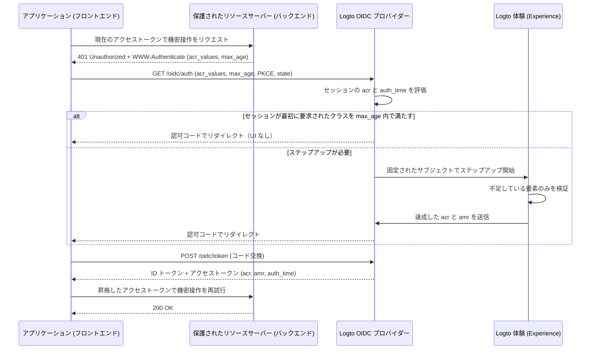

# ステップアップ認証 (Step-up authentication)

ステップアップ認証 (Step-up authentication) を利用すると、アプリケーションはユーザーをサインアウトさせることなく、支払いの認可、機密記録の閲覧、アカウントのセキュリティ設定の変更などの機密操作を行う前に、最近のユーザー認証やより強力な認証保証レベルを要求できます。

Logto は [OpenID Connect Core](https://openid.net/specs/openid-connect-core-1_0.html)、[RFC 9470 (OAuth 2.0 Step Up Authentication Challenge Protocol)](https://www.rfc-editor.org/rfc/rfc9470.html)、[RFC 8176 (Authentication Method Reference Values)](https://www.rfc-editor.org/rfc/rfc8176.html) に基づいた標準準拠のステップアップ認証 (Step-up authentication) を実装しています：

1. 保護されたリソースサーバーは、不十分なトークンに対して `401 Unauthorized` と、`acr_values` および `max_age` を含む RFC 9470 の `WWW-Authenticate` ヘッダーでチャレンジします。
2. アプリケーションは `acr_values` と `max_age` を指定して認可コードフローを開始します。すでに認証済みセッションが存在する場合、Logto はサインイン済みユーザーを固定し、不足している検証のみを促します。
3. Logto は達成された認証コンテキスト（`acr`、`amr`、`auth_time`）をセッションに記録し、ID トークン、JWT アクセストークン、不透明トークン (opaque-token) のイントロスペクション応答に出力します。



## 認証コンテキストモデル \{#authentication-context-model}

Logto 体験 (Experience) を通じて完了したすべてのサインイン、登録、ステップアップは、アプリケーションが `acr_values` を要求したかどうかに関わらず、OIDC セッションに 3 つの標準クレームを記録します：

| クレーム    | 型         | 説明                                                                                                               |
| ----------- | ---------- | ------------------------------------------------------------------------------------------------------------------ |
| `acr`       | `string`   | 認証コンテキストクラス参照 (Authentication Context Class Reference) — 達成した保証レベル。満たされない場合は省略。 |
| `amr`       | `string[]` | 認証方法参照 (Authentication Methods References) — そのやり取りで使用された検証方法。                              |
| `auth_time` | `number`   | エンドユーザー認証が完了した時点のエポックタイムスタンプ（秒単位）。                                               |

Logto はこれらの機能を OIDC Discovery（`/.well-known/openid-configuration` および `/.well-known/oauth-authorization-server`）で公開しています：

```json
{
  "acr_values_supported": ["urn:logto:acr:1fa", "urn:logto:acr:mfa"],
  "claims_supported": ["sub", "acr", "amr", "auth_time"]
}
```

ID トークンでは、`acr`、`amr`、`auth_time` はセッションに存在する場合、標準の `openid` スコープ下で含まれます。ユーザーアクセストークンでは、Logto はこれらを認可コード、デバイスコード、またはリフレッシュトークンから JWT ペイロードや不透明トークン (opaque-token) のイントロスペクション応答にコピーします。リフレッシュトークンのローテーションは元の `acr`、`amr`、`auth_time` を保持します — トークンのリフレッシュで `auth_time` が進むことはありません。他のグラントタイプ（クライアントクレデンシャルやトークンエクスチェンジなど）は認証コンテキストクレームを出力しません。

### サポートされる ACR 値 \{#supported-acr-values}

Logto は 2 つの認証コンテキストクラス参照 (Authentication Context Class Reference, `acr`) 値を定義しています：

| ACR 値              | 意味                                                                                                                                                                                       | 満たすクラス                             |
| ------------------- | ------------------------------------------------------------------------------------------------------------------------------------------------------------------------------------------ | ---------------------------------------- |
| `urn:logto:acr:1fa` | Logto が直接検証またはやり取りで確立した少なくとも 1 つの要素：パスワード、主要メールまたは電話の認証コード、マジックリンク（サインイン時のワンタイムトークン）、または登録済み MFA 要素。 | `urn:logto:acr:1fa`                      |
| `urn:logto:acr:mfa` | Logto で検証可能なファーストファクター（`1fa` ロール）証明と、**異なる**要素による `mfa` ロール証明の組み合わせ、またはユーザー検証付き WebAuthn / パスキー単独。                          | `urn:logto:acr:mfa`, `urn:logto:acr:1fa` |

満足関係は `urn:logto:acr:mfa` → `urn:logto:acr:1fa` です：`urn:logto:acr:mfa` を持つセッションやトークンは `urn:logto:acr:1fa` の要件も満たします。標準の `phr` や `phrh` ACR 値はサポートされていません。WebAuthn やパスキーのセレモニーはユーザー検証が必要で、`urn:logto:acr:mfa` にマッピングされます。

`urn:logto:acr:mfa` を導出する際、Logto は各検証方法をペアリングロールで分類します：

- **ファーストファクター（`1fa` ロール）**：パスワード、主要メール認証コード、主要電話認証コード、ワンタイムトークン（サインインのみ）。
- **セカンドファクター（`mfa` ロール）**：認証アプリ OTP（TOTP）、バックアップコード、MFA メール認証コード、MFA 電話認証コード。Logto で検証可能なファーストファクターなしで `mfa` ロール要素のみを検証した場合（例：ソーシャルサインイン + TOTP）は `urn:logto:acr:1fa` となり、`urn:logto:acr:mfa` にはなりません。
- **自己完結型（`both` ロール）**：パスキーサインインやユーザー検証付き WebAuthn MFA は 1 回のセレモニーで両方のロールを満たし、単独で `urn:logto:acr:mfa` となります。
- **異なる要素ルール**：`urn:logto:acr:mfa` には 2 つの**異なる**要素が必要です。2 つのファーストファクター（例：登録時のメール認証コード + パスワード）、2 つの `mfa` ロール要素（例：TOTP + バックアップコード）、または同じチャネルの 2 つの証明（例：主要メールコード + MFA メールコード）は 1 つの要素またはロールと見なされ、`urn:logto:acr:1fa` となります。
- **信頼済みデバイスと適応型 MFA**：[信頼済みデバイス](/end-user-flows/mfa/trusted-devices) の充足や適応型 MFA のスキップは現在のやり取りで何も証明せず、`acr` に寄与しません（信頼済みデバイスで MFA をスキップしたパスワードサインインは `acr="urn:logto:acr:1fa"`、`amr=["pwd"]` となります）。

登録も同じルールで認証コンテキストを記録します。なぜなら、アカウント作成時に書き込まれる認証情報がそのアカウントを証明するからです。例えば、ユーザー名とパスワードで登録した場合は `acr="urn:logto:acr:1fa"`、`amr=["pwd"]` となります。

### AMR マッピング \{#amr-mapping}

Logto は [RFC 8176](https://www.rfc-editor.org/rfc/rfc8176.html) の値に加え、フェデレーテッド認証 (federated authentication) 用に `fed` を `amr` に設定します：

| Logto 検証方法                                                                        | `amr` 値             | `acr` への寄与       |
| ------------------------------------------------------------------------------------- | -------------------- | -------------------- |
| パスワード（検証済み、または登録/ステップアップ時に新規設定）                         | `pwd`                | Yes（`1fa` ロール）  |
| 主要メール認証コード                                                                  | `otp`                | Yes（`1fa` ロール）  |
| 主要電話認証コード                                                                    | `sms`                | Yes（`1fa` ロール）  |
| ワンタイムトークン / マジックリンク（サインインのみ、ステップアップ不可）             | `otp`                | Yes（`1fa` ロール）  |
| 認証アプリ OTP（TOTP、検証済みまたは新規バインド）                                    | `otp`                | Yes（`mfa` ロール）  |
| MFA メール認証コード                                                                  | `otp`                | Yes（`mfa` ロール）  |
| MFA 電話認証コード                                                                    | `sms`                | Yes（`mfa` ロール）  |
| バックアップコード                                                                    | `otp`                | Yes（`mfa` ロール）  |
| WebAuthn MFA またはパスキーサインイン（ユーザー検証付き、検証済みまたは新規バインド） | `pop`, `user`, `mfa` | Yes（`both` ロール） |
| ソーシャルサインインまたはエンタープライズ SSO                                        | `fed`                | No                   |
| 達成した `acr` が `urn:logto:acr:mfa` のやり取り                                      | `mfa` を追加         | —                    |

#### フェデレーテッド認証 (`fed`) \{#federated-authentication-fed}

Logto は、ユーザーが Logto で直接検証できない上流のソーシャルまたはエンタープライズ SSO 証明で認証されたことを示すために `fed` を出力します。

- 純粋なソーシャルまたはエンタープライズ SSO サインインや登録は `amr=["fed"]` と新しい `auth_time` を記録し、**`acr` クレームはありません**。
- `fed` はファーストファクターではなく、上流ログインを繰り返しても `acr` は上がりません。ソーシャルサインイン後に Logto で検証可能な要素（例：TOTP）を完了すると `acr="urn:logto:acr:1fa"`、`amr=["fed", "otp"]` となります。
- `auth_time` 単独では保証を持たないため、必ず `acr` も併せて確認してください。
- どの上流プロバイダーで認証されたかは `amr` ではなく、`identities` や `sso_identities` クレームで確認できます。

### ステップアップによるセッションとトークンクレームの更新 \{#how-step-up-updates-session-and-token-claims}

既存の OIDC セッションで `acr_values` を伴う認可リクエストが到着し、やり取りが必要な場合、体験 (Experience) は**ステップアップモード**に入ります：

- **サブジェクト固定と累積 ACR**：Logto は現在のセッションの `sub` を固定し（アカウント切り替え、識別子入力、登録は不可）、不足している保証のみを要求します。明確なセッション方法はそのペアリングロールをステップアップに持ち込みます：
  - `pwd` や `sms` で認証されたセッションはすでに `1fa` を満たしているため、`urn:logto:acr:mfa` へのステップアップでは登録済み MFA 要素のみを要求します（`max_age=0` や `prompt=login` で新規認証を強制しても同様）。
  - ソーシャルやエンタープライズ SSO セッション（`amr=["fed"]`）は `1fa` を満たさないため、`urn:logto:acr:mfa` には MFA の前にファーストファクターの証明（または確立）、もしくは WebAuthn パスキーの検証が必要です。
- **`amr` と `auth_time` は現在のやり取りのみを反映**：パスワードセッションでステップアップ時に TOTP を検証すると、`acr="urn:logto:acr:mfa"`、`amr=["otp", "mfa"]`、新しい `auth_time` となります。**リライングパーティは `acr` から保証を読み取り、`amr` でファーストファクターを探してはいけません。**
- **セッションの置き換え、マージなし**：ステップアップ完了後、セッションの `acr`、`amr`、`auth_time` は新しいやり取りで達成されたコンテキストに置き換えられます。例えば、`urn:logto:acr:1fa` のためにパスワード再認証を行うと、セッションは `acr="urn:logto:acr:1fa"`、`amr=["pwd"]` となります。以前発行されたトークンは発行時のクレームを保持します。
- **ポリシーの上書きと副作用**：`urn:logto:acr:1fa` を要求すると、1 つの有効な検証のみが必要で、テナントのサインイン MFA ポリシーは再実行されません。`urn:logto:acr:mfa` を要求すると、信頼済みデバイスの充足、ユーザーの `skipMfaOnSignIn` 設定、適応型 MFA の非トリガー結果は無視されます。純粋なステップアップでは `PostSignIn` Webhook やアクションなどのサインイン副作用は実行されません。

`acr_values` 要求時に認証済み OIDC セッションが存在しない場合、Logto は通常のサインインまたは登録フローを実行し、認可コード発行前に要求された ACR を完了要件として強制します。

## ステップアップ認証 (Step-up authentication) のリクエスト \{#request-step-up-authentication}

認可コードフローリクエストで `/oidc/auth` に `acr_values` と `max_age` を渡します。

### `acr_values` の順序付きリストセマンティクス \{#ordered-list-semantics-of-acr-values}

`acr_values` は**呼び出し側の優先順**で並べたスペース区切りの ACR 値リストです（例：`urn:logto:acr:mfa urn:logto:acr:1fa`）。Logto は未認識の値を無視します。**いずれの値もサポートされていない場合**（例：`acr_values=phr`）、Logto は UI を表示せず即座に `redirect_uri` へ `error=unmet_authentication_requirements` でリダイレクトします。

少なくとも 1 つのサポートクラスが要求された場合：

1. **最初のクラスがすでに満たされている**：認証済みセッションが `acr_values` の**最初**のサポートクラスを満たし、`max_age` も満たし、`prompt=login` が要求されていなければ、Logto は UI なしで即座に認可コードを発行します。
2. **後ろのクラスのみ満たされている**：セッションが後ろのクラスのみ満たしている場合（例：`acr_values="urn:logto:acr:mfa urn:logto:acr:1fa"` で `1fa` セッション）、Logto は先頭クラス（`urn:logto:acr:mfa`）を目指してステップアップやり取りを開始します。
   - ユーザーが `urn:logto:acr:mfa` に到達できる場合（登録済み MFA 要素の検証や新規登録）、体験 (Experience) でそれを促します。
   - `urn:logto:acr:mfa` に到達できない場合（MFA 要素未登録か、テナントで登録可能な TOTP や WebAuthn 要素が無効）、Logto は次に到達可能なクラス（`urn:logto:acr:1fa`）にフォールバックします。セッションがすでにそのクラスを満たし、新規認証が強制されていなければ、Logto は UI を表示せずセッションの元の `auth_time` を保持します。
3. **`unmet_authentication_requirements` で厳格に失敗**：Logto はやり取りで目指すクラスより弱い ACR でトークンを発行しません。**いずれのクラスも到達不可能な場合**のみ、Logto は `redirect_uri` へ `error=unmet_authentication_requirements` でリダイレクトします。

### 厳格なリクエストと弱いクラスでの再試行パターン \{#strict-requests-vs-the-retry-with-weaker-class-pattern}

ユーザーが MFA を満たせない場合のアプリケーションの扱い方に応じて、2 つのパターンから選択できます：

- **特定クラスを厳格に要求し、アプリ側で再試行や分岐**：`acr_values=urn:logto:acr:mfa` のみを要求します。Logto は `mfa` トークンまたは `error=unmet_authentication_requirements` リダイレクトのいずれかを保証します。`unmet_authentication_requirements` 受信時、コールバックハンドラーで `acr_values=urn:logto:acr:1fa` で再認可するか、操作をブロックするか、承認ワークフローにルーティングするかを明示的に判断できます。
- **1 回のリクエストで順序付きフォールバックを宣言**：`acr_values="urn:logto:acr:mfa urn:logto:acr:1fa"` を要求します。Logto は到達可能な場合は `mfa` を追求し、ユーザーやテナントで `mfa` に到達できない場合のみ自動的に `1fa` にフォールバックします。結果のアクセストークンの `acr` を検証して、どのレベルが達成されたかを確認してください。

:::note
ステップアップ画面を放棄してもフォールバックやアプリへの通知は行われません — キャンセルエンドポイントはなく、放棄されたやり取りは単に期限切れになるか、次の認可リクエストで置き換えられます。保留中のアクション状態はアプリケーション側で管理し、ユーザーがコールバックを完了せずに戻った場合はクリアしてください。
:::

### `max_age` と `acr_values` の組み合わせ \{#combining-max-age-and-acr-values}

`max_age` はユーザーの直近のアクティブ認証（`auth_time`）からの経過秒数の最大値を指定します：

- `max_age` は `auth_time` をチェックし、**トークンの `exp` ではありません**。トークンのリフレッシュでは `auth_time` はリセットされません。
- `max_age=0`（または `prompt=login`）は、セッションが要求された `acr` をすでに保持していても新規インタラクティブ検証を強制します。
- `max_age` **のみ**（`acr_values` なし）は通常の `/sign-in` フローとなり、保証レベルは強制されません — ユーザーはソーシャルサインインで再認証でき、`auth_time` は更新されても `acr` はありません。操作に新鮮さと Logto で検証された保証が両方必要な場合は、**必ず** `acr_values` と `max_age` の両方を送信してください。

### `prompt=none` でのサイレントギャップ検出 \{#silent-gap-detection-with-prompt-none}

ユーザーの現在の Logto セッションが保証と新鮮さの要件をすでに満たしているかを UI を表示せず、登録も促さずに確認するには、`prompt=none` と `acr_values`（および任意で `max_age`）を組み合わせます：

- **満たされている場合**：`prompt=none` は UI なしで優先順を追求するため、セッションが `acr_values` 内の**いずれか**のサポートクラスを `max_age` 内で満たしていれば認可コードを発行します。
- **認証済みセッションだが要件未満または古い場合**：Logto は `error=unmet_authentication_requirements` でリダイレクトします（`max_age` エラーより優先）。
- **認証済みセッションがない場合**：Logto は `error=login_required` でリダイレクトします。

### 認可 URL と SDK の例 \{#authorization-url-and-sdk-examples}

保護された API リソースに対し、直近 5 分（`300` 秒）以内の MFA を要求する生の認可リクエスト例：

```http
GET /oidc/auth?client_id=my-web-app
  &redirect_uri=https%3A%2F%2Fapp.example.com%2Fcallback
  &response_type=code
  &scope=openid%20offline_access%20payment%3Awrite
  &resource=https%3A%2F%2Fapi.example.com
  &acr_values=urn%3Alogto%3Aacr%3Amfa
  &max_age=300
  &state=8f3d9c1b2a...
  &nonce=4e1a7b9c0f...
  &code_challenge=E9Melhoa2OwvFrEMTJguCHaoeK1t8URWbuGJSstw-cM
  &code_challenge_method=S256 HTTP/1.1
Host: [tenant-id].logto.app
```

Logto の JavaScript / TypeScript SDK（`@logto/browser`、`@logto/react`、`@logto/vue`、`@logto/node` など）では、`extraParams` で `acr_values` と `max_age` を渡します。シングルページアプリケーションでユーザーがすでにサインインしている場合、`clearTokens: false` を設定すると、ユーザーがステップアップを放棄したり OIDC エラーで戻った場合でもキャッシュされたトークンが保持されます：

```ts
await signIn({
  redirectUri: 'https://app.example.com/callback',
  clearTokens: false,
  extraParams: {
    acr_values: 'urn:logto:acr:mfa',
    max_age: '300',
  },
});
```

コールバックルートでは、`handleSignInCallback()` を呼ぶ前に `error` を確認します：

```ts
const params = new URLSearchParams(window.location.search);
const error = params.get('error');

if (error === 'unmet_authentication_requirements') {
  // ユーザーが要求された ACR に到達できない（または prompt=none でギャップを検出）。
  // 必要に応じて 'urn:logto:acr:1fa' など弱いクラスで再試行するか、説明を表示してください。
  return;
}
```

:::tip[異なる API リソースでのステップアップ]
認証コンテキストは Logto セッションに属し、単一の API リソースに限定されません。`resource` インジケーターでステップアップを要求すると、そのリソース用に昇格したトークンが発行されます（スコープ未許可の場合は同意画面を表示）。他の API リソース用に以前発行されたトークンは変更されません。各リソースサーバーは提示されたトークンの `acr` と `auth_time` を評価します。
:::

## 保護されたリソースサーバーでのチャレンジと検証 \{#challenge-and-validate-on-a-protected-resource-server}

認可 (Authorization) の判断はバックエンドや保護されたリソースサーバーで行います：

- **アクセストークン** を必ずリソースサーバーで検証し、ID トークンでは検証しないでください。
- ブラウザアプリケーションはアクセストークンを不透明トークン (opaque token) として扱うべきです。アプリケーションは UI 状態の調整のために ID トークンから `acr` や `auth_time` を読むことはできますが、セキュリティ強制のためにクライアント側デコードに依存してはいけません。

### RFC 9470 チャレンジの返却 \{#return-an-rfc-9470-challenge}

アクセストークンがベアラートークンとして有効（署名、`iss`、`aud`、`exp`、`scope` が有効）だが、必要な `acr` がない、または `max_age` を超えている場合は、`401 Unauthorized` と [RFC 9470](https://www.rfc-editor.org/rfc/rfc9470.html) の `WWW-Authenticate` ヘッダーで応答します：

```http
HTTP/1.1 401 Unauthorized
WWW-Authenticate: Bearer error="insufficient_user_authentication",
  error_description="直近 5 分以内の多要素認証が必要です",
  acr_values="urn:logto:acr:mfa",
  max_age="300"
```

アプリケーションが `error="insufficient_user_authentication"` の `401` を受信した場合、`WWW-Authenticate` から `acr_values` と `max_age` をパースし、ユーザーの保留中ルートや意図をローカルに保持し、それらのパラメータで `signIn()` をトリガーし、新たに発行されたアクセストークンで API コールを 1 回だけ再試行します。コールバック後の再試行でも `401` を受け取った場合は、2 回目のステップアップを開始しないことでリトライループを防いでください。

### JWT アクセストークンの検証 \{#validate-jwt-access-tokens}

API リソースインジケーター（`resource`）が要求された場合、Logto は `acr`、`amr`、`auth_time` を含む署名付き JWT アクセストークンを発行します：

```json
{
  "iss": "https://[tenant-id].logto.app/oidc",
  "sub": "user-id",
  "aud": "https://api.example.com",
  "client_id": "my-web-app",
  "scope": "payment:write",
  "exp": 1787749200,
  "iat": 1787745601,
  "auth_time": 1787745600,
  "acr": "urn:logto:acr:mfa",
  "amr": ["pwd", "otp", "mfa"]
}
```

[標準 JWT クレームの検証](/authorization/validate-access-tokens)（JWKS での署名、`iss`、`aud`、`exp`、`scope`）後、満足関係で `acr` を検証し、`auth_time`（`iat` ではなく）をポリシーと比較します：

```ts
import { createRemoteJWKSet, jwtVerify } from 'jose';

const issuer = 'https://[tenant-id].logto.app/oidc';
const jwks = createRemoteJWKSet(new URL(`${issuer}/jwks`));

type LogtoAcr = 'urn:logto:acr:1fa' | 'urn:logto:acr:mfa';

const satisfiedAcrs: Record<string, readonly LogtoAcr[]> = {
  'urn:logto:acr:1fa': ['urn:logto:acr:1fa'],
  'urn:logto:acr:mfa': ['urn:logto:acr:mfa', 'urn:logto:acr:1fa'],
};

const acrSatisfies = (achieved: unknown, required: LogtoAcr): boolean => {
  if (typeof achieved !== 'string') {
    return false;
  }

  return Boolean(satisfiedAcrs[achieved]?.includes(required));
};

export async function verifySensitiveRequest(
  bearerToken: string,
  requiredAcr: LogtoAcr = 'urn:logto:acr:mfa',
  maxAgeSeconds = 300
) {
  const { payload } = await jwtVerify(bearerToken, jwks, {
    issuer,
    audience: 'https://api.example.com',
  });

  const authTime = payload.auth_time;
  const nowSeconds = Date.now() / 1000;
  const isFresh =
    typeof authTime === 'number' &&
    Number.isInteger(authTime) &&
    nowSeconds - authTime >= 0 &&
    nowSeconds - authTime <= maxAgeSeconds;

  if (!acrSatisfies(payload.acr, requiredAcr) || !isFresh) {
    const challenge =
      `Bearer error="insufficient_user_authentication", ` +
      `error_description="Recent user authentication is required", ` +
      `acr_values="${requiredAcr}", max_age="${maxAgeSeconds}"`;

    return { authorized: false as const, wwwAuthenticate: challenge };
  }

  return { authorized: true as const, payload };
}
```

### 不透明アクセストークン (opaque access token) のイントロスペクションによる検証 \{#validate-opaque-access-tokens-via-introspection}

API `resource` が要求されていない場合、Logto は [不透明アクセストークン (opaque token)](/concepts/opaque-token) を発行します。これを検証するには、[RFC 7662](https://www.rfc-editor.org/rfc/rfc7662.html) のイントロスペクションエンドポイント（`POST /oidc/token/introspection`）にクライアント認証付きで呼び出します。Logto はアクティブな応答のトップレベルで `acr`、`amr`、`auth_time` を返します：

```bash
curl -X POST https://[tenant-id].logto.app/oidc/token/introspection \
  -u "<client_id>:<client_secret>" \
  -H "Content-Type: application/x-www-form-urlencoded" \
  --data-urlencode "token=<opaque_access_token>" \
  --data-urlencode "token_type_hint=access_token"
```

イントロスペクション応答例：

```json
{
  "active": true,
  "client_id": "my-web-app",
  "exp": 1787749200,
  "iat": 1787745601,
  "iss": "https://[tenant-id].logto.app/oidc",
  "scope": "openid offline_access profile",
  "sub": "user-id",
  "token_type": "Bearer",
  "acr": "urn:logto:acr:1fa",
  "amr": ["pwd"],
  "auth_time": 1787745600
}
```

まず `active === true` を確認し、上記と同様に `acrSatisfies` と `auth_time` のチェックを適用してください。

### カスタム JWT の予約クレーム \{#reserved-claims-in-custom-jwt}

ユーザーアクセストークンの `acr`、`amr`、`auth_time` は予約済みです。[カスタムアクセストークンスクリプト](/developers/custom-token-claims/create-script) でこれらを上書きしたり、Logto が認証コンテキストを導出しない場合に追加したりすることはできません。

## ファーストファクターの確立と MFA 登録 \{#establishing-a-first-factor-and-enrolling-mfa}

`urn:logto:acr:1fa` や `urn:logto:acr:mfa` を要求されたユーザーが、そのクラスに到達するための認証情報をまだ持っていない場合があります。例えば、パスワードのみのユーザーで MFA を登録したことがない場合や、ソーシャルのみのユーザーでパスワードや主要メール/電話コード、MFA 要素を持たない場合です。Logto では、**同じサインインまたはステップアップやり取りの中で** 不足しているファーストファクターの確立や MFA の登録が可能です。ただし、厳格な新鮮さの前提条件で制御されているため、盗まれたセッションクッキーだけで登録や確立はできません：

- **MFA 要素の登録**：ユーザーが `urn:logto:acr:mfa` に到達できる登録済み MFA 要素を持っていない場合**のみ**、かつ**現在のやり取りで Logto で検証可能なファーストファクター（`1fa` または `both` クラス）が検証または確立された後**にのみ提供されます。
  - セッションの保存済み `acr` や信頼済みデバイスのクッキーはこのゲートを満たしません。MFA 未登録のパスワードユーザーは、まずステップアップでパスワードを再入力し、その後 TOTP や WebAuthn パスキーをバインドできます（TOTP や WebAuthn と一緒にバックアップコードもオプションで登録可能。バックアップコード単独での登録は不可）。
- **ファーストファクターの確立**：ユーザーが追求するクラスに到達できるファーストファクターを持っていない場合（例：ソーシャルのみのユーザーが `1fa` を要求、または TOTP のみで `mfa` を要求）**かつ現在のやり取りで新鮮なサブジェクト証明がある場合**のみ提供されます：
  - **既存セッションでのステップアップ中**は、ユーザーはサインイン体験 (Sign-in Experience) で有効な**すでにリンク済みの**ソーシャルまたはエンタープライズ SSO コネクターで再認証してサブジェクトを証明します。上流コールバックが別ユーザーや未リンクアカウントに解決した場合、Logto は `403` で拒否します — 登録やアカウントリンクは許可されません。
  - サブジェクト証明が成功すると、テナントでサインイン用に有効なファーストファクター（パスワード、主要メールまたは電話番号の検証済み設定）を確立できます。例えば、Google で再認証しパスワードを設定したソーシャルのみのユーザーは `acr="urn:logto:acr:1fa"`、`amr=["fed", "pwd"]` で完了します。
  - すでに検証可能な方法を持つ場合は、確立は代替手段として提供されません。

Logto はやり取り中に確立・バインドされた認証情報や MFA 要素を、そのやり取りで検証されたものと同等に扱うため、ユーザーはセットアップ直後に再度チャレンジされることなくステップアップを完了できます。純粋なステップアップ中に新しい認証情報や要素を確立した場合、Logto は `User.Data.Updated` Webhook イベントを発行します。テナントでユーザーが検証・確立・登録できるものが何も有効でない場合（またはリンク済みソーシャル/SSO コネクターがない場合）、Logto は `error=unmet_authentication_requirements` でやり取りを終了します。

## アカウント API とアカウントセンター \{#account-api-and-account-center}

### アカウント API の認可ポリシー \{#account-api-authorization-policy}

機密性の高い [Account API](/end-user-flows/account-settings/by-account-api) 操作（パスワード、主要メール、主要電話、ユーザー名の更新、ソーシャル ID のリンク/解除、MFA 要素や設定の管理、パーソナルアクセストークンの管理、アクティブセッション・アプリグラント・信頼済みデバイスの閲覧や取り消しなど）は、以下を要求します：

1. **ファーストパーティアプリケーションからのアクセス**：サードパーティ OIDC アプリケーション（`isThirdParty: true`）や Client ID Metadata Document (CIMD) クライアントは、機密性の高い Account API リソースの変更や Account API ステップアップチャレンジの受信ができません（`urn:logto:acr:mfa` でも不可）。
2. **直近のアイデンティティ検証**、以下のいずれかで満たされます：
   - **OIDC 認証コンテキスト**：不透明アクセストークンが `urn:logto:acr:1fa`（`urn:logto:acr:1fa` または `urn:logto:acr:mfa`）を満たす `acr` を持ち、かつ `now - auth_time <= maximumAuthenticationAgeInSeconds`（`auth_time` から厳密に評価、`iat` ではない）。
   - **検証レコード（`logto-verification-id`）**：直接 Account API を統合する場合、Logto は `POST /api/verifications/password` または `POST /api/verifications/verification-code` + `/verify` で作成された有効かつ未期限切れの 10 分間有効な検証レコード ID を `logto-verification-id` リクエストヘッダーで受け付け続けます。

:::info[直近認証ウィンドウの設定]
デフォルトでは、`maximumAuthenticationAgeInSeconds` は**600 秒（10 分）**です。テナントごとに **1 ～ 120 分（60～7,200 秒）** の範囲で <CloudLink to="/sign-in-experience/account-center">コンソール > サインイン & アカウント > アカウントセンター</CloudLink> の **Recent authentication** で、または Management API（`PATCH /api/account-center` で `maximumAuthenticationAgeInSeconds`）で設定できます。

OIDC 認証コンテキストの場合、Logto で検証可能な方法で直前にサインインまたは登録したユーザーは、このウィンドウ内で追加の検証プロンプトなしに機密性の高い Account API 操作を実行できます。Verification API で作成された `logto-verification-id` レコードは後方互換性のため固定 10 分 TTL を維持します。
:::

Account API では初期パスワード例外も維持しています：現在パスワード、主要メール、主要電話を持たないユーザーは、`POST /api/my-account/password` で直近のアイデンティティ検証なしに初期パスワードを設定できます。Account API でパスワードを設定しても OIDC セッションの `acr` は更新されず、その後の機密操作の認可にはなりません。

### アカウント API の `WWW-Authenticate` チャレンジ \{#account-api-www-authenticate-challenge}

ファーストパーティの Account API リクエストで新鮮な `urn:logto:acr:1fa` アクセストークンと有効な `logto-verification-id` ヘッダーの両方が欠如している場合、Logto は互換性のため既存の JSON エラーボディを保持しつつ、テナント設定の `max_age` を含む RFC 9470 の `WWW-Authenticate` ヘッダー付きで `401 Unauthorized` を返します：

```http
HTTP/1.1 401 Unauthorized
WWW-Authenticate: Bearer error="insufficient_user_authentication", error_description="Recent user authentication is required", acr_values="urn:logto:acr:1fa", max_age="600"
Content-Type: application/json

{
  "code": "verification_record.permission_denied",
  "message": "Permission denied, please re-authenticate."
}
```

### 組み込みアカウントセンター \{#prebuilt-account-center}

[組み込みアカウントセンター UI](/end-user-flows/account-settings/by-account-center-ui)（`/account/*`）は OIDC ステップアップ認証 (Step-up authentication) のみを使用し、`logto-verification-id` 権限レコードは作成しません：

- ローカル ID トークンの `acr` と `auth_time` を確認し、サインインが `urn:logto:acr:1fa` を満たさない場合や古い場合は、機密なインライン操作や複数ステップのサブページの前に積極的にステップアップを開始し、Account API からの RFC 9470 `401` チャレンジもフォールバックとして処理します。
- ステップアップ完了後、アカウントセンターはトークンセットを置き換え、保留中のアクションを最大 1 回まで再開します。

## 関連リソース \{#related-resources}

<Url href="/end-user-flows/mfa">多要素認証 (Multi-factor authentication)</Url>
<Url href="/authorization/validate-access-tokens">
  API サービスやバックエンドでのアクセストークン検証方法
</Url>
<Url href="/concepts/opaque-token">不透明トークン (Opaque token) とイントロスペクション</Url>
<Url href="/end-user-flows/account-settings/by-account-api">Account API によるアカウント設定</Url>
<Url href="/end-user-flows/account-settings/by-account-center-ui">
  組み込みアカウントセンター UI によるアカウント設定
</Url>
