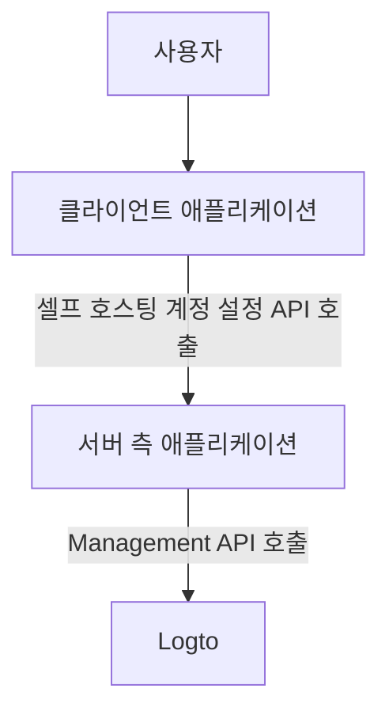
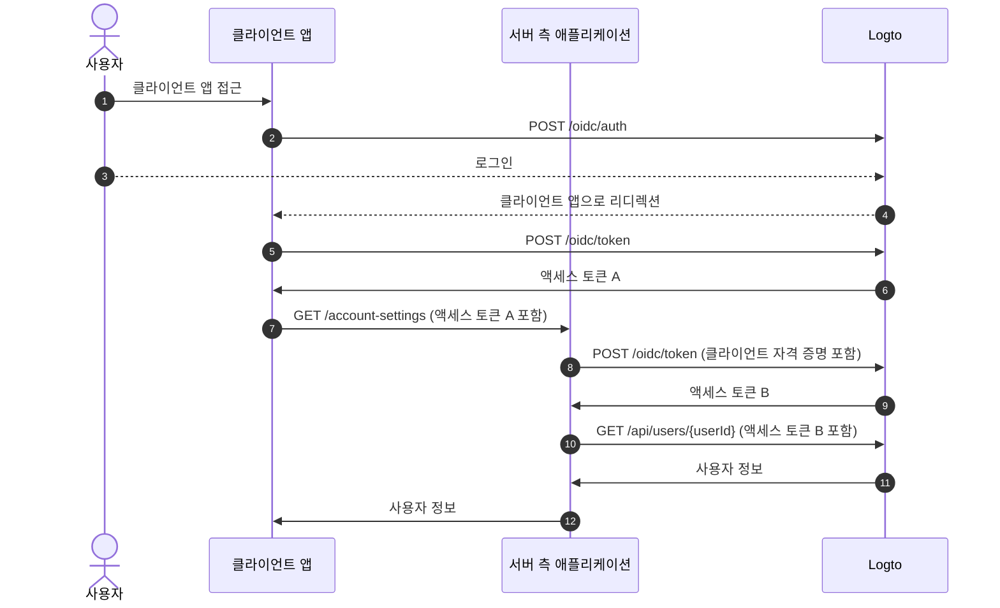
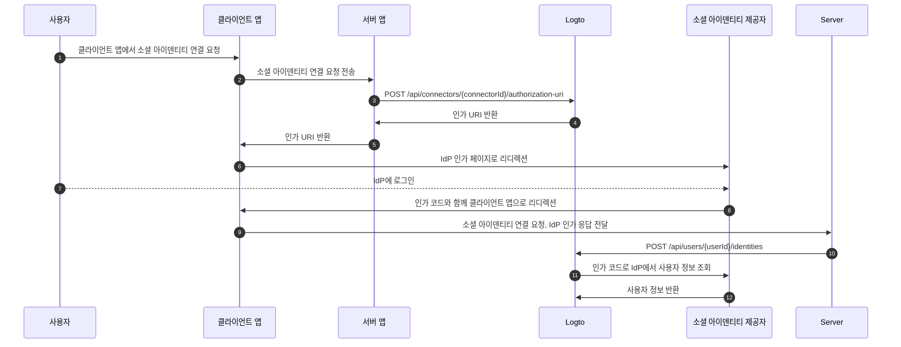

# Management API를 통한 계정 설정

## 통합 \{#integrations}

Logto는 사용자 계정을 관리할 수 있는 다양한 Management API를 제공합니다. 이 API들을 사용하여 최종 사용자를 위한 셀프 서비스 계정 설정 페이지를 구축할 수 있습니다.

### 아키텍처 \{#architecture}

1. **사용자**: 자신의 계정 설정에 접근하고 관리해야 하는 인증된 최종 사용자.
2. **클라이언트 애플리케이션**: 사용자에게 계정 설정 페이지를 제공하는 클라이언트 애플리케이션.
3. **서버 측 애플리케이션**: 클라이언트에 계정 설정 API를 제공하는 서버 측 애플리케이션. Logto Management API와 상호작용합니다.
4. **Logto**: 인증 (Authentication) 및 인가 (Authorization) 서비스로서의 Logto. 사용자 계정 관리를 위한 Management API를 제공합니다.

### 시퀀스 다이어그램 \{#sequence-diagram}

1. 사용자가 클라이언트 애플리케이션에 접근합니다.
2. 클라이언트 애플리케이션이 Logto에 인증 요청을 보내고 사용자를 Logto 로그인 페이지로 리디렉션합니다.
3. 사용자가 Logto에 로그인합니다.
4. 인증된 사용자가 인가 코드와 함께 클라이언트 애플리케이션으로 리디렉션됩니다.
5. 클라이언트 애플리케이션이 셀프 호스팅 계정 설정 API 접근을 위해 Logto에서 액세스 토큰을 요청합니다.
6. Logto가 클라이언트 애플리케이션에 액세스 토큰을 발급합니다.
7. 클라이언트 애플리케이션이 사용자 액세스 토큰과 함께 서버 측 애플리케이션에 계정 설정 요청을 보냅니다.
8. 서버 측 애플리케이션이 사용자 액세스 토큰에서 요청자의 신원과 권한을 검증한 후, Logto에서 Management API 액세스 토큰을 요청합니다.
9. Logto가 서버 측 애플리케이션에 Management API 액세스 토큰을 발급합니다.
10. 서버 측 애플리케이션이 Management API 액세스 토큰을 사용하여 Logto에서 사용자 데이터를 요청합니다.
11. Logto가 서버의 신원과 Management API 권한을 검증한 후 사용자 데이터를 반환합니다.
12. 서버 측 애플리케이션이 요청자의 권한에 따라 사용자 데이터를 처리하고, 사용자 계정 정보를 클라이언트 애플리케이션에 반환합니다.

### Management API를 서버 측 애플리케이션에 통합하기 \{#integrate-management-api-to-server-side-application}

Management API를 서버 측 애플리케이션에 통합하는 방법은 [Management API](/integrate-logto/interact-with-management-api/) 섹션을 참고하세요.

## 사용자 관리 API \{#user-management-apis}

### 사용자 데이터 스키마 \{#user-data-schema}

Logto의 사용자 스키마에 대해 더 알고 싶다면 [사용자 데이터 및 커스텀 데이터](/user-management/user-data/) 섹션을 참고하세요.

### 사용자 프로필 및 식별자 관리 API \{#user-profile-and-identifiers-management-apis}

사용자 프로필과 식별자는 사용자 관리에 필수적입니다. 다음 API를 사용하여 사용자 프로필과 식별자를 관리할 수 있습니다.

| method | path                                                                                                     | description                      |
| ------ | -------------------------------------------------------------------------------------------------------- | -------------------------------- |
| GET    | [/api/users/\{userId\}](https://openapi.logto.io/operation/operation-getuser)                            | 사용자 ID로 사용자 정보 조회.    |
| PATCH  | [/api/users/\{userId\}](https://openapi.logto.io/operation/operation-updateuser)                         | 사용자 정보 수정.                |
| PATCH  | [/api/users/\{userId\}/profile](https://openapi.logto.io/operation/operation-updateuserprofile)          | 사용자 ID로 프로필 필드 수정.    |
| GET    | [/api/users/\{userId\}/custom-data](https://openapi.logto.io/operation/operation-listusercustomdata)     | 사용자 ID로 커스텀 데이터 조회.  |
| PATCH  | [/api/users/\{userId\}/custom-data](https://openapi.logto.io/operation/operation-updateusercustomdata)   | 사용자 ID로 커스텀 데이터 수정.  |
| PATCH  | [/api/users/\{userId\}/is-suspended](https://openapi.logto.io/operation/operation-updateuserissuspended) | 사용자 ID로 계정 정지 상태 수정. |

### 이메일 및 전화번호 인증 \{#email-and-phone-number-verification}

Logto 시스템에서는 이메일 주소와 전화번호 모두 사용자 식별자로 사용될 수 있으므로, 이들의 인증이 필수적입니다. 이를 지원하기 위해 제공되는 인증 코드 API를 통해 이메일 또는 전화번호를 인증할 수 있습니다.

:::note
새 이메일 또는 전화번호로 사용자 프로필을 업데이트하기 전에 반드시 해당 이메일 또는 전화번호를 인증하세요.
:::

| method | path                                                                                                                             | description                            |
| ------ | -------------------------------------------------------------------------------------------------------------------------------- | -------------------------------------- |
| POST   | [/api/verifications/verification-code](https://openapi.logto.io/operation/operation-createverificationbyverificationcode)        | 이메일 또는 전화번호 인증 코드 전송.   |
| POST   | [/api/verifications/verification-code/verify](https://openapi.logto.io/operation/operation-verifyverificationbyverificationcode) | 인증 코드로 이메일 또는 전화번호 인증. |

### 사용자 비밀번호 관리 \{#user-password-management}

| method | path                                                                                                     | description                          |
| ------ | -------------------------------------------------------------------------------------------------------- | ------------------------------------ |
| POST   | [/api/users/\{userId\}/password/verify](https://openapi.logto.io/operation/operation-verifyuserpassword) | 사용자 ID로 현재 비밀번호 인증.      |
| PATCH  | [/api/users/\{userId\}/password](https://openapi.logto.io/operation/operation-updateuserpassword)        | 사용자 ID로 비밀번호 변경.           |
| GET    | [/api/users/\{userId\}/has-password](https://openapi.logto.io/operation/operation-getuserhaspassword)    | 사용자 ID로 비밀번호 존재 여부 확인. |

:::note
사용자 비밀번호를 변경하기 전에 반드시 현재 비밀번호를 인증하세요.
:::

### 사용자 소셜 아이덴티티 관리 \{#user-social-identities-management}

| method | path                                                                                                                              | description                                                                                |
| ------ | --------------------------------------------------------------------------------------------------------------------------------- | ------------------------------------------------------------------------------------------ |
| GET    | [/api/users/\{userId\}](https://openapi.logto.io/operation/operation-getuser)                                                     | 사용자 ID로 사용자 정보 조회. 소셜 아이덴티티는 `identities` 필드에서 확인할 수 있습니다.  |
| POST   | [/api/users/\{userId\}/identities](https://openapi.logto.io/operation/operation-createuseridentity)                               | 인증된 소셜 아이덴티티를 사용자 ID로 연결.                                                 |
| DELETE | [/api/users/\{userId\}/identities](https://openapi.logto.io/operation/operation-deleteuseridentity)                               | 사용자 ID로 소셜 아이덴티티 연결 해제.                                                     |
| PUT    | [/api/users/\{userId\}/identities](https://openapi.logto.io/operation/operation-replaceuseridentity)                              | 사용자 ID로 연결된 소셜 아이덴티티 직접 수정.                                              |
| POST   | [/api/connectors/\{connectorId\}/authorization-uri](https://openapi.logto.io/operation/operation-createconnectorauthorizationuri) | 소셜 아이덴티티 제공자의 인가 URI 조회. 이 URI로 새로운 소셜 아이덴티티 연결을 시작하세요. |

1. 사용자가 클라이언트 애플리케이션에 접근하여 소셜 아이덴티티 연결을 요청합니다.
2. 클라이언트 애플리케이션이 서버에 소셜 아이덴티티 연결 요청을 전송합니다.
3. 서버가 Logto에 소셜 아이덴티티 제공자의 인가 URI를 요청합니다. 이때 `state` 파라미터와 `redirect_uri`를 직접 제공해야 하며, `redirect_uri`는 소셜 아이덴티티 제공자에 사전 등록되어 있어야 합니다.
4. Logto가 서버에 인가 URI를 반환합니다.
5. 서버가 인가 URI를 클라이언트 애플리케이션에 반환합니다.
6. 클라이언트 애플리케이션이 사용자를 IdP 인가 URI로 리디렉션합니다.
7. 사용자가 IdP에 로그인합니다.
8. IdP가 인가 코드와 함께 사용자를 `redirect_uri`로 클라이언트 애플리케이션에 리디렉션합니다.
9. 클라이언트 애플리케이션이 `state`를 검증하고 IdP 인가 응답을 서버로 전달합니다.
10. 서버가 Logto에 소셜 아이덴티티를 사용자에 연결하도록 요청합니다.
11. Logto가 인가 코드를 사용해 IdP에서 사용자 정보를 조회합니다.
12. IdP가 사용자 정보를 Logto에 반환하고, Logto가 소셜 아이덴티티를 사용자에 연결합니다.

:::note
사용자에게 새로운 소셜 아이덴티티를 연결할 때 고려해야 할 몇 가지 제한 사항이 있습니다:

- Management API는 세션 컨텍스트가 없으므로, 소셜 인증 상태를 안전하게 유지하기 위해 활성 세션이 필요한 소셜 커넥터는 Management API를 통해 연결할 수 없습니다. 지원되지 않는 커넥터에는 apple, 표준 OIDC, 표준 OAuth 2.0 커넥터가 포함됩니다.
- 같은 이유로, Logto는 인가 응답의 `state` 파라미터를 검증할 수 없습니다. 클라이언트 앱에서 `state` 파라미터를 저장하고 인가 응답을 받을 때 반드시 검증하세요.
- `redirect_uri`를 소셜 아이덴티티 제공자에 미리 등록해야 합니다. 그렇지 않으면 소셜 IdP가 사용자를 클라이언트 앱으로 리디렉션하지 않습니다. 소셜 IdP는 사용자 로그인용, 프로필 바인딩 페이지용 등 둘 이상의 콜백 `redirect_uri`를 허용해야 합니다.

:::

### 사용자 엔터프라이즈 아이덴티티 관리 \{#user-enterprise-identities-management}

| method | path                                                                                                    | description                                                                                                                                                        |
| ------ | ------------------------------------------------------------------------------------------------------- | ------------------------------------------------------------------------------------------------------------------------------------------------------------------ |
| GET    | [/api/users/\{userId\}?includeSsoIdentities=true](https://openapi.logto.io/operation/operation-getuser) | 사용자 ID로 사용자 정보 조회. 엔터프라이즈 아이덴티티는 `ssoIdentities` 필드에서 확인할 수 있습니다. API에 `includeSsoIdentities=true` 쿼리 파라미터를 추가하세요. |

현재 Management API는 사용자에 엔터프라이즈 아이덴티티를 연결하거나 해제하는 기능을 지원하지 않습니다. 연결된 엔터프라이즈 아이덴티티만 표시할 수 있습니다.

### 개인 액세스 토큰 \{#personal-access-token}

| method | path                                                                                                                                 | description                              |
| ------ | ------------------------------------------------------------------------------------------------------------------------------------ | ---------------------------------------- |
| GET    | [/api/users/\{userId\}/personal-access-tokens](https://openapi.logto.io/operation/operation-listuserpersonalaccesstokens)            | 사용자의 모든 개인 액세스 토큰 조회.     |
| POST   | [/api/users/\{userId\}/personal-access-tokens](https://openapi.logto.io/operation/operation-createuserpersonalaccesstoken)           | 사용자에게 새로운 개인 액세스 토큰 추가. |
| DELETE | [/api/users/\{userId\}/personal-access-tokens/\{name\}](https://openapi.logto.io/operation/operation-deleteuserpersonalaccesstoken)  | 이름으로 사용자의 토큰 삭제.             |
| PATCH  | [/api/users/\{userId\s}/personal-access-tokens/\{name\}](https://openapi.logto.io/operation/operation-updateuserpersonalaccesstoken) | 이름으로 사용자의 토큰 수정.             |

개인 액세스 토큰은 사용자가 자격 증명과 상호작용 로그인 없이 [액세스 토큰 (Access token)](https://auth.wiki/access-token)을 안전하게 부여할 수 있는 방법을 제공합니다. [개인 액세스 토큰 사용법](/user-management/personal-access-token)에 대해 더 알아보세요.

### 사용자 MFA 설정 관리 \{#user-mfa-settings-management}

| method | path                                                                                                                                 | description                                                          |
| ------ | ------------------------------------------------------------------------------------------------------------------------------------ | -------------------------------------------------------------------- |
| GET    | [/api/users/\{userId\}/mfa-verifications](https://openapi.logto.io/operation/operation-listusermfaverifications)                     | 사용자 ID로 사용자 MFA 인증 정보 조회.                               |
| POST   | [/api/users/\{userId\}/mfa-verifications](https://openapi.logto.io/operation/operation-createusermfaverification)                    | 사용자 ID로 MFA 인증 정보 설정.                                      |
| DELETE | [/api/users/\{userId\}/mfa-verifications/\{verificationId\}](https://openapi.logto.io/operation/operation-deleteusermfaverification) | ID로 사용자 MFA 인증 정보 삭제.                                      |
| GET    | [/api/users/\{userId\}/logto-configs](https://openapi.logto.io/operation/operation-listuserlogtoconfigs)                             | 사용자 ID로 Logto MFA 구성 플래그 조회.                              |
| PATCH  | [/api/users/\{userId\}/logto-configs](https://openapi.logto.io/operation/operation-updateuserlogtoconfigs)                           | 사용자 Logto MFA 구성 플래그(`mfa.required`, `mfa.skipped` 등) 수정. |

저장된 WebAuthn 자격 증명을 포함하려면 `GET /api/users/{userId}/mfa-verifications`에 `includeWebAuthnCredentials=true` 쿼리 파라미터를 추가하세요. 예를 들어 동일 도메인 내 다른 시스템으로 [패스키 내보내기](/end-user-flows/mfa/webauthn#export-passkeys)에 사용할 수 있습니다.

개별 사용자에 대해 MFA 설정을 필수로 하려면 `PATCH /api/users/{userId}/logto-configs`에 `{ "mfa": { "required": true } }`를 사용하세요. (`mfa.required`는 사용자가 Account API를 통해 직접 수정할 수 없습니다.)

### 사용자 신뢰 기기 관리 \{#user-trusted-devices-management}

| method | path                                                                                                                              | description                        |
| ------ | --------------------------------------------------------------------------------------------------------------------------------- | ---------------------------------- |
| GET    | [/api/users/\{userId\}/trusted-devices](https://openapi.logto.io/operation/operation-listusertrusteddevices)                      | 사용자의 활성 신뢰 기기 목록 조회. |
| DELETE | [/api/users/\{userId\}/trusted-devices/\{trustedDeviceId\}](https://openapi.logto.io/operation/operation-deleteusertrusteddevice) | ID로 사용자의 신뢰 기기 삭제.      |

신뢰 기기 삭제는 향후 로그인에만 적용되며, 기존 세션은 해제되지 않습니다. 자세한 내용은 [MFA 신뢰 기기](/end-user-flows/mfa/trusted-devices)를 참고하세요.

사용자에게 [이메일 MFA](/end-user-flows/mfa/email-mfa) 또는 [SMS MFA](/end-user-flows/mfa/sms-mfa)를 추가하려면 POST 엔드포인트에 `{"type":"EmailVerificationCode"}` 또는 `{"type":"PhoneVerificationCode"}`를 전달하세요. 삭제하려면 해당 인증을 DELETE 엔드포인트로 삭제하세요. 코드는 사용자의 기본 이메일 주소 또는 전화번호로 전송되므로, 반드시 해당 정보가 있어야 하며, 동일한 인증 요소를 두 번 추가하면 422 오류가 반환됩니다. **설정한 사용자만** [등록 설정](/end-user-flows/mfa/configure-mfa#email-and-sms-mfa-enrollment)에서는 이 인증을 가진 사용자만 이메일 또는 SMS로 MFA를 사용할 수 있습니다. 두 모드 모두에서 추가할 수 있으므로, 예를 들어 특정 사용자를 이메일 또는 SMS MFA로 유지한 뒤 **설정한 사용자만** 모드로 전환할 수 있습니다.

### 사용자 계정 삭제 \{#user-account-deletion}

| method | path                                                                             | description              |
| ------ | -------------------------------------------------------------------------------- | ------------------------ |
| DELETE | [/api/users/\{userId\}](https://openapi.logto.io/operation/operation-deleteuser) | 사용자 ID로 사용자 삭제. |

### 사용자 세션 관리 \{#user-session-management}

| method | path                                                                                                           | description                   |
| ------ | -------------------------------------------------------------------------------------------------------------- | ----------------------------- |
| GET    | [/api/users/\{userId\}/sessions](https://openapi.logto.io/operation/operation-listusersessions)                | 사용자 ID로 사용자 세션 조회. |
| GET    | [/api/users/\{userId\}/sessions/\{sessionId\}](https://openapi.logto.io/operation/operation-getusersession)    | 세션 ID로 사용자 세션 조회.   |
| DELETE | [/api/users/\{userId\}/sessions/\{sessionId\}](https://openapi.logto.io/operation/operation-deleteusersession) | 세션 ID로 사용자 세션 삭제.   |

### 사용자 인가 앱(그랜트) 관리 \{#manage-user-authorized-apps-grants}

| method | path                                                                                                     | description                        |
| ------ | -------------------------------------------------------------------------------------------------------- | ---------------------------------- |
| GET    | [/api/users/\{userId\}/grants](https://openapi.logto.io/operation/operation-listusergrants)              | 사용자의 활성 앱 그랜트 목록 조회. |
| DELETE | [/api/users/\{userId\}/grants/\{grantId\}](https://openapi.logto.io/operation/operation-deleteusergrant) | 특정 ID의 앱 그랜트 해제.          |

그랜트 목록 조회 시 선택적 쿼리 파라미터:

- `appType=firstParty`: 퍼스트파티 앱 그랜트만 반환.
- `appType=thirdParty`: 서드파티 앱 그랜트만 반환.
- `appType` 생략: 모든 활성 그랜트 반환.

그랜트가 해제되면, 해당 그랜트로 발급된 기존 불투명 액세스 토큰 (Opaque token) 및 리프레시 토큰 (Refresh token)은 모두 무효화됩니다.
