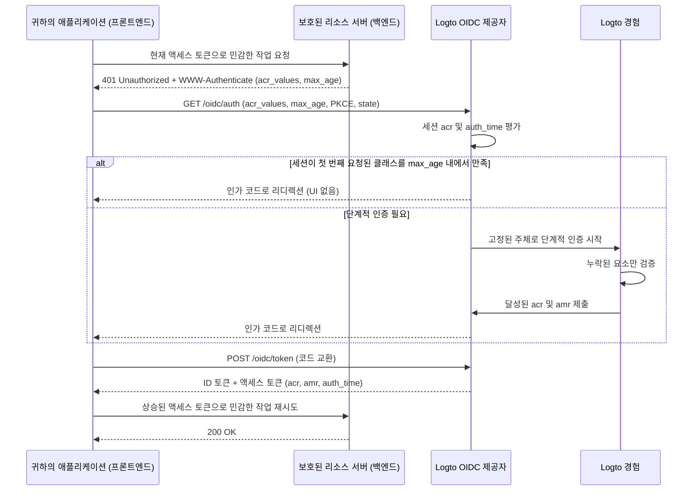

# 단계적 인증 (Step-up authentication)

단계적 인증 (Step-up authentication)은 애플리케이션이 사용자를 로그아웃시키지 않고도 결제 승인, 기밀 기록 열람, 계정 보안 설정 변경 등 민감한 작업을 수행하기 전에 최근의 사용자 인증 또는 더 강력한 인증 보장 수준을 요구할 수 있게 해줍니다.

Logto는 [OpenID Connect Core](https://openid.net/specs/openid-connect-core-1_0.html), [RFC 9470 (OAuth 2.0 Step Up Authentication Challenge Protocol)](https://www.rfc-editor.org/rfc/rfc9470.html), [RFC 8176 (Authentication Method Reference Values)](https://www.rfc-editor.org/rfc/rfc8176.html)에 기반한 표준 단계적 인증을 구현합니다:

1. 보호된 리소스 서버는 `401 Unauthorized`와 RFC 9470 `WWW-Authenticate` 헤더(`acr_values`, `max_age` 포함)로 불충분한 토큰에 챌린지를 보냅니다.
2. 애플리케이션은 `acr_values`와 `max_age`를 포함하여 Authorization Code Flow를 시작합니다. 이미 인증된 세션이 있으면 Logto는 로그인된 사용자를 고정하고 누락된 검증만 요청합니다.
3. Logto는 세션에 달성된 인증 컨텍스트 (`acr`, `amr`, `auth_time`)를 기록하고, 이를 ID 토큰, JWT 액세스 토큰, 불투명 토큰 (Opaque token) 인트로스펙션 응답에 포함합니다.



## 인증 컨텍스트 모델 \{#authentication-context-model}

Logto Experience를 통한 모든 로그인, 회원가입, 단계적 인증은 애플리케이션이 `acr_values`를 요청했는지 여부와 관계없이 OIDC 세션에 세 가지 표준 클레임을 기록합니다:

| Claim       | Type       | 설명                                                                         |
| ----------- | ---------- | ---------------------------------------------------------------------------- |
| `acr`       | `string`   | 인증 컨텍스트 클래스 참조 — 달성된 보장 수준. 만족된 것이 없으면 생략됩니다. |
| `amr`       | `string[]` | 인증 방법 참조 — 해당 상호작용에서 사용된 검증 방법.                         |
| `auth_time` | `number`   | 최종 사용자 인증이 완료된 시점의 epoch 타임스탬프(초 단위).                  |

Logto는 OIDC Discovery(`/.well-known/openid-configuration`, `/.well-known/oauth-authorization-server`)에서 이러한 기능을 광고합니다:

```json
{
  "acr_values_supported": ["urn:logto:acr:1fa", "urn:logto:acr:mfa"],
  "claims_supported": ["sub", "acr", "amr", "auth_time"]
}
```

ID 토큰에서는 세션에 존재할 때마다 표준 `openid` 스코프 하에 `acr`, `amr`, `auth_time`이 포함됩니다. 사용자 액세스 토큰에서는 Logto가 인가 코드, 디바이스 코드, 리프레시 토큰에서 이 값을 JWT 페이로드 및 불투명 토큰 (Opaque token) 인트로스펙션 응답으로 복사합니다. 리프레시 토큰 회전은 원래의 `acr`, `amr`, `auth_time`을 보존합니다 — 토큰을 새로 고쳐도 `auth_time`은 갱신되지 않습니다. 기타 그랜트 타입(클라이언트 크레덴셜, 토큰 교환 등)은 인증 컨텍스트 클레임을 발행하지 않습니다.

### 지원되는 ACR 값 \{#supported-acr-values}

Logto는 두 가지 인증 컨텍스트 클래스 참조 (`acr`) 값을 정의합니다:

| ACR 값              | 의미                                                                                                                                                         | 만족하는 클래스                          |
| ------------------- | ------------------------------------------------------------------------------------------------------------------------------------------------------------ | ---------------------------------------- |
| `urn:logto:acr:1fa` | Logto가 해당 상호작용에서 직접 검증하거나 확립한 최소 한 가지 요소: 비밀번호, 기본 이메일/전화 인증 코드, 매직 링크(로그인 시 일회성 토큰), 등록된 MFA 요소. | `urn:logto:acr:1fa`                      |
| `urn:logto:acr:mfa` | Logto가 검증 가능한 첫 번째 요소(`1fa` 역할) 증명과 **다른** 요소의 `mfa` 역할 증명, 또는 사용자 검증이 완료된 WebAuthn / 패스키 단독 증명.                  | `urn:logto:acr:mfa`, `urn:logto:acr:1fa` |

만족 관계는 `urn:logto:acr:mfa` → `urn:logto:acr:1fa`입니다: `urn:logto:acr:mfa`를 가진 세션/토큰은 `urn:logto:acr:1fa` 요구도 만족합니다. 표준 `phr`, `phrh` ACR 값은 지원하지 않습니다. WebAuthn 및 패스키 인증은 사용자 검증이 필요하며 `urn:logto:acr:mfa`로 매핑됩니다.

`urn:logto:acr:mfa`를 도출할 때 Logto는 각 검증 방법을 역할별로 분류합니다:

- **첫 번째 요소(`1fa`) 역할**: 비밀번호, 기본 이메일 인증 코드, 기본 전화 인증 코드, 일회성 토큰(로그인 한정).
- **두 번째 요소(`mfa`) 역할**: 인증 앱 OTP(TOTP), 백업 코드, MFA 이메일 인증 코드, MFA 전화 인증 코드. Logto가 검증 가능한 첫 번째 요소 없이 `mfa` 역할 요소만 검증(예: 소셜 로그인 + TOTP)하면 `urn:logto:acr:1fa`에 도달합니다.
- **자급자족(`both`) 역할**: 패스키 로그인 및 사용자 검증이 완료된 WebAuthn MFA는 한 번의 인증으로 두 역할을 모두 만족하며 `urn:logto:acr:mfa`에 도달합니다.
- **서로 다른 요소 규칙**: `urn:logto:acr:mfa`는 반드시 **서로 다른** 두 요소가 필요합니다. 두 개의 첫 번째 요소(예: 이메일 인증 코드 + 비밀번호), 두 개의 `mfa` 역할 요소(예: TOTP + 백업 코드), 동일 채널의 두 증명(예: 기본 이메일 코드 + MFA 이메일 코드)은 하나의 요소/역할로 간주되어 `urn:logto:acr:1fa`만 달성합니다.
- **신뢰된 디바이스 및 적응형 MFA**: [신뢰된 디바이스](/end-user-flows/mfa/trusted-devices) 충족 및 적응형 MFA 스킵은 현재 상호작용에서 아무것도 증명하지 않으므로 `acr`에 기여하지 않습니다(신뢰된 디바이스로 MFA를 건너뛴 비밀번호 로그인은 `acr="urn:logto:acr:1fa"`, `amr=["pwd"]`).

회원가입도 동일 규칙으로 인증 컨텍스트를 기록합니다. 예를 들어, 사용자명+비밀번호 회원가입은 `acr="urn:logto:acr:1fa"`, `amr=["pwd"]`를 남깁니다.

### AMR 매핑 \{#amr-mapping}

Logto는 [RFC 8176](https://www.rfc-editor.org/rfc/rfc8176.html) 값과 `fed`(연동 인증) 값을 `amr`에 채웁니다:

| Logto 검증 방법                                                        | `amr` 값             | `acr` 기여 여부  |
| ---------------------------------------------------------------------- | -------------------- | ---------------- |
| 비밀번호(검증됨, 또는 회원가입/단계적 인증 중 새로 설정)               | `pwd`                | 예 (`1fa` 역할)  |
| 기본 이메일 인증 코드                                                  | `otp`                | 예 (`1fa` 역할)  |
| 기본 전화 인증 코드                                                    | `sms`                | 예 (`1fa` 역할)  |
| 일회성 토큰/매직 링크(로그인 한정, 단계적 인증 불가)                   | `otp`                | 예 (`1fa` 역할)  |
| 인증 앱 OTP(TOTP, 검증됨/새로 등록)                                    | `otp`                | 예 (`mfa` 역할)  |
| MFA 이메일 인증 코드                                                   | `otp`                | 예 (`mfa` 역할)  |
| MFA 전화 인증 코드                                                     | `sms`                | 예 (`mfa` 역할)  |
| 백업 코드                                                              | `otp`                | 예 (`mfa` 역할)  |
| 사용자 검증이 완료된 WebAuthn MFA 또는 패스키 로그인(검증됨/새로 등록) | `pop`, `user`, `mfa` | 예 (`both` 역할) |
| 소셜 로그인 또는 엔터프라이즈 SSO                                      | `fed`                | 아니오           |
| 달성된 `acr`가 `urn:logto:acr:mfa`인 모든 상호작용                     | `mfa` 추가           | —                |

#### 연동 인증 (`fed`) \{#federated-authentication-fed}

Logto는 사용자가 Logto가 직접 검증할 수 없는 상위 소셜 또는 엔터프라이즈 SSO 증명으로 인증했음을 나타내기 위해 `fed`를 발행합니다.

- 순수 소셜 또는 엔터프라이즈 SSO 로그인/회원가입은 `amr=["fed"]`, 새로운 `auth_time`, **`acr` 클레임 없음**으로 기록됩니다.
- `fed`는 첫 번째 요소가 아니며, 상위 로그인 반복으로는 `acr`가 상승하지 않습니다. 소셜 로그인 후 Logto 검증 요소(예: TOTP) 추가 시 `acr="urn:logto:acr:1fa"`, `amr=["fed", "otp"]`가 됩니다.
- `auth_time`만으로는 보장이 없으므로 항상 `acr`와 함께 확인해야 합니다.
- 어떤 상위 제공자가 인증했는지는 `amr`가 아닌 `identities`, `sso_identities` 클레임에 노출됩니다.

### 단계적 인증이 세션 및 토큰 클레임을 갱신하는 방식 \{#how-step-up-updates-session-and-token-claims}

기존 OIDC 세션에서 `acr_values`가 포함된 인가 요청이 상호작용을 요구하면 Experience는 **단계적 인증 모드**로 진입합니다:

- **주체 고정 및 누적 ACR**: Logto는 현재 세션의 `sub`를 고정(계정 전환, 식별자 입력, 회원가입 불가)하고 누락된 보장만 요청합니다. 명확한 세션 방법은 해당 역할을 단계적 인증에 전달합니다:
  - `pwd` 또는 `sms`로 인증된 세션은 이미 `1fa` 기여를 제공하므로, `urn:logto:acr:mfa`로 단계적 인증 시 등록된 MFA 요소만 요청합니다(`max_age=0` 또는 `prompt=login`으로 신선한 인증을 강제해도 동일).
  - 소셜/엔터프라이즈 SSO 세션(`amr=["fed"]`)은 `1fa` 기여가 없으므로, `urn:logto:acr:mfa` 달성을 위해서는 첫 번째 요소 증명(또는 WebAuthn 패스키 검증)이 필요합니다.
- **`amr` 및 `auth_time`은 현재 상호작용만 반영**: 비밀번호 세션에서 단계적 인증 중 TOTP 검증 시 `acr="urn:logto:acr:mfa"`, `amr=["otp", "mfa"]`, 새로운 `auth_time`이 생성됩니다. **신뢰 당사자는 반드시 `acr`에서 보장 수준을 읽어야 하며, `amr`에서 첫 번째 요소를 찾으면 안 됩니다.**
- **세션 교체, 병합 아님**: 단계적 인증 완료 후 세션의 `acr`, `amr`, `auth_time`은 새 상호작용에서 달성된 값으로 교체됩니다. 예를 들어, 비밀번호 재인증으로 `urn:logto:acr:1fa` 요청 시 세션은 `acr="urn:logto:acr:1fa"`, `amr=["pwd"]`로 설정됩니다. 이전에 발행된 토큰은 발행 당시의 클레임을 유지합니다.
- **정책 무시 및 부수 효과 없음**: `urn:logto:acr:1fa` 요청은 하나의 적격 활성 검증만 요구하며 테넌트의 로그인 MFA 정책을 재실행하지 않습니다. `urn:logto:acr:mfa` 요청은 신뢰된 디바이스, 사용자 `skipMfaOnSignIn` 설정, 적응형 MFA 비트리거 결과를 무시합니다. 순수 단계적 인증은 `PostSignIn` 웹훅이나 액션 등 로그인 부수 효과를 실행하지 않습니다.

`acr_values` 요청 시 인증된 OIDC 세션이 없으면 Logto는 일반 로그인/회원가입 플로우를 실행하고, 인가 코드 발급 전 요청된 ACR 달성을 강제합니다.

## 단계적 인증 요청하기 \{#request-step-up-authentication}

Authorization Code Flow 요청에서 `/oidc/auth`에 `acr_values`와 `max_age`를 전달하세요.

### `acr_values`의 순서형 리스트 의미 \{#ordered-list-semantics-of-acr-values}

`acr_values`는 **호출자 선호 순서**로 나열된 공백 구분 ACR 값 리스트입니다(예: `urn:logto:acr:mfa urn:logto:acr:1fa`). Logto는 인식하지 못하는 값은 무시합니다. 요청된 값 중 **하나도** 지원되지 않으면(예: `acr_values=phr`), Logto는 UI 없이 즉시 실패하고 `redirect_uri`로 `error=unmet_authentication_requirements`와 함께 리디렉션합니다.

최소 하나의 지원 클래스가 요청된 경우:

1. **첫 번째 클래스 이미 만족**: 인증된 세션이 `acr_values`의 **첫 번째** 지원 클래스를 만족하고, `max_age`를 충족하며, `prompt=login`이 요청되지 않았다면 Logto는 UI 없이 즉시 인가 코드를 발급합니다.
2. **나중 클래스만 만족**: 세션이 나중에 나열된 클래스만 만족하고 첫 번째는 만족하지 않는 경우(예: `acr_values="urn:logto:acr:mfa urn:logto:acr:1fa"`에서 `1fa` 세션), Logto는 앞선 클래스(`urn:logto:acr:mfa`) 달성을 위해 단계적 인증을 시작합니다.
   - 사용자가 등록된 MFA 요소를 검증하거나 등록할 수 있다면 Experience가 이를 요청합니다.
   - 사용자가 `urn:logto:acr:mfa`에 도달할 수 없다면(예: MFA 요소 미등록, 등록 가능한 TOTP/WebAuthn 요소 없음), Logto는 다음 도달 가능한 클래스(`urn:logto:acr:1fa`)로 대체합니다. 세션이 이미 해당 클래스도 만족하고 신선한 인증이 강제되지 않았다면 UI 없이 완료하며 기존 `auth_time`을 유지합니다.
3. **`unmet_authentication_requirements`로 엄격 실패**: Logto는 상호작용이 추구하는 클래스보다 약한 ACR로 토큰을 발행하지 않습니다. 나열된 클래스 중 **어느 것도** 도달할 수 없을 때만 `redirect_uri`로 `error=unmet_authentication_requirements`와 함께 리디렉션합니다.

### 엄격 요청 vs. 약한 클래스 재시도 패턴 \{#strict-requests-vs-the-retry-with-weaker-class-pattern}

사용자가 MFA를 만족하지 못할 때 애플리케이션 처리 방식에 따라 두 가지 패턴 중 하나를 선택하세요:

- **특정 클래스를 엄격히 요구 후 앱에서 재시도/분기**: `acr_values=urn:logto:acr:mfa`만 요청하세요. Logto는 반드시 `mfa` 토큰 또는 `error=unmet_authentication_requirements` 리디렉션을 보장합니다. 실패 시 콜백 핸들러에서 `acr_values=urn:logto:acr:1fa`로 인가를 재시도하거나, 작업을 차단하거나, 승인 워크플로우로 라우팅할 수 있습니다.
- **한 번의 요청에 순서형 대체 선언**: `acr_values="urn:logto:acr:mfa urn:logto:acr:1fa"`를 요청하세요. Logto는 도달 가능할 때마다 `mfa`를 추구하고, 해당 사용자가 도달할 수 없을 때만 자동으로 `1fa`로 대체합니다. 결과 액세스 토큰의 `acr`를 확인하여 달성된 수준을 확인하세요.

:::note
단계적 인증 화면을 중단해도 대체나 앱 알림이 발생하지 않습니다 — 취소 엔드포인트가 없으며, 중단된 상호작용은 만료되거나 다음 인가 요청으로 대체됩니다. 애플리케이션에서 보류 중인 작업 상태를 관리하고, 사용자가 콜백 없이 뒤로 이동하면 이를 초기화하세요.
:::

### `max_age`와 `acr_values` 결합 \{#combining-max-age-and-acr-values}

`max_age`는 사용자의 마지막 활성 인증(`auth_time`) 이후 허용되는 최대 경과 시간(초)을 지정합니다:

- `max_age`는 `auth_time`을 검사하며, 토큰 `exp`가 아닙니다. 토큰을 새로 고쳐도 `auth_time`은 갱신되지 않습니다.
- `max_age=0`(또는 `prompt=login`)은 세션이 이미 요청된 `acr`를 보유해도 신선한 상호작용을 강제합니다.
- `max_age`만 있고 `acr_values`가 없으면 일반 `/sign-in` 플로우로 이동하며 보장 수준을 강제하지 않습니다 — 사용자는 소셜 로그인으로 재인증할 수 있고, 이 경우 `auth_time`만 갱신되고 `acr`는 없습니다. 신선함과 Logto 검증 보장이 모두 필요하다면 반드시 **둘 다** 전달하세요.

### `prompt=none`으로 무음 갭 감지 \{#silent-gap-detection-with-prompt-none}

UI를 표시하거나 등록을 제공하지 않고 사용자의 현재 Logto 세션이 보장 및 신선함 요구를 이미 충족하는지 확인하려면 `prompt=none`을 `acr_values`(및 선택적 `max_age`)와 결합하세요:

- **충족됨**: `prompt=none`은 선호 순서 추구를 위한 UI를 허용하지 않으므로, 세션이 `acr_values` 내 지원 클래스 중 **하나라도** `max_age` 내에서 만족하면 Logto는 인가 코드를 발급합니다.
- **인증된 세션, 요구 미충족/만료**: Logto는 `error=unmet_authentication_requirements`로 리디렉션합니다(`max_age` 오류보다 우선).
- **인증된 세션 없음**: Logto는 `error=login_required`로 리디렉션합니다.

### 인가 URL 및 SDK 예시 \{#authorization-url-and-sdk-examples}

보호된 API 리소스에 대해 최근 5분(`300`초) 내 MFA를 요청하는 원시 인가 요청 예시:

```http
GET /oidc/auth?client_id=my-web-app
  &redirect_uri=https%3A%2F%2Fapp.example.com%2Fcallback
  &response_type=code
  &scope=openid%20offline_access%20payment%3Awrite
  &resource=https%3A%2F%2Fapi.example.com
  &acr_values=urn%3Alogto%3Aacr%3Amfa
  &max_age=300
  &state=8f3d9c1b2a...
  &nonce=4e1a7b9c0f...
  &code_challenge=E9Melhoa2OwvFrEMTJguCHaoeK1t8URWbuGJSstw-cM
  &code_challenge_method=S256 HTTP/1.1
Host: [tenant-id].logto.app
```

Logto JavaScript / TypeScript SDK(`@logto/browser`, `@logto/react`, `@logto/vue`, `@logto/node` 등)에서는 `extraParams`로 `acr_values`, `max_age`를 전달하세요. 이미 로그인된 단일 페이지 애플리케이션에서는 사용자가 단계적 인증을 중단하거나 OIDC 오류로 돌아올 때 캐시된 토큰이 유지되도록 `clearTokens: false`로 설정하세요:

```ts
await signIn({
  redirectUri: 'https://app.example.com/callback',
  clearTokens: false,
  extraParams: {
    acr_values: 'urn:logto:acr:mfa',
    max_age: '300',
  },
});
```

콜백 라우트에서는 `handleSignInCallback()` 호출 전 `error`를 검사하세요:

```ts
const params = new URLSearchParams(window.location.search);
const error = params.get('error');

if (error === 'unmet_authentication_requirements') {
  // 사용자가 요청한 ACR에 도달할 수 없음(또는 prompt=none이 갭을 감지함).
  // 필요하다면 'urn:logto:acr:1fa' 등 약한 클래스로 재시도하거나 설명을 표시하세요.
  return;
}
```

:::tip[다른 API 리소스에 대해 단계적 인증 요청]
인증 컨텍스트는 Logto 세션에 속하며, 단일 API 리소스에만 국한되지 않습니다. `resource` 지표로 단계적 인증을 요청하면 해당 리소스에 대해 상승된 토큰이 발급됩니다(스코프 동의가 아직 부여되지 않았다면 동의 요청). 이전에 발급된 다른 API 리소스용 토큰은 변경되지 않으며, 각 리소스 서버는 제시된 토큰의 `acr`, `auth_time`을 자체적으로 평가합니다.
:::

## 보호된 리소스 서버에서 챌린지 및 검증하기 \{#challenge-and-validate-on-a-protected-resource-server}

인가 결정은 백엔드 또는 보호된 리소스 서버에서 이루어져야 합니다:

- **액세스 토큰**만 리소스 서버에서 검증하세요. ID 토큰은 검증하지 마세요.
- 브라우저 애플리케이션은 액세스 토큰을 불투명 토큰 (Opaque token)으로 취급해야 합니다. 애플리케이션은 요청 전 UI 상태 조정을 위해 ID 토큰의 `acr`, `auth_time`을 읽을 수 있지만, 보안 강제에는 클라이언트 측 디코딩을 절대 의존하지 마세요.

### RFC 9470 챌린지 반환하기 \{#return-an-rfc-9470-challenge}

액세스 토큰이 베어러 토큰으로 유효(서명, `iss`, `aud`, `exp`, `scope` 등)하지만 필요한 `acr`가 없거나 `max_age`를 초과한 경우, `401 Unauthorized`와 [RFC 9470](https://www.rfc-editor.org/rfc/rfc9470.html) `WWW-Authenticate` 헤더로 응답하세요:

```http
HTTP/1.1 401 Unauthorized
WWW-Authenticate: Bearer error="insufficient_user_authentication",
  error_description="최근 5분 이내 다단계 인증 (MFA)이 필요합니다",
  acr_values="urn:logto:acr:mfa",
  max_age="300"
```

애플리케이션이 `error="insufficient_user_authentication"`이 포함된 `401`을 수신하면, `WWW-Authenticate`에서 `acr_values`, `max_age`를 파싱하여 사용자의 보류 중 경로/의도를 로컬에 저장하고, 해당 파라미터로 `signIn()`을 트리거한 뒤 새 액세스 토큰으로 API 호출을 한 번만 재시도하세요. 콜백 후 재시도에도 여전히 `401`이 오면 재시도 루프에 빠지지 않도록 두 번째 단계적 인증을 시작하지 마세요.

### JWT 액세스 토큰 검증하기 \{#validate-jwt-access-tokens}

API 리소스 지표(`resource`)가 요청되면 Logto는 `acr`, `amr`, `auth_time`이 포함된 서명된 JWT 액세스 토큰을 발급합니다:

```json
{
  "iss": "https://[tenant-id].logto.app/oidc",
  "sub": "user-id",
  "aud": "https://api.example.com",
  "client_id": "my-web-app",
  "scope": "payment:write",
  "exp": 1787749200,
  "iat": 1787745601,
  "auth_time": 1787745600,
  "acr": "urn:logto:acr:mfa",
  "amr": ["pwd", "otp", "mfa"]
}
```

[표준 JWT 클레임 검증](/authorization/validate-access-tokens)(JWKS로 서명, `iss`, `aud`, `exp`, `scope`) 후, 만족 관계로 `acr`를 검증하고, 정책에 따라 `auth_time`(`iat` 아님)을 비교하세요:

```ts
import { createRemoteJWKSet, jwtVerify } from 'jose';

const issuer = 'https://[tenant-id].logto.app/oidc';
const jwks = createRemoteJWKSet(new URL(`${issuer}/jwks`));

type LogtoAcr = 'urn:logto:acr:1fa' | 'urn:logto:acr:mfa';

const satisfiedAcrs: Record<string, readonly LogtoAcr[]> = {
  'urn:logto:acr:1fa': ['urn:logto:acr:1fa'],
  'urn:logto:acr:mfa': ['urn:logto:acr:mfa', 'urn:logto:acr:1fa'],
};

const acrSatisfies = (achieved: unknown, required: LogtoAcr): boolean => {
  if (typeof achieved !== 'string') {
    return false;
  }

  return Boolean(satisfiedAcrs[achieved]?.includes(required));
};

export async function verifySensitiveRequest(
  bearerToken: string,
  requiredAcr: LogtoAcr = 'urn:logto:acr:mfa',
  maxAgeSeconds = 300
) {
  const { payload } = await jwtVerify(bearerToken, jwks, {
    issuer,
    audience: 'https://api.example.com',
  });

  const authTime = payload.auth_time;
  const nowSeconds = Date.now() / 1000;
  const isFresh =
    typeof authTime === 'number' &&
    Number.isInteger(authTime) &&
    nowSeconds - authTime >= 0 &&
    nowSeconds - authTime <= maxAgeSeconds;

  if (!acrSatisfies(payload.acr, requiredAcr) || !isFresh) {
    const challenge =
      `Bearer error="insufficient_user_authentication", ` +
      `error_description="최근 사용자 인증이 필요합니다", ` +
      `acr_values="${requiredAcr}", max_age="${maxAgeSeconds}"`;

    return { authorized: false as const, wwwAuthenticate: challenge };
  }

  return { authorized: true as const, payload };
}
```

### 불투명 액세스 토큰 인트로스펙션으로 검증하기 \{#validate-opaque-access-tokens-via-introspection}

API `resource`가 요청되지 않으면 Logto는 [불투명 액세스 토큰](/concepts/opaque-token)을 발급합니다. [RFC 7662](https://www.rfc-editor.org/rfc/rfc7662.html) 인트로스펙션 엔드포인트(`POST /oidc/token/introspection`)에 클라이언트 인증과 함께 호출하여 검증하세요. Logto는 활성 응답 최상위에 `acr`, `amr`, `auth_time`을 반환합니다:

```bash
curl -X POST https://[tenant-id].logto.app/oidc/token/introspection \
  -u "<client_id>:<client_secret>" \
  -H "Content-Type: application/x-www-form-urlencoded" \
  --data-urlencode "token=<opaque_access_token>" \
  --data-urlencode "token_type_hint=access_token"
```

인트로스펙션 응답 예시:

```json
{
  "active": true,
  "client_id": "my-web-app",
  "exp": 1787749200,
  "iat": 1787745601,
  "iss": "https://[tenant-id].logto.app/oidc",
  "scope": "openid offline_access profile",
  "sub": "user-id",
  "token_type": "Bearer",
  "acr": "urn:logto:acr:1fa",
  "amr": ["pwd"],
  "auth_time": 1787745600
}
```

먼저 `active === true`를 확인한 뒤, 위와 동일하게 `acrSatisfies`, `auth_time` 검사를 적용하세요.

### Custom JWT의 예약 클레임 \{#reserved-claims-in-custom-jwt}

사용자 액세스 토큰에서 `acr`, `amr`, `auth_time`은 예약되어 있습니다: [커스텀 액세스 토큰 스크립트](/developers/custom-token-claims/create-script)로 이를 덮어쓰거나 Logto가 인증 컨텍스트를 도출하지 않은 곳에 추가할 수 없습니다.

## 첫 번째 요소 확립 및 MFA 등록 \{#establishing-a-first-factor-and-enrolling-mfa}

`urn:logto:acr:1fa` 또는 `urn:logto:acr:mfa`가 요청될 때 사용자가 해당 클래스에 도달하는 데 필요한 자격 증명이 없을 수 있습니다 — 예를 들어, MFA를 등록하지 않은 비밀번호 전용 사용자, 비밀번호/기본 이메일/전화/MFA 요소가 없는 소셜 전용 사용자 등. Logto는 **동일한 로그인 또는 단계적 인증 상호작용 내에서** 누락된 첫 번째 요소 확립 및 MFA 등록을 허용합니다. 단, 세션 쿠키 탈취만으로는 아무것도 등록/확립할 수 없도록 엄격한 신선함 전제 조건이 적용됩니다:

- **MFA 요소 등록**: 사용자가 `urn:logto:acr:mfa`에 도달할 수 있는 등록된 MFA 요소가 없을 때만 제공되며, **현재 상호작용에서 Logto 검증 첫 번째 요소(`1fa` 또는 `both` 클래스)가 검증/확립된 후에만** 허용됩니다.
  - 세션에 저장된 `acr`나 신뢰된 디바이스 쿠키는 이 조건을 만족하지 않습니다. MFA가 없는 비밀번호 로그인 사용자는 단계적 인증에서 먼저 비밀번호를 재입력해야 하며, 그 후 TOTP 또는 WebAuthn 패스키(옵션으로 백업 코드 포함)를 등록할 수 있습니다(백업 코드는 단독 등록 불가).
- **첫 번째 요소 확립**: 사용자가 추구하는 클래스에 도달할 수 있는 첫 번째 요소가 없을 때만 제공되며(예: 소셜 전용 사용자가 `1fa` 요청, TOTP만 있는 사용자가 `mfa` 요청), **현재 상호작용에서 신선한 주체 증명이 있을 때만** 허용됩니다:
  - **기존 세션에서 단계적 인증 중**에는 사용자가 이미 연결된 소셜/엔터프라이즈 SSO 커넥터로 재인증하여 주체를 증명해야 합니다. 상위 콜백이 다른 사용자나 미연결 계정으로 해석되면 Logto는 `403`으로 거부합니다 — 회원가입/계정 연결은 허용되지 않습니다.
  - 주체 증명이 성공하면, 테넌트가 로그인에 허용한 첫 번째 요소(비밀번호, 활성 이메일/SMS 커넥터가 활성화된 경우 인증된 기본 이메일/전화)를 확립할 수 있습니다. 예를 들어, Google로 재인증 후 비밀번호를 설정한 소셜 전용 사용자는 `acr="urn:logto:acr:1fa"`, `amr=["fed", "pwd"]`로 완료됩니다.
  - 사용자가 이미 적격 방법을 보유하고 있다면 확립은 대안으로 제공되지 않습니다.

Logto는 상호작용 중에 확립/등록된 자격 증명이나 MFA 요소를 해당 상호작용에서 검증된 것과 동일하게 간주하므로, 사용자는 바로 단계적 인증을 완료하며 방금 설정한 요소로 다시 도전받지 않습니다. 순수 단계적 인증 중 새 자격 증명/요소를 확립하면 Logto는 `User.Data.Updated` 웹훅 이벤트를 발행합니다. 사용자가 검증/확립/등록할 수 있는 방법이 아무것도 없거나, 연결된 소셜/SSO 커넥터로 주체를 증명할 수 없다면 Logto는 `error=unmet_authentication_requirements`로 상호작용을 종료합니다.

## Account API 및 Account Center \{#account-api-and-account-center}

### Account API 인가 정책 \{#account-api-authorization-policy}

민감한 [Account API](/end-user-flows/account-settings/by-account-api) 작업(비밀번호/기본 이메일/기본 전화/사용자명 변경, 소셜 아이덴티티 연결/제거, MFA 요소/설정 관리, 개인 액세스 토큰 관리, 활성 세션/앱 권한/신뢰된 디바이스 조회/해제 등)은 다음을 요구합니다:

1. **퍼스트파티 애플리케이션 접근**: 서드파티 OIDC 애플리케이션(`isThirdParty: true`) 및 CIMD 클라이언트는 민감한 Account API 리소스를 변경하거나 Account API 단계적 인증 챌린지를 받을 수 없습니다(`urn:logto:acr:mfa` 포함).
2. **최근 아이덴티티 검증**, 아래 중 **하나**로 충족:
   - **OIDC 인증 컨텍스트**: 불투명 액세스 토큰이 `urn:logto:acr:1fa`(`urn:logto:acr:1fa` 또는 `urn:logto:acr:mfa`)를 만족하고, `now - auth_time <= maximumAuthenticationAgeInSeconds`(항상 `auth_time` 기준, `iat` 아님).
   - **검증 레코드(`logto-verification-id`)**: 직접 Account API 연동 시, Logto는 여전히 `POST /api/verifications/password` 또는 `POST /api/verifications/verification-code` + `/verify`로 생성된 10분 유효 검증 레코드 ID를 `logto-verification-id` 요청 헤더로 허용합니다.

:::info[최근 인증 윈도우 설정]
기본적으로 `maximumAuthenticationAgeInSeconds`는 **600초(10분)**입니다. 테넌트별로 **1~120분(60~7,200초)**까지 <CloudLink to="/sign-in-experience/account-center">콘솔 > 로그인 & 계정 > Account center</CloudLink>의 **Recent authentication** 또는 Management API(`PATCH /api/account-center`의 `maximumAuthenticationAgeInSeconds`)로 설정할 수 있습니다.

OIDC 인증 컨텍스트가 있으면, Logto 검증 방법으로 방금 로그인/회원가입한 사용자는 별도 검증 프롬프트 없이 이 윈도우 내에서 민감한 Account API 작업을 수행할 수 있습니다. Verification API로 생성된 `logto-verification-id`는 하위 호환을 위해 고정 10분 TTL을 유지합니다.
:::

Account API는 최초 비밀번호 예외도 유지합니다: 현재 비밀번호/기본 이메일/기본 전화가 없는 사용자는 최근 아이덴티티 검증 없이 `POST /api/my-account/password`로 최초 비밀번호를 설정할 수 있습니다. Account API로 비밀번호를 설정해도 OIDC 세션의 `acr`는 갱신되지 않으며, 이후 민감 작업 인가도 되지 않습니다.

### Account API `WWW-Authenticate` 챌린지 \{#account-api-www-authenticate-challenge}

퍼스트파티 Account API 요청에 신선한 `urn:logto:acr:1fa` 액세스 토큰과 유효한 `logto-verification-id` 헤더가 모두 없으면, Logto는 기존 JSON 오류 본문을 유지하면서 테넌트 설정 `max_age`가 포함된 RFC 9470 `WWW-Authenticate` 헤더와 함께 `401 Unauthorized`로 응답합니다:

```http
HTTP/1.1 401 Unauthorized
WWW-Authenticate: Bearer error="insufficient_user_authentication", error_description="최근 사용자 인증이 필요합니다", acr_values="urn:logto:acr:1fa", max_age="600"
Content-Type: application/json

{
  "code": "verification_record.permission_denied",
  "message": "권한이 거부되었습니다. 다시 인증하세요."
}
```

### 프리빌트 Account Center \{#prebuilt-account-center}

[프리빌트 Account Center UI](/end-user-flows/account-settings/by-account-center-ui)(`/account/*`)는 OIDC 단계적 인증만 사용하며, `logto-verification-id` 권한 레코드는 생성하지 않습니다:

- 로컬 ID 토큰의 `acr`, `auth_time`을 검사하여 로그인에 `urn:logto:acr:1fa`가 없거나 만료된 경우 민감한 인라인 작업/다단계 서브페이지 진입 전 단계적 인증을 선제적으로 시작하며, Account API의 RFC 9470 `401` 챌린지도 백업 처리합니다.
- 단계적 인증 완료 후에는 토큰 세트를 교체하고 보류 중인 작업을 최대 한 번만 재개합니다.

## 관련 리소스 \{#related-resources}

<Url href="/end-user-flows/mfa">다단계 인증 (MFA)</Url>
<Url href="/authorization/validate-access-tokens">
  API 서비스/백엔드에서 액세스 토큰을 검증하는 방법
</Url>
<Url href="/concepts/opaque-token">불투명 토큰 (Opaque token) 및 인트로스펙션</Url>
<Url href="/end-user-flows/account-settings/by-account-api">Account API로 계정 설정</Url>
<Url href="/end-user-flows/account-settings/by-account-center-ui">
  프리빌트 Account Center UI로 계정 설정
</Url>
