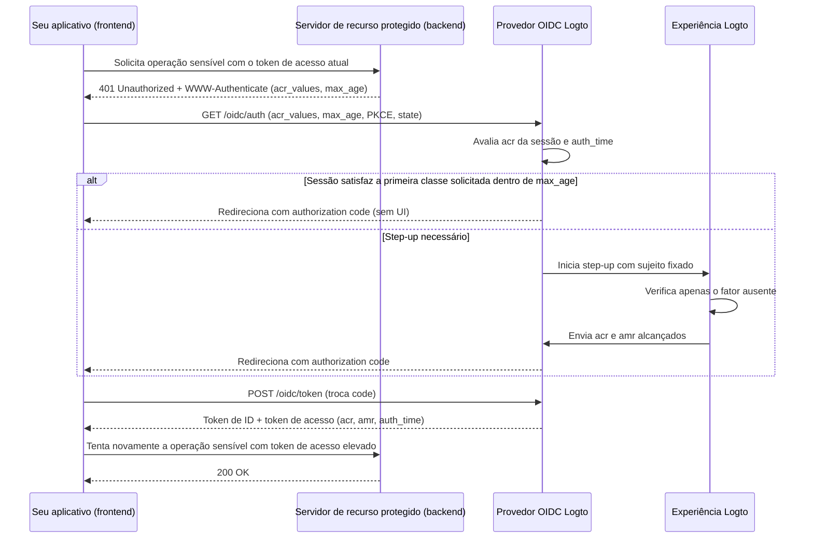

# Autenticação step-up

A autenticação step-up permite que um aplicativo exija autenticação recente do usuário ou um nível mais forte de garantia de autenticação antes de realizar operações sensíveis—como autorizar um pagamento, visualizar registros confidenciais ou modificar configurações de segurança da conta—sem desconectar o usuário.

O Logto implementa autenticação step-up baseada em padrões, construída sobre [OpenID Connect Core](https://openid.net/specs/openid-connect-core-1_0.html), [RFC 9470 (OAuth 2.0 Step Up Authentication Challenge Protocol)](https://www.rfc-editor.org/rfc/rfc9470.html) e [RFC 8176 (Authentication Method Reference Values)](https://www.rfc-editor.org/rfc/rfc8176.html):

1. Servidores de recursos protegidos desafiam tokens insuficientes com `401 Unauthorized` e um cabeçalho RFC 9470 `WWW-Authenticate` contendo `acr_values` e `max_age`.
2. Seu aplicativo inicia um Authorization Code Flow com `acr_values` e `max_age`. Quando já existe uma sessão autenticada, o Logto fixa o usuário conectado e solicita apenas a verificação ausente.
3. O Logto registra o contexto de autenticação alcançado (`acr`, `amr` e `auth_time`) na sessão e o emite em tokens de ID, tokens de acesso JWT e respostas de introspecção de token opaco.



## Modelo de contexto de autenticação \{#authentication-context-model}

Cada login, registro e step-up concluído pela Experiência Logto registra três reivindicações padrão na sessão OIDC, independentemente de o aplicativo ter solicitado `acr_values` ou não:

| Claim       | Tipo       | Descrição                                                                                               |
| ----------- | ---------- | ------------------------------------------------------------------------------------------------------- |
| `acr`       | `string`   | Authentication Context Class Reference—o nível de garantia alcançado. Omitido quando nenhum é atendido. |
| `amr`       | `string[]` | Authentication Methods References—os métodos de verificação usados naquela interação.                   |
| `auth_time` | `number`   | Timestamp epoch (em segundos) quando a autenticação do usuário foi concluída.                           |

O Logto anuncia essas capacidades em OIDC Discovery (`/.well-known/openid-configuration` e `/.well-known/oauth-authorization-server`):

```json
{
  "acr_values_supported": ["urn:logto:acr:1fa", "urn:logto:acr:mfa"],
  "claims_supported": ["sub", "acr", "amr", "auth_time"]
}
```

Em tokens de ID, `acr`, `amr` e `auth_time` são incluídos sob o escopo padrão `openid` sempre que presentes na sessão. Em tokens de acesso do usuário, o Logto os copia do authorization code, device code ou refresh token para os payloads JWT e respostas de introspecção de token opaco. A rotação do refresh token preserva o `acr`, `amr` e `auth_time` originais—atualizar um token nunca avança o `auth_time`. Outros tipos de concessão (como client credentials e token exchange) não emitem reivindicações de contexto de autenticação.

### Valores ACR suportados \{#supported-acr-values}

O Logto define dois valores de Authentication Context Class Reference (`acr`):

| Valor ACR           | Significado                                                                                                                                                                                                   | Satisfaz                                 |
| ------------------- | ------------------------------------------------------------------------------------------------------------------------------------------------------------------------------------------------------------- | ---------------------------------------- |
| `urn:logto:acr:1fa` | Pelo menos um fator que o Logto verificou diretamente ou estabeleceu na interação: senha, código de verificação de email ou telefone principal, magic link (token único no login) ou um fator MFA cadastrado. | `urn:logto:acr:1fa`                      |
| `urn:logto:acr:mfa` | Uma prova de primeiro fator verificável pelo Logto (função `1fa`) combinada com uma prova de função `mfa` de um **fator diferente**, ou uma asserção WebAuthn / passkey verificada pelo usuário sozinha.      | `urn:logto:acr:mfa`, `urn:logto:acr:1fa` |

A relação de satisfação é `urn:logto:acr:mfa` → `urn:logto:acr:1fa`: qualquer sessão ou token com `urn:logto:acr:mfa` também satisfaz um requisito para `urn:logto:acr:1fa`. Os valores padrão `phr` e `phrh` não são suportados; cerimônias WebAuthn e passkey exigem verificação do usuário e mapeiam para `urn:logto:acr:mfa`.

Ao derivar `urn:logto:acr:mfa`, o Logto classifica cada método verificável pelo Logto pelo papel que pode preencher:

- **Função de primeiro fator (`1fa`)**: senha, código de verificação de email principal, código de verificação de telefone principal e token único (apenas login).
- **Função de segundo fator (`mfa`)**: OTP de aplicativo autenticador (TOTP), código de backup, código de verificação de email MFA e código de verificação de telefone MFA. Um fator de função `mfa` verificado sem um primeiro fator verificável pelo Logto (por exemplo, login social + TOTP) atinge `urn:logto:acr:1fa`, não `urn:logto:acr:mfa`.
- **Função autossuficiente (`both`)**: login com passkey e MFA WebAuthn com verificação do usuário satisfazem ambas as funções em uma única cerimônia e atingem apenas `urn:logto:acr:mfa`.
- **Regra de fatores distintos**: `urn:logto:acr:mfa` exige dois fatores **diferentes**. Dois primeiros fatores (como código de verificação de email + senha durante o registro), dois fatores de função `mfa` (como TOTP + código de backup) ou duas provas do mesmo canal subjacente (como código de email principal + código de email MFA) contam como um único fator ou função e atingem `urn:logto:acr:1fa`.
- **Dispositivos confiáveis e MFA adaptativo**: o cumprimento de [dispositivo confiável](/end-user-flows/mfa/trusted-devices) e pulos de MFA adaptativo não provam nada na interação atual e não contribuem para o `acr` (um login por senha que pula MFA via dispositivo confiável resulta em `acr="urn:logto:acr:1fa"` e `amr=["pwd"]`).

O registro registra o contexto de autenticação sob as mesmas regras porque as credenciais criadas ao criar a conta provam aquela conta. Por exemplo, um registro de nome de usuário e senha resulta em `acr="urn:logto:acr:1fa"` e `amr=["pwd"]`.

### Mapeamento AMR \{#amr-mapping}

O Logto preenche `amr` com valores do [RFC 8176](https://www.rfc-editor.org/rfc/rfc8176.html), além de `fed` para autenticação federada:

| Método de verificação Logto                                           | Valores `amr`        | Contribui para `acr` |
| --------------------------------------------------------------------- | -------------------- | -------------------- |
| Senha (verificada ou recém-definida durante registro ou step-up)      | `pwd`                | Sim (função `1fa`)   |
| Código de verificação de email principal                              | `otp`                | Sim (função `1fa`)   |
| Código de verificação de telefone principal                           | `sms`                | Sim (função `1fa`)   |
| Token único / magic link (apenas login; indisponível em step-up)      | `otp`                | Sim (função `1fa`)   |
| OTP de aplicativo autenticador (TOTP, verificado ou recém-cadastrado) | `otp`                | Sim (função `mfa`)   |
| Código de verificação de email MFA                                    | `otp`                | Sim (função `mfa`)   |
| Código de verificação de telefone MFA                                 | `sms`                | Sim (função `mfa`)   |
| Código de backup                                                      | `otp`                | Sim (função `mfa`)   |
| MFA WebAuthn ou login com passkey com verificação do usuário          | `pop`, `user`, `mfa` | Sim (ambas funções)  |
| Login social ou SSO corporativo                                       | `fed`                | Não                  |
| Qualquer interação cujo `acr` alcançado seja `urn:logto:acr:mfa`      | adiciona `mfa`       | —                    |

#### Autenticação federada (`fed`) \{#federated-authentication-fed}

O Logto emite `fed` para indicar que o usuário autenticou por meio de uma asserção social ou SSO corporativa upstream cujo método o Logto não pode verificar diretamente.

- Um login ou registro puramente social ou SSO corporativo registra `amr=["fed"]` e um novo `auth_time`, **sem reivindicação `acr`**.
- `fed` não é um primeiro fator, e repetir o login upstream nunca eleva o `acr`. Completar um fator verificável pelo Logto após login social (como TOTP) resulta em `acr="urn:logto:acr:1fa"` e `amr=["fed", "otp"]`.
- `auth_time` sozinho não carrega garantia—sempre verifique `acr` junto com `auth_time`.
- Qual provedor upstream autenticou o usuário é exposto nas reivindicações `identities` e `sso_identities` em vez de codificado em `amr`.

### Como o step-up atualiza as reivindicações da sessão e do token \{#how-step-up-updates-session-and-token-claims}

Quando uma solicitação de autorização com `acr_values` chega em uma sessão OIDC existente e requer interação, a Experiência entra em **modo step-up**:

- **Fixação de sujeito e ACR cumulativo**: O Logto fixa o `sub` da sessão atual (sem troca de conta, entrada de identificador ou registro) e solicita apenas a garantia ausente. Métodos de sessão inequívocos carregam sua função para o step-up:
  - Uma sessão autenticada com `pwd` ou `sms` já fornece uma contribuição `1fa`, então subir para `urn:logto:acr:mfa` solicita **apenas** um fator MFA cadastrado (mesmo quando `max_age=0` ou `prompt=login` força autenticação fresca).
  - Uma sessão social ou SSO corporativa (`amr=["fed"]`) não fornece contribuição `1fa`, então atingir `urn:logto:acr:mfa` exige provar (ou estabelecer) um primeiro fator antes do MFA, ou verificar uma passkey WebAuthn.
- **`amr` e `auth_time` refletem apenas a interação atual**: Em uma sessão por senha, verificar TOTP durante o step-up produz `acr="urn:logto:acr:mfa"`, `amr=["otp", "mfa"]` e um novo `auth_time`. **As relying parties devem ler a garantia de `acr` e não procurar um primeiro fator em `amr`.**
- **Substituição de sessão, não mesclagem**: Após o step-up, o `acr`, `amr` e `auth_time` da sessão são substituídos pelo contexto alcançado na nova interação. Por exemplo, reautenticação por senha para `urn:logto:acr:1fa` define a sessão como `acr="urn:logto:acr:1fa"` e `amr=["pwd"]`. Tokens emitidos anteriormente mantêm as reivindicações capturadas quando foram criados.
- **Substituições de política e efeitos colaterais**: Solicitar `urn:logto:acr:1fa` exige uma verificação ativa elegível e não executa novamente a política de MFA de login do tenant. Solicitar `urn:logto:acr:mfa` ignora cumprimento de dispositivo confiável, preferências do usuário `skipMfaOnSignIn` e resultados de MFA adaptativo não acionados. Step-up puro não executa efeitos colaterais de login como webhooks `PostSignIn` ou ações.

Se não existir uma sessão OIDC autenticada quando `acr_values` for solicitado, o Logto executa o fluxo normal de login ou registro e aplica o ACR solicitado como requisito de conclusão antes de emitir o authorization code.

## Solicitar autenticação step-up \{#request-step-up-authentication}

Passe `acr_values` e `max_age` em uma solicitação Authorization Code Flow para `/oidc/auth`.

### Semântica de lista ordenada de `acr_values` \{#ordered-list-semantics-of-acr-values}

`acr_values` é uma lista delimitada por espaço de valores ACR aceitáveis em **ordem de preferência do solicitante** (por exemplo, `urn:logto:acr:mfa urn:logto:acr:1fa`). O Logto ignora valores não reconhecidos; se **nenhum** dos valores solicitados for suportado (por exemplo, `acr_values=phr`), o Logto falha imediatamente antes de qualquer UI e redireciona para `redirect_uri` com `error=unmet_authentication_requirements`.

Quando pelo menos uma classe suportada é solicitada:

1. **Primeira classe já satisfeita**: Se uma sessão autenticada satisfaz a **primeira** classe suportada em `acr_values`, atende `max_age` e `prompt=login` não foi solicitado, o Logto emite um authorization code imediatamente sem UI.
2. **Apenas uma classe posterior satisfeita**: Se a sessão satisfaz uma classe listada depois, mas não a primeira—por exemplo, `acr_values="urn:logto:acr:mfa urn:logto:acr:1fa"` em uma sessão `1fa`—o Logto ainda inicia uma interação step-up para buscar a classe anterior (`urn:logto:acr:mfa`).
   - Se o usuário pode atingir `urn:logto:acr:mfa` (verificando um fator MFA cadastrado ou cadastrando um), a Experiência solicita isso.
   - Se `urn:logto:acr:mfa` for inalcançável (por exemplo, o usuário não tem fator MFA cadastrado e o tenant não habilita TOTP ou WebAuthn cadastráveis), o Logto recai para a próxima classe alcançável (`urn:logto:acr:1fa`). Quando a sessão já satisfaz essa classe de fallback e nenhuma autenticação fresca foi forçada, o Logto finaliza sem mostrar UI e preserva o `auth_time` original da sessão.
3. **Falha estrita com `unmet_authentication_requirements`**: O Logto nunca emite um token com ACR mais fraco do que a classe que a interação busca. Apenas quando **nenhuma** classe listada é alcançável o Logto redireciona de volta para `redirect_uri` com `error=unmet_authentication_requirements`.

### Solicitações estritas vs. padrão de retry com classe mais fraca \{#strict-requests-vs-the-retry-with-weaker-class-pattern}

Dependendo de como seu aplicativo lida com usuários que não podem satisfazer MFA, escolha um dos dois padrões:

- **Exigir uma classe específica estritamente, depois tentar novamente ou ramificar no seu app**: Solicite apenas `acr_values=urn:logto:acr:mfa`. O Logto garante um token `mfa` ou um redirecionamento `error=unmet_authentication_requirements`. Em `unmet_authentication_requirements`, seu handler de callback pode decidir explicitamente se tenta novamente a autorização com `acr_values=urn:logto:acr:1fa`, bloqueia a operação ou encaminha a solicitação para um fluxo de aprovação.
- **Declarar fallback ordenado em uma solicitação**: Solicite `acr_values="urn:logto:acr:mfa urn:logto:acr:1fa"`. O Logto busca `mfa` sempre que possível e recai automaticamente para `1fa` apenas quando `mfa` não pode ser alcançado para aquele usuário e tenant. Verifique `acr` no token de acesso resultante para ver qual nível foi alcançado.

:::note
Abandonar uma tela de step-up não aciona fallback nem notifica seu app—não há endpoint de cancelamento, e uma interação abandonada simplesmente expira ou é substituída pela próxima solicitação de autorização. Mantenha o estado da ação pendente em seu aplicativo e limpe-o se o usuário voltar sem completar o callback.
:::

### Combinando `max_age` e `acr_values` \{#combining-max-age-and-acr-values}

`max_age` especifica o tempo máximo permitido em segundos desde a última autenticação ativa do usuário (`auth_time`):

- `max_age` verifica `auth_time`, **não** o `exp` do token. Atualizar tokens nunca redefine `auth_time`.
- `max_age=0` (ou `prompt=login`) força verificação interativa fresca mesmo quando a sessão já possui o `acr` solicitado.
- `max_age` **sem** `acr_values` leva ao fluxo regular de `/sign-in` e não impõe nível de garantia—um usuário pode se reautenticar com login social, atualizando `auth_time` sem `acr`. Quando sua operação exige frescor e garantia verificada pelo Logto, sempre envie **ambos** `acr_values` e `max_age`.

### Detecção silenciosa de lacunas com `prompt=none` \{#silent-gap-detection-with-prompt-none}

Para verificar se a sessão Logto atual do usuário já atende a um requisito de garantia e frescor sem mostrar UI ou oferecer cadastro, combine `prompt=none` com `acr_values` (e opcionalmente `max_age`):

- **Satisfeito**: Como `prompt=none` não permite UI para buscar ordem de preferência, o Logto emite um authorization code se a sessão satisfaz **qualquer** classe suportada em `acr_values` dentro de `max_age`.
- **Sessão autenticada, requisito não atendido ou expirada**: O Logto redireciona com `error=unmet_authentication_requirements` (com precedência sobre erros de `max_age`).
- **Nenhuma sessão autenticada**: O Logto redireciona com `error=login_required`.

### URL de autorização e exemplos de SDK \{#authorization-url-and-sdk-examples}

Solicitação de autorização bruta solicitando MFA nos últimos 5 minutos (`300` segundos) para um recurso de API protegido:

```http
GET /oidc/auth?client_id=my-web-app
  &redirect_uri=https%3A%2F%2Fapp.example.com%2Fcallback
  &response_type=code
  &scope=openid%20offline_access%20payment%3Awrite
  &resource=https%3A%2F%2Fapi.example.com
  &acr_values=urn%3Alogto%3Aacr%3Amfa
  &max_age=300
  &state=8f3d9c1b2a...
  &nonce=4e1a7b9c0f...
  &code_challenge=E9Melhoa2OwvFrEMTJguCHaoeK1t8URWbuGJSstw-cM
  &code_challenge_method=S256 HTTP/1.1
Host: [tenant-id].logto.app
```

Com um SDK JavaScript / TypeScript do Logto (como `@logto/browser`, `@logto/react`, `@logto/vue` ou `@logto/node`), passe `acr_values` e `max_age` via `extraParams`. Em aplicativos single-page onde o usuário já está conectado, defina `clearTokens: false` para que os tokens em cache permaneçam intactos se o usuário abandonar o step-up ou retornar com um erro OIDC:

```ts
await signIn({
  redirectUri: 'https://app.example.com/callback',
  clearTokens: false,
  extraParams: {
    acr_values: 'urn:logto:acr:mfa',
    max_age: '300',
  },
});
```

Na rota de callback, inspecione `error` antes de chamar `handleSignInCallback()`:

```ts
const params = new URLSearchParams(window.location.search);
const error = params.get('error');

if (error === 'unmet_authentication_requirements') {
  // Usuário não pode atingir o ACR solicitado (ou prompt=none detectou uma lacuna).
  // Opcionalmente tente novamente com uma classe mais fraca como 'urn:logto:acr:1fa', ou mostre uma explicação.
  return;
}
```

:::tip[Elevando para um recurso de API diferente]
O contexto de autenticação pertence à sessão Logto, não a um único recurso de API. Solicitar step-up com um indicador de `resource` emite tokens elevados para esse recurso (solicitando consentimento se seus escopos ainda não foram concedidos). Tokens emitidos anteriormente para outros recursos de API permanecem inalterados; cada servidor de recurso avalia `acr` e `auth_time` no token apresentado a ele.
:::

## Desafiar e validar em um servidor de recurso protegido \{#challenge-and-validate-on-a-protected-resource-server}

As decisões de autorização pertencem ao seu backend ou servidor de recurso protegido:

- Sempre valide o **token de acesso (Access token)** no servidor de recurso, nunca o token de ID.
- Aplicativos de navegador devem tratar tokens de acesso como opacos. Seu aplicativo pode ler `acr` e `auth_time` do token de ID local para coordenar o estado da UI antes de enviar uma solicitação, mas nunca deve confiar na decodificação do lado do cliente para aplicação de segurança.

### Retornar um desafio RFC 9470 \{#return-an-rfc-9470-challenge}

Quando um token de acesso é válido como bearer token (assinatura válida, `iss`, `aud`, `exp` e `scope`), mas não possui o `acr` exigido ou excede sua janela `max_age`, responda com `401 Unauthorized` e um cabeçalho [RFC 9470](https://www.rfc-editor.org/rfc/rfc9470.html) `WWW-Authenticate`:

```http
HTTP/1.1 401 Unauthorized
WWW-Authenticate: Bearer error="insufficient_user_authentication",
  error_description="Multi-factor authentication within the last 5 minutes is required",
  acr_values="urn:logto:acr:mfa",
  max_age="300"
```

Quando seu aplicativo receber `401` com `error="insufficient_user_authentication"`, analise `acr_values` e `max_age` do `WWW-Authenticate`, persista a rota ou intenção pendente do usuário localmente, acione `signIn()` com esses parâmetros e tente novamente a chamada de API uma vez com o novo token de acesso emitido. Proteja-se contra loops de retry não iniciando um segundo step-up se a solicitação repetida após o callback ainda receber `401`.

### Validar tokens de acesso JWT \{#validate-jwt-access-tokens}

Quando um indicador de recurso de API (`resource`) é solicitado, o Logto emite um token de acesso JWT assinado que inclui `acr`, `amr` e `auth_time`:

```json
{
  "iss": "https://[tenant-id].logto.app/oidc",
  "sub": "user-id",
  "aud": "https://api.example.com",
  "client_id": "my-web-app",
  "scope": "payment:write",
  "exp": 1787749200,
  "iat": 1787745601,
  "auth_time": 1787745600,
  "acr": "urn:logto:acr:mfa",
  "amr": ["pwd", "otp", "mfa"]
}
```

Após [validar as reivindicações padrão do JWT](/authorization/validate-access-tokens) (assinatura contra JWKS, `iss`, `aud`, `exp` e `scope`), verifique `acr` usando a relação de satisfação e compare `auth_time` (nunca `iat`) com sua política:

```ts
import { createRemoteJWKSet, jwtVerify } from 'jose';

const issuer = 'https://[tenant-id].logto.app/oidc';
const jwks = createRemoteJWKSet(new URL(`${issuer}/jwks`));

type LogtoAcr = 'urn:logto:acr:1fa' | 'urn:logto:acr:mfa';

const satisfiedAcrs: Record<string, readonly LogtoAcr[]> = {
  'urn:logto:acr:1fa': ['urn:logto:acr:1fa'],
  'urn:logto:acr:mfa': ['urn:logto:acr:mfa', 'urn:logto:acr:1fa'],
};

const acrSatisfies = (achieved: unknown, required: LogtoAcr): boolean => {
  if (typeof achieved !== 'string') {
    return false;
  }

  return Boolean(satisfiedAcrs[achieved]?.includes(required));
};

export async function verifySensitiveRequest(
  bearerToken: string,
  requiredAcr: LogtoAcr = 'urn:logto:acr:mfa',
  maxAgeSeconds = 300
) {
  const { payload } = await jwtVerify(bearerToken, jwks, {
    issuer,
    audience: 'https://api.example.com',
  });

  const authTime = payload.auth_time;
  const nowSeconds = Date.now() / 1000;
  const isFresh =
    typeof authTime === 'number' &&
    Number.isInteger(authTime) &&
    nowSeconds - authTime >= 0 &&
    nowSeconds - authTime <= maxAgeSeconds;

  if (!acrSatisfies(payload.acr, requiredAcr) || !isFresh) {
    const challenge =
      `Bearer error="insufficient_user_authentication", ` +
      `error_description="Recent user authentication is required", ` +
      `acr_values="${requiredAcr}", max_age="${maxAgeSeconds}"`;

    return { authorized: false as const, wwwAuthenticate: challenge };
  }

  return { authorized: true as const, payload };
}
```

### Validar tokens de acesso opacos via introspecção \{#validate-opaque-access-tokens-via-introspection}

Quando nenhum `resource` de API é solicitado, o Logto emite um [token de acesso opaco](/concepts/opaque-token). Valide-o chamando o endpoint de introspecção [RFC 7662](https://www.rfc-editor.org/rfc/rfc7662.html) (`POST /oidc/token/introspection`) com autenticação do cliente; o Logto retorna `acr`, `amr` e `auth_time` no topo de uma resposta ativa:

```bash
curl -X POST https://[tenant-id].logto.app/oidc/token/introspection \
  -u "<client_id>:<client_secret>" \
  -H "Content-Type: application/x-www-form-urlencoded" \
  --data-urlencode "token=<opaque_access_token>" \
  --data-urlencode "token_type_hint=access_token"
```

Exemplo de resposta de introspecção:

```json
{
  "active": true,
  "client_id": "my-web-app",
  "exp": 1787749200,
  "iat": 1787745601,
  "iss": "https://[tenant-id].logto.app/oidc",
  "scope": "openid offline_access profile",
  "sub": "user-id",
  "token_type": "Bearer",
  "acr": "urn:logto:acr:1fa",
  "amr": ["pwd"],
  "auth_time": 1787745600
}
```

Verifique primeiro se `active === true`, depois aplique os mesmos testes de `acrSatisfies` e `auth_time` acima.

### Reivindicações reservadas em Custom JWT \{#reserved-claims-in-custom-jwt}

Em tokens de acesso do usuário, `acr`, `amr` e `auth_time` são reservados: um [script de token de acesso personalizado](/developers/custom-token-claims/create-script) não pode sobrescrevê-los nem adicioná-los onde o Logto não deriva contexto de autenticação.

## Estabelecendo um primeiro fator e cadastrando MFA \{#establishing-a-first-factor-and-enrolling-mfa}

Um usuário solicitado para `urn:logto:acr:1fa` ou `urn:logto:acr:mfa` pode ainda não ter as credenciais necessárias para atingir essa classe—por exemplo, um usuário apenas com senha que nunca cadastrou MFA, ou um usuário apenas social que não tem senha, código de email/telefone principal ou fator MFA. O Logto permite estabelecer um primeiro fator ausente e cadastrar MFA **dentro da mesma interação de login ou step-up**, protegido por pré-condições de frescor rigorosas para que um cookie de sessão roubado sozinho nunca possa cadastrar ou estabelecer nada:

- **Cadastrando um fator MFA**: Oferecido apenas quando o usuário não tem fator MFA cadastrado que possa atingir `urn:logto:acr:mfa`, e **apenas após um primeiro fator verificável pelo Logto (`1fa` ou classe `both`) ter sido verificado ou estabelecido na interação atual**.
  - Nem o `acr` armazenado na sessão nem um cookie de dispositivo confiável satisfazem esse requisito. Um usuário conectado por senha que não tem MFA deve primeiro reentrar sua senha no step-up e então pode cadastrar TOTP ou uma passkey WebAuthn (com códigos de backup opcionais junto com TOTP ou WebAuthn; códigos de backup não podem ser cadastrados isoladamente).
- **Estabelecendo um primeiro fator**: Oferecido apenas quando o usuário não possui um primeiro fator que possa atingir a classe buscada (ou não tem método elegível algum, como um usuário apenas social solicitando `1fa`, ou tem apenas um fator de função `mfa` como TOTP ao solicitar `mfa`), e **apenas quando a interação atual possui uma prova de sujeito fresca**:
  - Durante **step-up em uma sessão existente**, o usuário prova o sujeito reautenticando com um de seus conectores sociais ou SSO corporativos já vinculados e habilitados na Experiência de Login. Se o callback upstream resolver para outro usuário ou uma conta não vinculada, o Logto rejeita com `403`—nem registro nem vinculação de conta são permitidos.
  - Uma vez que a prova de sujeito seja bem-sucedida, o usuário pode estabelecer qualquer método de primeiro fator que o tenant habilite para login: uma senha (quando login por senha está habilitado) ou um email ou telefone principal verificado (quando habilitado para login com conector de email ou SMS ativo). Por exemplo, um usuário apenas social que se reautentica com Google e define uma senha termina com `acr="urn:logto:acr:1fa"` e `amr=["fed", "pwd"]`.
  - Estabelecer nunca é oferecido como alternativa quando o usuário já tem um método elegível para verificar.

O Logto considera uma credencial ou fator MFA estabelecido e vinculado durante uma interação igual a um verificado nela, então o usuário conclui o step-up imediatamente sem ser desafiado uma segunda vez para o fator que acabou de configurar. Quando um usuário estabelece uma nova credencial ou fator durante step-up puro, o Logto emite o evento webhook `User.Data.Updated`. Se o tenant não habilitar nada que o usuário possa verificar, estabelecer ou cadastrar (ou o usuário não tiver conector social/SSO vinculado para provar o sujeito), o Logto finaliza a interação com `error=unmet_authentication_requirements`.

## Account API e Account Center \{#account-api-and-account-center}

### Política de autorização da Account API \{#account-api-authorization-policy}

Operações sensíveis da [Account API](/end-user-flows/account-settings/by-account-api)—como atualizar senha, email principal, telefone principal ou nome de usuário, vincular ou remover identidades sociais, gerenciar fatores e configurações de MFA, gerenciar tokens de acesso pessoal e visualizar ou revogar sessões ativas, concessões de aplicativos e dispositivos confiáveis—exigem:

1. **Acesso de aplicativo de primeira parte**: Aplicativos OIDC de terceiros (`isThirdParty: true`) e clientes Client ID Metadata Document (CIMD) não podem modificar recursos sensíveis da Account API nem receber desafios step-up da Account API, mesmo com `urn:logto:acr:mfa`.
2. **Verificação recente de identidade**, satisfeita por **um dos seguintes**:
   - **Contexto de autenticação OIDC**: O token de acesso opaco carrega `acr` satisfazendo `urn:logto:acr:1fa` (`urn:logto:acr:1fa` ou `urn:logto:acr:mfa`) **e** `now - auth_time <= maximumAuthenticationAgeInSeconds` (avaliado estritamente a partir de `auth_time`, nunca `iat`).
   - **Registro de verificação (`logto-verification-id`)**: Para integrações diretas com Account API, o Logto continua aceitando um ID de registro de verificação válido e não expirado de 10 minutos no cabeçalho de solicitação `logto-verification-id` criado via `POST /api/verifications/password` ou `POST /api/verifications/verification-code` + `/verify`.

:::info[Configurando a janela de autenticação recente]
Por padrão, `maximumAuthenticationAgeInSeconds` é **600 segundos (10 minutos)**. Você pode configurá-lo por tenant de **1 a 120 minutos (60–7.200 segundos)** em <CloudLink to="/sign-in-experience/account-center">Console > Login & conta > Account center</CloudLink> em **Autenticação recente**, ou via Management API (`PATCH /api/account-center` com `maximumAuthenticationAgeInSeconds`).

Com contexto de autenticação OIDC, um usuário que acabou de fazer login ou se registrar com um método verificável pelo Logto pode realizar operações sensíveis da Account API dentro dessa janela sem um prompt de verificação separado. Observe que registros `logto-verification-id` criados pela Verification API mantêm seu TTL fixo de 10 minutos para compatibilidade retroativa.
:::

A Account API também preserva a exceção de senha inicial: um usuário que atualmente não tem senha, email principal ou telefone principal pode definir uma senha inicial via `POST /api/my-account/password` sem verificação recente de identidade. Definir uma senha pela Account API não atualiza o `acr` da sessão OIDC e não autoriza operações sensíveis subsequentes.

### Desafio `WWW-Authenticate` da Account API \{#account-api-www-authenticate-challenge}

Quando uma solicitação de Account API de primeira parte não possui tanto um token de acesso `urn:logto:acr:1fa` fresco quanto um cabeçalho `logto-verification-id` válido, o Logto responde com `401 Unauthorized`, preservando o corpo de erro JSON existente para compatibilidade e adicionando o cabeçalho RFC 9470 `WWW-Authenticate` com o `max_age` configurado do tenant:

```http
HTTP/1.1 401 Unauthorized
WWW-Authenticate: Bearer error="insufficient_user_authentication", error_description="Recent user authentication is required", acr_values="urn:logto:acr:1fa", max_age="600"
Content-Type: application/json

{
  "code": "verification_record.permission_denied",
  "message": "Permissão negada, por favor reautentique."
}
```

### Account Center pré-construído \{#prebuilt-account-center}

A [UI pré-construída do Account Center](/end-user-flows/account-settings/by-account-center-ui) (`/account/*`) usa autenticação step-up OIDC exclusivamente e nunca cria registros de permissão `logto-verification-id`:

- Ela inspeciona `acr` e `auth_time` em seu token de ID local para iniciar step-up proativamente antes de ações inline sensíveis ou subpáginas multi-etapas quando o login não possui `urn:logto:acr:1fa` ou está expirado, e também lida com desafios RFC 9470 `401` da Account API como fallback.
- Após o step-up, o Account Center substitui seu conjunto de tokens e retoma a ação pendente no máximo uma vez.

## Recursos relacionados \{#related-resources}

<Url href="/end-user-flows/mfa">Autenticação multifatorial (Multi-factor authentication)</Url>
<Url href="/authorization/validate-access-tokens">
  Como validar tokens de acesso (Access tokens) em seu serviço de API ou backend
</Url>
<Url href="/concepts/opaque-token">Token opaco (Opaque token) e introspecção</Url>
<Url href="/end-user-flows/account-settings/by-account-api">
  Configurações de conta pela Account API
</Url>
<Url href="/end-user-flows/account-settings/by-account-center-ui">
  Configurações de conta pela UI pré-construída do Account Center
</Url>
