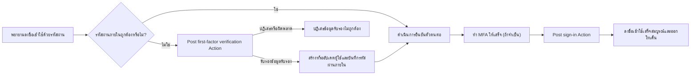

# Actions

Logto Actions ช่วยให้คุณสามารถรัน JavaScript ที่เชื่อถือได้ ณ จุดที่กำหนดในโฟลว์การยืนยันตัวตน (Authentication) สคริปต์ Action จะทำงานแบบ synchronous: คำขอการยืนยันตัวตนจะรอผลลัพธ์จากสคริปต์ และผลลัพธ์นั้นสามารถอัปเดตผู้ใช้หรือกำหนดได้ว่าโฟลว์จะดำเนินต่อหรือไม่

Actions มีประโยชน์เมื่อการตัดสินใจต้องเกิดขึ้นภายในโฟลว์การยืนยันตัวตน (Authentication) กรณีการใช้งานที่พบบ่อย เช่น:

- ย้ายผู้ใช้และรหัสผ่านจากระบบระบุตัวตนเดิมเมื่อพวกเขาลงชื่อเข้าใช้ครั้งแรก
- รีเฟรชโปรไฟล์ผู้ใช้หรือข้อมูลเฉพาะแอปก่อนที่ Logto จะดำเนินการลงชื่อเข้าใช้ให้เสร็จสมบูรณ์
- เรียกใช้บริการภายนอกและนำผลลัพธ์มาใช้กับผู้ใช้ Logto

:::note
Actions มีให้ใช้งานใน Logto Cloud Enterprise plans และใน Logto OSS ที่ติดตั้งเอง (v1.43.0 ขึ้นไป)
:::

:::warning
สคริปต์ Action สามารถมีผลต่อการยืนยันตัวตน (Authentication) และแก้ไขข้อมูลผู้ใช้ได้ เฉพาะผู้ดูแลระบบที่เชื่อถือได้เท่านั้นที่ควรได้รับสิทธิ์ในการดู สร้าง แก้ไข ทดสอบ เปิดใช้งาน หรือ ลบ

ในระบบที่ติดตั้งเอง สคริปต์ Action จะรันภายใน process ของ Logto server พร้อมสิทธิ์ของมัน การให้สิทธิ์แก้ไขหรือทดสอบสคริปต์จึงเทียบเท่ากับการให้สิทธิ์รันโค้ดบนโฮสต์ของ Logto ดังนั้น Admin Console ไม่ควรแชร์กับผู้ใช้ที่ไม่เชื่อถือ จงปฏิบัติต่อสคริปต์เสมือนเป็นโค้ดฝั่งเซิร์ฟเวอร์ที่เชื่อถือได้; runtime จะจำกัดเวลาและหน่วยความจำของสคริปต์ แต่ไม่ใช่ขอบเขตความปลอดภัยสำหรับโค้ดที่ไม่เชื่อถือ
:::

## Actions ในโฟลว์การลงชื่อเข้าใช้ \{#how-actions-fit-into-sign-in}

ปัจจุบัน Logto มี Action สองประเภท:



| ประเภท Action                                                                        | เมื่อไหร่ที่มันทำงาน                                                                                                       | สิ่งที่สามารถทำได้                                                                             |
| ------------------------------------------------------------------------------------ | -------------------------------------------------------------------------------------------------------------------------- | ---------------------------------------------------------------------------------------------- |
| [Post first-factor verification](/developers/actions/post-first-factor-verification) | ระหว่างการลงชื่อเข้าใช้ด้วยรหัสผ่าน เฉพาะเมื่อการตรวจสอบรหัสผ่านภายในของ Logto ล้มเหลว จะไม่ทำงานเมื่อรหัสผ่านภายในถูกต้อง | ตรวจสอบข้อมูลรับรองกับระบบเดิม จากนั้นสร้างหรืออัปเดตผู้ใช้ Logto และย้ายรหัสผ่านกับปัจจัย MFA |
| [Post sign-in](/developers/actions/post-sign-in)                                     | หลังจากผู้ใช้ผ่านการยืนยันตัวตนครบทุกปัจจัย รวมถึง MFA (ถ้าจำเป็น) และก่อนที่ Logto จะลงชื่อเข้าใช้เสร็จและออกโทเค็น       | อัปเดตและเติมข้อมูลผู้ใช้ Logto ที่มีอยู่โดยใช้ context การลงชื่อเข้าใช้สุดท้าย                |

Action ทั้งสองประเภทจะทำงานเฉพาะกับ `SignIn` interactions ใน Experience API เท่านั้น Post first-factor verification ใช้กับการลงชื่อเข้าใช้ด้วยรหัสผ่านเท่านั้น; Post sign-in ไม่ขึ้นกับวิธีการยืนยันตัวตน (Authentication)

## โมเดลของสคริปต์ \{#script-model}

แต่ละประเภท Action จะมีการตั้งค่าและฟังก์ชัน JavaScript entry ชื่อ `runAction` หนึ่งตัว:

```js
const runAction = async ({ event, environmentVariables = {} }) => {
  // ตรวจสอบ event, ดึงข้อมูลภายนอกถ้าต้องการ, และคืนค่าผลลัพธ์ที่รองรับโดย Action ประเภทนี้
};
```

payload ประกอบด้วย:

- `event`: เหตุการณ์การยืนยันตัวตน (Authentication) จริง รูปแบบขึ้นกับประเภท Action
- `environmentVariables`: ค่าข้อความที่ตั้งค่าสำหรับ Action นี้ ค่านี้จะถูกส่งผ่าน payload ของฟังก์ชัน; จะไม่สามารถเข้าถึงผ่าน `process.env`

ตัว editor ให้ข้อมูล type แต่สคริปต์ที่บันทึกจะถูกรันเป็น JavaScript สคริปต์สามารถเป็น async และใช้ Web API มาตรฐานเหล่านี้ได้ทั้งใน Logto Cloud และ Logto ที่ติดตั้งเอง:

- `fetch`, `Request`, `Response`, และ `Headers`
- Web Crypto ผ่าน `crypto` และ `crypto.subtle`
- `TextEncoder` และ `TextDecoder`
- `URL` และ `URLSearchParams`

สคริปต์ไม่สามารถ import แพ็กเกจ หลีกเลี่ยงการใช้ global หรือ module เฉพาะ Node.js เพราะไม่สามารถใช้งานข้ามระหว่าง Logto ที่ติดตั้งเองกับ Logto Cloud และไม่อยู่ในข้อตกลงของสคริปต์ที่รองรับ

ผลลัพธ์ที่รองรับจะแตกต่างกันไปในแต่ละประเภท Action; โปรดดูหน้าข้อมูลอ้างอิงของแต่ละประเภทก่อนเปิดใช้งาน Action

## Actions และ Webhooks \{#actions-and-webhooks}

Actions และ [Webhooks](/developers/webhooks) มีวัตถุประสงค์ต่างกัน:

|                                              | Actions                                                   | Webhooks                                                   |
| -------------------------------------------- | --------------------------------------------------------- | ---------------------------------------------------------- |
| การทำงาน                                     | synchronous และอยู่ในโฟลว์การยืนยันตัวตน (Authentication) | asynchronous และอยู่นอกคำขอการยืนยันตัวตน (Authentication) |
| มีผลต่อโฟลว์การยืนยันตัวตนปัจจุบันได้หรือไม่ | ได้                                                       | ไม่ได้                                                     |
| แก้ไขผู้ใช้จากผลลัพธ์ได้หรือไม่              | ได้ โดยใช้ user patch ที่รองรับ                           | ไม่ได้โดยตรง; ผู้รับสามารถเรียก Management API แยกต่างหาก  |
| ครอบคลุมเหตุการณ์                            | จุดการยืนยันตัวตน (Authentication) ที่เลือกไว้            | เหตุการณ์ interaction และการเปลี่ยนแปลงข้อมูลที่หลากหลาย   |
| การใช้งานทั่วไป                              | ย้ายข้อมูลรับรอง, enrich โปรไฟล์ก่อนออกโทเค็น             | แจ้งเตือน, ซิงค์ downstream, วิเคราะห์ข้อมูล               |

งาน asynchronous ควรอยู่ใน Webhooks ใช้ Action เฉพาะเมื่อ Logto ต้องการผลลัพธ์ก่อนที่การยืนยันตัวตน (Authentication) จะดำเนินต่อได้

## ขั้นตอนถัดไป \{#next-steps}

- [ตั้งค่าและทดสอบ Actions](/developers/actions/configure-and-test-actions)
- [ย้ายผู้ใช้เมื่อเข้าสู่ระบบด้วยรหัสผ่าน](/developers/actions/post-first-factor-verification)
- [เติมข้อมูลผู้ใช้หลังลงชื่อเข้าใช้](/developers/actions/post-sign-in)
