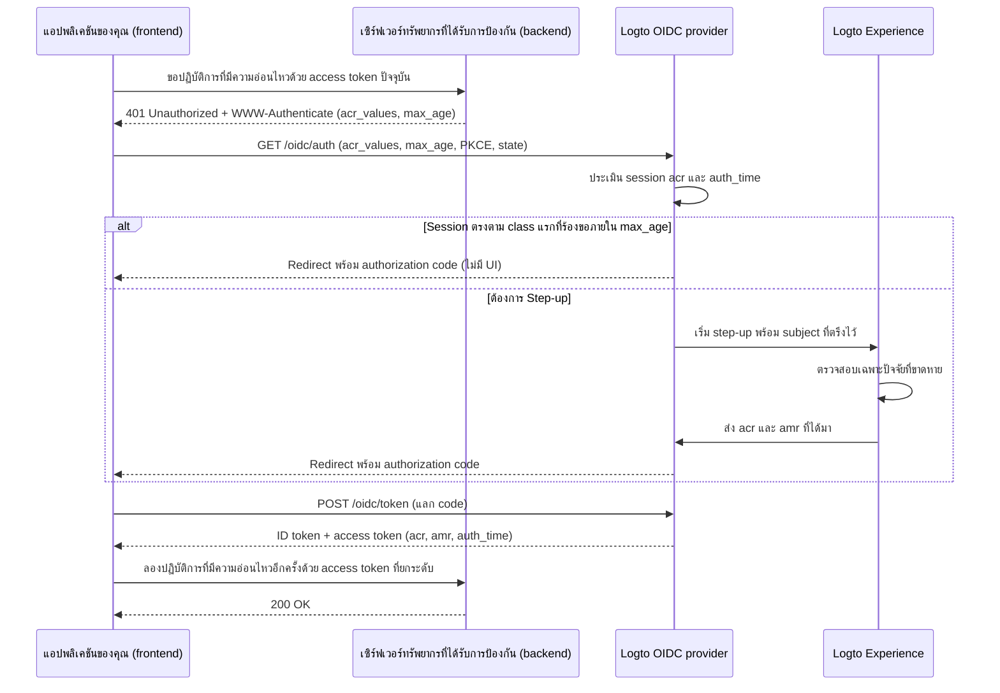

# การยืนยันตัวตนแบบ Step-up

การยืนยันตัวตนแบบ Step-up ช่วยให้แอปพลิเคชันร้องขอการยืนยันตัวตนของผู้ใช้ที่เพิ่งเกิดขึ้น หรือระดับความมั่นใจในการยืนยันตัวตนที่สูงขึ้น ก่อนดำเนินการที่มีความอ่อนไหว เช่น การอนุมัติการชำระเงิน, ดูข้อมูลลับ, หรือแก้ไขการตั้งค่าความปลอดภัยของบัญชี โดยไม่ต้องลงชื่อออก

Logto ใช้มาตรฐานการยืนยันตัวตนแบบ Step-up ตาม [OpenID Connect Core](https://openid.net/specs/openid-connect-core-1_0.html), [RFC 9470 (OAuth 2.0 Step Up Authentication Challenge Protocol)](https://www.rfc-editor.org/rfc/rfc9470.html), และ [RFC 8176 (Authentication Method Reference Values)](https://www.rfc-editor.org/rfc/rfc8176.html):

1. เซิร์ฟเวอร์ทรัพยากรที่ได้รับการป้องกันจะ challenge โทเค็นที่ไม่เพียงพอด้วย `401 Unauthorized` และ header `WWW-Authenticate` ตาม RFC 9470 ที่มี `acr_values` และ `max_age`
2. แอปพลิเคชันของคุณเริ่ม Authorization Code Flow พร้อม `acr_values` และ `max_age` เมื่อมี session ที่ยืนยันตัวตนอยู่แล้ว Logto จะตรึงผู้ใช้ที่ลงชื่อเข้าใช้ไว้และขอเฉพาะการตรวจสอบที่ขาดหาย
3. Logto บันทึกบริบทการยืนยันตัวตน (`acr`, `amr`, และ `auth_time`) ใน session และส่งออกใน ID token, JWT access token, และ introspection response ของโทเค็นทึบ (opaque-token)



## โมเดลบริบทการยืนยันตัวตน (Authentication context model) \{#authentication-context-model}

ทุกการลงชื่อเข้าใช้, การลงทะเบียน, และ step-up ที่สำเร็จผ่าน Logto Experience จะบันทึกการอ้างสิทธิ์มาตรฐานสามรายการใน session OIDC ไม่ว่ามีการร้องขอ `acr_values` หรือไม่:

| การอ้างสิทธิ์ (Claim) | ประเภท (Type) | คำอธิบาย                                                                                                                  |
| --------------------- | ------------- | ------------------------------------------------------------------------------------------------------------------------- |
| `acr`                 | `string`      | การอ้างอิงคลาสบริบทการยืนยันตัวตน (Authentication Context Class Reference)—ระดับความมั่นใจที่ได้รับ หากไม่ตรงตามจะไม่แสดง |
| `amr`                 | `string[]`    | การอ้างอิงวิธีการยืนยันตัวตน (Authentication Methods References)—วิธีการตรวจสอบที่ใช้ใน interaction นั้น                  |
| `auth_time`           | `number`      | เวลาตาม epoch (วินาที) ที่การยืนยันตัวตนของผู้ใช้เสร็จสมบูรณ์                                                             |

Logto โฆษณาความสามารถเหล่านี้ใน OIDC Discovery (`/.well-known/openid-configuration` และ `/.well-known/oauth-authorization-server`):

```json
{
  "acr_values_supported": ["urn:logto:acr:1fa", "urn:logto:acr:mfa"],
  "claims_supported": ["sub", "acr", "amr", "auth_time"]
}
```

ใน ID token, `acr`, `amr`, และ `auth_time` จะถูกรวมอยู่ภายใต้ขอบเขตมาตรฐาน `openid` เมื่อมีอยู่ใน session สำหรับ user access token, Logto จะคัดลอกค่าจาก authorization code, device code, หรือ refresh token ไปยัง payload ของ JWT และ introspection response ของโทเค็นทึบ (opaque-token) การหมุน refresh token จะรักษา `acr`, `amr`, และ `auth_time` เดิมไว้—การรีเฟรชโทเค็นจะไม่เปลี่ยน `auth_time` ประเภท grant อื่น (เช่น client credentials และ token exchange) จะไม่ส่งออกการอ้างสิทธิ์บริบทการยืนยันตัวตน

### ค่า ACR ที่รองรับ \{#supported-acr-values}

Logto กำหนดค่า Authentication Context Class Reference (`acr`) สองค่า:

| ค่า ACR             | ความหมาย                                                                                                                                                                                                 | ตรงตาม (Satisfies)                       |
| ------------------- | -------------------------------------------------------------------------------------------------------------------------------------------------------------------------------------------------------- | ---------------------------------------- |
| `urn:logto:acr:1fa` | อย่างน้อยหนึ่งปัจจัยที่ Logto ตรวจสอบโดยตรงหรือสร้างขึ้นใน interaction: รหัสผ่าน, รหัสยืนยันอีเมลหลักหรือโทรศัพท์หลัก, magic link (โทเค็นใช้ครั้งเดียวขณะลงชื่อเข้าใช้), หรือปัจจัย MFA ที่ลงทะเบียนแล้ว | `urn:logto:acr:1fa`                      |
| `urn:logto:acr:mfa` | หลักฐาน first-factor ที่ Logto ตรวจสอบได้ (`1fa`-role) รวมกับหลักฐาน `mfa`-role จากปัจจัย **คนละชนิด** หรือ assertion WebAuthn / passkey ที่ผู้ใช้ยืนยันตัวเอง                                           | `urn:logto:acr:mfa`, `urn:logto:acr:1fa` |

ความสัมพันธ์การตรงตามคือ `urn:logto:acr:mfa` → `urn:logto:acr:1fa`: session หรือโทเค็นที่มี `urn:logto:acr:mfa` จะตรงตามข้อกำหนด `urn:logto:acr:1fa` ด้วย ค่า ACR มาตรฐาน `phr` และ `phrh` ไม่รองรับ; พิธี WebAuthn และ passkey ต้องการการยืนยันตัวผู้ใช้และแมปเป็น `urn:logto:acr:mfa`

เมื่ออนุมาน `urn:logto:acr:mfa`, Logto จะจัดประเภทแต่ละวิธีที่ตรวจสอบได้โดย Logto ตามบทบาทที่เติมเต็มได้:

- **บทบาท first-factor (`1fa`)**: รหัสผ่าน, รหัสยืนยันอีเมลหลัก, รหัสยืนยันโทรศัพท์หลัก, และโทเค็นใช้ครั้งเดียว (เฉพาะลงชื่อเข้าใช้)
- **บทบาท second-factor (`mfa`)**: รหัส OTP จากแอป authenticator (TOTP), รหัสสำรอง, รหัสยืนยันอีเมล MFA, และรหัสยืนยันโทรศัพท์ MFA ปัจจัย `mfa`-role ที่ตรวจสอบโดยไม่มี first factor ที่ Logto ตรวจสอบได้ (เช่น social sign-in + TOTP) จะได้แค่ `urn:logto:acr:1fa` ไม่ใช่ `urn:logto:acr:mfa`
- **บทบาท self-sufficient (`both`)**: การลงชื่อเข้าใช้ด้วย passkey และ WebAuthn MFA ที่ผู้ใช้ยืนยันตัวเองจะเติมเต็มทั้งสองบทบาทในพิธีเดียวและได้ `urn:logto:acr:mfa` เพียงอย่างเดียว
- **กฎปัจจัยต่างชนิด (Distinct-factor rule)**: `urn:logto:acr:mfa` ต้องการสองปัจจัย **คนละชนิด** สอง first factor (เช่น รหัสยืนยันอีเมล + รหัสผ่านขณะลงทะเบียน), สองปัจจัย `mfa`-role (เช่น TOTP + รหัสสำรอง), หรือสองหลักฐานจากช่องทางเดียวกัน (เช่น รหัสอีเมลหลัก + รหัส MFA อีเมล) จะนับเป็นปัจจัยเดียวหรือบทบาทเดียวและได้แค่ `urn:logto:acr:1fa`
- **อุปกรณ์ที่เชื่อถือได้และ adaptive MFA**: [trusted-device](/end-user-flows/mfa/trusted-devices) fulfillment และ adaptive-MFA skip ไม่ถือเป็นหลักฐานใน interaction ปัจจุบันและไม่ส่งผลต่อ `acr` (การลงชื่อเข้าใช้ด้วยรหัสผ่านที่ข้าม MFA ผ่านอุปกรณ์ที่เชื่อถือได้จะได้ `acr="urn:logto:acr:1fa"` และ `amr=["pwd"]`)

การลงทะเบียนจะบันทึกบริบทการยืนยันตัวตนตามกฎเดียวกัน เพราะ credential ที่สร้างขณะสร้างบัญชีถือเป็นหลักฐานของบัญชีนั้น เช่น การลงทะเบียนด้วยชื่อผู้ใช้และรหัสผ่านจะได้ `acr="urn:logto:acr:1fa"` และ `amr=["pwd"]`

### การแมป AMR \{#amr-mapping}

Logto เติมค่า `amr` ด้วยค่าจาก [RFC 8176](https://www.rfc-editor.org/rfc/rfc8176.html) และเพิ่ม `fed` สำหรับการยืนยันตัวตนแบบ federated:

| วิธีตรวจสอบของ Logto                                                                  | ค่า `amr`            | มีผลต่อ `acr` หรือไม่ |
| ------------------------------------------------------------------------------------- | -------------------- | --------------------- |
| รหัสผ่าน (ตรวจสอบแล้ว หรือเพิ่งตั้งขณะลงทะเบียนหรือ step-up)                          | `pwd`                | ใช่ (`1fa` role)      |
| รหัสยืนยันอีเมลหลัก                                                                   | `otp`                | ใช่ (`1fa` role)      |
| รหัสยืนยันโทรศัพท์หลัก                                                                | `sms`                | ใช่ (`1fa` role)      |
| โทเค็นใช้ครั้งเดียว / magic link (เฉพาะลงชื่อเข้าใช้; ไม่มีใน step-up)                | `otp`                | ใช่ (`1fa` role)      |
| OTP จากแอป authenticator (TOTP, ตรวจสอบแล้วหรือเพิ่งผูกใหม่)                          | `otp`                | ใช่ (`mfa` role)      |
| รหัสยืนยันอีเมล MFA                                                                   | `otp`                | ใช่ (`mfa` role)      |
| รหัสยืนยันโทรศัพท์ MFA                                                                | `sms`                | ใช่ (`mfa` role)      |
| รหัสสำรอง                                                                             | `otp`                | ใช่ (`mfa` role)      |
| WebAuthn MFA หรือ passkey sign-in ที่ผู้ใช้ยืนยันตัวเอง (ตรวจสอบแล้วหรือเพิ่งผูกใหม่) | `pop`, `user`, `mfa` | ใช่ (`both` roles)    |
| Social sign-in หรือ enterprise SSO                                                    | `fed`                | ไม่ใช่                |
| Interaction ใด ๆ ที่ได้ `acr` เป็น `urn:logto:acr:mfa`                                | เพิ่ม `mfa`          | —                     |

#### การยืนยันตัวตนแบบ federated (`fed`) \{#federated-authentication-fed}

Logto ส่งออก `fed` เพื่อระบุว่าผู้ใช้ยืนยันตัวตนผ่าน social หรือ enterprise SSO upstream ที่ Logto ไม่สามารถตรวจสอบวิธีโดยตรงได้

- การลงชื่อเข้าใช้หรือสมัครด้วย social หรือ enterprise SSO เพียงอย่างเดียวจะบันทึก `amr=["fed"]` และ `auth_time` ใหม่ โดย **ไม่มีการอ้างสิทธิ์ `acr`**
- `fed` ไม่ใช่ first factor และการเข้าสู่ระบบ upstream ซ้ำจะไม่เพิ่ม `acr` การตรวจสอบปัจจัยที่ Logto ตรวจสอบได้หลัง social sign-in (เช่น TOTP) จะได้ `acr="urn:logto:acr:1fa"` และ `amr=["fed", "otp"]`
- `auth_time` เพียงอย่างเดียวไม่มีความมั่นใจ—ควรตรวจสอบ `acr` ควบคู่กับ `auth_time` เสมอ
- ผู้ให้บริการ upstream ที่ยืนยันตัวผู้ใช้จะถูกเปิดเผยใน `identities` และ `sso_identities` แทนที่จะเข้ารหัสใน `amr`

### Step-up อัปเดต session และ token claims อย่างไร \{#how-step-up-updates-session-and-token-claims}

เมื่อมีคำขอ authorization พร้อม `acr_values` มาถึง session OIDC ที่มีอยู่และต้องการ interaction, Experience จะเข้าสู่ **โหมด step-up**:

- **Subject pinning และ cumulative ACR**: Logto จะตรึง `sub` ของ session ปัจจุบัน (ไม่อนุญาตสลับบัญชี, ป้อน identifier, หรือสมัครใหม่) และขอเฉพาะ assurance ที่ขาดหาย วิธี session ที่ชัดเจนจะนำ pairing role ไปยัง step-up:
  - Session ที่ยืนยันด้วย `pwd` หรือ `sms` มี `1fa` อยู่แล้ว ดังนั้นการ step-up เป็น `urn:logto:acr:mfa` จะขอ **เฉพาะ** ปัจจัย MFA ที่ลงทะเบียน (แม้ `max_age=0` หรือ `prompt=login` จะบังคับยืนยันใหม่)
  - Session social หรือ enterprise SSO (`amr=["fed"]`) ไม่มี `1fa` ดังนั้นการไปถึง `urn:logto:acr:mfa` ต้องพิสูจน์ (หรือสร้าง) first factor ก่อน MFA หรือยืนยัน passkey WebAuthn
- **`amr` และ `auth_time` สะท้อนเฉพาะ interaction ปัจจุบัน**: บน session รหัสผ่าน, การตรวจสอบ TOTP ระหว่าง step-up จะได้ `acr="urn:logto:acr:mfa"`, `amr=["otp", "mfa"]`, และ `auth_time` ใหม่ **Relying party ต้องอ่าน assurance จาก `acr` และต้องไม่มองหา first factor ใน `amr`**
- **แทนที่ session ไม่ใช่ merge**: หลัง step-up เสร็จ, `acr`, `amr`, และ `auth_time` ของ session จะถูกแทนที่ด้วย context ที่ interaction ใหม่ได้มา โทเค็นที่ออกก่อนหน้านี้จะคง claims เดิมไว้
- **Policy override และ side effect**: การร้องขอ `urn:logto:acr:1fa` ต้องการการตรวจสอบที่ใช้งานได้หนึ่งรายการและจะไม่รันนโยบาย MFA ของ tenant ซ้ำ การร้องขอ `urn:logto:acr:mfa` จะไม่สนใจ trusted-device, ค่ากำหนด `skipMfaOnSignIn` ของผู้ใช้, และ adaptive-MFA ที่ไม่ trigger Step-up เพียว ๆ จะไม่รัน side effect เช่น webhook `PostSignIn` หรือ action

หากไม่มี session OIDC ที่ยืนยันตัวตนอยู่เมื่อร้องขอ `acr_values`, Logto จะรัน flow ลงชื่อเข้าใช้หรือสมัครตามปกติและบังคับใช้ ACR ที่ร้องขอเป็นเงื่อนไขก่อนออก authorization code

## ขอการยืนยันตัวตนแบบ Step-up \{#request-step-up-authentication}

ส่ง `acr_values` และ `max_age` ในคำขอ Authorization Code Flow ไปที่ `/oidc/auth`

### ความหมายแบบลำดับของ `acr_values` \{#ordered-list-semantics-of-acr-values}

`acr_values` คือรายการค่า ACR ที่ยอมรับได้โดยคั่นด้วยช่องว่าง **ตามลำดับความชอบของผู้เรียก** (เช่น `urn:logto:acr:mfa urn:logto:acr:1fa`) Logto จะเพิกเฉยค่าที่ไม่รู้จัก; หาก **ไม่มี** ค่าใดที่รองรับ (เช่น `acr_values=phr`), Logto จะล้มเหลวก่อนแสดง UI และ redirect ไปที่ `redirect_uri` พร้อม `error=unmet_authentication_requirements`

เมื่อมีการร้องขอ class ที่รองรับอย่างน้อยหนึ่งรายการ:

1. **Class แรกตรงตามแล้ว**: หาก session ที่ยืนยันตัวตนตรงตาม class แรกที่รองรับใน `acr_values`, ตรงตาม `max_age`, และไม่ได้ร้องขอ `prompt=login`, Logto จะออก authorization code ทันทีโดยไม่มี UI
2. **ตรงตามเฉพาะ class ถัดไป**: หาก session ตรงตาม class ที่อยู่ถัดไปแต่ไม่ใช่ class แรก—เช่น `acr_values="urn:logto:acr:mfa urn:logto:acr:1fa"` บน session `1fa`—Logto จะเริ่ม interaction step-up เพื่อไล่ class แรก (`urn:logto:acr:mfa`)
   - หากผู้ใช้สามารถไปถึง `urn:logto:acr:mfa` (โดยตรวจสอบ MFA ที่ลงทะเบียนหรือผูกใหม่), Experience จะขอให้ดำเนินการ
   - หาก `urn:logto:acr:mfa` ไปไม่ถึง (เช่น ผู้ใช้ไม่มี MFA ที่ลงทะเบียนและ tenant ไม่เปิดให้ผูก TOTP หรือ WebAuthn), Logto จะ fallback ไป class ถัดไปที่ไปถึง (`urn:logto:acr:1fa`) เมื่อ session ตรงตาม class fallback แล้วและไม่มีการบังคับยืนยันใหม่ Logto จะจบโดยไม่แสดง UI และรักษา `auth_time` เดิม
3. **ล้มเหลวแบบ strict ด้วย `unmet_authentication_requirements`**: Logto จะไม่ออกโทเค็นที่มี ACR อ่อนกว่าที่ interaction ไล่หา เฉพาะเมื่อ **ไม่มี** class ใดที่ไปถึง Logto จะ redirect กลับ `redirect_uri` พร้อม `error=unmet_authentication_requirements`

### คำขอแบบ strict กับแพทเทิร์น retry-with-weaker-class \{#strict-requests-vs-the-retry-with-weaker-class-pattern}

ขึ้นกับวิธีที่แอปของคุณจัดการผู้ใช้ที่ไม่สามารถผ่าน MFA ได้ ให้เลือกหนึ่งในสองแพทเทิร์น:

- **ต้องการ class เฉพาะแบบ strict แล้ว retry หรือแตก branch ในแอป**: ขอ `acr_values=urn:logto:acr:mfa` เพียงอย่างเดียว Logto รับประกันว่าจะได้โทเค็น `mfa` หรือ redirect ด้วย `error=unmet_authentication_requirements` เมื่อเกิด error นี้ handler callback ของคุณสามารถตัดสินใจ retry authorization ด้วย `acr_values=urn:logto:acr:1fa`, บล็อก operation, หรือส่งไป workflow อนุมัติ
- **ประกาศ fallback ตามลำดับในคำขอเดียว**: ขอ `acr_values="urn:logto:acr:mfa urn:logto:acr:1fa"` Logto จะไล่ `mfa` เมื่อไปถึงได้และ fallback อัตโนมัติไป `1fa` เมื่อ `mfa` ไปไม่ถึงสำหรับผู้ใช้และ tenant นั้น ตรวจสอบ `acr` ใน access token ที่ได้เพื่อดูว่าระดับใดสำเร็จ

:::note
การละทิ้งหน้าจอ step-up จะไม่ trigger fallback หรือแจ้งแอปของคุณ—ไม่มี endpoint ยกเลิก และ interaction ที่ละทิ้งจะหมดอายุหรือถูกแทนที่ด้วย authorization request ถัดไป เก็บสถานะ action ที่รอดำเนินการในแอปของคุณและล้างเมื่อผู้ใช้นำทางกลับโดยไม่จบ callback
:::

### การรวม `max_age` และ `acr_values` \{#combining-max-age-and-acr-values}

`max_age` ระบุเวลาผ่านไปสูงสุด (วินาที) นับจากการยืนยันตัวตนล่าสุดของผู้ใช้ (`auth_time`):

- `max_age` ตรวจสอบ `auth_time` **ไม่ใช่** `exp` ของโทเค็น การรีเฟรชโทเค็นจะไม่รีเซ็ต `auth_time`
- `max_age=0` (หรือ `prompt=login`) จะบังคับตรวจสอบแบบ interactive ใหม่ แม้ session จะมี `acr` ที่ร้องขออยู่แล้ว
- `max_age` **โดยไม่มี** `acr_values` จะเข้าสู่ flow `/sign-in` ปกติและไม่บังคับระดับ assurance—ผู้ใช้สามารถยืนยันตัวตนใหม่ด้วย social sign-in ซึ่งจะรีเฟรช `auth_time` โดยไม่มี `acr` เมื่อ operation ของคุณต้องการทั้งความสดใหม่และ assurance ที่ Logto ตรวจสอบได้ ให้ส่ง **ทั้ง** `acr_values` และ `max_age` เสมอ

### การตรวจจับช่องว่างแบบ silent ด้วย `prompt=none` \{#silent-gap-detection-with-prompt-none}

เพื่อตรวจสอบว่า session Logto ปัจจุบันของผู้ใช้ตรงตามข้อกำหนด assurance และ freshness โดยไม่แสดง UI หรือเสนอ enrollment ให้รวม `prompt=none` กับ `acr_values` (และ `max_age` ถ้าต้องการ):

- **ตรงตาม**: เพราะ `prompt=none` ไม่อนุญาต UI เพื่อไล่ลำดับความชอบ Logto จะออก authorization code หาก session ตรงตาม class ใด class หนึ่งใน `acr_values` ภายใน `max_age`
- **มี session แต่ไม่ตรงตามหรือเก่าเกิน**: Logto redirect ด้วย `error=unmet_authentication_requirements` (มีลำดับความสำคัญเหนือ error `max_age`)
- **ไม่มี session**: Logto redirect ด้วย `error=login_required`

### ตัวอย่าง Authorization URL และ SDK \{#authorization-url-and-sdk-examples}

คำขอ authorization ตรง ๆ ที่ร้องขอ MFA ภายใน 5 นาทีล่าสุด (`300` วินาที) สำหรับทรัพยากร API ที่ได้รับการป้องกัน:

```http
GET /oidc/auth?client_id=my-web-app
  &redirect_uri=https%3A%2F%2Fapp.example.com%2Fcallback
  &response_type=code
  &scope=openid%20offline_access%20payment%3Awrite
  &resource=https%3A%2F%2Fapi.example.com
  &acr_values=urn%3Alogto%3Aacr%3Amfa
  &max_age=300
  &state=8f3d9c1b2a...
  &nonce=4e1a7b9c0f...
  &code_challenge=E9Melhoa2OwvFrEMTJguCHaoeK1t8URWbuGJSstw-cM
  &code_challenge_method=S256 HTTP/1.1
Host: [tenant-id].logto.app
```

กับ Logto JavaScript / TypeScript SDK (เช่น `@logto/browser`, `@logto/react`, `@logto/vue`, หรือ `@logto/node`), ส่ง `acr_values` และ `max_age` ผ่าน `extraParams` ใน single-page application ที่ผู้ใช้ลงชื่อเข้าใช้แล้ว ให้ตั้ง `clearTokens: false` เพื่อให้โทเค็นที่แคชอยู่ไม่ถูกลบหากผู้ใช้ละทิ้ง step-up หรือกลับมาพร้อม OIDC error:

```ts
await signIn({
  redirectUri: 'https://app.example.com/callback',
  clearTokens: false,
  extraParams: {
    acr_values: 'urn:logto:acr:mfa',
    max_age: '300',
  },
});
```

ใน route callback, ตรวจสอบ `error` ก่อนเรียก `handleSignInCallback()`:

```ts
const params = new URLSearchParams(window.location.search);
const error = params.get('error');

if (error === 'unmet_authentication_requirements') {
  // ผู้ใช้ไม่สามารถไปถึง ACR ที่ร้องขอ (หรือ prompt=none ตรวจพบช่องว่าง)
  // อาจ retry ด้วย class ที่อ่อนกว่า เช่น 'urn:logto:acr:1fa' หรือแสดงคำอธิบาย
  return;
}
```

:::tip[Step-up สำหรับทรัพยากร API อื่น]
บริบทการยืนยันตัวตนเป็นของ session Logto ไม่ใช่ของทรัพยากร API เดียว การร้องขอ step-up พร้อมตัวบ่งชี้ `resource` จะออกโทเค็นที่ยกระดับสำหรับทรัพยากรนั้น (ขอความยินยอมถ้ายังไม่ได้รับ scope) โทเค็นที่ออกก่อนหน้านี้สำหรับทรัพยากร API อื่นจะไม่เปลี่ยน; แต่ละ resource server จะประเมิน `acr` และ `auth_time` จากโทเค็นที่ได้รับ
:::

## Challenge และตรวจสอบบนเซิร์ฟเวอร์ทรัพยากรที่ได้รับการป้องกัน \{#challenge-and-validate-on-a-protected-resource-server}

การตัดสินใจอนุญาตเป็นหน้าที่ของ backend หรือเซิร์ฟเวอร์ทรัพยากรที่ได้รับการป้องกันของคุณ:

- ตรวจสอบ **โทเค็นการเข้าถึง (Access token)** บน resource server เสมอ ไม่ใช่ ID token
- แอปพลิเคชันบนเบราว์เซอร์ควรปฏิบัติต่อ access token เป็นโทเค็นทึบ (opaque token) แอปของคุณอาจอ่าน `acr` และ `auth_time` จาก ID token เพื่อประสานสถานะ UI ก่อนส่งคำขอ แต่ต้องไม่พึ่งพาการถอดรหัสฝั่ง client เพื่อบังคับใช้นโยบายความปลอดภัย

### ส่งคืน challenge ตาม RFC 9470 \{#return-an-rfc-9470-challenge}

เมื่อ access token ใช้ได้เป็น bearer token (ลายเซ็นถูกต้อง, `iss`, `aud`, `exp`, และ `scope` ถูกต้อง) แต่ขาด `acr` ที่ต้องการหรือเกินช่วง `max_age` ของคุณ ให้ตอบกลับด้วย `401 Unauthorized` และ header `WWW-Authenticate` ตาม [RFC 9470](https://www.rfc-editor.org/rfc/rfc9470.html):

```http
HTTP/1.1 401 Unauthorized
WWW-Authenticate: Bearer error="insufficient_user_authentication",
  error_description="Multi-factor authentication within the last 5 minutes is required",
  acr_values="urn:logto:acr:mfa",
  max_age="300"
```

เมื่อแอปของคุณได้รับ `401` พร้อม `error="insufficient_user_authentication"`, ให้แยก `acr_values` และ `max_age` จาก `WWW-Authenticate`, เก็บเส้นทางหรือเจตนาของผู้ใช้ไว้ในเครื่อง, เรียก `signIn()` พร้อมพารามิเตอร์เหล่านั้น และ retry API call หนึ่งครั้งด้วย access token ใหม่ ระวังไม่ให้เกิด retry loop โดยไม่เริ่ม step-up รอบที่สองหากคำขอที่ retry หลัง callback ยังได้ `401`

### ตรวจสอบ JWT access token \{#validate-jwt-access-tokens}

เมื่อร้องขอตัวบ่งชี้ทรัพยากร API (`resource`), Logto จะออก JWT access token ที่ลงลายเซ็นซึ่งมี `acr`, `amr`, และ `auth_time`:

```json
{
  "iss": "https://[tenant-id].logto.app/oidc",
  "sub": "user-id",
  "aud": "https://api.example.com",
  "client_id": "my-web-app",
  "scope": "payment:write",
  "exp": 1787749200,
  "iat": 1787745601,
  "auth_time": 1787745600,
  "acr": "urn:logto:acr:mfa",
  "amr": ["pwd", "otp", "mfa"]
}
```

หลัง [ตรวจสอบ claims มาตรฐานของ JWT](/authorization/validate-access-tokens) (ลายเซ็นกับ JWKS, `iss`, `aud`, `exp`, และ `scope`), ตรวจสอบ `acr` ด้วยความสัมพันธ์การตรงตาม และเปรียบเทียบ `auth_time` (ไม่ใช่ `iat`) กับนโยบายของคุณ:

```ts
import { createRemoteJWKSet, jwtVerify } from 'jose';

const issuer = 'https://[tenant-id].logto.app/oidc';
const jwks = createRemoteJWKSet(new URL(`${issuer}/jwks`));

type LogtoAcr = 'urn:logto:acr:1fa' | 'urn:logto:acr:mfa';

const satisfiedAcrs: Record<string, readonly LogtoAcr[]> = {
  'urn:logto:acr:1fa': ['urn:logto:acr:1fa'],
  'urn:logto:acr:mfa': ['urn:logto:acr:mfa', 'urn:logto:acr:1fa'],
};

const acrSatisfies = (achieved: unknown, required: LogtoAcr): boolean => {
  if (typeof achieved !== 'string') {
    return false;
  }

  return Boolean(satisfiedAcrs[achieved]?.includes(required));
};

export async function verifySensitiveRequest(
  bearerToken: string,
  requiredAcr: LogtoAcr = 'urn:logto:acr:mfa',
  maxAgeSeconds = 300
) {
  const { payload } = await jwtVerify(bearerToken, jwks, {
    issuer,
    audience: 'https://api.example.com',
  });

  const authTime = payload.auth_time;
  const nowSeconds = Date.now() / 1000;
  const isFresh =
    typeof authTime === 'number' &&
    Number.isInteger(authTime) &&
    nowSeconds - authTime >= 0 &&
    nowSeconds - authTime <= maxAgeSeconds;

  if (!acrSatisfies(payload.acr, requiredAcr) || !isFresh) {
    const challenge =
      `Bearer error="insufficient_user_authentication", ` +
      `error_description="Recent user authentication is required", ` +
      `acr_values="${requiredAcr}", max_age="${maxAgeSeconds}"`;

    return { authorized: false as const, wwwAuthenticate: challenge };
  }

  return { authorized: true as const, payload };
}
```

### ตรวจสอบโทเค็นทึบ (opaque access token) ผ่าน introspection \{#validate-opaque-access-tokens-via-introspection}

เมื่อไม่มีการร้องขอ `resource` ของ API, Logto จะออก [โทเค็นทึบ (opaque access token)](/concepts/opaque-token) ให้ตรวจสอบโดยเรียก endpoint introspection ตาม [RFC 7662](https://www.rfc-editor.org/rfc/rfc7662.html) (`POST /oidc/token/introspection`) พร้อม client authentication; Logto จะคืน `acr`, `amr`, และ `auth_time` ที่ระดับบนสุดของ response ที่ active:

```bash
curl -X POST https://[tenant-id].logto.app/oidc/token/introspection \
  -u "<client_id>:<client_secret>" \
  -H "Content-Type: application/x-www-form-urlencoded" \
  --data-urlencode "token=<opaque_access_token>" \
  --data-urlencode "token_type_hint=access_token"
```

ตัวอย่าง introspection response:

```json
{
  "active": true,
  "client_id": "my-web-app",
  "exp": 1787749200,
  "iat": 1787745601,
  "iss": "https://[tenant-id].logto.app/oidc",
  "scope": "openid offline_access profile",
  "sub": "user-id",
  "token_type": "Bearer",
  "acr": "urn:logto:acr:1fa",
  "amr": ["pwd"],
  "auth_time": 1787745600
}
```

ตรวจสอบ `active === true` ก่อน แล้วจึงใช้การตรวจสอบ `acrSatisfies` และ `auth_time` แบบเดียวกับด้านบน

### การอ้างสิทธิ์ที่สงวนไว้ใน Custom JWT \{#reserved-claims-in-custom-jwt}

บน user access token, `acr`, `amr`, และ `auth_time` เป็นค่าที่สงวนไว้: [สคริปต์ custom access token](/developers/custom-token-claims/create-script) ไม่สามารถ override หรือเพิ่มได้หาก Logto ไม่ได้อนุมานบริบทการยืนยันตัวตน

## การสร้าง first factor และการผูก MFA \{#establishing-a-first-factor-and-enrolling-mfa}

ผู้ใช้ที่ถูกขอ `urn:logto:acr:1fa` หรือ `urn:logto:acr:mfa` อาจยังไม่มี credential ที่จำเป็น เช่น ผู้ใช้ที่มีแต่รหัสผ่านแต่ไม่เคยผูก MFA หรือผู้ใช้ social-only ที่ไม่มีรหัสผ่าน, รหัสอีเมล/โทรศัพท์หลัก, หรือปัจจัย MFA Logto อนุญาตให้สร้าง first factor ที่ขาดหายและผูก MFA **ใน interaction เดียวกับการลงชื่อเข้าใช้หรือ step-up** โดยมีเงื่อนไขความสดใหม่ที่เข้มงวดเพื่อป้องกัน session cookie ที่ถูกขโมยไม่ให้ผูกหรือสร้างอะไรได้:

- **การผูกปัจจัย MFA**: เสนอเฉพาะเมื่อผู้ใช้ไม่มี MFA ที่ผูกไว้ซึ่งสามารถไปถึง `urn:logto:acr:mfa` และ **เฉพาะหลังจากที่มีการตรวจสอบหรือสร้าง first factor (`1fa` หรือ `both` class) ที่ Logto ตรวจสอบได้ใน interaction ปัจจุบัน**
  - ทั้ง `acr` ที่เก็บใน session และ trusted-device cookie ไม่ผ่าน gate นี้ ผู้ใช้ที่ลงชื่อด้วยรหัสผ่านแต่ไม่มี MFA ต้องป้อนรหัสผ่านใหม่ใน step-up ก่อนจึงจะผูก TOTP หรือ passkey WebAuthn ได้ (พร้อมรหัสสำรองถ้าต้องการ; รหัสสำรองผูกเดี่ยวไม่ได้)
- **การสร้าง first factor**: เสนอเฉพาะเมื่อผู้ใช้ไม่มี first factor ที่ไปถึง class ที่ไล่หา (เช่น ไม่มีวิธีที่ใช้ได้เลยสำหรับ `1fa` หรือมีแต่ `mfa`-role เช่น TOTP เมื่อขอ `mfa`) และ **เฉพาะเมื่อ interaction ปัจจุบันมี subject proof ที่สดใหม่**:
  - ระหว่าง **step-up บน session ที่มีอยู่**, ผู้ใช้พิสูจน์ subject โดยยืนยันตัวตนกับ social หรือ enterprise SSO connector ที่เชื่อมไว้ใน Sign-in Experience หาก callback upstream ชี้ไปผู้ใช้คนอื่นหรือบัญชีที่ไม่ได้เชื่อม Logto จะปฏิเสธด้วย `403`—ไม่อนุญาตสมัครใหม่หรือเชื่อมบัญชี
  - เมื่อ subject proof สำเร็จ ผู้ใช้สามารถสร้าง first factor ที่ tenant เปิดให้ลงชื่อเข้าใช้: รหัสผ่าน (ถ้าเปิด password sign-in) หรืออีเมล/เบอร์โทรหลักที่ยืนยันแล้ว (ถ้าเปิด sign-in ด้วยอีเมลหรือ SMS) เช่น social-only user ที่ยืนยันตัวกับ Google แล้วตั้งรหัสผ่านจะจบด้วย `acr="urn:logto:acr:1fa"` และ `amr=["fed", "pwd"]`
  - จะไม่เสนอการสร้างเป็นทางเลือกเมื่อผู้ใช้มีวิธีที่ใช้ได้อยู่แล้ว

Logto นับ credential หรือ MFA factor ที่สร้างและผูกใน interaction เทียบเท่ากับที่ตรวจสอบใน interaction นั้น ดังนั้นผู้ใช้จะจบ step-up ทันทีโดยไม่ถูก challenge ซ้ำสำหรับปัจจัยที่เพิ่งตั้ง เมื่อผู้ใช้สร้าง credential หรือ factor ใหม่ระหว่าง step-up เพียว ๆ Logto จะส่ง event webhook `User.Data.Updated` หาก tenant ไม่เปิดวิธีใดที่ผู้ใช้จะตรวจสอบ, สร้าง, หรือผูกได้ (หรือผู้ใช้ไม่มี social/SSO connector ที่เชื่อมไว้เพื่อพิสูจน์ subject) Logto จะจบ interaction ด้วย `error=unmet_authentication_requirements`

## Account API และ Account Center \{#account-api-and-account-center}

### นโยบายการอนุญาตของ Account API \{#account-api-authorization-policy}

[Account API](/end-user-flows/account-settings/by-account-api) ที่มีความอ่อนไหว เช่น การอัปเดตรหัสผ่าน, อีเมลหลัก, โทรศัพท์หลัก, หรือชื่อผู้ใช้, การเชื่อมหรือถอด social identity, จัดการปัจจัย MFA และการตั้งค่า, จัดการ personal access token, ดูหรือเพิกถอน session ที่ใช้งาน, app grant, และ trusted device ต้องการ:

1. **การเข้าถึงจากแอป first-party**: OIDC application ของ third-party (`isThirdParty: true`) และ Client ID Metadata Document (CIMD) client ไม่สามารถเปลี่ยนแปลงทรัพยากร Account API ที่อ่อนไหวหรือรับ challenge step-up ของ Account API ได้ แม้จะมี `urn:logto:acr:mfa`
2. **การยืนยันตัวตนล่าสุด**, ซึ่งพอใจด้วย **อย่างใดอย่างหนึ่ง** ต่อไปนี้:
   - **บริบทการยืนยันตัวตน OIDC**: โทเค็นทึบ (opaque access token) มี `acr` ที่ตรงตาม `urn:logto:acr:1fa` (`urn:logto:acr:1fa` หรือ `urn:logto:acr:mfa`) **และ** `now - auth_time <= maximumAuthenticationAgeInSeconds` (ประเมินจาก `auth_time` เท่านั้น ไม่ใช่ `iat`)
   - **บันทึกการตรวจสอบ (`logto-verification-id`)**: สำหรับการเชื่อมต่อ Account API โดยตรง Logto ยังคงรับค่า ID ของบันทึกการตรวจสอบที่ถูกต้องและไม่หมดอายุ 10 นาทีใน header `logto-verification-id` ที่สร้างผ่าน `POST /api/verifications/password` หรือ `POST /api/verifications/verification-code` + `/verify`

:::info[การตั้งค่าหน้าต่างการยืนยันตัวตนล่าสุด]
โดยค่าเริ่มต้น `maximumAuthenticationAgeInSeconds` คือ **600 วินาที (10 นาที)** คุณสามารถตั้งค่าต่อ tenant ได้ตั้งแต่ **1 ถึง 120 นาที (60–7,200 วินาที)** ที่ <CloudLink to="/sign-in-experience/account-center">Console > Sign-in & account > Account center</CloudLink> ในหัวข้อ **Recent authentication** หรือผ่าน Management API (`PATCH /api/account-center` พร้อม `maximumAuthenticationAgeInSeconds`)

สำหรับบริบทการยืนยันตัวตน OIDC ผู้ใช้ที่เพิ่งลงชื่อเข้าใช้หรือสมัครด้วยวิธีที่ Logto ตรวจสอบได้สามารถดำเนินการ Account API ที่อ่อนไหวภายในหน้าต่างนี้โดยไม่ต้องยืนยันแยกต่างหาก โปรดทราบว่า `logto-verification-id` ที่สร้างผ่าน Verification API จะคง TTL 10 นาทีเพื่อความเข้ากันได้ย้อนหลัง
:::

Account API ยังรักษาข้อยกเว้น initial-password: ผู้ใช้ที่ยังไม่มีรหัสผ่าน, อีเมลหลัก, หรือโทรศัพท์หลัก สามารถตั้งรหัสผ่านแรกผ่าน `POST /api/my-account/password` ได้โดยไม่ต้องยืนยันตัวตนล่าสุด การตั้งรหัสผ่านผ่าน Account API จะไม่อัปเดต `acr` ของ session OIDC และไม่อนุญาต operation ที่อ่อนไหวถัดไป

### Challenge `WWW-Authenticate` ของ Account API \{#account-api-www-authenticate-challenge}

เมื่อคำขอ Account API ของ first-party ขาดทั้ง access token `urn:logto:acr:1fa` ที่สดใหม่และ header `logto-verification-id` ที่ถูกต้อง Logto จะตอบกลับด้วย `401 Unauthorized` โดยรักษา body JSON error เดิมเพื่อความเข้ากันได้และเพิ่ม header `WWW-Authenticate` ตาม RFC 9470 พร้อม `max_age` ที่ตั้งค่าใน tenant:

```http
HTTP/1.1 401 Unauthorized
WWW-Authenticate: Bearer error="insufficient_user_authentication", error_description="Recent user authentication is required", acr_values="urn:logto:acr:1fa", max_age="600"
Content-Type: application/json

{
  "code": "verification_record.permission_denied",
  "message": "Permission denied, please re-authenticate."
}
```

### Account Center ที่สร้างไว้ล่วงหน้า \{#prebuilt-account-center}

[UI Account Center ที่สร้างไว้ล่วงหน้า](/end-user-flows/account-settings/by-account-center-ui) (`/account/*`) ใช้การยืนยันตัวตนแบบ Step-up ของ OIDC เท่านั้นและไม่สร้างบันทึกสิทธิ์ `logto-verification-id`:

- จะตรวจสอบ `acr` และ `auth_time` จาก ID token ในเครื่องเพื่อเริ่ม step-up เชิงรุกก่อน action inline ที่อ่อนไหวหรือ subpage หลายขั้นตอนเมื่อการลงชื่อเข้าใช้ขาด `urn:logto:acr:1fa` หรือเก่าเกินไป และยังจัดการ challenge `401` ตาม RFC 9470 จาก Account API เป็น fallback
- หลัง step-up เสร็จ Account Center จะเปลี่ยน token set และดำเนินการที่รอดำเนินการต่อสูงสุดหนึ่งครั้ง

## แหล่งข้อมูลที่เกี่ยวข้อง \{#related-resources}

<Url href="/end-user-flows/mfa">การยืนยันตัวตนหลายปัจจัย (Multi-factor authentication)</Url>
<Url href="/authorization/validate-access-tokens">
  วิธีตรวจสอบโทเค็นการเข้าถึงในบริการ API หรือ backend ของคุณ
</Url>
<Url href="/concepts/opaque-token">โทเค็นทึบ (Opaque token) และ introspection</Url>
<Url href="/end-user-flows/account-settings/by-account-api">การตั้งค่าบัญชีด้วย Account API</Url>
<Url href="/end-user-flows/account-settings/by-account-center-ui">
  การตั้งค่าบัญชีด้วย UI Account Center ที่สร้างไว้ล่วงหน้า
</Url>
