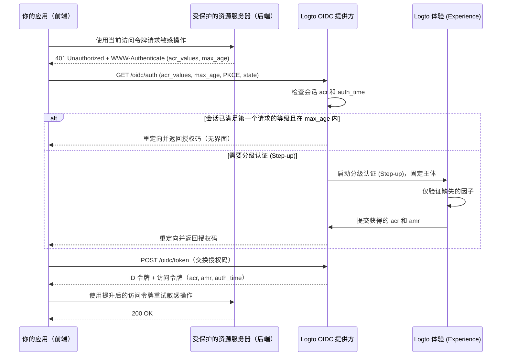

# 分级认证 (Step-up authentication)

分级认证 (Step-up authentication) 允许应用在执行敏感操作（如授权支付、查看机密记录或修改账户安全设置）前，要求用户进行最近的认证 (Authentication) 或更高的认证 (Authentication) 保证等级，而无需让用户退出登录。

Logto 实现了基于标准的分级认证 (Step-up authentication)，构建于 [OpenID Connect Core](https://openid.net/specs/openid-connect-core-1_0.html)、[RFC 9470 (OAuth 2.0 Step Up Authentication Challenge Protocol)](https://www.rfc-editor.org/rfc/rfc9470.html) 和 [RFC 8176 (Authentication Method Reference Values)](https://www.rfc-editor.org/rfc/rfc8176.html) 之上：

1. 受保护的资源服务器在令牌不足时，使用 `401 Unauthorized` 和带有 `acr_values` 及 `max_age` 的 RFC 9470 `WWW-Authenticate` 响应头发起挑战。
2. 你的应用通过携带 `acr_values` 和 `max_age` 启动授权码流程 (Authorization Code Flow)。当已存在认证 (Authentication) 会话时，Logto 固定已登录用户，仅提示缺失的验证步骤。
3. Logto 在会话中记录认证 (Authentication) 上下文（`acr`、`amr` 和 `auth_time`），并在 ID 令牌、JWT 访问令牌和不透明令牌 (Opaque token) 鉴权响应中返回。



## 认证 (Authentication) 上下文模型 \{#authentication-context-model}

每一次通过 Logto 体验 (Experience) 完成的登录、注册和分级认证 (Step-up) 都会在 OIDC 会话上记录三个标准声明 (Claim)，无论应用是否请求了 `acr_values`：

| Claim       | Type       | 描述                                                                   |
| ----------- | ---------- | ---------------------------------------------------------------------- |
| `acr`       | `string`   | 认证 (Authentication) 上下文等级引用——已达成的保证等级。未满足时省略。 |
| `amr`       | `string[]` | 认证 (Authentication) 方法引用——本次交互中使用的验证方式。             |
| `auth_time` | `number`   | 终端用户认证 (Authentication) 完成时的 Unix 时间戳（秒）。             |

Logto 在 OIDC 发现文档（`/.well-known/openid-configuration` 和 `/.well-known/oauth-authorization-server`）中声明这些能力：

```json
{
  "acr_values_supported": ["urn:logto:acr:1fa", "urn:logto:acr:mfa"],
  "claims_supported": ["sub", "acr", "amr", "auth_time"]
}
```

在 ID 令牌中，`acr`、`amr` 和 `auth_time` 只要会话中存在，就会包含在标准 `openid` scope 下。在用户访问令牌中，Logto 会将它们从授权码、设备码或刷新令牌复制到 JWT 负载和不透明令牌 (Opaque token) 鉴权响应中。刷新令牌轮换会保留原始的 `acr`、`amr` 和 `auth_time`——刷新令牌不会更新 `auth_time`。其他授权类型（如客户端凭证和令牌交换）不会发出认证 (Authentication) 上下文声明。

### 支持的 ACR 值 \{#supported-acr-values}

Logto 定义了两个认证 (Authentication) 上下文等级引用（`acr`）值：

| ACR 值              | 含义                                                                                                                       | 满足关系                                 |
| ------------------- | -------------------------------------------------------------------------------------------------------------------------- | ---------------------------------------- |
| `urn:logto:acr:1fa` | 至少有一个 Logto 直接验证或建立的因子：密码、主邮箱或主手机号验证码、魔法链接（登录时的一次性令牌）、或已绑定的 MFA 因子。 | `urn:logto:acr:1fa`                      |
| `urn:logto:acr:mfa` | 一个 Logto 可验证的第一因子（`1fa` 角色）加上来自**不同**因子的 `mfa` 角色，或单独的用户验证 WebAuthn / 密钥。             | `urn:logto:acr:mfa`, `urn:logto:acr:1fa` |

满足关系为 `urn:logto:acr:mfa` → `urn:logto:acr:1fa`：任何持有 `urn:logto:acr:mfa` 的会话或令牌也满足对 `urn:logto:acr:1fa` 的要求。不支持标准的 `phr` 和 `phrh` ACR 值；WebAuthn 和密钥认证需用户验证，映射为 `urn:logto:acr:mfa`。

在推导 `urn:logto:acr:mfa` 时，Logto 会将每种可验证方式按其可承担的角色分类：

- **第一因子（`1fa` 角色）**：密码、主邮箱验证码、主手机号验证码、一次性令牌（仅限登录）。
- **第二因子（`mfa` 角色）**：身份验证器应用 OTP（TOTP）、备份码、MFA 邮箱验证码、MFA 手机验证码。未与 Logto 可验证第一因子配对的 `mfa` 角色（如社交登录 + TOTP）只能达到 `urn:logto:acr:1fa`，而非 `urn:logto:acr:mfa`。
- **自足（`both` 角色）**：密钥登录和带用户验证的 WebAuthn MFA 一次性满足两个角色，直接达到 `urn:logto:acr:mfa`。
- **因子区分规则**：`urn:logto:acr:mfa` 需要两个**不同**因子。两个第一因子（如注册时邮箱验证码 + 密码）、两个 `mfa` 角色（如 TOTP + 备份码）、或同一渠道的两次证明（如主邮箱验证码 + MFA 邮箱验证码）都只算作一个因子或角色，只能达到 `urn:logto:acr:1fa`。
- **可信设备与自适应 MFA**：[可信设备](/end-user-flows/mfa/trusted-devices) 和自适应 MFA 跳过不会为当前交互提供任何证明，不计入 `acr`（如通过可信设备跳过 MFA 的密码登录，`acr="urn:logto:acr:1fa"`，`amr=["pwd"]`）。

注册时也按同样规则记录认证 (Authentication) 上下文，因为创建账户时写入的凭证即证明了该账户。例如，用户名密码注册会得到 `acr="urn:logto:acr:1fa"` 和 `amr=["pwd"]`。

### AMR 映射 \{#amr-mapping}

Logto 使用 [RFC 8176](https://www.rfc-editor.org/rfc/rfc8176.html) 中的 `amr` 值，并增加 `fed` 表示联合认证 (Authentication)：

| Logto 验证方式                                               | `amr` 值             | 是否计入 `acr`    |
| ------------------------------------------------------------ | -------------------- | ----------------- |
| 密码（验证通过，或注册/分级认证 (Step-up) 时新设置）         | `pwd`                | 是（`1fa` 角色）  |
| 主邮箱验证码                                                 | `otp`                | 是（`1fa` 角色）  |
| 主手机号验证码                                               | `sms`                | 是（`1fa` 角色）  |
| 一次性令牌 / 魔法链接（仅限登录，分级认证 (Step-up) 不可用） | `otp`                | 是（`1fa` 角色）  |
| 身份验证器应用 OTP（TOTP，验证或新绑定）                     | `otp`                | 是（`mfa` 角色）  |
| MFA 邮箱验证码                                               | `otp`                | 是（`mfa` 角色）  |
| MFA 手机验证码                                               | `sms`                | 是（`mfa` 角色）  |
| 备份码                                                       | `otp`                | 是（`mfa` 角色）  |
| 带用户验证的 WebAuthn MFA 或密钥登录（验证或新绑定）         | `pop`, `user`, `mfa` | 是（`both` 角色） |
| 社交登录或企业单点登录 (SSO)                                 | `fed`                | 否                |
| 任何获得 `urn:logto:acr:mfa` 的交互                          | 追加 `mfa`           | —                 |

#### 联合认证 (Authentication)（`fed`）\{#federated-authentication-fed}

Logto 发出 `fed` 表示用户通过上游社交或企业单点登录 (SSO) 认证 (Authentication)，Logto 无法直接验证其方式。

- 纯社交或企业单点登录 (SSO) 登录/注册会记录 `amr=["fed"]` 和新的 `auth_time`，**不包含 `acr` 声明**。
- `fed` 不是第一因子，重复上游登录不会提升 `acr`。社交登录后完成一个 Logto 可验证因子（如 TOTP）会得到 `acr="urn:logto:acr:1fa"` 和 `amr=["fed", "otp"]`。
- 仅有 `auth_time` 并不代表任何保证——务必同时检查 `acr` 和 `auth_time`。
- 哪个上游提供方认证 (Authentication) 了用户，会体现在 `identities` 和 `sso_identities` 声明中，而不是编码在 `amr`。

### 分级认证 (Step-up) 如何更新会话和令牌声明 \{#how-step-up-updates-session-and-token-claims}

当带有 `acr_values` 的授权请求到达现有 OIDC 会话且需要交互时，体验 (Experience) 进入**分级认证 (Step-up) 模式**：

- **主体固定与累积 ACR**：Logto 固定当前会话的 `sub`（不允许切换账户、输入标识符或注册），只要求缺失的保证。明确的会话方式会将其角色带入分级认证 (Step-up)：
  - 已用 `pwd` 或 `sms` 认证 (Authentication) 的会话已提供 `1fa`，升级到 `urn:logto:acr:mfa` 时**只需**验证已绑定的 MFA 因子（即使 `max_age=0` 或 `prompt=login` 强制重新认证 (Authentication)）。
  - 社交或企业单点登录 (SSO) 会话（`amr=["fed"]`）不提供 `1fa`，要达到 `urn:logto:acr:mfa`，需先证明（或建立）第一因子，或验证 WebAuthn 密钥。
- **`amr` 和 `auth_time` 仅反映当前交互**：在密码会话上，分级认证 (Step-up) 时验证 TOTP 会产生 `acr="urn:logto:acr:mfa"`、`amr=["otp", "mfa"]` 和新的 `auth_time`。**依赖方必须从 `acr` 读取保证，不应仅从 `amr` 查找第一因子。**
- **会话替换而非合并**：分级认证 (Step-up) 完成后，会话的 `acr`、`amr` 和 `auth_time` 会被新交互获得的上下文替换。比如为 `urn:logto:acr:1fa` 重新认证 (Authentication) 密码，会将会话设置为 `acr="urn:logto:acr:1fa"` 和 `amr=["pwd"]`。之前发出的令牌保留其签发时的声明。
- **策略覆盖与副作用**：请求 `urn:logto:acr:1fa` 只需一次有效验证，不会重新执行租户的登录 MFA 策略。请求 `urn:logto:acr:mfa` 会忽略可信设备、用户 `skipMfaOnSignIn` 偏好和自适应 MFA 非触发结果。纯分级认证 (Step-up) 不会触发登录副作用，如 `PostSignIn` Webhook 或动作。

如果请求 `acr_values` 时不存在已认证 (Authentication) 的 OIDC 会话，Logto 会走正常的登录或注册流程，并在发放授权码前强制要求满足所请求的 ACR。

## 请求分级认证 (Step-up authentication) \{#request-step-up-authentication}

在授权码流程 (Authorization Code Flow) 请求 `/oidc/auth` 时传递 `acr_values` 和 `max_age`。

### `acr_values` 的有序列表语义 \{#ordered-list-semantics-of-acr-values}

`acr_values` 是以空格分隔的可接受 ACR 值列表，**按调用方偏好顺序排列**（如 `urn:logto:acr:mfa urn:logto:acr:1fa`）。Logto 会忽略无法识别的值；如果**所有**请求的值都不支持（如 `acr_values=phr`），Logto 会在任何界面显示前立即失败，并带 `error=unmet_authentication_requirements` 重定向到 `redirect_uri`。

当至少请求了一个支持的等级时：

1. **第一个等级已满足**：如果已认证 (Authentication) 会话满足 `acr_values` 中**第一个**支持的等级，且满足 `max_age`，且未请求 `prompt=login`，Logto 会立即发放授权码，无需界面。
2. **仅满足后续等级**：如果会话只满足后面列出的等级而不满足第一个——比如 `acr_values="urn:logto:acr:mfa urn:logto:acr:1fa"` 时会话为 `1fa`——Logto 仍会启动分级认证 (Step-up) 以追求前面的等级（`urn:logto:acr:mfa`）。
   - 如果用户可以达到 `urn:logto:acr:mfa`（通过验证已绑定的 MFA 因子或绑定一个），体验 (Experience) 会提示操作。
   - 如果 `urn:logto:acr:mfa` 无法达到（如用户未绑定 MFA 且租户未启用可绑定的 TOTP 或 WebAuthn），Logto 会回退到下一个可达等级（`urn:logto:acr:1fa`）。如果会话已满足该回退等级且未强制重新认证 (Authentication)，Logto 会直接完成，无需界面，并保留原始 `auth_time`。
3. **严格失败并返回 `unmet_authentication_requirements`**：Logto 永远不会发放比当前交互追求的等级更弱的令牌。仅当**所有**列出的等级都无法达到时，Logto 才会带 `error=unmet_authentication_requirements` 重定向回 `redirect_uri`。

### 严格请求与弱等级重试模式 \{#strict-requests-vs-the-retry-with-weaker-class-pattern}

根据你的应用如何处理无法满足 MFA 的用户，可选择以下两种模式：

- **严格要求某一等级，然后在应用内重试或分支**：仅请求 `acr_values=urn:logto:acr:mfa`。Logto 保证只会返回 `mfa` 令牌或 `error=unmet_authentication_requirements`。收到 `unmet_authentication_requirements` 时，你的回调处理器可决定是否用 `acr_values=urn:logto:acr:1fa` 重试授权、阻止操作或进入审批流程。
- **一次请求声明有序回退**：请求 `acr_values="urn:logto:acr:mfa urn:logto:acr:1fa"`。Logto 会在可达时优先追求 `mfa`，仅在用户和租户无法达到时自动回退到 `1fa`。请在最终访问令牌上校验 `acr`，以确认实际达成的等级。

:::note
放弃分级认证 (Step-up) 界面不会触发回退或通知你的应用——没有取消端点，放弃的交互会自动过期或被下一个授权请求替换。请在你的应用中自行管理待处理操作状态，若用户未完成回调而返回，应清除该状态。
:::

### 结合使用 `max_age` 和 `acr_values` \{#combining-max-age-and-acr-values}

`max_age` 指定自用户上次主动认证 (Authentication)（`auth_time`）以来允许的最大秒数：

- `max_age` 检查的是 `auth_time`，**不是**令牌 `exp`。刷新令牌不会重置 `auth_time`。
- `max_age=0`（或 `prompt=login`）即使会话已持有所需 `acr`，也会强制重新交互验证。
- 仅有 `max_age` 而**没有** `acr_values` 时，会进入常规 `/sign-in` 流程，不强制任何保证等级——用户可用社交登录重新认证 (Authentication)，刷新 `auth_time` 但无 `acr`。如需同时保证新鲜度和 Logto 验证的保证等级，务必同时传递 **`acr_values` 和 `max_age`**。

### 使用 `prompt=none` 静默检测差距 \{#silent-gap-detection-with-prompt-none}

如需在不显示任何界面或提供绑定入口的情况下，检测用户当前 Logto 会话是否已满足保证等级和新鲜度要求，可结合 `prompt=none` 与 `acr_values`（及可选 `max_age`）：

- **已满足**：因 `prompt=none` 不允许界面，Logto 只要会话在 `max_age` 内满足 `acr_values` 中**任一**支持等级，就会发放授权码。
- **已认证 (Authentication) 会话但未满足要求或已过期**：Logto 会带 `error=unmet_authentication_requirements` 重定向（优先于 `max_age` 错误）。
- **无已认证 (Authentication) 会话**：Logto 会带 `error=login_required` 重定向。

### 授权 URL 与 SDK 示例 \{#authorization-url-and-sdk-examples}

请求最近 5 分钟（`300` 秒）内 MFA 的原始授权请求示例，针对受保护 API 资源：

```http
GET /oidc/auth?client_id=my-web-app
  &redirect_uri=https%3A%2F%2Fapp.example.com%2Fcallback
  &response_type=code
  &scope=openid%20offline_access%20payment%3Awrite
  &resource=https%3A%2F%2Fapi.example.com
  &acr_values=urn%3Alogto%3Aacr%3Amfa
  &max_age=300
  &state=8f3d9c1b2a...
  &nonce=4e1a7b9c0f...
  &code_challenge=E9Melhoa2OwvFrEMTJguCHaoeK1t8URWbuGJSstw-cM
  &code_challenge_method=S256 HTTP/1.1
Host: [tenant-id].logto.app
```

在 Logto JavaScript / TypeScript SDK（如 `@logto/browser`、`@logto/react`、`@logto/vue` 或 `@logto/node`）中，通过 `extraParams` 传递 `acr_values` 和 `max_age`。在用户已登录的单页应用中，设置 `clearTokens: false`，以便用户放弃分级认证 (Step-up) 或遇到 OIDC 错误返回时，缓存令牌不会被清除：

```ts
await signIn({
  redirectUri: 'https://app.example.com/callback',
  clearTokens: false,
  extraParams: {
    acr_values: 'urn:logto:acr:mfa',
    max_age: '300',
  },
});
```

在回调路由中，调用 `handleSignInCallback()` 前先检查 `error`：

```ts
const params = new URLSearchParams(window.location.search);
const error = params.get('error');

if (error === 'unmet_authentication_requirements') {
  // 用户无法达到请求的 ACR（或 prompt=none 检测到差距）。
  // 可选择用更弱等级如 'urn:logto:acr:1fa' 重试，或展示说明。
  return;
}
```

:::tip[为不同 API 资源分级认证 (Step-up)]
认证 (Authentication) 上下文属于 Logto 会话，而不是单个 API 资源。带 `resource` 指示器请求分级认证 (Step-up) 时，会为该资源发放提升后的令牌（如未授权其权限会提示授权）。之前为其他 API 资源发放的令牌保持不变；每个资源服务器需自行校验所持令牌的 `acr` 和 `auth_time`。
:::

## 在受保护资源服务器上发起挑战与校验 \{#challenge-and-validate-on-a-protected-resource-server}

授权 (Authorization) 决策应在你的后端或受保护资源服务器上完成：

- 始终在资源服务器上校验**访问令牌**，不要校验 ID 令牌。
- 浏览器应用应将访问令牌视为不透明。你的应用可从 ID 令牌读取 `acr` 和 `auth_time` 以协调界面状态，但**绝不可**依赖客户端解码做安全校验。

### 返回 RFC 9470 挑战 \{#return-an-rfc-9470-challenge}

当访问令牌作为持有者令牌（签名、`iss`、`aud`、`exp`、`scope` 均有效）但缺少所需 `acr` 或超出 `max_age` 时，返回 `401 Unauthorized` 并带 [RFC 9470](https://www.rfc-editor.org/rfc/rfc9470.html) `WWW-Authenticate` 响应头：

```http
HTTP/1.1 401 Unauthorized
WWW-Authenticate: Bearer error="insufficient_user_authentication",
  error_description="Multi-factor authentication within the last 5 minutes is required",
  acr_values="urn:logto:acr:mfa",
  max_age="300"
```

你的应用收到带 `error="insufficient_user_authentication"` 的 `401` 时，应解析 `WWW-Authenticate` 中的 `acr_values` 和 `max_age`，本地保存用户的待处理路由或意图，带这些参数触发 `signIn()`，并用新发放的访问令牌重试 API 调用一次。若回调后重试仍收到 `401`，应避免进入重试循环，不要再次发起分级认证 (Step-up)。

### 校验 JWT 访问令牌 \{#validate-jwt-access-tokens}

请求了 API 资源指示器（`resource`）时，Logto 会发放包含 `acr`、`amr` 和 `auth_time` 的签名 JWT 访问令牌：

```json
{
  "iss": "https://[tenant-id].logto.app/oidc",
  "sub": "user-id",
  "aud": "https://api.example.com",
  "client_id": "my-web-app",
  "scope": "payment:write",
  "exp": 1787749200,
  "iat": 1787745601,
  "auth_time": 1787745600,
  "acr": "urn:logto:acr:mfa",
  "amr": ["pwd", "otp", "mfa"]
}
```

在[校验标准 JWT 声明](/authorization/validate-access-tokens)（签名、`iss`、`aud`、`exp`、`scope`）后，按满足关系校验 `acr`，并用你的策略比较 `auth_time`（不要用 `iat`）：

```ts
import { createRemoteJWKSet, jwtVerify } from 'jose';

const issuer = 'https://[tenant-id].logto.app/oidc';
const jwks = createRemoteJWKSet(new URL(`${issuer}/jwks`));

type LogtoAcr = 'urn:logto:acr:1fa' | 'urn:logto:acr:mfa';

const satisfiedAcrs: Record<string, readonly LogtoAcr[]> = {
  'urn:logto:acr:1fa': ['urn:logto:acr:1fa'],
  'urn:logto:acr:mfa': ['urn:logto:acr:mfa', 'urn:logto:acr:1fa'],
};

const acrSatisfies = (achieved: unknown, required: LogtoAcr): boolean => {
  if (typeof achieved !== 'string') {
    return false;
  }

  return Boolean(satisfiedAcrs[achieved]?.includes(required));
};

export async function verifySensitiveRequest(
  bearerToken: string,
  requiredAcr: LogtoAcr = 'urn:logto:acr:mfa',
  maxAgeSeconds = 300
) {
  const { payload } = await jwtVerify(bearerToken, jwks, {
    issuer,
    audience: 'https://api.example.com',
  });

  const authTime = payload.auth_time;
  const nowSeconds = Date.now() / 1000;
  const isFresh =
    typeof authTime === 'number' &&
    Number.isInteger(authTime) &&
    nowSeconds - authTime >= 0 &&
    nowSeconds - authTime <= maxAgeSeconds;

  if (!acrSatisfies(payload.acr, requiredAcr) || !isFresh) {
    const challenge =
      `Bearer error="insufficient_user_authentication", ` +
      `error_description="Recent user authentication is required", ` +
      `acr_values="${requiredAcr}", max_age="${maxAgeSeconds}"`;

    return { authorized: false as const, wwwAuthenticate: challenge };
  }

  return { authorized: true as const, payload };
}
```

### 通过鉴权端点校验不透明访问令牌 (Opaque token) \{#validate-opaque-access-tokens-via-introspection}

未请求 API `resource` 时，Logto 会发放[不透明访问令牌 (Opaque token)](/concepts/opaque-token)。请通过 [RFC 7662](https://www.rfc-editor.org/rfc/rfc7662.html) 鉴权端点（`POST /oidc/token/introspection`，需客户端认证）校验；Logto 会在活跃响应顶层返回 `acr`、`amr` 和 `auth_time`：

```bash
curl -X POST https://[tenant-id].logto.app/oidc/token/introspection \
  -u "<client_id>:<client_secret>" \
  -H "Content-Type: application/x-www-form-urlencoded" \
  --data-urlencode "token=<opaque_access_token>" \
  --data-urlencode "token_type_hint=access_token"
```

鉴权响应示例：

```json
{
  "active": true,
  "client_id": "my-web-app",
  "exp": 1787749200,
  "iat": 1787745601,
  "iss": "https://[tenant-id].logto.app/oidc",
  "scope": "openid offline_access profile",
  "sub": "user-id",
  "token_type": "Bearer",
  "acr": "urn:logto:acr:1fa",
  "amr": ["pwd"],
  "auth_time": 1787745600
}
```

请先检查 `active === true`，再按上述方式校验 `acrSatisfies` 和 `auth_time`。

### 自定义 JWT 的保留声明 \{#reserved-claims-in-custom-jwt}

在用户访问令牌中，`acr`、`amr` 和 `auth_time` 为保留字段：[自定义访问令牌脚本](/developers/custom-token-claims/create-script)无法覆盖或添加这些字段，Logto 未推导出认证 (Authentication) 上下文时也不会添加。

## 建立第一因子与绑定 MFA \{#establishing-a-first-factor-and-enrolling-mfa}

被要求 `urn:logto:acr:1fa` 或 `urn:logto:acr:mfa` 的用户，可能尚未具备达到该等级所需的凭证——比如仅有密码但未绑定 MFA 的用户，或仅有社交登录、没有密码/主邮箱/主手机号/MFA 因子的用户。Logto 允许在**同一次登录或分级认证 (Step-up) 交互中**建立缺失的第一因子和绑定 MFA，前提是有严格的新鲜度校验，确保仅凭被盗会话 Cookie 无法绑定或建立任何内容：

- **绑定 MFA 因子**：仅在用户尚未绑定可达 `urn:logto:acr:mfa` 的 MFA 因子，且**仅在本次交互中已验证或建立 Logto 可验证的第一因子（`1fa` 或 `both` 等级）后**才可绑定。
  - 会话中存储的 `acr` 或可信设备 Cookie 均不满足此条件。已登录但未绑定 MFA 的密码用户，需先在分级认证 (Step-up) 中重新输入密码，才能绑定 TOTP 或 WebAuthn 密钥（可选同时绑定备份码；备份码不能单独绑定）。
- **建立第一因子**：仅在用户缺少可达目标等级的第一因子（如仅有社交登录请求 `1fa`，或仅有 TOTP 请求 `mfa`），且**仅在本次交互中有新鲜的主体证明时**才可建立：
  - **现有会话分级认证 (Step-up)** 时，用户需用已绑定的社交或企业单点登录 (SSO) 连接器重新认证 (Authentication)（需在登录体验 (Experience) 启用）。若上游回调解析为其他用户或未绑定账户，Logto 会以 `403` 拒绝——不允许注册或绑定账户。
  - 主体证明成功后，用户可建立租户启用的任一登录第一因子：密码（启用密码登录时）或已验证的主邮箱/手机号（启用邮箱/SMS 登录且有激活连接器时）。例如，社交用户用 Google 重新认证 (Authentication) 并设置密码，最终获得 `acr="urn:logto:acr:1fa"` 和 `amr=["fed", "pwd"]`。
  - 若用户已有可用方式验证，则不会提供建立选项。

Logto 视在交互中绑定/建立的凭证或 MFA 因子等同于已验证的，用户可立即完成分级认证 (Step-up)，无需再次验证刚设置的因子。用户在纯分级认证 (Step-up) 中建立新凭证或因子时，Logto 会发出 `User.Data.Updated` Webhook 事件。若租户未启用用户可验证、建立或绑定的任何方式（或用户无已绑定社交/SSO 连接器可证明主体），Logto 会以 `error=unmet_authentication_requirements` 结束交互。

## 账户 API 与账户中心 \{#account-api-and-account-center}

### 账户 API 授权 (Authorization) 策略 \{#account-api-authorization-policy}

敏感的 [账户 API](/end-user-flows/account-settings/by-account-api) 操作——如更新密码、主邮箱、主手机号或用户名，绑定/解绑社交身份，管理 MFA 因子和设置，管理个人访问令牌，查看/撤销活跃会话、应用授权和可信设备——要求：

1. **一方应用访问**：第三方 OIDC 应用（`isThirdParty: true`）和 CIMD 客户端无法变更敏感账户 API 资源，也不会收到账户 API 分级认证 (Step-up) 挑战，即使带 `urn:logto:acr:mfa`。
2. **最近身份验证 (Authentication)**，满足以下**任一**条件：
   - **OIDC 认证 (Authentication) 上下文**：不透明访问令牌 (Opaque token) 携带 `acr` 满足 `urn:logto:acr:1fa`（`urn:logto:acr:1fa` 或 `urn:logto:acr:mfa`）**且** `now - auth_time <= maximumAuthenticationAgeInSeconds`（严格按 `auth_time`，不看 `iat`）。
   - **验证记录（`logto-verification-id`）**：对于直接集成账户 API 的场景，Logto 仍接受通过 `POST /api/verifications/password` 或 `POST /api/verifications/verification-code` + `/verify` 创建的 10 分钟有效期验证记录 ID，放在 `logto-verification-id` 请求头。

:::info[配置最近认证 (Authentication) 窗口]
默认情况下，`maximumAuthenticationAgeInSeconds` 为**600 秒（10 分钟）**。你可在 <CloudLink to="/sign-in-experience/account-center">控制台 > 登录与账户 > 账户中心</CloudLink> 的**最近认证 (Authentication)** 下，或通过 Management API（`PATCH /api/account-center`，带 `maximumAuthenticationAgeInSeconds`）为每个租户配置，范围 1–120 分钟（60–7,200 秒）。

使用 OIDC 认证 (Authentication) 上下文时，用户只要刚用 Logto 可验证方式登录或注册，在此窗口内即可执行敏感账户 API 操作，无需单独验证。注意通过 Verification API 创建的 `logto-verification-id` 记录仍为固定 10 分钟 TTL，以保持兼容。
:::

账户 API 还保留初始密码例外：当前无密码、主邮箱或主手机号的用户，可通过 `POST /api/my-account/password` 设置初始密码，无需最近身份验证 (Authentication)。通过账户 API 设置密码不会更新 OIDC 会话的 `acr`，也不会授权后续敏感操作。

### 账户 API `WWW-Authenticate` 挑战 \{#account-api-www-authenticate-challenge}

当一方账户 API 请求既无新鲜的 `urn:logto:acr:1fa` 访问令牌，也无有效 `logto-verification-id` 请求头时，Logto 会返回 `401 Unauthorized`，保留现有 JSON 错误体以兼容，并附带租户配置的 `max_age` 的 RFC 9470 `WWW-Authenticate` 响应头：

```http
HTTP/1.1 401 Unauthorized
WWW-Authenticate: Bearer error="insufficient_user_authentication", error_description="Recent user authentication is required", acr_values="urn:logto:acr:1fa", max_age="600"
Content-Type: application/json

{
  "code": "verification_record.permission_denied",
  "message": "Permission denied, please re-authenticate."
}
```

### 预置账户中心 \{#prebuilt-account-center}

[预置账户中心 UI](/end-user-flows/account-settings/by-account-center-ui)（`/account/*`）仅使用 OIDC 分级认证 (Step-up authentication)，不会创建 `logto-verification-id` 权限记录：

- 它会在本地 ID 令牌上检查 `acr` 和 `auth_time`，在敏感内联操作或多步子页面前主动发起分级认证 (Step-up)，当登录不满足 `urn:logto:acr:1fa` 或已过期时，也会作为后备处理账户 API 的 RFC 9470 `401` 挑战。
- 分级认证 (Step-up) 完成后，账户中心会替换令牌集，并最多恢复一次待处理操作。

## 相关资源 \{#related-resources}

<Url href="/end-user-flows/mfa">多因素认证 (MFA)</Url>
<Url href="/authorization/validate-access-tokens">如何在 API 服务或后端校验访问令牌</Url>
<Url href="/concepts/opaque-token">不透明令牌 (Opaque token) 与鉴权</Url>
<Url href="/end-user-flows/account-settings/by-account-api">通过账户 API 管理账户设置</Url>
<Url href="/end-user-flows/account-settings/by-account-center-ui">
  通过预置账户中心 UI 管理账户设置
</Url>
