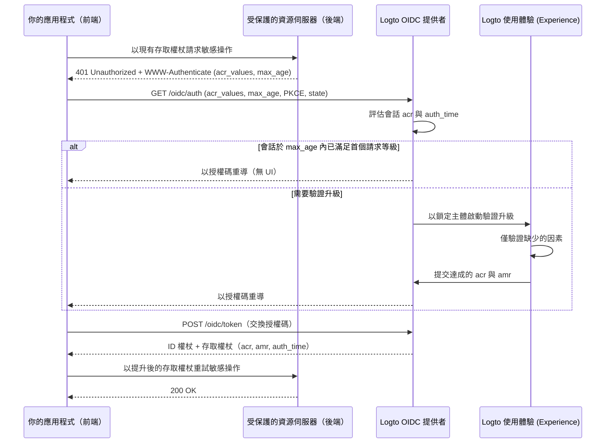

# 驗證升級 (Step-up authentication)

驗證升級 (Step-up authentication) 讓應用程式在執行敏感操作（如授權付款、檢視機密紀錄或修改帳戶安全設定）前，要求最近的使用者驗證或更高的驗證保證等級，而無需將使用者登出。

Logto 實作了基於標準的驗證升級，建構於 [OpenID Connect Core](https://openid.net/specs/openid-connect-core-1_0.html)、[RFC 9470（OAuth 2.0 Step Up Authentication Challenge Protocol）](https://www.rfc-editor.org/rfc/rfc9470.html) 及 [RFC 8176（Authentication Method Reference Values）](https://www.rfc-editor.org/rfc/rfc8176.html)：

1. 受保護的資源伺服器以 `401 Unauthorized` 及帶有 `acr_values` 和 `max_age` 的 RFC 9470 `WWW-Authenticate` 標頭，對權杖不足發出挑戰。
2. 你的應用程式以 `acr_values` 和 `max_age` 啟動授權碼流程 (Authorization Code Flow)。若已存在驗證會話，Logto 會鎖定已登入使用者，僅提示缺少的驗證步驟。
3. Logto 將達成的驗證情境（`acr`、`amr` 和 `auth_time`）記錄於會話，並發送於 ID 權杖 (ID tokens)、JWT 存取權杖 (access tokens) 及不透明權杖 (opaque-token) 查詢回應中。



## 驗證情境模型 (Authentication context model) \{#authentication-context-model}

每次透過 Logto 使用體驗 (Experience) 完成的登入、註冊與驗證升級，無論應用程式是否請求 `acr_values`，都會在 OIDC 會話上記錄三個標準宣告 (claims)：

| Claim       | Type       | 說明                                                                                    |
| ----------- | ---------- | --------------------------------------------------------------------------------------- |
| `acr`       | `string`   | 驗證情境類別參考（Authentication Context Class Reference）—達成的保證等級。若無則省略。 |
| `amr`       | `string[]` | 驗證方法參考（Authentication Methods References）—本次互動中使用的驗證方法。            |
| `auth_time` | `number`   | 終端使用者驗證完成時的 Unix 時間戳（秒）。                                              |

Logto 於 OIDC 探索 (`/.well-known/openid-configuration` 與 `/.well-known/oauth-authorization-server`) 公告這些能力：

```json
{
  "acr_values_supported": ["urn:logto:acr:1fa", "urn:logto:acr:mfa"],
  "claims_supported": ["sub", "acr", "amr", "auth_time"]
}
```

在 ID 權杖中，`acr`、`amr` 與 `auth_time` 只要會話上存在，便會包含於標準 `openid` 權限範圍 (scope) 下。於使用者存取權杖中，Logto 會將它們從授權碼、裝置碼或重新整理權杖複製到 JWT 載荷與不透明權杖查詢回應。重新整理權杖 (refresh token) 輪替會保留原始的 `acr`、`amr` 與 `auth_time`——重新整理權杖不會更新 `auth_time`。其他授權類型（如 client credentials 與 token exchange）不會發出驗證情境宣告。

### 支援的 ACR 值 \{#supported-acr-values}

Logto 定義兩個驗證情境類別參考（`acr`）值：

| ACR 值              | 意義                                                                                                                          | 滿足條件                                 |
| ------------------- | ----------------------------------------------------------------------------------------------------------------------------- | ---------------------------------------- |
| `urn:logto:acr:1fa` | 至少一個 Logto 直接驗證或建立的因素：密碼、主要電子郵件或電話驗證碼、魔術連結（登入時的一次性權杖）、或已註冊的 MFA 因素。    | `urn:logto:acr:1fa`                      |
| `urn:logto:acr:mfa` | 一個 Logto 可驗證的第一因素（`1fa` 角色）證明，結合來自**不同**因素的 `mfa` 角色證明，或單獨的使用者驗證 WebAuthn / passkey。 | `urn:logto:acr:mfa`, `urn:logto:acr:1fa` |

滿足關係為 `urn:logto:acr:mfa` → `urn:logto:acr:1fa`：任何持有 `urn:logto:acr:mfa` 的會話或權杖也滿足 `urn:logto:acr:1fa` 的需求。不支援標準的 `phr` 與 `phrh` ACR 值；WebAuthn 與 passkey 驗證需使用者驗證，並對應至 `urn:logto:acr:mfa`。

推導 `urn:logto:acr:mfa` 時，Logto 依每個驗證方法可扮演的角色分類：

- **第一因素（`1fa` 角色）**：密碼、主要電子郵件驗證碼、主要電話驗證碼、一次性權杖（僅登入）。
- **第二因素（`mfa` 角色）**：驗證器 App OTP（TOTP）、備用碼、MFA 電子郵件驗證碼、MFA 電話驗證碼。若僅驗證 `mfa` 角色因素而無 Logto 可驗證的第一因素（如社交登入 + TOTP），僅達成 `urn:logto:acr:1fa`，非 `urn:logto:acr:mfa`。
- **自足（`both` 角色）**：passkey 登入與 WebAuthn MFA（含使用者驗證）一次性滿足兩角色，僅達成 `urn:logto:acr:mfa`。
- **不同因素規則**：`urn:logto:acr:mfa` 需兩個**不同**因素。兩個第一因素（如註冊時的電子郵件驗證碼 + 密碼）、兩個 `mfa` 角色因素（如 TOTP + 備用碼）、或同一通道的兩個證明（如主要電子郵件碼 + MFA 電子郵件碼）僅算一個因素或角色，僅達成 `urn:logto:acr:1fa`。
- **受信任裝置與自適應 MFA**：[受信任裝置](/end-user-flows/mfa/trusted-devices) 滿足與自適應 MFA 跳過不計入本次互動，不影響 `acr`（如密碼登入跳過 MFA 僅得 `acr="urn:logto:acr:1fa"` 與 `amr=["pwd"]`）。

註冊時也依同樣規則記錄驗證情境，因建立帳號時寫入的憑證即證明該帳號。例如，使用者名稱與密碼註冊會得 `acr="urn:logto:acr:1fa"` 與 `amr=["pwd"]`。

### AMR 對應表 \{#amr-mapping}

Logto 以 [RFC 8176](https://www.rfc-editor.org/rfc/rfc8176.html) 的值填入 `amr`，並加上 `fed` 代表聯邦驗證：

| Logto 驗證方法                                                 | `amr` 值             | 是否貢獻於 `acr`  |
| -------------------------------------------------------------- | -------------------- | ----------------- |
| 密碼（驗證通過，或註冊/驗證升級時新設）                        | `pwd`                | 是（`1fa` 角色）  |
| 主要電子郵件驗證碼                                             | `otp`                | 是（`1fa` 角色）  |
| 主要電話驗證碼                                                 | `sms`                | 是（`1fa` 角色）  |
| 一次性權杖 / 魔術連結（僅登入，驗證升級不可用）                | `otp`                | 是（`1fa` 角色）  |
| 驗證器 App OTP（TOTP，驗證通過或新綁定）                       | `otp`                | 是（`mfa` 角色）  |
| MFA 電子郵件驗證碼                                             | `otp`                | 是（`mfa` 角色）  |
| MFA 電話驗證碼                                                 | `sms`                | 是（`mfa` 角色）  |
| 備用碼                                                         | `otp`                | 是（`mfa` 角色）  |
| WebAuthn MFA 或 passkey 登入（含使用者驗證，驗證通過或新綁定） | `pop`, `user`, `mfa` | 是（`both` 角色） |
| 社交登入或企業級單一登入 (Enterprise SSO)                      | `fed`                | 否                |
| 任何達成 `urn:logto:acr:mfa` 的互動                            | 附加 `mfa`           | —                 |

#### 聯邦驗證（`fed`）\{#federated-authentication-fed}

Logto 發出 `fed` 代表使用者透過上游社交或企業級單一登入 (SSO) 驗證，Logto 無法直接驗證其方法。

- 純社交或企業級單一登入 (SSO) 登入或註冊會記錄 `amr=["fed"]` 與新的 `auth_time`，**不含 `acr` 宣告**。
- `fed` 不是第一因素，重複上游登入不會提升 `acr`。社交登入後完成一個 Logto 可驗證因素（如 TOTP）會得 `acr="urn:logto:acr:1fa"` 與 `amr=["fed", "otp"]`。
- `auth_time` 本身不具保證——務必同時檢查 `acr` 與 `auth_time`。
- 上游驗證提供者資訊會顯示於 `identities` 與 `sso_identities` 宣告，而非編碼於 `amr`。

### 驗證升級如何更新會話與權杖宣告 \{#how-step-up-updates-session-and-token-claims}

當帶有 `acr_values` 的授權請求進入現有 OIDC 會話且需互動時，使用體驗 (Experience) 進入**驗證升級模式**：

- **主體鎖定與累積 ACR**：Logto 鎖定當前會話的 `sub`（不可切換帳號、輸入識別碼或註冊），僅要求缺少的保證。明確的會話方法會將其角色帶入驗證升級：
  - 以 `pwd` 或 `sms` 驗證的會話已提供 `1fa`，升級至 `urn:logto:acr:mfa` 僅提示已註冊的 MFA 因素（即使 `max_age=0` 或 `prompt=login` 強制重新驗證）。
  - 社交或企業級單一登入 (SSO) 會話（`amr=["fed"]`）不提供 `1fa`，需先證明（或建立）第一因素再進行 MFA，或驗證 WebAuthn passkey。
- **`amr` 與 `auth_time` 僅反映本次互動**：密碼會話於驗證升級時驗證 TOTP，會產生 `acr="urn:logto:acr:mfa"`、`amr=["otp", "mfa"]` 與新的 `auth_time`。**Relying party 必須從 `acr` 讀取保證，不可僅從 `amr` 判斷第一因素。**
- **會話取代而非合併**：驗證升級完成後，會話的 `acr`、`amr` 與 `auth_time` 會被新互動達成的情境取代。例如，密碼重新驗證以達成 `urn:logto:acr:1fa`，會將會話設為 `acr="urn:logto:acr:1fa"` 與 `amr=["pwd"]`。先前發出的權杖仍保留當時的宣告。
- **政策覆寫與副作用**：請求 `urn:logto:acr:1fa` 僅需一個合格的有效驗證，不會重跑租戶的登入 MFA 政策。請求 `urn:logto:acr:mfa` 會忽略受信任裝置、使用者 `skipMfaOnSignIn` 偏好與自適應 MFA 非觸發結果。純驗證升級不會執行登入副作用（如 `PostSignIn` webhook 或 action）。

若請求 `acr_values` 時不存在已驗證 OIDC 會話，Logto 會執行一般登入或註冊流程，並於發出授權碼前強制完成所需 ACR。

## 請求驗證升級 \{#request-step-up-authentication}

於授權碼流程 (Authorization Code Flow) 請求 `/oidc/auth` 時帶上 `acr_values` 與 `max_age`。

### `acr_values` 的有序列表語意 \{#ordered-list-semantics-of-acr-values}

`acr_values` 是以空格分隔的可接受 ACR 值清單，**依呼叫方偏好順序排列**（如 `urn:logto:acr:mfa urn:logto:acr:1fa`）。Logto 會忽略不識別的值；若**所有**請求值皆不支援（如 `acr_values=phr`），Logto 會在任何 UI 前立即失敗，並以 `error=unmet_authentication_requirements` 重導至 `redirect_uri`。

當至少有一個支援的等級被請求時：

1. **首個等級已滿足**：若已驗證會話滿足 `acr_values` 中**首個**支援等級，且符合 `max_age`，且未請求 `prompt=login`，Logto 會立即發出授權碼，無需 UI。
2. **僅後面等級滿足**：若會話僅滿足後面列出的等級而非首個（如 `acr_values="urn:logto:acr:mfa urn:logto:acr:1fa"` 但會話為 `1fa`），Logto 仍會啟動驗證升級互動以追求前面等級（`urn:logto:acr:mfa`）。
   - 若使用者可達成 `urn:logto:acr:mfa`（驗證已註冊 MFA 因素或註冊一個），Experience 會提示。
   - 若 `urn:logto:acr:mfa` 無法達成（如使用者無已註冊 MFA 因素且租戶未啟用可註冊 TOTP 或 WebAuthn），Logto 會退回至下一可達等級（`urn:logto:acr:1fa`）。若會話已滿足該等級且未強制重新驗證，Logto 會直接完成且保留原始 `auth_time`。
3. **嚴格失敗（`unmet_authentication_requirements`）**：Logto 絕不會發出低於互動追求等級的權杖。僅當**所有**列出的等級皆無法達成時，Logto 會以 `error=unmet_authentication_requirements` 重導至 `redirect_uri`。

### 嚴格請求 vs. 較弱等級重試模式 \{#strict-requests-vs-the-retry-with-weaker-class-pattern}

依你的應用程式如何處理無法通過 MFA 的使用者，選擇以下兩種模式之一：

- **嚴格要求特定等級，然後於應用程式內重試或分支**：僅請求 `acr_values=urn:logto:acr:mfa`。Logto 保證僅會發出 `mfa` 權杖或 `error=unmet_authentication_requirements` 重導。遇到 `unmet_authentication_requirements` 時，你的 callback handler 可決定是否以 `acr_values=urn:logto:acr:1fa` 重試授權、阻擋操作或導向審核流程。
- **於單一請求中宣告有序備援**：請求 `acr_values="urn:logto:acr:mfa urn:logto:acr:1fa"`。Logto 會在可達時追求 `mfa`，僅於該使用者與租戶無法達成時自動退回 `1fa`。請於取得的存取權杖上檢查 `acr` 以確認達成等級。

:::note
放棄驗證升級畫面不會觸發備援或通知你的應用程式——沒有取消端點，放棄的互動僅會過期或被下一個授權請求取代。請於應用程式內自行維護待處理動作狀態，若使用者未完成 callback 而返回，請清除該狀態。
:::

### 結合 `max_age` 與 `acr_values` \{#combining-max-age-and-acr-values}

`max_age` 指定自使用者上次主動驗證（`auth_time`）以來允許的最長秒數：

- `max_age` 檢查 `auth_time`，**非**權杖 `exp`。重新整理權杖不會重設 `auth_time`。
- `max_age=0`（或 `prompt=login`）即使會話已持有所需 `acr`，也會強制重新互動驗證。
- 僅有 `max_age` 而**無** `acr_values` 會進入一般 `/sign-in` 流程，且不強制保證等級——使用者可用社交登入重新驗證，僅刷新 `auth_time` 而無 `acr`。若操作同時需新鮮度與 Logto 驗證保證，務必同時傳送 **`acr_values` 與 `max_age`**。

### 使用 `prompt=none` 進行靜默差距偵測 \{#silent-gap-detection-with-prompt-none}

若要在不顯示任何 UI 或提供註冊的情況下，檢查使用者當前 Logto 會話是否已滿足保證與新鮮度需求，請結合 `prompt=none` 與 `acr_values`（及選用 `max_age`）：

- **已滿足**：因 `prompt=none` 不允許 UI 追求偏好順序，若會話於 `max_age` 內滿足 `acr_values` 中**任一**支援等級，Logto 會發出授權碼。
- **已驗證會話但需求未滿足或過期**：Logto 以 `error=unmet_authentication_requirements` 重導（優先於 `max_age` 錯誤）。
- **無已驗證會話**：Logto 以 `error=login_required` 重導。

### 授權 URL 與 SDK 範例 \{#authorization-url-and-sdk-examples}

請求過去 5 分鐘（`300` 秒）內 MFA 的原始授權請求範例，針對受保護 API 資源：

```http
GET /oidc/auth?client_id=my-web-app
  &redirect_uri=https%3A%2F%2Fapp.example.com%2Fcallback
  &response_type=code
  &scope=openid%20offline_access%20payment%3Awrite
  &resource=https%3A%2F%2Fapi.example.com
  &acr_values=urn%3Alogto%3Aacr%3Amfa
  &max_age=300
  &state=8f3d9c1b2a...
  &nonce=4e1a7b9c0f...
  &code_challenge=E9Melhoa2OwvFrEMTJguCHaoeK1t8URWbuGJSstw-cM
  &code_challenge_method=S256 HTTP/1.1
Host: [tenant-id].logto.app
```

於 Logto JavaScript / TypeScript SDK（如 `@logto/browser`、`@logto/react`、`@logto/vue` 或 `@logto/node`）中，透過 `extraParams` 傳遞 `acr_values` 與 `max_age`。於單頁應用程式中，若使用者已登入，請設 `clearTokens: false`，以便使用者放棄驗證升級或遇 OIDC 錯誤返回時，快取權杖仍保留：

```ts
await signIn({
  redirectUri: 'https://app.example.com/callback',
  clearTokens: false,
  extraParams: {
    acr_values: 'urn:logto:acr:mfa',
    max_age: '300',
  },
});
```

於 callback 路由中，於呼叫 `handleSignInCallback()` 前檢查 `error`：

```ts
const params = new URLSearchParams(window.location.search);
const error = params.get('error');

if (error === 'unmet_authentication_requirements') {
  // 使用者無法達成請求的 ACR（或 prompt=none 偵測到差距）。
  // 可選擇以較弱等級（如 'urn:logto:acr:1fa'）重試，或顯示說明。
  return;
}
```

:::tip[針對不同 API 資源進行驗證升級]
驗證情境屬於 Logto 會話，而非單一 API 資源。以 `resource` 標示請求驗證升級，會針對該資源發出提升後的權杖（若其權限範圍尚未授權則提示同意）。先前針對其他 API 資源發出的權杖不會改變；每個資源伺服器會根據收到的權杖檢查 `acr` 與 `auth_time`。
:::

## 於受保護資源伺服器發出挑戰與驗證 \{#challenge-and-validate-on-a-protected-resource-server}

授權決策應於你的後端或受保護資源伺服器執行：

- 請**僅於資源伺服器驗證存取權杖**，切勿驗證 ID 權杖。
- 瀏覽器應用程式應將存取權杖視為不透明。你的應用程式可從 ID 權杖讀取 `acr` 與 `auth_time` 以協調 UI 狀態，但**絕不可依賴前端解碼進行安全管控**。

### 回應 RFC 9470 挑戰 \{#return-an-rfc-9470-challenge}

當存取權杖作為持有者權杖（簽章、`iss`、`aud`、`exp`、`scope` 均有效）但缺少所需 `acr` 或超過 `max_age` 時，請以 `401 Unauthorized` 及 [RFC 9470](https://www.rfc-editor.org/rfc/rfc9470.html) `WWW-Authenticate` 標頭回應：

```http
HTTP/1.1 401 Unauthorized
WWW-Authenticate: Bearer error="insufficient_user_authentication",
  error_description="Multi-factor authentication within the last 5 minutes is required",
  acr_values="urn:logto:acr:mfa",
  max_age="300"
```

當你的應用程式收到帶有 `error="insufficient_user_authentication"` 的 `401` 時，請解析 `WWW-Authenticate` 中的 `acr_values` 與 `max_age`，本地保存使用者的待處理路由或意圖，帶著這些參數觸發 `signIn()`，並以新發出的存取權杖重試 API 呼叫一次。請防止重試迴圈：若 callback 後重試仍收到 `401`，請勿再次啟動驗證升級。

### 驗證 JWT 存取權杖 \{#validate-jwt-access-tokens}

當請求 API 資源標示符（`resource`）時，Logto 會發出包含 `acr`、`amr` 與 `auth_time` 的簽章 JWT 存取權杖：

```json
{
  "iss": "https://[tenant-id].logto.app/oidc",
  "sub": "user-id",
  "aud": "https://api.example.com",
  "client_id": "my-web-app",
  "scope": "payment:write",
  "exp": 1787749200,
  "iat": 1787745601,
  "auth_time": 1787745600,
  "acr": "urn:logto:acr:mfa",
  "amr": ["pwd", "otp", "mfa"]
}
```

於[驗證標準 JWT 宣告](/authorization/validate-access-tokens)（簽章、`iss`、`aud`、`exp`、`scope`）後，請依滿足關係驗證 `acr`，並以你的政策比較 `auth_time`（切勿用 `iat`）：

```ts
import { createRemoteJWKSet, jwtVerify } from 'jose';

const issuer = 'https://[tenant-id].logto.app/oidc';
const jwks = createRemoteJWKSet(new URL(`${issuer}/jwks`));

type LogtoAcr = 'urn:logto:acr:1fa' | 'urn:logto:acr:mfa';

const satisfiedAcrs: Record<string, readonly LogtoAcr[]> = {
  'urn:logto:acr:1fa': ['urn:logto:acr:1fa'],
  'urn:logto:acr:mfa': ['urn:logto:acr:mfa', 'urn:logto:acr:1fa'],
};

const acrSatisfies = (achieved: unknown, required: LogtoAcr): boolean => {
  if (typeof achieved !== 'string') {
    return false;
  }

  return Boolean(satisfiedAcrs[achieved]?.includes(required));
};

export async function verifySensitiveRequest(
  bearerToken: string,
  requiredAcr: LogtoAcr = 'urn:logto:acr:mfa',
  maxAgeSeconds = 300
) {
  const { payload } = await jwtVerify(bearerToken, jwks, {
    issuer,
    audience: 'https://api.example.com',
  });

  const authTime = payload.auth_time;
  const nowSeconds = Date.now() / 1000;
  const isFresh =
    typeof authTime === 'number' &&
    Number.isInteger(authTime) &&
    nowSeconds - authTime >= 0 &&
    nowSeconds - authTime <= maxAgeSeconds;

  if (!acrSatisfies(payload.acr, requiredAcr) || !isFresh) {
    const challenge =
      `Bearer error="insufficient_user_authentication", ` +
      `error_description="Recent user authentication is required", ` +
      `acr_values="${requiredAcr}", max_age="${maxAgeSeconds}"`;

    return { authorized: false as const, wwwAuthenticate: challenge };
  }

  return { authorized: true as const, payload };
}
```

### 透過查詢驗證不透明存取權杖 \{#validate-opaque-access-tokens-via-introspection}

未請求 API `resource` 時，Logto 會發出[不透明存取權杖](/concepts/opaque-token)。請呼叫 [RFC 7662](https://www.rfc-editor.org/rfc/rfc7662.html) 查詢端點（`POST /oidc/token/introspection`，需用戶端驗證）；Logto 於有效回應頂層返回 `acr`、`amr` 與 `auth_time`：

```bash
curl -X POST https://[tenant-id].logto.app/oidc/token/introspection \
  -u "<client_id>:<client_secret>" \
  -H "Content-Type: application/x-www-form-urlencoded" \
  --data-urlencode "token=<opaque_access_token>" \
  --data-urlencode "token_type_hint=access_token"
```

查詢回應範例：

```json
{
  "active": true,
  "client_id": "my-web-app",
  "exp": 1787749200,
  "iat": 1787745601,
  "iss": "https://[tenant-id].logto.app/oidc",
  "scope": "openid offline_access profile",
  "sub": "user-id",
  "token_type": "Bearer",
  "acr": "urn:logto:acr:1fa",
  "amr": ["pwd"],
  "auth_time": 1787745600
}
```

請先檢查 `active === true`，再依上述方式檢查 `acrSatisfies` 與 `auth_time`。

### Custom JWT 的保留宣告 \{#reserved-claims-in-custom-jwt}

於使用者存取權杖中，`acr`、`amr` 與 `auth_time` 為保留宣告：[自訂存取權杖腳本](/developers/custom-token-claims/create-script)不可覆寫或於 Logto 未產生驗證情境時新增。

## 建立第一因素與註冊 MFA \{#establishing-a-first-factor-and-enrolling-mfa}

被要求 `urn:logto:acr:1fa` 或 `urn:logto:acr:mfa` 的使用者，可能尚未具備達成該等級所需憑證——例如僅有密碼但未註冊 MFA 的使用者，或僅有社交登入、無密碼/主要信箱/電話碼/MFA 因素的使用者。Logto 允許於**同一次登入或驗證升級互動中**建立缺少的第一因素與註冊 MFA，並以嚴格新鮮度前置條件把關，確保僅靠被竊會話 cookie 絕無法註冊或建立任何因素：

- **註冊 MFA 因素**：僅於使用者無已註冊可達成 `urn:logto:acr:mfa` 的 MFA 因素時提供，且**僅於本次互動已驗證或建立 Logto 可驗證第一因素（`1fa` 或 `both` 等級）後**才可註冊。
  - 會話儲存的 `acr` 或受信任裝置 cookie 均不滿足此條件。已登入密碼使用者若無 MFA，需先於驗證升級中重新輸入密碼，方可綁定 TOTP 或 WebAuthn passkey（可選備用碼與 TOTP/WebAuthn 一同綁定；備用碼不可單獨註冊）。
- **建立第一因素**：僅於使用者缺乏可達成目標等級的第一因素時提供（如僅有社交登入請求 `1fa`，或僅有 `mfa` 角色因素如 TOTP 請求 `mfa`），且**僅於本次互動已持有新鮮主體證明時**：
  - **現有會話驗證升級時**，使用者需以已連結的社交或企業級單一登入 (SSO) 連接器重新驗證主體。若上游 callback 對應到不同使用者或未連結帳號，Logto 會以 `403` 拒絕——不允許註冊或帳號連結。
  - 主體證明成功後，使用者可建立租戶啟用的登入第一因素：密碼（啟用密碼登入時）、已驗證主要電子郵件或電話（啟用並有有效連接器時）。例如，僅有社交登入的使用者以 Google 重新驗證並設密碼，最終會得 `acr="urn:logto:acr:1fa"` 與 `amr=["fed", "pwd"]`。
  - 若使用者已有可驗證方法，則不會提供建立選項。

Logto 將互動中建立並綁定的憑證或 MFA 因素視同於本次驗證通過，因此使用者可立即完成驗證升級，不會再次被要求剛設立的因素。於純驗證升級中建立新憑證或因素時，Logto 會發出 `User.Data.Updated` webhook 事件。若租戶未啟用任何可驗證、建立或註冊的方法（或使用者無已連結社交/SSO 連接器可證明主體），Logto 會以 `error=unmet_authentication_requirements` 結束互動。

## 帳戶 API 與帳戶中心 \{#account-api-and-account-center}

### 帳戶 API 授權政策 \{#account-api-authorization-policy}

敏感的 [Account API](/end-user-flows/account-settings/by-account-api) 操作——如更新密碼、主要電子郵件、主要電話、使用者名稱、連結/移除社交身分、管理 MFA 因素與設定、管理個人存取權杖、檢視/撤銷作用中會話、應用授權與受信任裝置——需：

1. **第一方應用程式存取**：第三方 OIDC 應用程式（`isThirdParty: true`）與 CIMD 用戶端無法變更敏感 Account API 資源，也不會收到 Account API 驗證升級挑戰，即使帶有 `urn:logto:acr:mfa`。
2. **近期身分驗證**，可由下列**任一**方式滿足：
   - **OIDC 驗證情境**：不透明存取權杖帶有 `acr` 滿足 `urn:logto:acr:1fa`（`urn:logto:acr:1fa` 或 `urn:logto:acr:mfa`）**且** `now - auth_time <= maximumAuthenticationAgeInSeconds`（嚴格以 `auth_time` 計算，非 `iat`）。
   - **驗證紀錄（`logto-verification-id`）**：針對直接整合 Account API，Logto 仍接受由 `POST /api/verifications/password` 或 `POST /api/verifications/verification-code` + `/verify` 建立的 10 分鐘有效驗證紀錄 ID，於請求標頭 `logto-verification-id` 傳送。

:::info[設定近期驗證時限]
預設 `maximumAuthenticationAgeInSeconds` 為**600 秒（10 分鐘）**。你可於每個租戶設定 1–120 分鐘（60–7,200 秒），路徑為 <CloudLink to="/sign-in-experience/account-center">Console > Sign-in & account > Account center</CloudLink> 下的**Recent authentication**，或透過 Management API（`PATCH /api/account-center`，帶 `maximumAuthenticationAgeInSeconds`）。

使用 OIDC 驗證情境時，剛以 Logto 可驗證方法登入或註冊的使用者，可於此時限內執行敏感 Account API 操作，無需額外驗證提示。注意，透過 Verification API 建立的 `logto-verification-id` 紀錄仍維持 10 分鐘有效期以保相容性。
:::

Account API 亦保留初始密碼例外：目前無密碼、主要電子郵件或主要電話的使用者，可透過 `POST /api/my-account/password` 設定初始密碼，無需近期身分驗證。透過 Account API 設定密碼不會更新 OIDC 會話的 `acr`，亦不授權後續敏感操作。

### Account API `WWW-Authenticate` 挑戰 \{#account-api-www-authenticate-challenge}

當第一方 Account API 請求同時缺乏新鮮 `urn:logto:acr:1fa` 存取權杖與有效 `logto-verification-id` 標頭時，Logto 會以 `401 Unauthorized` 回應，保留現有 JSON 錯誤主體以保相容，並加上 RFC 9470 `WWW-Authenticate` 標頭與租戶設定的 `max_age`：

```http
HTTP/1.1 401 Unauthorized
WWW-Authenticate: Bearer error="insufficient_user_authentication", error_description="Recent user authentication is required", acr_values="urn:logto:acr:1fa", max_age="600"
Content-Type: application/json

{
  "code": "verification_record.permission_denied",
  "message": "Permission denied, please re-authenticate."
}
```

### 預建帳戶中心 \{#prebuilt-account-center}

[預建帳戶中心 UI](/end-user-flows/account-settings/by-account-center-ui)（`/account/*`）僅使用 OIDC 驗證升級，**不會**建立 `logto-verification-id` 權限紀錄：

- 它會於本地 ID 權杖檢查 `acr` 與 `auth_time`，於敏感即時操作或多步驟子頁面前主動啟動驗證升級（當登入不滿足 `urn:logto:acr:1fa` 或已過期時），亦會處理 Account API 發出的 RFC 9470 `401` 挑戰作為備援。
- 驗證升級完成後，帳戶中心會替換權杖組，並最多恢復一次待處理動作。

## 相關資源 \{#related-resources}

<Url href="/end-user-flows/mfa">多重要素驗證 (MFA)</Url>
<Url href="/authorization/validate-access-tokens">如何於 API 服務或後端驗證存取權杖</Url>
<Url href="/concepts/opaque-token">不透明權杖 (Opaque token) 與查詢</Url>
<Url href="/end-user-flows/account-settings/by-account-api">透過 Account API 管理帳戶設定</Url>
<Url href="/end-user-flows/account-settings/by-account-center-ui">
  透過預建帳戶中心 UI 管理帳戶設定
</Url>
